# Oracle page walkthrough — all LP2 pages, open notes

Companion to ORACLE_QUEUE.md: the queue asks *specific* questions; this file
is for *anything you notice* on a page that we may have missed. You do not
have to fill every page — partial notes on any subset are gold. Skip a page
by leaving its Notes line empty.

Conventions: page numbers = BOOK numbers (0–57; p50 = runeless token page;
pp56–57 = solved closing pages). Red ink uses `*` per red glyph. "Known"
lists what the machine census + your previous answers already account for —
anything NOT in that list is news to us.

### Legend — copy/paste runes & symbols

Runes (value = our corpus code, letter = Gematria reading):

    ᚠ F  ᚢ U  ᚦ TH  ᚩ O  ᚱ R  ᚳ C  ᚷ G  ᚹ W  ᚻ H  ᚾ N  ᛁ I  ᛄ J  ᛇ EO
ᛈ P  ᛉ X  ᛋ S  ᛏ T  ᛒ B  ᛖ E  ᛗ M  ᛚ L  ᛝ NG  ᛟ OE  ᛞ D  ᚪ A  ᚫ AE
ᚣ Y  ᛡ IA  ᛠ EA

Transcription symbols (krisyotam): `-` word dot · `.` sentence dot · `/`
line end · `*` after a rune = red ink · `⟦'⟧` `⟦"⟧` = apostrophe / double
quote seen in the image but ABSENT from the transcription.

Owner annotation symbols (adopted 2026-11-17, pp0–7 pass — you fill these
directly into the Ciphertext lines; the generator never overwrites a line
containing them):

- `◆N` = dot-lattice/diamond of N dots rendered at that position (replaces
  krisyotam's `.` or `&` there). `◆4` black 4-dot diamond · `◆10` red 10-dot
  · `◆13` red 13-dot · `◆23` red 23-dot (book end). `◆3` = 3-dot, assumed a
  line-wrapped `◆4` for decryption purposes (your p5 note).
- `*` after `◆` = red lattice (same red-ink convention).
- `//` = small vertical break (paragraph-style) · `///` = large vertical
  break (section boundary).
- Line numbers stay **krisyotam's** (his `&`/`$`/`§` blank lines count as
  numbered lines — every campaign index uses his numbering), so a page's
  numbering can exceed the visible text lines.

Ornaments — two alphabets, keep them straight:

- Krisyotam's own (in the Ciphertext lines): `&` (18×), `$` (9×), `§` (1×,
  p57 book end) — standalone segments where you saw dot-lattices.
- **RESOLVED by your pass (campaign #16, 2026-11-17): `&` = red 13-dot
  lattice (all 18 have an adjacent ◆13), `§` = red 23-dot (book end), and
  the black `◆4` diamond IS the rendered `.` sentence separator (126/127
  of your ◆4 replaced a krisyotam `.`).**
- ANSWERED (your review, 2026-11-17): (c) the unstarred ◆13/◆23 marks are
  red after re-review — you starred all but ONE; **p7 L9 is the only
  confirmed no-red ◆13** (kept unstarred). (a) `$` is krisyotam's own
  symbol, not yours — meaning unknown to you; machine facts: all 9 `$`
  sit immediately after an `&`, 8/9 at page end (p15 mid-page), and on
  p7/p15 the red census finds TWO 13-dot lattices side-by-side on one
  visual line (the bookends of your red display lines). Early read of
  marked full pages (round #6): at `$` positions we see LARGE graphics,
  not lattices — p2 mayfly woodcut + ∞ loops, p15 a ∞ loop under the
  digit block, p7 a scattered diamond of LARGE black dots under the red
  line — `$` may be krisyotam's generic "graphic element" marker.
  Round #6 S9 asks you to name the shape on all 9 `$` pages.
- Still open: (b) 19 `.` you left as plain dots — genuinely small round
  dots, or unwalked diamonds? Marked FULL-PAGE images coming (see
  ORACLE_QUEUE round #6); per your policy all audits now use full pages.
- NOTES: corrected the ◆13/23 marks without *; observed only one with no red after review. $ is not my symbol and I have no idea what it denotes. Help me find the unstarred plain dots.

Romanization (`   = …` on every runic line, derived — edit the rune side,
the roman side is recomputed by `scripts/audit/append_romanization.py`):
`-` → space · ◆3/◆4 → `.` (diamond = rendered sentence dot) · ◆10 → `†`
(dagger, inline red ornament) · ◆13 → `¶` (pilcrow, section terminator) ·
◆23 → `§` (section sign — krisyotam's own symbol for the book-end
lattice) · `*` red marker kept · everything else passed through.

Broad questions worth a thought as you flip (answer inline anywhere):

- Do word-separator dots (·) ever differ in size/shape from page to page?
- Any pages where the margin decoration differs from the usual scroll motif?
- Do the 4-dot black diamonds and the red dot-matrices ever appear on the
  SAME page? Same line?
- Anything that repeats visually across pages but is not in the Known list?

---

## p0 (unsolved)

Known: red head word (line 1) ** words, since they contain one - and terminated by red 13 dot lattice

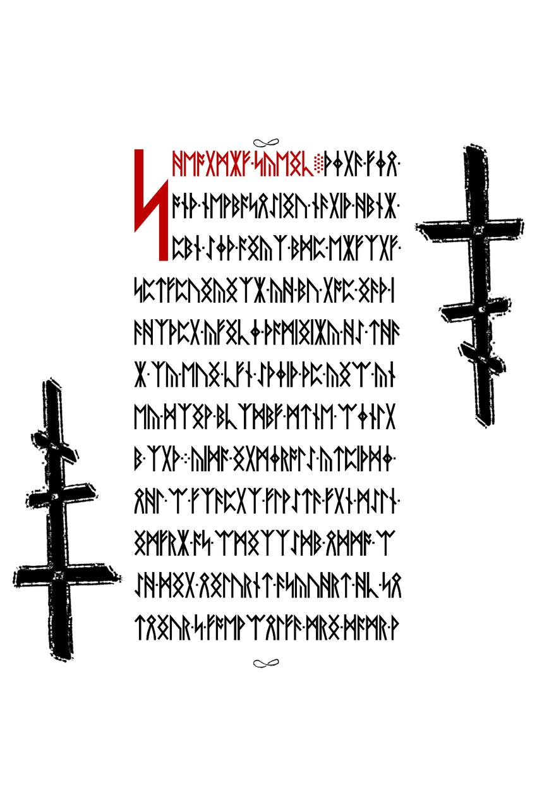

**Ciphertext** (krisyotam verbatim; `-` word separator, `.` = sentence dot (see p56 L1 `END.`), `/` = line end; standalone `&` (18×) / `$` (9×) / `§` (1×, book end p57) are krisyotam's transcription of the red dot-matrix ornaments — cipher-stream content, size mapping unconfirmed; `*` = red ink on owner-confirmed spans; `⟦'⟧`/`⟦"⟧` = image-only punctuation absent from the transcription, ≈word slot estimated. Line numbers = krisyotam lines (≠ image lines on solved pages, which wrap mid-word); printed Roman/Arabic content is omitted by krisyotam and appended below where known):

```
 1  ᛋ*ᚻ*ᛖ*ᚩ*ᚷ*ᛗ*ᛡ*ᚠ*-*ᛋ*ᚣ*ᛖ*ᛝ*ᚳ*◆13*ᚦᛄᚷᚫ-ᚠᛄᛟ-/   = S*H*E*O*G*M*IA*F* *S*Y*E*NG*C*¶*THJGAE FJOE /
 2  ᚩᚾᚦ-ᚾᛖᚹᛒᚪᛋᛟᛇᛁᛝᚢ-ᚾᚫᚷᛁᚦ-ᚻᛒᚾᛡ-/   = ONTH NEWBASOEEOINGU NAEGITH HBNIA /
 3  ᛈᛒᚾ-ᛇᛄᚦ-ᚪᛝᚣᛉ-ᛒᛞᛈ-ᛖᛡᚠᛉᚷᚠ-/   = PBN EOJTH ANGYX BDP EIAFXGF /
 4  ᛋᛈᛏᚠᛈᚢᛝᚣᛝᛉᛡ-ᚣᚻ-ᛒᚢ-ᚷᚩᛈ-ᛝᚫᚦ-ᛁ/   = SPTFPUNGYNGXIA YH BU GOP NGAETH I/
 5  ᚫᚻᛉᚦᛈᚷ-ᚣᚠᛝᚳᛄ-ᚦᚪᛗᛁᛝᛁᛡᚣ-ᚻᛇ-ᛏᚻᚫ/   = AEHXTHPG YFNGCJ THAMINGIIAY HEO THAE/
 6  ᛡ-ᛉᚣ-ᛖᚢᛝ-ᚳᚠᚾ-ᛇᚦᛄᛁᚦ-ᚦᛈ-ᚣᛝᛠ-ᚣᚾ/   = IA XY EUNG CFN EOTHJITH THP YNGEA YN/
 7  ᛖᚣ-ᛞᛉᛝᚹ-ᛒᚳᛉᛞᛒᚠ-ᛗᛏᚾᛖ-ᛠᛄᚾᛚᚷ/   = EY DXNGW BCXDBF MTNE EAJNLG/
 8  ᛒ-ᛉᚷᚦ◆4ᚣᛁᛞᚪ-ᛝᚷᛗᛄᚱᚩᛚᛇ-ᚣᛏᛈᛁᚦᛞᛄ-/   = B XGTH.YIDA NGGMJROLEO YTPITHDJ /
 9  ᛟᚻᛚ-ᛠ-ᚠᛉᚫᛈᚷᛉ-ᚠᛚᚹᛇᛏᚫ-ᚠᚷᚾ-ᛗᛇᛚᚾ-/   = OEHL EA FXAEPGX FLWEOTAE FGN MEOLN /
10  ᛝᛗᚠᚱᛡ-ᚪᛋ-ᛠᛗᛝᛉᛉᛇᛞᛒ-ᛟᛞᛗᚩ-ᛠ/   = NGMFRIA AS EAMNGXXEODB OEDMO EA/
11  ᛇᚻ-ᛞᛝᚷ-ᛟᛝᛚᚢᚱᚾᛏ-ᚫᛋᚣᚢᚻᚱᛏ-ᚻᚳ-ᛋᛟ/   = EOH DNGG OENGLURNT AESYUHRT HC SOE/
12  ᛏᛟᛝᚢᚱ-ᛋ-ᚠᚩᛖᚹᛠᛟᛚᚠᚫ-ᛗᚱᛝ-ᛞᚪᛗᚱ-ᚹ/   = TOENGUR S FOEWEAOELFAE MRNG DAMR W/
```

**Notes:**

## p1 (unsolved)

Known: —

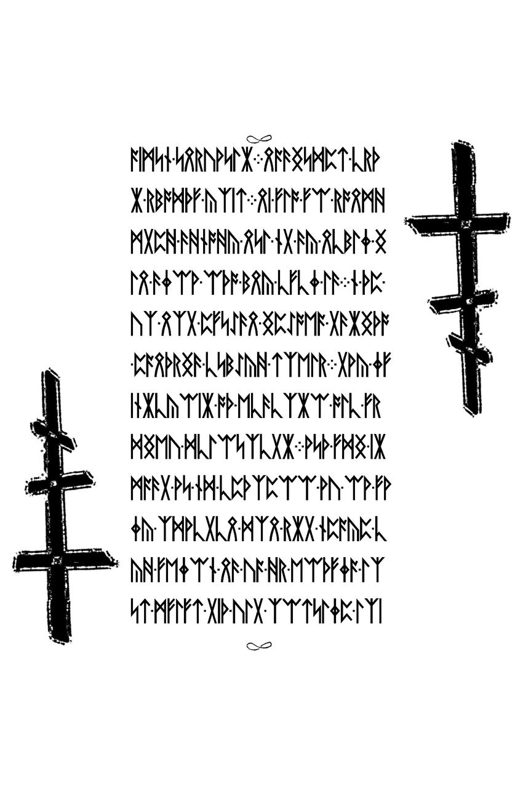

**Ciphertext** (krisyotam verbatim; `-` word separator, `.` = sentence dot (see p56 L1 `END.`), `/` = line end; standalone `&` (18×) / `$` (9×) / `§` (1×, book end p57) are krisyotam's transcription of the red dot-matrix ornaments — cipher-stream content, size mapping unconfirmed; `*` = red ink on owner-confirmed spans; `⟦'⟧`/`⟦"⟧` = image-only punctuation absent from the transcription, ≈word slot estimated. Line numbers = krisyotam lines (≠ image lines on solved pages, which wrap mid-word); printed Roman/Arabic content is omitted by krisyotam and appended below where known):

```
 1  ᚪᛁᛗᛋᚾ-ᛋᛟᚱᚢᚹᛋᛚᛡ◆4ᛟᚪᚫᛝᛋᛞᛈᛏ-ᚳᚱᚦ/   = AIMSN SOERUWSLIA.OEAAENGSDPT CRTH/
 2  ᛡ-ᚱᛒᚩᛞᚦᚠ-ᚣᛉᛁᛏ◆4ᛟᛁ-ᚠᛚᚩ-ᚠᛠ-ᚱᚩᛟᛗᚻ/   = IA RBODTHF YXIT.OEI FLO FEA ROOEMH/
 3  ᛗᚷᛈᚻ-ᚫᚻᚾᚩᚻᚣ-ᛟᛋᛚ-ᚾᚷ-ᚫᚣ-ᛟᚳᛒᛚᛄ-ᛝ/   = MGPH AEHNOHY OESL NG AEY OECBLJ NG/
 4  ᛚᛟ-ᚫᛄᛠᚹ-ᛠᚦᚩ-ᛒᛟᚣ-ᚳᚠᚳᛄ-ᛚᚫ◆4ᚾ-ᚦᛈ-/   = LOE AEJEAW EATHO BOEY CFCJ LAE.N THP /
 5  ᚢᛉ-ᛟᛉᚷ-ᛈᚠᛋᛇᚫᛟ-ᛝᛈᛇᚩᛖᚪ-ᚷᚫᛡᛝᚦᚩ/   = UX OEXG PFSEOAEOE NGPEOOEA GAEIANGTHO/
 6  -ᛈᚪᛟᚦᚱᛝᚫ-ᚳᛋᛒᛇᚣᚻ-ᛏᛉᛖᛚᚱ◆4ᚷᚹᚣ-ᛄᚠ/   =  PAOETHRNGAE CSBEOYH TXELR.GWY JF/
 7  ᛁᚾᛡᚳᚣᛠᛁᛡ-ᚩᚦ-ᛖᚳᚫᚳᛉᛡᛠ-ᚩᛚᚳ-ᚠᚱ/   = INIACYEAIIA OTH ECAECXIAEA OLC FR/
 8  ᛞᛝᛖᚢ-ᛞᚳᛚᛠᛋᛉᚳᚷᛡ◆4ᚹᛋᚦ-ᚠᛞᛝ-ᛁᛡ/   = DNGEU DCLEASXCGIA.WSTH FDNG IIA/
 9  ᛗᚪᚫᚷ-ᚹᛋ-ᚾᛞ-ᚳᛈᚦᛉᛈᛠᛠ-ᚹᚢ-ᛠᚹ-ᚠᚹ/   = MAAEG WS ND CPTHXPEAEA WU EAW FW/
10  ᛄᚣ-ᛉᛞᚹᚳᚷᚳᛟ-ᛞᛉᛟ-ᚱᛡᚷ-ᚾᛈᚪᚣᛈ-ᚳ/   = JY XDWCGCOE DXOE RIAG NPAYP C/
11  ᚣᚻ-ᚠᛖᛄᛠᚾ-ᛟᚫ-ᚢᚪ-ᚻᚱ-ᛖᛠᚦᚠᛄᚪ-ᛚᛉ/   = YH FEJEAN OEAE UA HR EEATHFJA LX/
12  ᛋᛏ-ᛗᚠᛚᚠᛏ-ᚷᛁᚦ-ᚢᛚᚷ-ᛉᛠᛏᛋᛚᛄᛈ-ᛚᛉᛁ/   = ST MFLFT GITH ULG XEATSLJP LXI/
```

**Notes:**

## p2 (unsolved)

Known: red only via dot-lattice (13 dot section terminator)

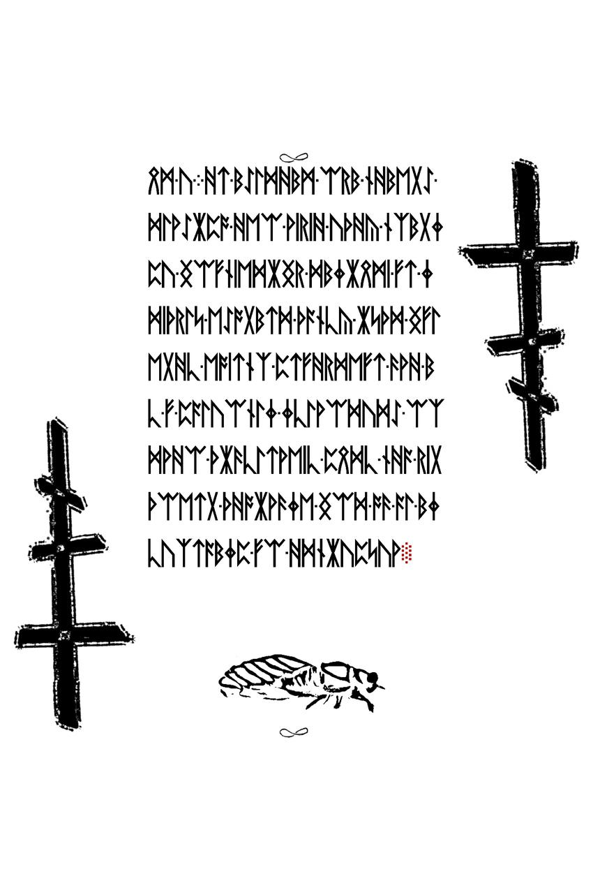

**Ciphertext** (krisyotam verbatim; `-` word separator, `.` = sentence dot (see p56 L1 `END.`), `/` = line end; standalone `&` (18×) / `$` (9×) / `§` (1×, book end p57) are krisyotam's transcription of the red dot-matrix ornaments — cipher-stream content, size mapping unconfirmed; `*` = red ink on owner-confirmed spans; `⟦'⟧`/`⟦"⟧` = image-only punctuation absent from the transcription, ≈word slot estimated. Line numbers = krisyotam lines (≠ image lines on solved pages, which wrap mid-word); printed Roman/Arabic content is omitted by krisyotam and appended below where known):

```
 1  ᛟᛗ-ᚢ◆4ᚻᛏ-ᛒᛇᛚᛞᚻᛒᛗ-ᛠᚱᛒ-ᚾᚻᛒᛖᚷᛇ-/   = OEM U.HT BEOLDHBM EARB NHBEGEO /
 2  ᛞᛚᚹᛇᛡᛈᚩ-ᚻᛖᛠ-ᚹᛁᚱᛁᚻ-ᚢᚦᚻᚣ-ᚾᛉᛒᚷᛄ/   = DLWEOIAPO HEEA WIRIH UTHHY NXBGJ/
 3  ᛈᚢ-ᛝᛠᚠᚾᛁᛖᛞᛡᛝᚱ-ᛞᛒᛄᛡᛟᛗᛁ-ᚠᛏ-ᛄ/   = PU NGEAFNIEDIANGR DBJIAOEMI FT J/
 4  ᛞᛁᚦᚱᛚᛋ-ᛖᛇᚩᚷᛒᛏᛞ-ᚦᚪᚾᚳᚣ-ᛡᛋᚦᛞ-ᛝᚠᛚ/   = DITHRLS EEOOGBTD THANCY IASTHD NGFL/
 5  ᛖᚷᚻᚳ-ᛖᚩᛁᛏᚾᛉ-ᛈᛏᚠᚻᚱᛞᛖᚠᛏ-ᚫᚹᚻ-ᛒ/   = EGHC EOITNX PTFHRDEFT AEWH B/
 6  ᚳ-ᚠ-ᛈᚪᛚᚢᛠᚾᛚᛄ-ᛄᚳᛚᚹᛠᛞᚢᛞᛇ-ᛠᛉ/   = C F PALUEANLJ JCLWEADUDEO EAX/
 7  ᛞᚹᚻᛠ-ᚦᛡᚫᚳᛚᛏᚹᛖᛁᚳ-ᛈᛟᛞᚳ-ᚾᚻᚪ-ᚱᛁᚷ/   = DWHEA THIAAECLTWEIC POEDC NHA RIG/
 8  ᚦᛠᛖᛏᚷ-ᚦᚻᚩᛡᚹᚫᛄᛖ-ᛝᛠᛞ-ᚩᚫ-ᚪᛚ-ᛒᛄ/   = THEAETG THHOIAWAEJE NGEAD OAE AL BJ/
 9  ᚳᚢᛉᛏᚪᛒᛄᛈ-ᚠᛠ-ᚻᛞᚾᛡᚢᛈᛋᚢᚹ◆13*/   = CUXTABJP FEA HDNIAUPSUW¶*/
10  &
11  $
```

**Notes:**

## p3 (unsolved)

Known: red head word (line 1); red inline dot-matrix ** 13 dot lattice ** after red word (seen 2026-11-16) ** red head word line 7, 3 glyphs followed by 13 dot lattice ** 


**Ciphertext** (krisyotam verbatim; `-` word separator, `.` = sentence dot (see p56 L1 `END.`), `/` = line end; standalone `&` (18×) / `$` (9×) / `§` (1×, book end p57) are krisyotam's transcription of the red dot-matrix ornaments — cipher-stream content, size mapping unconfirmed; `*` = red ink on owner-confirmed spans; `⟦'⟧`/`⟦"⟧` = image-only punctuation absent from the transcription, ≈word slot estimated. Line numbers = krisyotam lines (≠ image lines on solved pages, which wrap mid-word); printed Roman/Arabic content is omitted by krisyotam and appended below where known):

```
 1  ᛚ*ᛄ*-*ᛇ*ᚻ*ᛝ*ᚳ*ᚦ*ᛏ*ᚫ*ᛄ*ᛏ*ᛉ*ᚻ*-*ᛏ*ᚢ*ᛟ*◆13*ᛋᛈᚱᚷ/   = L*J* *EO*H*NG*C*TH*T*AE*J*T*X*H* *T*U*OE*¶*SPRG/
 2  -ᚣᚾᚪᚷᛇᛝᚾ-ᚹᚠᚣᚾᛒᛠᛡ-ᛈᚾᚣᚪᛋᛗ/   =  YNAGEONGN WFYNBEAIA PNYASM/
 3  ᛒ-ᛡᛠᛡᛁ-ᚩᛒᚱᚾᛚᛠ-ᚱᛚᛚᛖᛒᚹᚾᚻᛗᚠ/   = B IAEAIAI OBRNLEA RLLEBWNHMF/
 4  ᛟᛒ-ᛝ-ᚱᚪᛡᚷᛟᛇᛏᛗᛉ-ᛞᛇ-ᛗᚣᚻᛠ-ᛁᛚᛋ-ᚾ/   = OEB NG RAIAGOEEOTMX DEO MYHEA ILS N/
 5  ᚹᚳᚠᛈᛗᛈᛚ-ᛠᛋᚦᚠᛟᛡ-ᚦᛖᚣ-ᚳᛄᛚᚳᛡᛗ-/   = WCFPMPL EASTHFOEIA THEY CJLCIAM /
 6  ᛒᛞᚳᛇ-ᛄᛁᛏᛟ-ᛞᛠᛖᛡᚾᛏ◆13*///   = BDCEO JITOE DEAEIANT¶*///
 7  &
 8  ᛈ*ᛞ*ᚦ*◆13*ᛇᛞᛇ-ᚫᛚᚳ-ᛡᛇ-ᛠᚻ-ᚹᛗᚣᚦ/   = P*D*TH*¶*EODEO AELC IAEO EAH WMYTH/
 9  ᚢ-ᚻᛏᚦᚱᚻᛝ-ᛚᛝᛋ-ᚾᚫᛠᚷᛋᛚ-ᛋᛉ/   = U HTTHRHNG LNGS NAEEAGSL SX/
10  ᚩᚻᚹᛞᛗᛖᛗᚪᚠ-ᚳᚣᚳᚫᚾ-ᛏᚦᚷ-ᛁᛄᛁ/   = OHWDMEMAF CYCAEN TTHG IJI/
11  -ᚳᛞᛡᛉ-ᚻᚫᚫᛠᚷ-ᛠᛝ-ᚠᛏᚩᚱᛞᚳᛇ-ᚠᚢ/   =  CDIAX HAEAEEAG EANG FTORDCEO FU/
12  ᛉᛠᛒᚩ-ᛉᛁᚣᚷᛋᛋᛒᛠ-ᚩᛁᛈ-ᛁᛄᛁᚩᛖ-ᚻᛠᚻ/   = XEABO XIYGSSBEA OIP IJIOE HEAH/
```

**Notes: /// is large vertical break between sections**

## p4 (unsolved)

Known: —

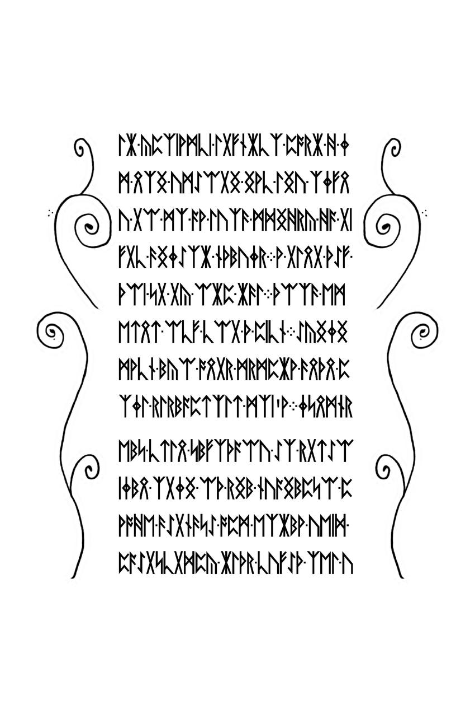

**Ciphertext** (krisyotam verbatim; `-` word separator, `.` = sentence dot (see p56 L1 `END.`), `/` = line end; standalone `&` (18×) / `$` (9×) / `§` (1×, book end p57) are krisyotam's transcription of the red dot-matrix ornaments — cipher-stream content, size mapping unconfirmed; `*` = red ink on owner-confirmed spans; `⟦'⟧`/`⟦"⟧` = image-only punctuation absent from the transcription, ≈word slot estimated. Line numbers = krisyotam lines (≠ image lines on solved pages, which wrap mid-word); printed Roman/Arabic content is omitted by krisyotam and appended below where known):

```
 1  ᛚᛡ-ᚣᛈᛉᛁᚹᛗᚳᛁ-ᛚᚷᚠᚾᛡᚳᛉ-ᛈᚩᚱᛡ-ᚻ-ᛄ/   = LIA YPXIWMCI LGFNIACX PORIA H J/
 2  ᛗ-ᛟᛉᛝ-ᚢᛗᛇᛠᚷᛝ-ᛝᚹᚳ-ᛚᛝᚢ-ᛉᛄᚠᛟ/   = M OEXNG UMEOEAGNG NGWC LNGU XJFOE/
 3  ᚢ-ᚷᛠ-ᛗᛉ-ᚪᚹ-ᛚᚢᛉᚫ-ᛗᛞᛝᚻᚱᚣ-ᚻᚪ-ᚷᛁ/   = U GEA MX AW LUXAE MDNGHRY HA GI/
 4  ᚠᚷᚳ-ᚫᛝᛄᛇᛉᛡ-ᚾᚦᛒᚢᛄᚱ◆4ᚹ-ᚷᛚᛟᚷ-ᚦᛇᚠ-/   = FGC AENGJEOXIA NTHBUJR.W GLOEG THEOF /
 5  ᚦᛠᛁ-ᛋᚷ-ᚷᚣ-ᛠᛡᛈ-ᛡᚫᛚ◆4ᚦᛠᛉᚫ-ᛖᛗ/   = THEAI SG GY EAIAP IAAEL.THEAXAE EM/
 6  ᛖᛏᛟᛏ-ᛠᚳᚠ-ᚳᛠᚷ-ᚦ-ᛈᛁᚳᚾ◆4ᛇᚣᛝᛄᛝ/   = ETOET EACF CEAG TH PICN.EOYNGJNG/
 7  ᛗᚹᚳᚾ-ᛒᚣᛠ-ᚩᛟᚷᚱ-ᛗᚱᛗᛈᛡᚹ-ᚫᛟᚦᛟ-ᛈ/   = MWCN BYEA OOEGR MRMPIAW AEOETHOE P/
 8  ᛉᛄᛚ-ᚱᛚᚱᛒᚪᛈᛏᛉᛚᛏ-ᛗᛉᛁᚹ◆4ᛄᛋᛟᛗᚾᚱ//   = XJL RLRBAPTXLT MXIW.JSOEMNR//
 9  ᛖᛒᛋ-ᚳᛏᛚᛟ-ᛋᛒᚠᛉᚦᚪᛠᚢ-ᛇᛉ-ᚱᚷᛏᛇᛠ/   = EBS CTLOE SBFXTHAEAU EOX RGTEOEA/
10  ᛁᛄᛒᛟ-ᛉᚷᛄᛝ-ᛠᚦ-ᚱᛝᛒ-ᚾᚢᚪᛝᛒᛈᛋᛠ-ᛈ/   = IJBOE XGJNG EATH RNGB NUANGBPSEA P/
11  ᚹᚩᚻᛖ-ᚫᛇᚷᚾᚫᛋᛇ-ᚩᛈᛗ-ᛖᛉᛡᛒᚹ-ᚢᛖᛁᛞ-/   = WOHE AEEOGNAESEO OPM EXIABW UEID /
12  ᛈᚪᛇᚷᛋᚳᚷᛞᛈᚣ-ᛡᛚᚦᚱ-ᚳᚢᚠᛇᚦ-ᛉᛖᛚ-ᚢ/   = PAEOGSCGDPY IALTHR CUFEOTH XEL U/
```

**Notes: // is small vertical break between sets of lines, like a paragraph end/begin?**

## p5 (unsolved)

Known: —

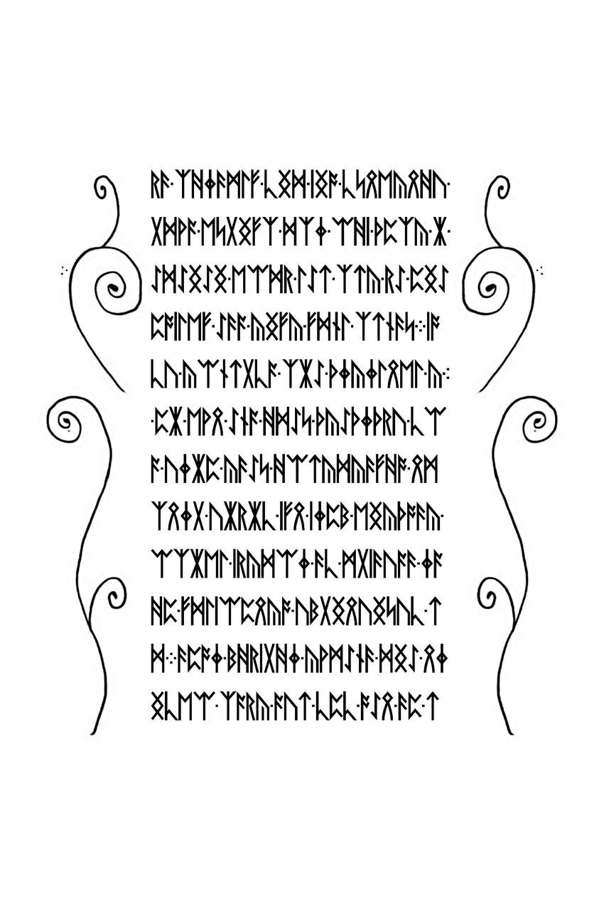

**Ciphertext** (krisyotam verbatim; `-` word separator, `.` = sentence dot (see p56 L1 `END.`), `/` = line end; standalone `&` (18×) / `$` (9×) / `§` (1×, book end p57) are krisyotam's transcription of the red dot-matrix ornaments — cipher-stream content, size mapping unconfirmed; `*` = red ink on owner-confirmed spans; `⟦'⟧`/`⟦"⟧` = image-only punctuation absent from the transcription, ≈word slot estimated. Line numbers = krisyotam lines (≠ image lines on solved pages, which wrap mid-word); printed Roman/Arabic content is omitted by krisyotam and appended below where known):

```
 1  ᚱᚫ-ᛉᚻᛄᚫᛗᛚᚠ-ᚳᛝᛞ-ᛁᛝᚩ-ᚳᛋᛟᛖᚣᛟᚻᚢ-/   = RAE XHJAEMLF CNGD INGO CSOEEYOEHU /
 2  ᚷᛞᚹᚪ-ᛖᛋᚷᛝᚠᛉ-ᛞᛉᛄ-ᛠᚻᛁ-ᚦᛈᛉᚣ-ᛡ-/   = GDWA ESGNGFX DXJ EAHI THPXY IA /
 3  ᛇᛞᛇᛝᛇᛝ-ᛖᛠᛞᚱ-ᛚᛇᛏ-ᛉᛏᚣ-ᚱᛇ-ᛈᛝᛇ/   = EODEONGEONG EEADR LEOT XTY REO PNGEO/
 4  ᛈᚩᛁᛚᛖᚠ-ᛇᚫᚪ-ᚣᛝᚠᚣ-ᚠᛞᚾᛚ-ᛉᛏᚾᚫᛋ◆4ᛁᚩ/   = POILEF EOAEA YNGFY FDNL XTNAES.IO/
 5  ᚳᚢ-ᚣᛠᚾᛏᚷᚳᚪ-ᛉᛡᛇ-ᚦᛄᚣᛄᛚᛟᛖᛚ-ᚣ◆3/   = CU YEANTGCA XIAEO THJYJLOEEL Y./
 6  -ᛈᛡ-ᛖᚹᛟ-ᛇᚾᚪ-ᚻᛞᛇᛋ-ᚦᚣᛇᚦᛄᚦᚱᚢ-ᚳᛠ/   =  PIA EWOE EONA HDEOS THYEOTHJTHRU CEA/
 7  ᚪ-ᚢᛄᛡᛈ-ᚣᚫᛇᛋ-ᚻᛠᛏᚣᛞᚣᚫᚠᚻᚩ-ᛟᛗ/   = A UJIAP YAEEOS HEATYDYAEFHO OEM/
 8  ᛉᛟᛄᚷ-ᚢᛡᚱᛡᚳ-ᛁᚠᛟ-ᛁᛄᛈᛒ-ᛖᛝᚣᚦᚩᚫᚣ-/   = XOEJG UIARIAC IFOE IJPB ENGYTHOAEY /
 9  ᛠᛉᛡᛖᛚ-ᛁᚱᚣᛞᛠᛄ-ᚫᚳ-ᛗᚷᛁᚫᚢᚪᚫ-ᛄᚪ/   = EAXIAEL IRYDEAJ AEC MGIAEUAAE JA/
10  ᚻᛈ-ᚠᛞᛚᛁᛠᛈᛟᚣᚩ-ᚢᛒᚷᛝᛟᚢᛝᛋᚢᚳ-ᛏ/   = HP FDLIEAPOEYO UBGNGOEUNGSUC T/
11  ᛞ◆4ᚫᛈᚩᛄ-ᛒᚻᚱᛁᚷᚻᛄ-ᚣᚹᛗᛇᚾᚫ-ᛞᛝᛇ-ᛟᛄ/   = D.AEPOJ BHRIGHJ YWMEONAE DNGEO OEJ/
12  ᛝᚳᛖᛠ-ᛉᚪᚱᚣ-ᚪᚢᛏ-ᚳᛈᚳ-ᚩᛇᛟ-ᚫᛈ-ᛏ/   = NGCEEA XARY AUT CPC OEOOE AEP T/
```

**Notes:** ◆3 with - on next line may just be a word wrapped ◆4; let's assume this for now for decryption purposes

## p6 (unsolved)

Known: red head word (line 1) ** incorrect, red 13-dot lattice ends line 4, red head words (4) line 5 terminated by red 13 dot lattice

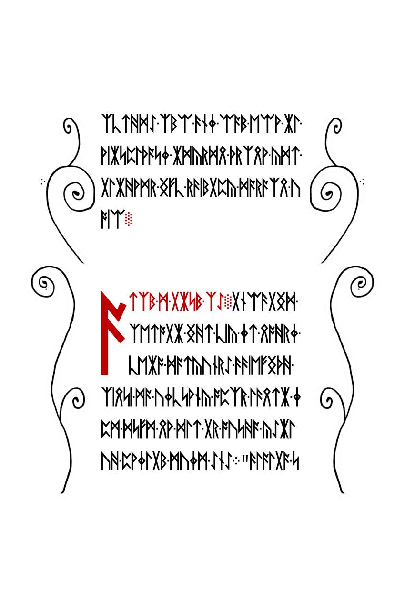

**Ciphertext** (krisyotam verbatim; `-` word separator, `.` = sentence dot (see p56 L1 `END.`), `/` = line end; standalone `&` (18×) / `$` (9×) / `§` (1×, book end p57) are krisyotam's transcription of the red dot-matrix ornaments — cipher-stream content, size mapping unconfirmed; `*` = red ink on owner-confirmed spans; `⟦'⟧`/`⟦"⟧` = image-only punctuation absent from the transcription, ≈word slot estimated. Line numbers = krisyotam lines (≠ image lines on solved pages, which wrap mid-word); printed Roman/Arabic content is omitted by krisyotam and appended below where known):

```
 1  ᛉᚳᛏᚻᛞᛇ-ᛉᛒᛠ-ᚫᚾᛄ-ᛠᚪᛒ-ᛖᛠᚹ-ᛡᛚ-/   = XCTHDEO XBEA AENJ EAAB EEAW IAL /
 2  ᚹᛁᛡᛋᛈᛚᚦᚪᛋᛄ-ᛡᛞᚣᚱᛞᛟ-ᚦᚱᛉᛟᚹ-ᚣᛞᛏ-/   = WIIASPLTHASJ IADYRDOE THRXOEW YDT /
 3  ᚷᛚᛡᚻᚹᛗᚱ-ᛝᚠᚳ-ᚱᚫᛁᛒᚷᛈᚣ-ᛞᚪᚱᚪᛉᛟ-ᚢ/   = GLIAHWMR NGFC RAEIBGPY DARAXOE U/
 4  ᚩᛁᛠ◆13*///   = OIEA¶*///
 5  &
 6  ᚪ*ᛏ*ᛉ*ᛒ*-*ᛗ*-*ᚷ*ᛡ*ᛋ*ᛒ*-*ᛉ*ᛇ*◆13*ᚷᚾᛠᚫᚷᛝᛞ-/   = A*T*X*B* *M* *G*IA*S*B* *X*EO*¶*GNEAAEGNGD /
 7  ᛉᛖᛏᚩᚷᛡ-ᛝᚻᛏ-ᚳᛁᚣ-ᛄᛏ-ᛟᚩᚻᚱᛄ-/   = XETOGIA NGHT CIY JT OEOHRJ /
 8  ᚳᛖᛡᚩ-ᛞᚪᛏᚣᚢᚾᚱᛇ-ᚫᚫᛁᛖᚠᛝᚦᚻ-/   = CEIAO DATYUNREO AEAEIEFNGTHH /
 9  ᛉᛁᛟᛋᛁ-ᛗᚪ-ᚢᛄᚳᛋᚹᚾᚣ-ᚩᛈᛉᚱ-ᛚᚫᛟᛏᛡ-ᛄ/   = XIOESI MA UJCSWNY OPXR LAEOETIA J/
10  ᛈᛗ-ᛞᛋᚠᛗ-ᛟᚹ-ᛞᛚᛏ-ᚷᚱ-ᚩᚢᛋᚻᚪ-ᚣᛇᛡᛚ/   = PM DSFM OEW DLT GR OUSHA YEOIAL/
11  ᚢᚻ-ᛈᚹᛄᛚᚷᛒ-ᛗᚢᛄᛗ-ᛇᚾᛇ◆4"ᚫᛚᚪᛚᚷᚪ-ᛋ/   = UH PWJLGB MUJM EONEO."AELALGA S/
```

**Notes:**

## p7 (unsolved)

Known: red head word (line 1) ** incorrect, red tail words line 10, begins and ends with red 13 dot lattice


**Ciphertext** (krisyotam verbatim; `-` word separator, `.` = sentence dot (see p56 L1 `END.`), `/` = line end; standalone `&` (18×) / `$` (9×) / `§` (1×, book end p57) are krisyotam's transcription of the red dot-matrix ornaments — cipher-stream content, size mapping unconfirmed; `*` = red ink on owner-confirmed spans; `⟦'⟧`/`⟦"⟧` = image-only punctuation absent from the transcription, ≈word slot estimated. Line numbers = krisyotam lines (≠ image lines on solved pages, which wrap mid-word); printed Roman/Arabic content is omitted by krisyotam and appended below where known):

```
 1  ᚻᛝ-ᛚᚦᛒ-ᛋᚳᚢᚳᚩᛡ"-ᛚᚳᛄ-ᛉᚪᚾᛇᛉ◆4ᛠ/   = HNG LTHB SCUCOIA" LCJ XANEOX.EA/
 2  ᛗᛈᚢ-ᛗᚠᛚᛠᛝ-ᛒᛉᛁ-ᛚᚦᚱ-ᛠᛡᛁᚳ-ᚩᛉᛖ/   = MPU MFLEANG BXI LTHR EAIAIC OXE/
 3  ᛞᛡ-ᛏᛋᛗᛠᛄᛈ-ᛠᛟ-ᛡᚫᚦᚹᚻᛈᛇᚪᚷᛈᚻ/   = DIA TSMEAJP EAOE IAAETHWHPEOAGPH/
 4  ᛠ-ᚳᛚᛠᛈ-ᛡᚣᚾᛁ-ᛚᛡᛁᚳ-ᚫᛇᚾ-ᚫᚳᛡᚱᛡᛚ/   = EA CLEAP IAYNI LIAIC AEEON AECIARIAL/
 5  ᛞ-ᛒᛟᛝᛡ-ᛉᛗᛝ-ᚳᚻᛟᛠᚾᛈᚳᚦ-ᛁᛇᚦ-ᛇᚢᚩ/   = D BOENGIA XMNG CHOEEANPCTH IEOTH EOUO/
 6  -ᚦᛈᚪ-ᛡᛚᛟᚹᛡᛈ-ᛄᛗ-ᚷᛒᛈᛋᚾᛇ-ᛏᚩᚷᚢᚾᚫ/   =  THPA IALOEWIAP JM GBPSNEO TOGUNAE/
 7  ᛖ-ᚾᚣᛁᛖ-ᛞᛝ-ᛞᛝ-ᛚᚢᛚᛉ-ᚪᚾᛝ-ᛇᚪᛄ-ᚻ-ᛞ/   = E NYIE DNG DNG LULX ANNG EOAJ H D/
 8  ᚹᛈᚫᚹᚫ-ᛇᛁᛚᛝ-ᚦᚾᚳ.ᛒᛁᛏ-ᛠᚳᚩᛇᛖᛝ-ᚳᚻ/   = WPAEWAE EOILNG THNC.BIT EACOEOENG CH/
 9  ᛟᚻᚫᛄ-ᛟᛉ-ᛁᚳᛖᛏᛋᚹᛖᚾᛡᚣᛄᛗ-ᛖᚳᚪ◆13///   = OEHAEJ OEX ICETSWENIAYJM ECA¶///
10  &
11  ◆13*ᛞ*ᚩ*-*ᛟ*ᛏ*ᚦ*ᚫ*◆4*ᚳ*ᚹ*ᛄ*-*ᛉ*ᛠ*-*ᚷ*ᛠ*ᛗ*◆13*/   = ¶*D*O* *OE*T*TH*AE*.*C*W*J* *X*EA* *G*EA*M*¶*/
12  &
13  $
```

**Notes:**

## p8 (unsolved)

Known: red head word (line 1); black 4-dot diamonds L3/L7/L11 (L6-left = noise per owner S7) ** incorrect, red head words (2)


**Ciphertext** (krisyotam verbatim; `-` word separator, `.` = sentence dot (see p56 L1 `END.`), `/` = line end; standalone `&` (18×) / `$` (9×) / `§` (1×, book end p57) are krisyotam's transcription of the red dot-matrix ornaments — cipher-stream content, size mapping unconfirmed; `*` = red ink on owner-confirmed spans; `⟦'⟧`/`⟦"⟧` = image-only punctuation absent from the transcription, ≈word slot estimated. Line numbers = krisyotam lines (≠ image lines on solved pages, which wrap mid-word); printed Roman/Arabic content is omitted by krisyotam and appended below where known):

```
 1  ᛉ*ᛁ*ᛉ*ᛗ*-ᚢ*ᛉ*ᛗ*ᚳ*ᚦ*ᛈ*ᚩ*ᛒ*-ᛡᚾᛏ-ᛠᛉ/   = X*I*X*M* U*X*M*C*TH*P*O*B* IANT EAX/
 2  -ᛈᚱᚣ-ᚩᚳᛠᛗᛝᚷᛉᛚᚢ-ᛝᛁᛏᚩ-/   =  PRY OCEAMNGGXLU NGITO /
 3  ᛄᚠᛝ-ᛋᛚᚾᛞ◆4ᚩᛗ-ᛇᚫ-ᚱᛞᚹᛏᛄᚦ-/   = JFNG SLND.OM EOAE RDWTJTH /
 4  ᚣᚦᛋ-ᚫᚣᛖᛋᛉᛟᛒ-ᛠᚱᛇ-ᛈᛝᚢᛈ-ᚩᚦᛉ-ᚪᚻ/   = YTHS AEYESXOEB EAREO PNGUP OTHX AH/
 5  ᛟᚱᛝᚢᛖᚱ-ᚣᛚᛉᛚ-ᛡᛚᚱ-ᛈᚹᛇᚾ-ᛠᚪᚱᛉᛝ-/   = OERNGUER YLXL IALR PWEON EAARXNG /
 6  ᚣᛋᚻᚢᛚ-ᛋᚣ-ᚷᚾᚢ-ᛇᚫᚾᚾ-ᚩᚫᛖᛞ-ᚪᚩᛄᛡᚢ/   = YSHUL SY GNU EOAENN OAEED AOJIAU/
 7  ᚪᛉ-ᚱᛉᛡᛟᛄ-ᛗᛁᛇᛚᛠᚻᚦᛗᛠᚣ◆4ᚷᛒᚳᛈ/   = AX RXIAOEJ MIEOLEAHTHMEAY.GBCP/
 8  ᛉᚳ-ᚾᛟᛟᛋᚷᛗᛈᛖᛏᛚᚾᛄ-ᛄᚳᛝᚩ-ᛁᚹᛚᛠᛒ-/   = XC NOEOESGMPETLNJ JCNGO IWLEAB /
 9  ᚠᚪᛖ-ᛏᛝ-ᚾᛈᛠᚩᛏᚦ-ᚻᛝᛉᛈᚻᛈᚳᛈᚱᚢ-ᛚ/   = FAE TNG NPEAOTTH HNGXPHPCPRU L/
10  ᚠᛖᛟ-ᚷᚪᛒᚠᛁᚫᚠᚢᛟ-ᛗᚠᚣᛝᛄᚳ-ᚻᛏᚠᛚᚫ-ᛖ/   = FEOE GABFIAEFUOE MFYNGJC HTFLAE E/
11  ᚦᛋᛚᚩᚢ-ᚫᚩᚪᛗᛟᚢᚹᛇ◆4ᛒᚾᛋᛚᛝᛄᛟᚾ-ᛗᛚᛒ-/   = THSLOU AEOAMOEUWEO.BNSLNGJOEN MLB /
12  ᛟᛏ-ᚾᛞᛒᚩᚾᚦᛡᚻᛟ-ᚱᛈᚾᚠᛈᛞ-ᛋᚩᛁᛠᚣᚾ-ᛇ/   = OET NDBONTHIAHOE RPNFPD SOIEAYN EO/
```

**Notes:**

## p9 (unsolved)

Known: —


**Ciphertext** (krisyotam verbatim; `-` word separator, `.` = sentence dot (see p56 L1 `END.`), `/` = line end; standalone `&` (18×) / `$` (9×) / `§` (1×, book end p57) are krisyotam's transcription of the red dot-matrix ornaments — cipher-stream content, size mapping unconfirmed; `*` = red ink on owner-confirmed spans; `⟦'⟧`/`⟦"⟧` = image-only punctuation absent from the transcription, ≈word slot estimated. Line numbers = krisyotam lines (≠ image lines on solved pages, which wrap mid-word); printed Roman/Arabic content is omitted by krisyotam and appended below where known):

```
 1  ᚣᚹᚫᚷᛄ-ᛝᛗᚪᚹᛈ-ᚪᚢᚾ-ᛈᛡᛗᛖᛞᛟ◆4ᛁ-ᛉ/   = YWAEGJ NGMAWP AUN PIAMEDOE.I X/
 2  ᛡᛗ-ᚠᛈᚩ-ᚦᛉᛞ-ᚩᛞ-ᛋᛈᛉᛡᚷ-ᛟᚻᚠᚦᛉᛄ/   = IAM FPO THXD OD SPXIAG OEHFTHXJ/
 3  ᛟᛋᚦᚣᚦ-ᛏᚻᛋᚣ-ᚻᛠᚷᛚᚫᚱᛏ-ᚢᛋᛟ-ᚦᚠᚠᚣ/   = OESTHYTH THSY HEAGLAERT USOE THFFY/
 4  ᛟᛡ-ᛇᚳᚣᛒᛚᛝ-ᛠᚱᚻᛞ-ᛄᚣᛏᚫ-ᚻᛞᚳᛋ-ᛉ/   = OEIA EOCYBLNG EARHD JYTAE HDCS X/
 5  ᚠᛞ-ᚦᛗ-ᚳᛇᛝ-ᚫᚾᛡᛠᚹᛁᛡ-ᛒᛗᛝ-ᚷᛈᛁᚳ-ᛠ/   = FD THM CEONG AENIAEAWIIA BMNG GPIC EA/
 6  ᛚᚷᛉᚣᚣᚱᛄ-ᛉᛁᛄᚢ-ᛖᚣ-ᚪᛝᛈ-ᛡᚫᚳ-ᛖᛠ/   = LGXYYRJ XIJU EY ANGP IAAEC EEA/
 7  ᚹᛒᚦᛟᚠᛗ-ᚫᚱᚠᚩᛏ-ᛝᛉᛞ-ᛗᛖᛡ-ᚩᛈᛋ-ᛇᛞ-/   = WBTHOEFM AERFOT NGXD MEIA OPS EOD /
 8  ᛇᛟᚫᚾ-ᚷᛗᚣᛁᚫᛁᛄ-ᛈᛄᚩᛡᚷ-ᛈᚳᛄ-ᛚᛖᛡᚻᛚ/   = EOOEAEN GMYIAEIJ PJOIAG PCJ LEIAHL/
 9  ᚷᚱᛇ-ᛟᚣ-ᛠᚣᛗᚹᚾᚹ-ᚠᛁᛄᚢᛗᚫᚾᚳᛗᛠᛁ◆4/   = GREO OEY EAYMWNW FIJUMAENCMEAI./
10  ᚩᛇ-ᛒᛚᛞ-ᚾᚹᚠᚾᛒᚱ-ᛋᛟᚦᛡ-ᚪᛡᛏᚷᚷᚹ-ᚪᛋᛡᚦ/   = OEO BLD NWFNBR SOETHIA AIATGGW ASIATH/
11  ᛋᚦᛋᚠᛗᚷᛞᛠ-ᛝᛈᚩᚪᚣᛝᛈᛋ-ᛟᚾᛇᚪᛖ-ᚻᚢ/   = STHSFMGDEA NGPOAYNGPS OENEOAE HU/
12  ᚷ-ᚩ-ᚢᚦᛏ-ᛒᚷᚣᛝᚠᚣᛁᚻ-ᚹᛡᛠᚱᚫᚹᛡᛞᚪᚦ/   = G O UTHT BGYNGFYIH WIAEARAEWIADATH/
```

**Notes:**

## p10 (unsolved)

Known: black inline digit 7 (L8)

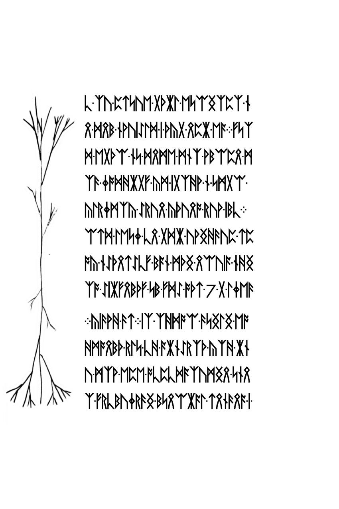

**Ciphertext** (krisyotam verbatim; `-` word separator, `.` = sentence dot (see p56 L1 `END.`), `/` = line end; standalone `&` (18×) / `$` (9×) / `§` (1×, book end p57) are krisyotam's transcription of the red dot-matrix ornaments — cipher-stream content, size mapping unconfirmed; `*` = red ink on owner-confirmed spans; `⟦'⟧`/`⟦"⟧` = image-only punctuation absent from the transcription, ≈word slot estimated. Line numbers = krisyotam lines (≠ image lines on solved pages, which wrap mid-word); printed Roman/Arabic content is omitted by krisyotam and appended below where known):

```
 1  ᚳ-ᛉᚢ-ᛈᛏᛋᚢᛖ-ᚷᚦᛡᛚ-ᛖᛋᛠᛝᛉᛈᛉ-ᚾ/   = C XU PTSUE GTHIAL ESEANGXPX N/
 2  ᛟ-ᛞᛟᛒ-ᚾᚹᚢᛁᛇᛚᛞ-ᛁ-ᚦᚣᚷ-ᛟᛈᛡ-ᛖᚪ◆4ᚠᛋᛉ/   = OE DOEB NWUIEOLD I THYG OEPIA EA.FSX/
 3  ᛞ-ᛖᚷᚦᛠ-ᚾᛋ-ᛞᛟᛗᛖ-ᛗᚾᛉ-ᚹᛒᛠᛈᛟ-ᛗ/   = D EGTHEA NS DOEME MNX WBEAPOE M/
 4  ᛉᚫ-ᛄᚩᛞᚻᛡᚷᚠ-ᚣᛗ-ᛁᚷᛉᚻᚹ-ᚾ-ᛋᛗᚷᛠ-/   = XAE JODHIAGF YM IGXHW N SMGEA /
 5  ᚣᛚᚱᛄᛗᛉᚣ-ᛇᚱᚢᛟ-ᚣᚦᚢᛟᚩ-ᚱᚢᚹ-ᛁᛒᚳ◆4/   = YLRJMXY EORUOE YTHUOEO RUW IBC./
 6  ᛠᛏᛞ-ᛚᛖᛋᛄ-ᚳᛟ-ᚷᛞᛡ-ᚢᚹᛝᚻᚫᚢᛈ-ᛏᛈ/   = EATD LESJ COE GDIA UWNGHAEUP TP/
 7  ᚩᚣ-ᚾᛇᚦᛟᛏᛇᚳᚠ-ᛒᚪᚾ-ᛗᚦᛝ-ᛟᛠᚢᛁᚪ-ᚾᚻᛝ/   = OY NEOTHOETEOCF BAN MTHNG OEEAUIA NHNG/
 8  ᛉᚩ-ᛇᛁᛡᚠᛟᛒᚦᚠ-ᛋᛒ-ᚠᛞᛇ-ᚩᚦᛏ-7-ᚷ-ᛚᛄᛖᚫ/   = XO EOIIAFOEBTHF SB FDEO OTHT 7 G LJEAE/
 9  ◆4ᚣᛁᚫᚹᚻ-ᚫᛏ.◆4ᛉ-ᛉᚻᛞᚩᛠ-ᚫᛋᛝᛚᛝ-ᛖᚩ/   = .YIAEWH AET..X XHDOEA AESNGLNG EO/
10  ᚻᛗᚩᛟᛒᚦ-ᚱᛚᛋ-ᚳᚻ-ᚪᛡᚾᛇᚱᛉᚦ-ᚣᛉᚻ-ᛡᚾ/   = HMOOEBTH RLS CH AIANEORXTH YXH IAN/
11  ᚢ-ᛗᛉᚹ-ᛖᛈᛖ-ᚩᚳᛈᚳᛞᚪᛉᚢᛗᛝᛟ-ᛋᚾᛟ/   = U MXW EPE OCPCDAXUMNGOE SNOE/
12  ᛉ-ᚠᚱᚳᛒᚢᛄᚱᚫᛝ-ᛒᛋᛟᛠᛡᚪᛚ-ᛏᛟᚾᚫᛟᚪ-ᛁ-/   = X FRCBUJRAENG BSOEEAIAAL TOENAEOEA I /
```

**Notes:**

## p11 (unsolved)

Known: —

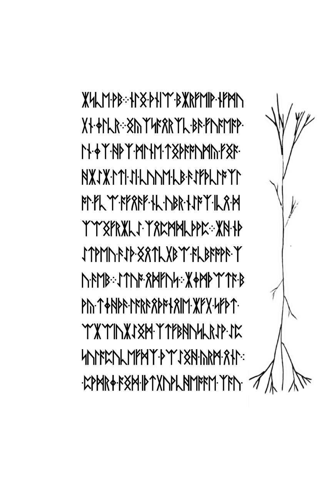

**Ciphertext** (krisyotam verbatim; `-` word separator, `.` = sentence dot (see p56 L1 `END.`), `/` = line end; standalone `&` (18×) / `$` (9×) / `§` (1×, book end p57) are krisyotam's transcription of the red dot-matrix ornaments — cipher-stream content, size mapping unconfirmed; `*` = red ink on owner-confirmed spans; `⟦'⟧`/`⟦"⟧` = image-only punctuation absent from the transcription, ≈word slot estimated. Line numbers = krisyotam lines (≠ image lines on solved pages, which wrap mid-word); printed Roman/Arabic content is omitted by krisyotam and appended below where known):

```
 1  ᛡᛋᚳᛖ-ᚹᛒ◆4ᚾᛚᛝ-ᚦᚾᛁᛠ-ᛒᛡᚱᚠᛖᛁᚹ-ᚾᚠᛗᚢ/   = IASCE WB.NLNG THNIEA BIARFEIW NFMU/
 2  ᚷᚾ-ᛄᛚᚳᚱ◆4ᛝᚣᛉᛋᚪᛟᚱᛉᚳ-ᛒᚫ-ᚠᚢᚪᛖᚪᚹ-/   = GN JLCR.NGYXSAOERXC BAE FUAEAW /
 3  ᛚᚾ-ᛄᛉ-ᚻᚦᛉ-ᛗᛚᚾᛖ-ᛏᛝᚦᚪᚩᚢᛗᚣ-ᚠᛝᚪ-/   = LN JX HTHX MLNE TNGTHAOUMY FNGA /
 4  ᚻᛡᛇᛡ-ᛚᛏᛁ-ᛇᛁ-ᚳᚢᚢᛖ-ᚳᛒ-ᚫᛇᚠᚦᚳᛚᚩᛉᛚ/   = HIAEOIA LTI EOI CUUE CB AEEOFTHCLOXL/
 5  ᚩᛚ-ᚠᚳᛠ-ᚪᚠᛟᚫᚠ-ᚾᚳ-ᚢᛒᚱ-ᚾᛇᚩᛉ-ᛁᚳᛟ-ᛞ/   = OL FCEA AFOEAEF NC UBR NEOOX ICOE D/
 6  ᛉᛠᛝᚠᚱᛡᚳᛇ-ᛉᛟᛈᛗᛞᚳᚦᚹᛈ◆4ᛡᚻ-ᚾᚦ/   = XEANGFRIACEO XOEPMDCTHWP.IAH NTH/
 7  ᛇᛏᚹᛖᚢ-ᚫᛇᚦ-ᛝᛟᛏᚳᚷᛒᛠ-ᚪᚳᛒᚪᚩᚹᚫ-ᛉ/   = EOTWEU AEEOTH NGOETCGBEA ACBAOWAE X/
 8  ᚢ-ᚫᛖᛒ◆4ᛇᛏᚢᚩ-ᛟᛞᚠᚢᛋ◆4ᛡᛄᛗᚦᛠᛏᚪ-ᛒ/   = U AEEB.EOTUO OEDFUS.IAJMTHEATA B/
 9  ᚹᚣ-ᛏᛄᚻᚦᚫ-ᛚᚪᚱᚫᛟᚦᚩᚾᛟᛁᛖ-ᛡᚠᚷ-ᛋᚠᚦᛏ-/   = WY TJHTHAE LARAEOETHONOEIE IAFG SFTHT /
10  ᛠᛡᛠᛁᚢᛡᛇᛝᛞ-ᛉᛏᚠᛒᚻᚢᛋᚳᚱᛇᚹ-ᛇᛈ/   = EAIAEAIUIAEONGD XTFBHUSCREOW EOP/
11  ᛋᚢᛚᚪᛈᚢᚳᛖᚠᛞᛉ-ᚦᛠᛇᛝᚻ-ᚣᚱᛗ-ᛟᚾᛚ◆3/   = SULAPUCEFDX THEAEONGH YRM OENL./
12  -ᛈᚹᛞᚱᛄ-ᚪᛝᛞ-ᛁᚦᛏᚷᚢᚹᚳᚻᛖᚩᚪᛖ-ᛉᚪᚢ-/   =  PWDRJ ANGD ITHTGUWCHEOAE XAU /
```

**Notes: same **◆3 / - construction as earlier probably meaning ◆4

## p12 (unsolved)

Known: —

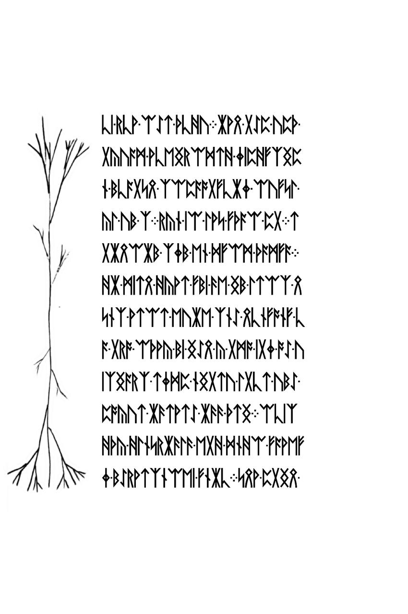

**Ciphertext** (krisyotam verbatim; `-` word separator, `.` = sentence dot (see p56 L1 `END.`), `/` = line end; standalone `&` (18×) / `$` (9×) / `§` (1×, book end p57) are krisyotam's transcription of the red dot-matrix ornaments — cipher-stream content, size mapping unconfirmed; `*` = red ink on owner-confirmed spans; `⟦'⟧`/`⟦"⟧` = image-only punctuation absent from the transcription, ≈word slot estimated. Line numbers = krisyotam lines (≠ image lines on solved pages, which wrap mid-word); printed Roman/Arabic content is omitted by krisyotam and appended below where known):

```
 1  ᚳᛁ-ᚱᚳᚹ-ᛠᛇᛏ-ᚦᚳᚻᚢ◆4ᛡᚹᛟ-ᚷᛇᛈ-ᚢᛈᚦ-/   = CI RCW EAEOT THCHU.IAWOE GEOP UPTH /
 2  ᚷᚣᚢᚪᛗ-ᚹᚳᛖᛝᚱᛠᛞᛏᚻ-ᛄᛁᛈᚻᚠᛉᛝᛈ/   = GYUAM WCENGREADTH JIPHFXNGP/
 3  ᚾ-ᛒᚳᚪᚷᛋᛟ-ᛉᛠᛈᚪᚩᚷᚠᚳᛡᛄ-ᛠᚢᚠᛋᛚ-/   = N BCAGSOE XEAPAOGFCIAJ EAUFSL /
 4  ᚣᛚ-ᚢᛒ-ᛉ◆4ᚱᚣᚾ-ᛁᛠ-ᛚᚹᛋ-ᚠᚦᚪᛠ-ᛈᚷ◆4ᛏ/   = YL UB X.RYN IEA LWS FTHAEA PG.T/
 5  ᚷᛡᛟᛠᛡᛒ-ᛉᛄᛒ-ᛖᚾ-ᛞᚠᛠᛗ-ᚦᚪᛗᚠᚪ◆4/   = GIAOEEAIAB XJB EN DFEAM THAMFA./
 6  ᚻᛡ-ᛗᛁᛏᛟ-ᚻᚣᚹᛏ-ᚠᛒᛁ-ᚫᛖ-ᛝᛒ-ᛚᛏᛠᛉ-ᛟ/   = HIA MITOE HYWT FBI AEE NGB LTEAX OE/
 7  ᛋᚾᛉ-ᚹᛏᛠᛏ-ᛖᚢᛡᛖ-ᛉᚾᛇ-ᛟᚳᚾᚠᚩᚾᚠ-ᚳ/   = SNX WTEAT EUIAE XNEO OECNFONF C/
 8  ᚪ-ᚷᚱᚩ-ᛠᚦᚹᚣ-ᛒᛁ-ᛝᛇᛟ-ᚣ-ᚷᛗᚩ-ᛁᚷᛄ-ᚩᛇ-ᚢ/   = A GRO EATHWY BI NGEOOE Y GMO IGJ OEO U/
 9  ᛁᛉᛝᚪᚱᛉ-ᛏᛄᛞᛈ-ᚾᛝᚷᛏᚢ-ᛚᚷᚳᛏ-ᚢᛒᛇ-/   = IXNGARX TJDP NNGGTU LGCT UBEO /
10  ᛈᚩᚣᚢᛏ-ᛡᚫᛏᚹᛏᛇ-ᛡᚫᚫ-ᚦᛏᛝ◆4ᛠᚳᛁᛉ/   = POYUT IAAETWTEO IAAEAE THTNG.EACIX/
11  ᚻᚦᚣ-ᚻᛚᚾᛋᚱᛡᚫᛚᚫ-ᛖᚷᚻ-ᛞᚾᚻᛠ-ᚠᚪᚹᛖᚠ/   = HTHY HLNSRIAAELAE EGH DNHEA FAWEF/
12  ᛄ-ᛒᛇᚱᚹᛏᛉᚾᛠᛖᛁ-ᚠᚾᛡᚳ◆4ᛋᛟᚹ-ᛈᚷᛝᛟ-/   = J BEORWTXNEAEI FNIAC.SOEW PGNGOE /
```

**Notes:**

## p13 (unsolved)

Known: —


**Ciphertext** (krisyotam verbatim; `-` word separator, `.` = sentence dot (see p56 L1 `END.`), `/` = line end; standalone `&` (18×) / `$` (9×) / `§` (1×, book end p57) are krisyotam's transcription of the red dot-matrix ornaments — cipher-stream content, size mapping unconfirmed; `*` = red ink on owner-confirmed spans; `⟦'⟧`/`⟦"⟧` = image-only punctuation absent from the transcription, ≈word slot estimated. Line numbers = krisyotam lines (≠ image lines on solved pages, which wrap mid-word); printed Roman/Arabic content is omitted by krisyotam and appended below where known):

```
 1  ᚷᚦᚠᛄᚷᚳ-ᛒᛁᛗᛚᛇᛠᚹ-ᚾᚫᚹᚷ◆4ᚩᚻᚪᛏᚾᛄ-ᚣ/   = GTHFJGC BIMLEOEAW NAEWG.OHATNJ Y/
 2  ᛝᛏᛡᛝ-ᚢ-ᚩᚠᚣ-ᛗᚢᛒ-ᛏᚠᛈ◆4ᚱᚩ-ᛉᚩᛝᛒ-ᛖ/   = NGTIANG U OFY MUB TFP.RO XONGB E/
 3  ᛏᚩᛉ-ᚣᛗᚠᛉ-ᛖᚩᚫᚷᚣᛚ-ᚩᛇ-ᚠᛋᚫᛇᛗ-ᛡᛟᚹ/   = TOX YMFX EOAEGYL OEO FSAEEOM IAOEW/
 4  ᚾᚩᚢᚹᛖᛁ-ᚾᚦᚫᛠᚪ-ᛠᛚ-ᚹ-ᛡᚩ-ᚢᚦᛗ-ᛝᛚᚪᚠ/   = NOUWEI NTHAEEAA EAL W IAO UTHM NGLAF/
 5  ᛝ-ᛚᚠᛚᚳᛒᚢᛝᛉ-ᚣᛡᚪᚷ-ᚹᛟᚪᚻᚹᚢ-ᛖᛠᚷ-/   = NG LFLCBUNGX YIAAG WOEAHWU EEAG /
 6  ᛁᚪᛏᛄᛗ-ᛏᛖᛁ-ᚣᛡ-ᚦᚾᚠᚦ-ᚩᛈᚻᚪ-ᚻᛋᛠ-ᛡᛉ/   = IATJM TEI YIA THNFTH OPHA HSEA IAX/
 7  ᚪᚫ-ᚠᚣᛞᛠᛇᚠᚫ-ᛏᛗ-ᚳᛡᚷ-ᚱᚢᛞ-ᛄ-ᛋᛡᛇᚩ/   = AAE FYDEAEOFAE TM CIAG RUD J SIAEOO/
 8  -ᛚᛟ-ᚦᚱᚫᛒᛚᚦ-ᛖᚪᚦᛗᛚ-ᚦᛉᚪᚱ-ᛟᛖᛒᛄᚱᛄᛖᛁ/   =  LOE THRAEBLTH EATHML THXAR OEEBJRJEI/
 9  ᛈ-ᚪᛖᛠᚠᛄᚢ-ᛞᚹᚦᚣ-ᛉᚷᚩᚳᛡ-ᛇᛗᛞᚳᛏ-/   = P AEEAFJU DWTHY XGOCIA EOMDCT /
10  ᚻᛚᚦᛝᛖᛗᚱ-ᛒᚷᛞᛉᛗᛒᛉᚳᛝᚦᚣᛞᚫᛠ-ᛋ/   = HLTHNGEMR BGDXMBXCNGTHYDAEEA S/
11  ᛏᛗᛏᚻᚹ-ᛇᚳᚪᛞ-ᛠᚢᛒᛉ-ᛡᛁᛡᛚ-ᚷᛋᚦᛞ-ᚠ/   = TMTHW EOCAD EAUBX IAIIAL GSTHD F/
12  ᚢᚩᛠ-ᛚᛋᚣᛏ-ᛋᚪᛞᚫᚹᛄᛞ-ᛋᛈᛋᛄ-ᚪᛖᛁᛇᛒᛟ/   = UOEA LSYT SADAEWJD SPSJ AEIEOBOE/
```

**Notes:**

## p14 (unsolved)

Known: red only via dot-lattice (section terminator)


**Ciphertext** (krisyotam verbatim; `-` word separator, `.` = sentence dot (see p56 L1 `END.`), `/` = line end; standalone `&` (18×) / `$` (9×) / `§` (1×, book end p57) are krisyotam's transcription of the red dot-matrix ornaments — cipher-stream content, size mapping unconfirmed; `*` = red ink on owner-confirmed spans; `⟦'⟧`/`⟦"⟧` = image-only punctuation absent from the transcription, ≈word slot estimated. Line numbers = krisyotam lines (≠ image lines on solved pages, which wrap mid-word); printed Roman/Arabic content is omitted by krisyotam and appended below where known):

```
 1  -ᛏᛄ-ᚠᚩᛚᛞ-ᚾᚷᚳ-ᛚᚷᛗ-ᛠᚦᚢ-ᛟᚻᚾᛟᚣᛡ◆4/   =  TJ FOLD NGC LGM EATHU OEHNOEYIA./
 2  ᛇᚻᚣᚪᛈ-ᚾᛋ◆4ᛞᚫᛠᚳᛉᛄ-ᚦᚹᛋᚱᚦᚫᚾ-ᛡᛚᚣ/   = EOHYAP NS.DAEEACXJ THWSRTHAEN IALY/
 3  ᚫᛋᛖ-ᛟᚣᛝᛡ-ᚦᚣᚷᛇᚱ-ᛋᛠᛏ-ᛡᚳᛉ-ᛠᚷ-/   = AESE OEYNGIA THYGEOR SEAT IACX EAG /
 4  ᚳᛒᛋ-ᚹᚾᚻᛖᛝᛋ-ᚩᛡᛗᛉᛝ-ᛉᚦ-ᛠᛞᚳᛒᚷ/   = CBS WNHENGS OIAMXNG XTH EADCBG/
 5  ᛉᚹᛝᚢ-ᛉᛞᛈ◆4ᛉᛡᛈᛟ-ᚾᛡᚠᛡᚢᛋ-ᛉᚪᛖ/   = XWNGU XDP.XIAPOE NIAFIAUS XAE/
 6  ᚻᚱᚣᛠᛇ-ᛒᛟ-ᚪᛝᛡ-ᚳᚱᚳᛈᚩᛏ-ᚻᚣᚫᛁᛋᚩᚦᛚ/   = HRYEAEO BOE ANGIA CRCPOT HYAEISOTHL/
 7  -ᛟᛚ-ᛋᚪᚢᚪᛈᚻ◆13*/   =  OEL SAUAPH¶*/
 8  &
```

**Notes:**

## p15 (unsolved)

Known: red head **words** (line 1); printed digit group 3278/3299*(red)/3298/2838; red head words line 6 (after 4 lines of printed digits)

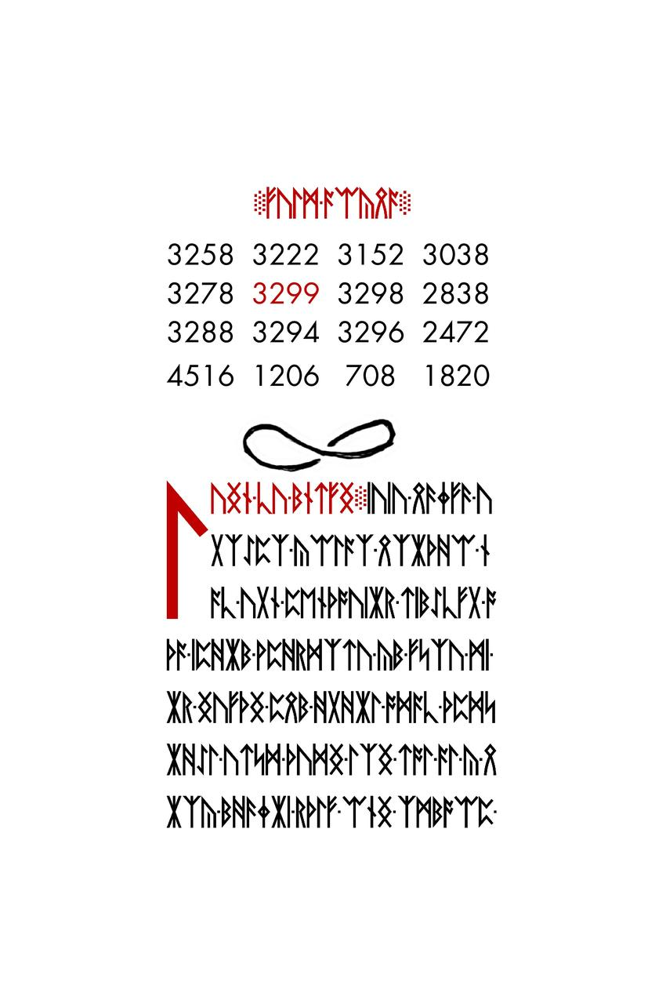

**Ciphertext** (krisyotam verbatim; `-` word separator, `.` = sentence dot (see p56 L1 `END.`), `/` = line end; standalone `&` (18×) / `$` (9×) / `§` (1×, book end p57) are krisyotam's transcription of the red dot-matrix ornaments — cipher-stream content, size mapping unconfirmed; `*` = red ink on owner-confirmed spans; `⟦'⟧`/`⟦"⟧` = image-only punctuation absent from the transcription, ≈word slot estimated. Line numbers = krisyotam lines (≠ image lines on solved pages, which wrap mid-word); printed Roman/Arabic content is omitted by krisyotam and appended below where known):

```
 1  ◆13*ᚠ*ᚢ*ᛚ*ᛗ*-*ᚪ*ᛠ*ᚣ*ᛟ*ᚪ*◆13*/   = ¶*F*U*L*M* *A*EA*Y*OE*A*¶*/
 2  &  3258 3222 3152 3038/ 3278 3*2*9*9* 3298 2838/ 3288 3294 3296 2472/ 4516 1206 708 1820/
 3  $
 4  ᛚ*ᚢ*ᛝ*ᚾ*-*ᚳ*ᚢ*-*ᛒ*ᚾ*ᛏ*ᚠ*ᛝ*◆13*ᛁᚢᛁᚢ-ᛟᚫᛄᚠᚫ-ᚢ/   = L*U*NG*N* *C*U* *B*N*T*F*NG*¶*IUIU OEAEJFAE U/
 5  ᚷᛉᛇᛈᛉ-ᚣᛠᛚᚪᛉ-ᛟᛉᛡᚦᚻᛠ-ᚾ/   = GXEOPX YEALAX OEXIATHHEA N/
 6  ᚪ*ᚳ*-ᚢᚷᚾ-ᛈᛖᚾᚦᚩᚢᛁᛡᚱ-ᛏᛁᛒᛇᚳᚠᚷ-ᚩ/   = A*C* UGN PENTHOUIIAR TIBEOCFG O/
 7  ᚦᚪ-ᛁᛈᚻᛡᛒ-ᚹᛈᚻᚱᛞᛉᛏᚢ-ᚣᛒ-ᚠᛋᛉᚢ-ᛗᛁ-/   = THA IPHIAB WPHRDXTU YB FSXU MI /
 8  ᛡᚱ-ᛝᚢᚠᚦᛝ-ᛈᛟᛒ-ᚻᚷᚻᛡᛚ-ᚩᛞᚪᚳ-ᚦᛈᛞᛋ/   = IAR NGUFTHNG POEB HGHIAL ODAC THPDS/
 9  ᛡᚻᛇᛚ-ᚢᛏᛋᛞ-ᚦᚢᛞᛝ-ᛚᛉᛝ-ᛏᚩᛚ-ᚪᛚ-ᚣ-ᛟ/   = IAHEOL UTSD THUDNG LXNG TOL AL Y OE/
10  ᛡᛉᚣ-ᛒᚻᚫᛄᛡᛁ-ᚱᚦᛚᚠ-ᛠᚾᛝ-ᛉᛗᛒᚩᛠᛈ-/   = IAXY BHAEJIAI RTHLF EANNG XMBOEAP /
```

**Notes:**

## p16 (unsolved)

Known: —

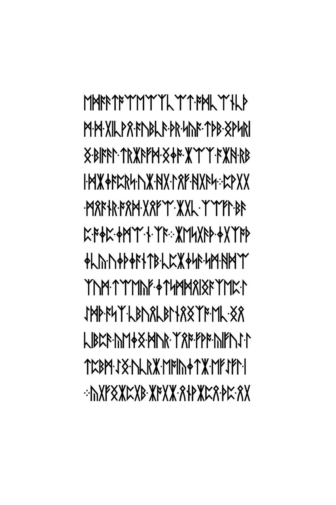

**Ciphertext** (krisyotam verbatim; `-` word separator, `.` = sentence dot (see p56 L1 `END.`), `/` = line end; standalone `&` (18×) / `$` (9×) / `§` (1×, book end p57) are krisyotam's transcription of the red dot-matrix ornaments — cipher-stream content, size mapping unconfirmed; `*` = red ink on owner-confirmed spans; `⟦'⟧`/`⟦"⟧` = image-only punctuation absent from the transcription, ≈word slot estimated. Line numbers = krisyotam lines (≠ image lines on solved pages, which wrap mid-word); printed Roman/Arabic content is omitted by krisyotam and appended below where known):

```
 1  ᛖᛞᚪᚫᛏᚩᛠᛖᛠᛉᚳᛠᛏ-ᚩᛞᚳᛠᚾᚳᚦ/   = EDAAETOEAEEAXCEAT ODCEANCTH/
 2  ᛗ-ᛞ-ᚷᛁᚳᚹᛟ-ᚪᚢᛒᚳᚫ-ᚦᚱ-ᛋᚣᚪ-ᛏᚦᛒ-ᛝᚹᛋᚱᛁ/   = M D GICWOE AUBCAE THR SYA TTHB NGWSRI/
 3  ᛝ-ᛒᛁᚪᚫᛚ-ᛏᚱᛡᚫᚠᛞ-ᛝᛄᚩ-ᛡᛠᛉ-ᚪᛡᚻ-ᚱᛒ/   = NG BIAAEL TRIAAEFD NGJO IAEAX AIAH RB/
 4  ᛁ-ᛞᛡᛄᚪᛈᚱᛋ-ᚢᛡ-ᚻᚷ-ᛚᛟᚠ-ᚻᚷᚫᛋ◆4ᛈᚹᚷᚷ/   = I DIAJAPRS UIA HG LOEF HGAES.PWGG/
 5  -ᛗᛟᚪᚾᚱ-ᚩᛟᛞ-ᚷᛟᚠᛠ-ᛡᚷᚳ-ᛉᛠᚠᛚ-ᛒᚫ/   =  MOEANR OOED GOEFEA IAGC XEAFL BAE/
 6  ᛈ-ᚩᛄᛈ-ᛄᛗᛠ-ᚾ-ᛉᚪ◆4ᛡᛖᛋᚷᚫᚦ-ᛄᚷᛉᚩᚦ/   = P OJP JMEA N XA.IAESGAETH JGXOTH/
 7  ᛄᚳᚣ-ᚢᛄᚦᛄᚪᚾᛏᛒ-ᚳᛈᛡᛄᛋᚫ-ᛋᛗ-ᚻᛞᛠ/   = JCY UJTHJANTB CPIAJSAE SM HDEA/
 8  ᛉᚢᛗ-ᛏᛠᛖᚣᚠ-ᛄᛏᛋᛗᛞᛟᛁᛝᚪᛉᛖᛈ-ᛚ/   = XUM TEAEYF JTSMDOEINGAXEP L/
 9  ᛇᛞᚦ-ᚪᛋᛉ-ᚳᛒᚢᛟᚳᛒᛚᚾᛟᛝᛉᚩ-ᛖᚳ-ᛝᛟ/   = EODTH ASX CBUOECBLNOENGXO EC NGOE/
10  ᚳᛁᛒᛈᚫ-ᚣᛖᛄᛝ-ᛞᚢᚱ-ᛉᛟᚩ-ᚠᚹᚩ-ᚣᛁᚠᚢᛇ-ᛚ/   = CIBPAE YEJNG DUR XOEO FWO YIFUEO L/
11  ᛏᛈᛒᛗ-ᛇᛝ-ᚢᚳᚱᛡ-ᛖᚩᛁᚣᛄᛏᛡ-ᛖᚠᛇᚠᛚ-ᛁ/   = TPBM EONG UCRIA EOIYJTIA EFEOFL I/
12  ◆4ᚣᚷᚠᛝᛡᛈᚷᛒ-ᛡᚩᚷᛡ-ᛟᚾᚹᛡᛈᛟ-ᚦᛈ-ᛟᚷ/   = .YGFNGIAPGB IAOGIA OENWIAPOE THP OEG/
```

**Notes:**

## p17 (unsolved)

Known: —


**Ciphertext** (krisyotam verbatim; `-` word separator, `.` = sentence dot (see p56 L1 `END.`), `/` = line end; standalone `&` (18×) / `$` (9×) / `§` (1×, book end p57) are krisyotam's transcription of the red dot-matrix ornaments — cipher-stream content, size mapping unconfirmed; `*` = red ink on owner-confirmed spans; `⟦'⟧`/`⟦"⟧` = image-only punctuation absent from the transcription, ≈word slot estimated. Line numbers = krisyotam lines (≠ image lines on solved pages, which wrap mid-word); printed Roman/Arabic content is omitted by krisyotam and appended below where known):

```
 1  ᛚᚦ-ᛈᛞ-ᚦᛇᛒ-ᛡᚪᛒᚪ-ᚾᛗ-ᚳᚾᛖᛡᚹᛝᛏᚱ-ᛝᚫ/   = LTH PD THEOB IAABA NM CNEIAWNGTR NGAE/
 2  ᛚᛟᛁᛇᚣ-ᛝᛡᚾᛏ-ᚱᛁ-ᛋᚪᛖ-ᛇᚢ-ᛝᛞᛄ-ᚠᚱᛠᛗ/   = LOEIEOY NGIANT RI SAE EOU NGDJ FREAM/
 3  ᛠᚪ-ᚫᛈ-ᛏᚠ-ᛖᛏᚷᚾᚠᛁᚠ-ᚱᚻᚱᛇᛒ.ᚻᛈᛏ-ᛇᚱ/   = EAA AEP TF ETGNFIF RHREOB.HPT EOR/
 4  ᛝᛡᛒᚹᛚᛏ-ᛗᛉᚦ-ᚾᛄᚳᚫ-ᚷᛈ-ᛋᛖᚩ-ᚢᛝᚩ-ᛏ/   = NGIABWLT MXTH NJCAE GP SEO UNGO T/
 5  ᛈᛁᚣᚾᚪ-ᛏᚹ-ᚠᛗᚾᛟᚾᚳᛒ◆4ᛄᛉᛡ-ᛟᚪᛁᚫᛝ-ᛒ-/   = PIYNA TW FMNOENCB.JXIA OEAIAENG B /
 6  ᛉᛏᛄᛁᛋ◆4ᛠ-ᚳᛖᚱᚦᚣᚩᚣ-ᛈᚫᚷ-ᛡᛄᛁᚩ-ᚱᚦ/   = XTJIS.EA CERTHYOY PAEG IAJIO RTH/
 7  ᛠ-ᛇᚦᚩᛉ-ᚾᚱᚾᚫᛁᛉ-ᛁ-ᛝᚣᚫᛡᚫᛗ-ᚹᛖ-ᛇᚷᚻ/   = EA EOTHOX NRNAEIX I NGYAEIAAEM WE EOGH/
 8  ᛖᛗ-ᚷᚢᛞᚹ-ᛄᚻ◆4ᛉᚱᚢᛄᚢᚾᛈ-ᛋᚣᛄᚫ-ᛈᚳ/   = EM GUDW JH.XRUJUNP SYJAE PC/
 9  ᚣᚳᛒᛡ-ᚫᛟᚪᚠ-ᛏ-ᚷᚩᛇᛟ-ᛁᚱᛗ-ᛖᛉᛟ-ᛗᛇᚫᛟ/   = YCBIA AEOEAF T GOEOOE IRM EXOE MEOAEOE/
10  ᚦ-ᚱ-ᛞᛁᚢᚦᚻᛗᛡᚾ-ᛁᚦᚻᛚ◆4ᛏᚳ-ᚪᚦ-ᚠᚪᚫᚣᚻ/   = TH R DIUTHHMIAN ITHHL.TC ATH FAAEYH/
11  ᛠ-ᚦᚠᛋᚠᛝᚷᚱᛈ-ᛏᛄᛉᛟ-ᚷᛚᚻ-ᚩᚪᚦᛏᚳᛁ-ᚠ/   = EA THFSFNGGRP TJXOE GLH OATHTCI F/
12  ᚣᚢᛁᚹ-ᛟᚪᚣᛁᛠᛄᚪ-ᛟᛝᚦ-ᛟᚠᚦᚾ-ᛇᚷ-ᛠᛚᛒᚠ/   = YUIW OEAYIEAJA OENGTH OEFTHN EOG EALBF/
```

**Notes:**

## p18 (unsolved)

Known: —

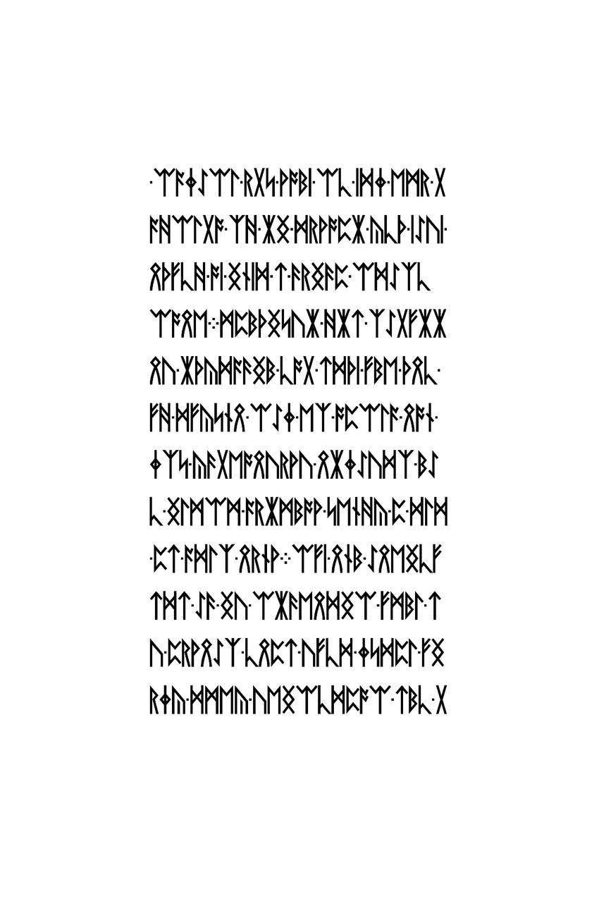

**Ciphertext** (krisyotam verbatim; `-` word separator, `.` = sentence dot (see p56 L1 `END.`), `/` = line end; standalone `&` (18×) / `$` (9×) / `§` (1×, book end p57) are krisyotam's transcription of the red dot-matrix ornaments — cipher-stream content, size mapping unconfirmed; `*` = red ink on owner-confirmed spans; `⟦'⟧`/`⟦"⟧` = image-only punctuation absent from the transcription, ≈word slot estimated. Line numbers = krisyotam lines (≠ image lines on solved pages, which wrap mid-word); printed Roman/Arabic content is omitted by krisyotam and appended below where known):

```
 1  -ᛠᚪᛄᛇᛠᛚ-ᚱᚷᛋ-ᚹᚩᛒᛁ-ᛠᚳ-ᛁᛞᛄ-ᛖᛗᚱ-ᚷ/   =  EAAJEOEAL RGS WOBI EAC IDJ EMR G/
 2  ᚪᚻᛠᛚᚷᚩ-ᛉᚻ-ᛡᛝ-ᛞᚱᚹᚩᛈᛡ-ᚣᚳᚦ-ᛁᛇᚢᛁ-/   = AHEALGO XH IANG DRWOPIA YCTH IEOUI /
 3  ᛟᚦᚠᚳᚻ-ᚩᛁ-ᛝᚾᛁᛞ-ᛏ-ᚫᚱᛝᚫᛈ-ᛠᛞᛇᛉᚳ/   = OETHFCH OI NGNID T AERNGAEP EADEOXC/
 4  ᛠᚩᛟᛖ◆4ᛗᛈᛒᚦᛝᛋᚢᛡ-ᚻᛡᛏ-ᛉᛇᚷᚠᛡᛡ/   = EAOOEE.MPBTHNGSUIA HIAT XEOGFIAIA/
 5  ᛟᚢ-ᛡᚦᚣᛞᚪᚫᛝᛒ-ᚳᚩᚷ-ᛏᛞᚦᛁ-ᚠᛒᛖ-ᚦᛟᚳ-/   = OEU IATHYDAAENGB COG TDTHI FBE THOEC /
 6  ᚠᚻ-ᛞᚠᚣᛋᚾᛟ-ᛠᛇᛄ-ᛖᛉ-ᚩᛈᛠᛚᚪ-ᛟᚩᚾ-/   = FH DFYSNOE EAEOJ EX OPEALA OEON /
 7  ᛄᛉᛋ-ᚣᚫᚷᛖᚩᛟᚢᚱᚹᚢ-ᛟᛡᛄᛇᚢᛞᛉ-ᛒᛇ/   = JXS YAEGEOOEURWU OEIAJEOUDX BEO/
 8  ᚳ-ᛝᛚᛗᛠᛗ-ᚪᚱᛡᛗᛒᚩᚹ-ᛋᛖᚾᚻᚣ-ᛈ-ᛞᛚᛞ/   = C NGLMEAM ARIAMBOW SENHY P DLD/
 9  -ᛈᛏ-ᚪᛞᛚᛉ-ᛟᚱᚾᚹ◆4ᛠᚠᛁ-ᛟᚾᛒ-ᛇᛟᛖᛝᚳᚠ/   =  PT ADLX OERNW.EAFI OENB EOOEENGCF/
10  ᛏᛞᛏ-ᛇᚫ-ᛝᚢ-ᛠᛡᚫᛖᛟᛞᛝᛠ-ᚠᛗᛒᛚ-ᛏ/   = TDT EOAE NGU EAIAAEEOEDNGEA FMBL T/
11  ᚢ-ᛈᚱᚹᛟᛇᛉ-ᚳᛟᛈᛏ-ᚢᚠᚳᛞ-ᛄᛋᛞᛈᛚ-ᚠᛝ/   = U PRWOEEOX COEPT UFCD JSDPL FNG/
12  ᚱᛄᚣ-ᛞᛗᛖᚣ-ᚢᛖᛝᛠᚳᛞᛈᚩᛠ-ᛏᛒᚳ-ᚷ/   = RJY DMEY UENGEACDPOEA TBC G/
```

**Notes:**

## p19 (unsolved)

Known: —

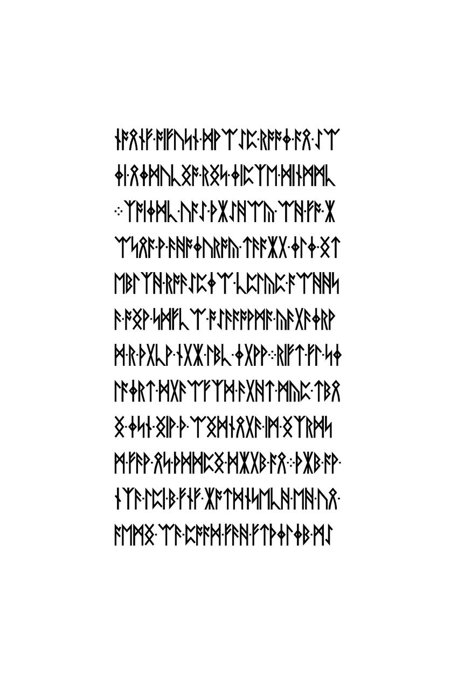

**Ciphertext** (krisyotam verbatim; `-` word separator, `.` = sentence dot (see p56 L1 `END.`), `/` = line end; standalone `&` (18×) / `$` (9×) / `§` (1×, book end p57) are krisyotam's transcription of the red dot-matrix ornaments — cipher-stream content, size mapping unconfirmed; `*` = red ink on owner-confirmed spans; `⟦'⟧`/`⟦"⟧` = image-only punctuation absent from the transcription, ≈word slot estimated. Line numbers = krisyotam lines (≠ image lines on solved pages, which wrap mid-word); printed Roman/Arabic content is omitted by krisyotam and appended below where known):

```
 1  ᚾᚩᛟᚾᚠ-ᚩᛁᚠᚢᛋᚾ-ᛞᚹᛠᛇᛈ-ᚱᚩᚩᛄ-ᚪᛟ-ᛇᛠ/   = NOOENF OIFUSN DWEAEOP ROOJ AOE EOEA/
 2  ᛄᛁ-ᛟᛄᛞᚢᚳᛝᚩ-ᚱᛝᛋ-ᛄᛁᛈᛉᛖ-ᛞᛁᚾᛗᛗᚳ/   = JI OEJDUCNGO RNGS JIPXE DINMMC/
 3  ◆4ᛉᚩᛁᛄᛞᚳ-ᚢᚪᛇ-ᚦᛡᛇᚻᛠᚣ-ᛠᚻ-ᚠᚩ-ᛡ/   = .XOIJDC UAEO THIAEOHEAY EAH FO IA/
 4  ᛠᛋᛟᚪ-ᚹ-ᚫᚻᚩᛄᚢᚱᚩᚣ-ᛏᚫᚪᛡᚷ-ᛄᛚᛄ-ᛝᛏ/   = EASOEA W AEHOJUROY TAEAIAG JLJ NGT/
 5  ᛖᛒᛚᛉᚻ-ᚱᚩᚫᛇᛈᛄᛠ-ᚳᛈᛚᚣᛈ-ᚪᛠᚻᚻᛋ/   = EBLXH ROAEEOPJEA CPLYP AEAHHS/
 6  ᚫ-ᚩᛝᚹ-ᛋᛞᚠᚳᛠ-ᚩᛇᚫᚪᚩᚹᛗᚪ-ᚣᚫᚷᚫᛄᚱᚹ/   = AE ONGW SDFCEA OEOAEAOWMA YAEGAEJRW/
 7  ᛞ-ᚱ-ᚦᚷᚳᚹ-ᚾᚷᛡ-ᛚᛒᚳ-ᛄᚷᚹᚹ◆4ᚱᛁᚠᛏ-ᚠᛚ-ᛋᛄ/   = D R THGCW NGIA LBC JGWW.RIFT FL SJ/
 8  ᛚᚪᛄᚱᛏ-ᛞᚷᚫᛠᚠᛉᛞ-ᚫᚷᚻᛏ-ᛗᚣᛈ-ᛏᛒᛟ/   = LAJRT DGAEEAFXD AEGHT MYP TBOE/
 9  ᛝ-ᛄᛋᚾ-ᛝᛁᚹ-ᚦ-ᛠᛝᛞᚾᛟᚷᚫ-ᛁᛗ-ᛝᛉᚱᛞᛋ/   = NG JSN NGIW TH EANGDNOEGAE IM NGXRDS/
10  ᛗ-ᚠᚫᚹ-ᛟᛋ-ᚦᛞᛞᛈᛝ-ᛞᛡᚷᛒ-ᚪᛟ◆4ᚦᛡᛒ-ᚪᚹ-/   = M FAEW OES THDDPNG DIAGB AOE.THIAB AW /
11  ᚾᛉᚫ-ᛚᛈᛁ-ᛒ-ᚠᚾᚠ-ᛡᚩᛏᛞᚾᛋᛖᚳᚻ-ᛖᚻ-ᚢᛟ-/   = NXAE LPI B FNF IAOTDNSECH EH UOE /
12  ᚪᛖᛗᛝ-ᛠᚫ-ᛈᚩᚪᛞ-ᚠᚫᚻ-ᚠᛏᚦᛄᛚᛄᛒ-ᛗᛇ/   = AEMNG EAAE POAD FAEH FTTHJLJB MEO/
```

**Notes:**

## p20 (unsolved)

Known: —

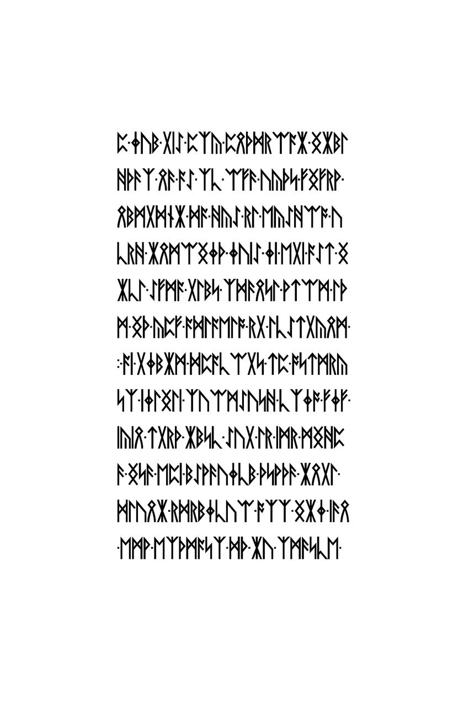

**Ciphertext** (krisyotam verbatim; `-` word separator, `.` = sentence dot (see p56 L1 `END.`), `/` = line end; standalone `&` (18×) / `$` (9×) / `§` (1×, book end p57) are krisyotam's transcription of the red dot-matrix ornaments — cipher-stream content, size mapping unconfirmed; `*` = red ink on owner-confirmed spans; `⟦'⟧`/`⟦"⟧` = image-only punctuation absent from the transcription, ≈word slot estimated. Line numbers = krisyotam lines (≠ image lines on solved pages, which wrap mid-word); printed Roman/Arabic content is omitted by krisyotam and appended below where known):

```
 1  ᛈ-ᛄᚢᛒ-ᚷᛁᛇ-ᛈᛉᚣ-ᛈᛟᚦᛞᚱᛠᚪᛡ-ᛝᛡᛒᛚ/   = P JUB GIEO PXY POETHDREAAIA NGIABL/
 2  ᚻᚦᚫᛉ-ᛟᚫ-ᚪᛇ-ᛉᚳ-ᛠᚠᚫ-ᚢᚣᚦᛋ-ᚠᛝᚠᚱᚹ-/   = HTHAEX OEAE AEO XC EAFAE UYTHS FNGFRW /
 3  ᛟᛒᛗᚷᛞᚾᛡ-ᛞᚪ-ᚻᚣᛇ-ᚱᛚ-ᛖᚣᛇᚻᛠᚩ-ᚢ/   = OEBMGDNIA DA HYEO RL EYEOHEAO U/
 4  ᚳᚱᚻ-ᛡᛟᛗᛠᛝᛄᚦ-ᛄᚢᛁᛇ-ᛄᛁ-ᛖᚷᛁ-ᚪᛇᛏ-ᛝ/   = CRH IAOEMEANGJTH JUIEO JI EGI AEOT NG/
 5  ᛡᚳᛚ-ᛇᚠᛗᚪ-ᚷᛚᛒᛋ-ᛉᛞᚫᛟᛋᛚ-ᚹᛏᛠᛗ-ᛚᚦ/   = IACL EOFMA GLBS XDAEOESL WTEAM LTH/
 6  ᛗ-ᛝᚦ-ᚣᛈᚠ-ᚪᛞᛚᚪᛖᛚᚩ-ᚱᚷ-ᛚᚳᛇᛏᚷᚣᛟᛗ./   = M NGTH YPF ADLAELO RG LCEOTGYOEM./
 7  ᚪᛁ-ᚷᛄᛒᛡᛗ-ᛞᛈᚪᚳᛠᚷᛋ-ᛏᛈ-ᚩᛋᛏᛗᚱᚣ/   = AI GJBIAM DPACEAGS TP OSTMRY/
 8  ᛋᛉ-ᛁᛄᛚᛝᛚᛁ-ᛉᚢᛠᛗᛇᚢᛋᚻ-ᚳᛉᛄᚩ-ᚠᛄᚠ-/   = SX IJLNGLI XUEAMEOUSH CXJO FJF /
 9  ᛁᚣᛁᛟ-ᛏᚷᚱᚦ-ᛡᛒᛋᚳ-ᛇᚢᚷ-ᛚᚱ-ᛁᛗᚱ-ᛗᛝᚻᛈ/   = IYIOE TGRTH IABSC EOUG LR IMR MNGHP/
10  ᚫ-ᛝᛋᚫ-ᛖᛈᛁ-ᛒᛇᚹᚫᚢᛄᚳᛒ-ᚦᛋᚹᚦᚫ-ᛡᛟᚷᛚ-/   = AE NGSAE EPI BEOWAEUJCB THSWTHAE IAOEGL /
11  ᛞᛚᚢᛟᛡ-ᚱᛞᚱᛒᛄᚳᚢᛠ-ᚩᛉᛉ-ᛝᛡᛄ-ᛁᚫᛟ/   = DLUOEIA RDRBJCUEA OXX NGIAJ IAEOE/
12  -ᛖᛗᚹ-ᛖᛉᚦᛗᚪᛋᛉ-ᛞᚦ-ᛡᚢ-ᛉᛗᚫᛋᚳᛖ-/   =  EMW EXTHMASX DTH IAU XMAESCE /
```

**Notes:**

## p21 (unsolved)

Known: —

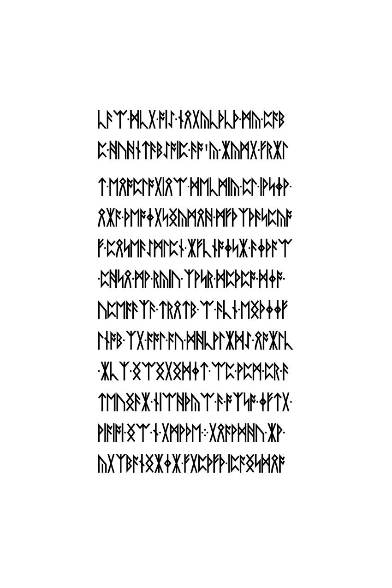

**Ciphertext** (krisyotam verbatim; `-` word separator, `.` = sentence dot (see p56 L1 `END.`), `/` = line end; standalone `&` (18×) / `$` (9×) / `§` (1×, book end p57) are krisyotam's transcription of the red dot-matrix ornaments — cipher-stream content, size mapping unconfirmed; `*` = red ink on owner-confirmed spans; `⟦'⟧`/`⟦"⟧` = image-only punctuation absent from the transcription, ≈word slot estimated. Line numbers = krisyotam lines (≠ image lines on solved pages, which wrap mid-word); printed Roman/Arabic content is omitted by krisyotam and appended below where known):

```
 1  ᚳᚫᛠ-ᛞᚳᚷ-ᚩᛁᛇ-ᚾᛟᚷᚣᚳᚦᚳᚦ-ᛗᚣ-ᛈᚪᛒ/   = CAEEA DCG OIEO NOEGYCTHCTH MY PAB/
 2  ᛈ-ᚻᚢᚻᚾᛏᚫᛒᛇᚩᛁᛈ-ᚫᚩ'ᚣ-ᛡᚣᛗᚷ-ᚠᚱᛡᛚ/   = P HUHNTAEBEOOIP AEO'Y IAYMG FRIAL/
 3  ᛏ-ᛖᛟᚩᛈᛚᚩᚷᛁᛟᛠ-ᛞᛖᚳᛗᛁᚣ-ᛈᛚ-ᛁᚹᛋᛄᚹ-/   = T EOEOPLOGIOEEA DECMIY PL IWSJW /
 4  ᛟᛡᚪ-ᚦᛖᚩᛄᚷᛋᛝᚣᛗᛟᚻ-ᛗᚠᚦᛉᚦᚫᛋᛈᚣᚩ/   = OEIAA THEOJGSNGYMOEH MFTHXTHAESPYO/
 5  ᚠ-ᛈᛟᛋᛖᚫᛇᛗᛚᛈᚾ-ᛡᚠᚳᚾᚩᛄᛋᛡ-ᚫᛄᚦᚪᛠ/   = F POESEAEEOMLPN IAFCNOJSIA AEJTHAEA/
 6  -ᛈᚻᛋᛟ-ᛗᚹ-ᚱᚣᛁᚢ-ᛉᚹᛋᚱ-ᛞᛈᚦᛈᚩ-ᛞᛄᚩ-/   =  PHSOE MW RYIU XWSR DPTHPO DJO /
 7  ᚢᛈᛖᚪᚫᛉᚫ-ᛏᚱᛟᛏᛒ-ᛠ-ᚫᚳᚾ-ᛖᛝᚦᛄᛄᚠ/   = UPEAAEXAE TROETB EA AECN ENGTHJJF/
 8  ᛚᚾᚩᛒ-ᛉᚷ-ᚪᚩᛚ-ᚪᚢ-ᛞᚻᚳᚹᛚᛡᛞᛇ-ᛟᚩᛡᛚᚳ/   = LNOB XG AOL AU DHCWLIADEO OEOIALC/
 9  -ᛡᚳᛉ-ᛝᛠᛝᚷᛝᛞᛄᛏ-ᛠᛈ-ᚹᛈᛗ-ᛈᚱ-ᚫ/   =  IACX NGEANGGNGDJT EAP WPM PR AE/
10  ᛏᛖᚢᛝᚫᛡ-ᚾᛁᛠᚻᚦᚣᛠ-ᚫ-ᚩᛉᛋᚩ-ᛄᚠᛏᚷ-/   = TEUNGAEIA NIEAHTHYEA AE OXSO JFTG /
11  ᚹᛁᚪᛁᚩᛁ-ᛝᛠ-ᚾ-ᚷᛗᚹᚦᛖ◆4ᚷᛟᚪᚹᛞᚻᚢ-ᛡᚹ-/   = WIAIOI NGEA N GMWTHE.GOEAWDHU IAW /
12  ᚣᚷᛉᛒᚪᚾᛝᛡᛄᛡ-ᚠᚷᛈᚦᚠᚦ-ᛁᛈᚪᛝᛋᛞᛟᚩ/   = YGXBANNGIAJIA FGPTHFTH IPANGSDOEO/
```

**Notes:**

## p22 (unsolved)

Known: red only via dot-lattice (section terminator)

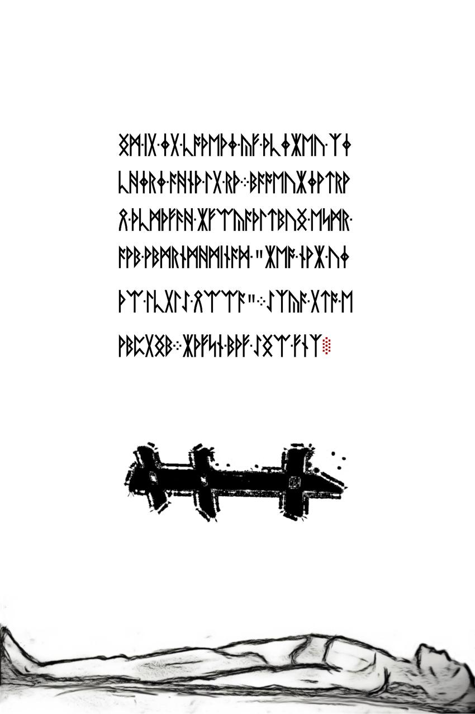

**Ciphertext** (krisyotam verbatim; `-` word separator, `.` = sentence dot (see p56 L1 `END.`), `/` = line end; standalone `&` (18×) / `$` (9×) / `§` (1×, book end p57) are krisyotam's transcription of the red dot-matrix ornaments — cipher-stream content, size mapping unconfirmed; `*` = red ink on owner-confirmed spans; `⟦'⟧`/`⟦"⟧` = image-only punctuation absent from the transcription, ≈word slot estimated. Line numbers = krisyotam lines (≠ image lines on solved pages, which wrap mid-word); printed Roman/Arabic content is omitted by krisyotam and appended below where known):

```
 1  ᛝᛗ-ᛁᚷ-ᛄᚷ-ᚳᚩᚦᛖᚦᛄ-ᚣᚠ-ᚦᚳᛄᛡᛖᚢ-ᛉᛄ/   = NGM IG JG COTHETHJ YF THCJIAEU XJ/
 2  ᚳᚻᛄᚱᛄ-ᚪᚻᚾᚦ-ᛚᚷ-ᚱᚦ◆4ᛒᚪᚩᛖᚢᛡᛄᚹᛏᚱᚹ/   = CHJRJ AHNTH LG RTH.BAOEUIAJWTRW/
 3  ᛟ-ᚦᚳᛗᚦᚠᚫᚻ-ᛡᚠᛠᚣᚪᚦᛚᛏᛒᚢᛝ-ᛖᛋᛗᚱ-/   = OE THCMTHFAEH IAFEAYATHLTBUNG ESMR /
 4  ᚪᚹᛒ-ᚹᛒᛗᚱᚾᛗᚻᛗᛁᚾᚪᛞ-"ᛡᛖᚩ-ᚾᚹᛡ-ᚢᛄ/   = AWB WBMRNMHMINAD "IAEO NWIA UJ/
 5  ᚦᛠ-ᛚᚳᚷᛚᛇ-ᛟᛠᛠᚪ"◆4ᛇᛉᚣᚪ-ᚷᛏᚩ-ᛖ/   = THEA LCGLEO OEEAEAA".EOXYA GTO E/
 6  ᚹᛒᛈᚷᛝᛒ◆4ᛡᚦᚠᛋᚾ-ᛒᚦᚠ-ᛇᛝᛠ-ᚠᚾᛉ◆13*/   = WBPGNGB.IATHFSN BTHF EONGEA FNX¶*/
 7  &
 8  $   red 13-dot lattice (section terminator)
```

**Notes:**

## p23 (unsolved)

Known: red head word (line 1)

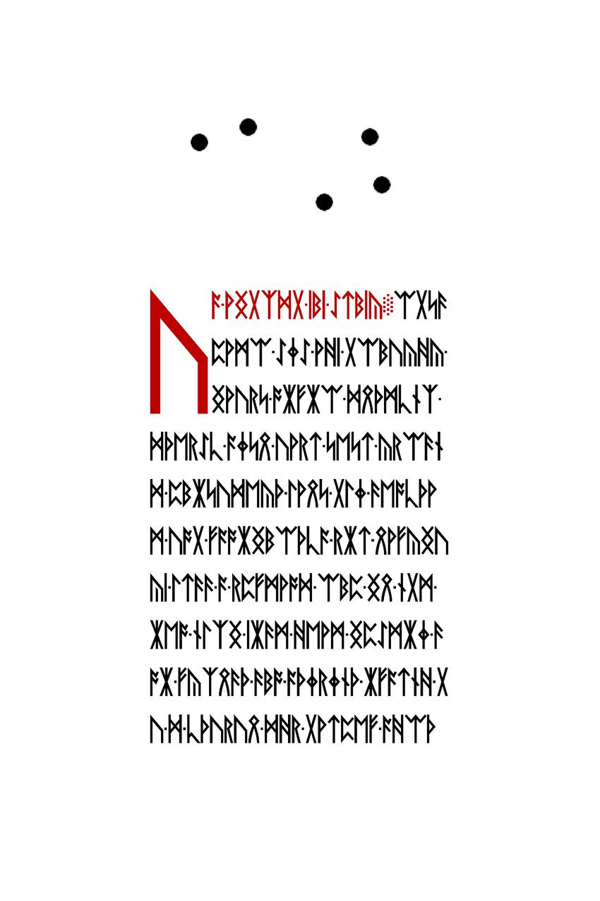

**Ciphertext** (krisyotam verbatim; `-` word separator, `.` = sentence dot (see p56 L1 `END.`), `/` = line end; standalone `&` (18×) / `$` (9×) / `§` (1×, book end p57) are krisyotam's transcription of the red dot-matrix ornaments — cipher-stream content, size mapping unconfirmed; `*` = red ink on owner-confirmed spans; `⟦'⟧`/`⟦"⟧` = image-only punctuation absent from the transcription, ≈word slot estimated. Line numbers = krisyotam lines (≠ image lines on solved pages, which wrap mid-word); printed Roman/Arabic content is omitted by krisyotam and appended below where known):

```
 1  ᚢ*ᚪ*-*ᚹ*ᛝ*ᚷ*ᛉ*ᛞ*ᚷ*-*ᛁ*ᛒ*ᛁ*-*ᛇ*ᛏ*ᛒ*ᛁ*ᚣ*◆13*ᛠᚷᛋᚫ/   = U*A* *W*NG*G*X*D*G* *I*B*I* *EO*T*B*I*Y*¶*EAGSAE/
 2  ᛈᚹᛗᛠ-ᛇᛄᛇ-ᚹᚻᛁ-ᚷᛠᛒᚢᚣᚻᚣ-/   = PWMEA EOJEO WHI GEABUYHY /
 3  ᛝᚹᚢᚱᛋ-ᚩᛡᚠᛡᛠ-ᛞᛟᚦᛗᚳᚾᛉ-/   = NGWURS OIAFIAEA DOETHMCNX /
 4  ᛞᚦᛖᚱᛇᚳ-ᚪᛄᛋᛟ-ᚢᚹᚱᛏ-ᛋᛖᛋᛏ-ᚣᚱᛠᚫᚾ/   = DTHEREOC AJSOE UWRT SEST YREAAEN/
 5  ᛞ-ᛈᛒᛡᛋᚢᛞᛖᚣᚦ-ᛚᚹᛟᛋ-ᚷᛚᛄ-ᚫᛖᚩᚳᚦᚹ/   = D PBIASUDEYTH LWOES GLJ AEEOCTHW/
 6  ᛗ-ᚢᚩᚷ-ᚠᚪᚩᛡᛝᛒᛠᚦᚳᚪ-ᚱᛡᛏ-ᛟᚹᚠᚣᛝᚢ/   = M UOG FAOIANGBEATHCA RIAT OEWFYNGU/
 7  ᚣᛁ-ᛚᛏᚫᚫ-ᚪ-ᚱᛈᚠᛗᚹᚩᛞ-ᛠᛒᛈ-ᛝᛟ-ᚾᚷᛗ-/   = YI LTAEAE A RPFMWOD EABP NGOE NGM /
 8  ᛡᛖᚩ-ᚾᛚᛉᛝ-ᛁᛡᚫᛗ-ᚻᛖᚹᛗ-ᛝᛈᛇᛗᛡᛄ-ᚫ/   = IAEO NLXNG IIAAEM HEWM NGPEOMIAJ AE/
 9  ᚩᛡ-ᚠᚣᛉᛟᚫᚦ-ᚫᛒᚩ-ᚪᚦᛄᚱᛄᚾᚦ-ᛡᚠᚪᛏᚾᚻ-ᚷ/   = OIA FYXOEAETH AEBO ATHJRJNTH IAFATNH G/
10  ᚢ-ᛞ-ᚳᚦᚢᚱᚢᛟ-ᛞᚻᚱ-ᚷᚹᛏᛈᛖᚠ-ᚪᚻᛠᚦ/   = U D CTHURUOE DHR GWTPEF AHEATH/
```

**Notes: dots at top could be "decoration" or could be clue**

## p24 (unsolved)

Known: —


**Ciphertext** (krisyotam verbatim; `-` word separator, `.` = sentence dot (see p56 L1 `END.`), `/` = line end; standalone `&` (18×) / `$` (9×) / `§` (1×, book end p57) are krisyotam's transcription of the red dot-matrix ornaments — cipher-stream content, size mapping unconfirmed; `*` = red ink on owner-confirmed spans; `⟦'⟧`/`⟦"⟧` = image-only punctuation absent from the transcription, ≈word slot estimated. Line numbers = krisyotam lines (≠ image lines on solved pages, which wrap mid-word); printed Roman/Arabic content is omitted by krisyotam and appended below where known):

```
 1  ᛞᚱᚠ-ᛖᛄᚫ-ᚾᚳᚻᚹ-ᛇᛡᛈᛠᚹ-ᛗᛚ-ᚹᛟᚹᛠ-ᚪ/   = DRF EJAE NCHW EOIAPEAW ML WOEWEA A/
 2  ᚾᚪ-ᚳᚪ-ᚷᛚᚦᛒᚩᚹᚢ-ᚷᛚᚠᛋᚻ-ᚾᛉᛝᛗ-ᛖᚦᚢᛝ/   = NA CA GLTHBOWU GLFSH NXNGM ETHUNG/
 3  ᛡ-ᛈᚣᚢ-ᛉᚷᚷ-ᚹᛞᛁᛋ-ᚦᛡᛡᛈᚳᚪᚩ-ᚢᛗᚢ/   = IA PYU XGG WDIS THIAIAPCAO UMU/
 4  ᛉᚩᚣᚻᛏ-ᚩᚫᛗᚢ-ᚩᚾᛏᛠᛒᛟᛒᚠᛁᛈ-ᛚᛋᛝᚫᚳ/   = XOYHT OAEMU ONTEABOEBFIP LSNGAEC/
 5  -ᚫᛟᛏ-ᚢᚩᛉᚾᛡᛋᚠᛖ-ᛉᚱ-ᛗᚩᚩᚫ-ᚠᚢᚦᛖᛞᚾ/   =  AEOET UOXNIASFE XR MOOAE FUTHEDN/
 6  ᚣ-ᛡᛋ-ᛋᚱᛚᛟ-ᚢᚻ◆4ᚢᚾᛈ-ᛁᚻ-ᛖᛉ-ᚦᛞᛗ-ᛈᛟ/   = Y IAS SRLOE UH.UNP IH EX THDM POE/
 7  ᚠ-ᛈᚠᛝᚫᛝᛋ-ᛟᛄᚹ-ᛠᛒᚣ-ᛟᚹᛞ◆4ᚠᚣᛄᛁᛏᛉ/   = F PFNGAENGS OEJW EABY OEWD.FYJITX/
 8  ᛚ-ᚩᚦᛝ-ᚠᚪᛋᛡᛁᚻᛒᚱ-ᚪᚢᚣ-ᚫᚢ-ᛟᛠᚪᚣ-ᛖᛟ/   = L OTHNG FASIAIHBR AUY AEU OEEAAY EOE/
 9  ᚫ-ᛖᛈᚠᛒ-ᛈᛄᛁ◆4ᛋᛝᛒ-ᚱᚦᚳᛇ-ᛚᛁᚢᛈᛏᚳᛒᛉ-/   = AE EPFB PJI.SNGB RTHCEO LIUPTCBX /
10  ᛖᚪᚣᚠᛗᚳᚣᚱ-ᚻᚹᛏᚾᛡᛉᚫᚦᛟ-ᚳᚹ-ᛠᚠ-ᛏ/   = EAYFMCYR HWTNIAXAETHOE CW EAF T/
11  ᛠ-ᛝᚩᚻ-ᛡᛠᛒᛋᚻᛟ-ᚫᛁ-ᛠᛏᛁᛋ-ᛏᚫᚻᚱ-ᚻᛄ/   = EA NGOH IAEABSHOE AEI EATIS TAEHR HJ/
12  ᛋᛡᚹᚾᚾᛡᚹᛚ-ᚢᛖ-ᛏ-ᚱᛝᚳᚣ-ᚪᛉᛇᛝᛋᛖᛇᛁ/   = SIAWNNIAWL UE T RNGCY AXEONGSEEOI/
```

**Notes:**

## p25 (unsolved)

Known: —


**Ciphertext** (krisyotam verbatim; `-` word separator, `.` = sentence dot (see p56 L1 `END.`), `/` = line end; standalone `&` (18×) / `$` (9×) / `§` (1×, book end p57) are krisyotam's transcription of the red dot-matrix ornaments — cipher-stream content, size mapping unconfirmed; `*` = red ink on owner-confirmed spans; `⟦'⟧`/`⟦"⟧` = image-only punctuation absent from the transcription, ≈word slot estimated. Line numbers = krisyotam lines (≠ image lines on solved pages, which wrap mid-word); printed Roman/Arabic content is omitted by krisyotam and appended below where known):

```
 1  ᚻᚾ-ᚷ-ᚹᛉᚳᛉᚣ-ᛋᛈᚳᛟᚱ-ᛒᚣᛄᛝᛖᛁ-ᚾᚷᚪ-/   = HN G WXCXY SPCOER BYJNGEI NGA /
 2  ᚣᚷ-ᛚᛒ-ᚢᛄᚩ-ᛝᛉᛉᚪᛖ-ᛒᚦᛉᛡᚱ◆4ᛏᚷᚹᛄᛋ/   = YG LB UJO NGXXAE BTHXIAR.TGWJS/
 3  ᛁᚠ-ᛠᛁᛡᚦᛝᚾᛖᚾᚠᚩᛗᛖᚣᚪ-ᚳᛖᚳᚹᚪᚫᚹ-ᛇ/   = IF EAIIATHNGNENFOMEYA CECWAAEW EO/
 4  ᚢᚦᚻᛉᚢᚾ-ᛠᛚᚢᚾᚦᛈᛋᚢᛈᚱ-ᛞᚫᛟᚱᛡᚫᚪ/   = UTHHXUN EALUNTHPSUPR DAEOERIAAEA/
 5  ᚢ-ᚢᛗᛚᚦᛠ-ᛚᛝᛈᚣ-ᚩᛋᛟᚪᚱᛗᚦᛟᛈ-ᛚᛋ-ᛏᛁ/   = U UMLTHEA LNGPY OSOEARMTHOEP LS TI/
 6  ᚠᛋᛖᚹᛝ-ᛗᛞᚩ-ᛠᚫᛡᛒᛏᚩᛋ-ᛖᛏᚪᚠ-ᚫᛒ-ᛚᚾ-/   = FSEWNG MDO EAAEIABTOS ETAF AEB LN /
 7  ᛋᚪᛉᛟ-ᚾᛚᚹᛖ-ᚩᛚᛁᛄᛏ-ᛒᚪᚠᛉᛏ-ᚩᛟᛄ-ᚾᚷᛋ-/   = SAXOE NLWE OLIJT BAFXT OOEJ NGS /
 8  ᚷᛚᚷᛠ-ᛒᚷᛖᚩᚪᚩᛖᛞ-ᚷᛇᛗ-ᚳᚱᚷ-ᛈᛞᚩᚠᚹ/   = GLGEA BGEOAOED GEOM CRG PDOFW/
 9  ᛇ-ᛠᛞᚣᛝ-ᚾᛁᚠᛈᛚ◆4ᛖᛟ-ᚢᚳᛗ-ᛚᚫᛏᛉᛄᚱ/   = EO EADYNG NIFPL.EOE UCM LAETXJR/
10  ᛉ-ᛁᛠᚷᛚ-ᚷᚳᛋᚩᛝ-ᚫᚦ-ᛗᚻᛟᚠ-ᚱᛋᚳᚦ-ᚣᚩ-ᛒᛁ/   = X IEAGL GCSONG AETH MHOEF RSCTH YO BI/
11  ᚫᚻᛖᚢᛏᛚᛚ-ᛇᚷᛟᚣ-ᛒᚾᚦᚻ-ᛠᛖᛄᛒᚾᛁᛚᛠ/   = AEHEUTLL EOGOEY BNTHH EAEJBNILEA/
12  ᚱ-ᛄᚠᚳᛋᛝᚳᛈ-ᚷᚻᛋᛗ-ᛇᛞᛇ-ᚣ-ᛡᛖᛏᛠᚢ/   = R JFCSNGCP GHSM EODEO Y IAETEAU/
```

**Notes:**

## p26 (unsolved)

Known: red only via dot-lattice (section terminator)


**Ciphertext** (krisyotam verbatim; `-` word separator, `.` = sentence dot (see p56 L1 `END.`), `/` = line end; standalone `&` (18×) / `$` (9×) / `§` (1×, book end p57) are krisyotam's transcription of the red dot-matrix ornaments — cipher-stream content, size mapping unconfirmed; `*` = red ink on owner-confirmed spans; `⟦'⟧`/`⟦"⟧` = image-only punctuation absent from the transcription, ≈word slot estimated. Line numbers = krisyotam lines (≠ image lines on solved pages, which wrap mid-word); printed Roman/Arabic content is omitted by krisyotam and appended below where known):

```
 1  ᛡ-ᚩᚾᛠᚩ-ᛄᚣᛇᛉᛠᚪᛡ-ᚾᛞᛝᚻ-ᛈᛠᚻᛡ/   = IA ONEAO JYEOXEAAIA NDNGH PEAHIA/
 2  ᚢ-ᛝᚻᚦᛈ-ᛉᚢ-ᛠᚣᛈᛟᚦᛋᚣᛈ-ᚠᛏ-ᛒᛁᛟᚪᚷ/   = U NGHTHP XU EAYPOETHSYP FT BIOEAG/
 3  ᛚ-ᛠᚻ-ᛝᛁᛡᛚᛝᚾᛞᚪᛈᚷ-ᚾᛏᚦᛋᛒ-ᛋᛋᛠ-ᚷᚳ/   = L EAH NGIIALNGNDAPG NTTHSB SSEA GC/
 4  -ᛠᛗᚢ-ᛖᛉᛒᚷᚫᚠᚩᛁᛉ◆4ᚠᚪ-ᛠᚱᛇ-ᚩᛁᛞᛋᛚ/   =  EAMU EXBGAEFOIX.FA EAREO OIDSL/
 5  ᚦᛖᛒᛇ-ᛟᚷᚣᚷᚾᚷ-ᚦᚠᚳᛗ-ᚩᛖᛖ-ᚩᚠᛒᚻᛝ-ᚳᛁ/   = THEBEO OEGYGNG THFCM OEE OFBHNG CI/
 6  ᛄᚪᚾᚩᚪ-ᛈᚻᚱᛗ-ᚱᛗᛟ-ᚦᚷᛄ-ᛒᚱᚦᚪᛠ-ᛉᛖᛡ/   = JANOA PHRM RMOE THGJ BRTHAEA XEIA/
 7  ᛞᚦ-ᚱᛝᛄᛒ-ᚾᛏᚣ-ᛏᛋᛒᚾᚫ-ᚢᛖᛁᚩᛡ-ᛄᛇᚢᚦᛚ/   = DTH RNGJB NTY TSBNAE UEIOIA JEOUTHL/
 8  ᚳᛖ-ᛚᛁ-ᛒᚢᚠᚪᚱᛠ-ᛗᛒ-ᛞᛉᛗ-ᚢᛠᛏᚣ-ᚪᛄ/   = CE LI BUFAREA MB DXM UEATY AJ/
 9  ᛈᚢᛈᛠᚣᚷ-ᛗᛡᛗᚢᚪᛗᛝ-ᚣᛡ.ᚪᛖᛏ-ᛖ/   = PUPEAYG MIAMUAMNG YIA.AET E/
10  ᛋᚪᛟ-ᚳᚻᛁᛋᚠᛁᚾ-ᛈᛟᛝ-ᛇᚦᚣᛏᚫᛉ-ᛖᛟᛏ-ᛞᛡ/   = SAOE CHISFIN POENG EOTHYTAEX EOET DIA/
11  ᛚᛖᛈᛏᚪ-ᛏᚠᚱᚾ-ᚪᛠᚱ-ᛠᚳ-ᚾᚻᚹᛒᛇᛋ-ᛁᚻᚣ/   = LEPTA TFRN AEAR EAC NHWBEOS IHY/
12  ᛋᚹᚩᛉᚹ-ᚩᛝᚢ-ᚻᛝᛟ-ᛏᛚᚠ-ᛄᚷᛏᛝᛄᛝ◆13*/   = SWOXW ONGU HNGOE TLF JGTNGJNG¶*/
13  &
14  $
```

**Notes:**

## p27 (unsolved)

Known: red head word (line 1) ** red words with red 13 dot lattice at end

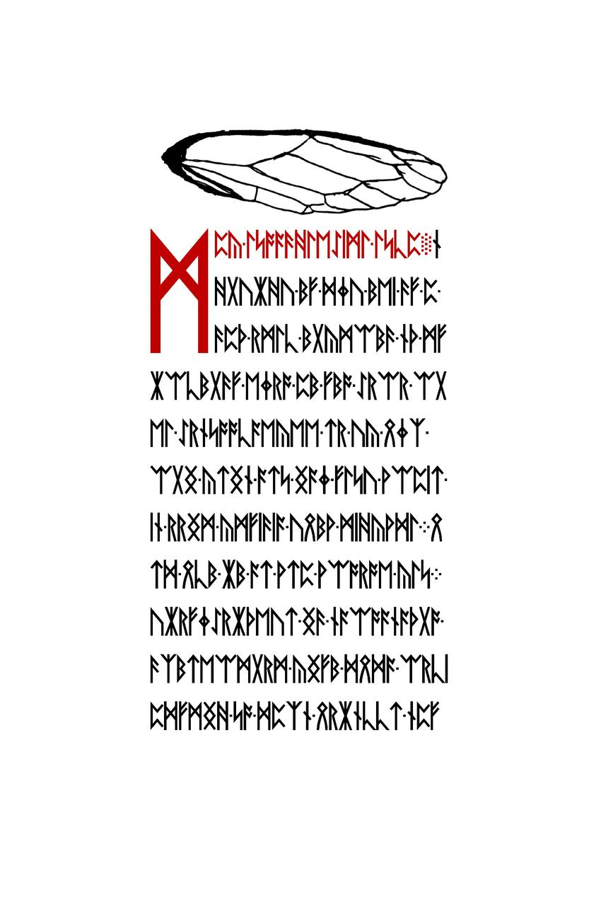

**Ciphertext** (krisyotam verbatim; `-` word separator, `.` = sentence dot (see p56 L1 `END.`), `/` = line end; standalone `&` (18×) / `$` (9×) / `§` (1×, book end p57) are krisyotam's transcription of the red dot-matrix ornaments — cipher-stream content, size mapping unconfirmed; `*` = red ink on owner-confirmed spans; `⟦'⟧`/`⟦"⟧` = image-only punctuation absent from the transcription, ≈word slot estimated. Line numbers = krisyotam lines (≠ image lines on solved pages, which wrap mid-word); printed Roman/Arabic content is omitted by krisyotam and appended below where known):

```
 1  ᛗ*ᛈ*ᚣ*-*ᛚ*ᛋ*ᚩ*ᚪ*ᚫ*ᚻ*ᛚ*ᛖ*ᛇ*ᛁ*ᛗ*ᛚ*-*ᛚ*ᛋ*ᚳ*ᛈ*◆13*ᚾ/   = M*P*Y* *L*S*O*A*AE*H*L*E*EO*I*M*L* *L*S*C*P*¶*N/
 2  ᚻᚷᚢᛡᚻᚢ-ᛒᚠ-ᛞᛄᚢ-ᛒᛖᛁ-ᚫᚠ-ᛈ-/   = HGUIAHU BF DJU BEI AEF P /
 3  ᚫᛈᚦ-ᚱᛗᛚᚳ-ᛒᚷᚣᛗᛠᛒᚫ-ᚾᚦ-ᛗᚠ/   = AEPTH RMLC BGYMEABAE NTH MF/
 4  ᛡᛠᚳᛒᚷᚫᚠ-ᛖᛄᚱᚩ-ᛈᛒ-ᚠᛒᚩ-ᛇᚱᛠᚱ-ᛠᚷ/   = IAEACBGAEF EJRO PB FBO EOREAR EAG/
 5  ᛖᛚ-ᛇᚱᚾᛋᚩᚩᚳᚪᛖᚣᛖᛖ-ᛏᚱ-ᚢᚣ-ᛟᛄᛉ-/   = EL EORNSOOCAEYEE TR UY OEJX /
 6  ᛠᚷᛝ-ᚣᛏᛝᚾ-ᚪᛏᛋ-ᛝᚪᛄ-ᚠᛚᛋᚢ-ᚹᛠᛈᛁᛏ-/   = EAGNG YTNGN ATS NGAJ FLSU WEAPIT /
 7  ᛁᚾ-ᚱᚱᛝᛗ-ᚣᛗᚠᛁᚫᛁᚪ-ᚢᛟᛒᚹ-ᛗᛁᚻᚣᚹᛞᛚ.ᛟ/   = IN RRNGM YMFIAEIA UOEBW MIHYWDL.OE/
 8  ᛏᛞ-ᛟᚳᛒ-ᛡᛒ-ᚪᛏ-ᚹᛏᛈ-ᚹᛠᚩᚱᚩᛖ-ᚣᛚᛋ./   = TD OECB IAB AT WTP WEAOROE YLS./
 9  ᚢᛡᚱᚠᛄᛇᚱᛡᚦᛖᚢᛏ-ᛝᚫ-ᚾᚪᛠᚩᚪᚾᚪᚦᚷᚩ-/   = UIARFJEORIATHEUT NGAE NAEAOANATHGO /
10  ᚫᛉᛒᛏᛖᛠᛗᚷᚱᛗ-ᚣᛝᚠᛒ-ᛞᛟᛞᚪ-ᛠᚱᚳᛁ/   = AEXBTEEAMGRM YNGFB DOEDA EARCI/
11  ᛈᛞᚠᛗᛝᚻ-ᛋᚩ-ᛞᛈᛉᚾ-ᛟᚱᛡᚾᚳᚳᛏ-ᚾᛈᚠ/   = PDFMNGH SO DPXN OERIANCCT NPF/
```

**Notes:**

## p28 (unsolved)

Known: —


**Ciphertext** (krisyotam verbatim; `-` word separator, `.` = sentence dot (see p56 L1 `END.`), `/` = line end; standalone `&` (18×) / `$` (9×) / `§` (1×, book end p57) are krisyotam's transcription of the red dot-matrix ornaments — cipher-stream content, size mapping unconfirmed; `*` = red ink on owner-confirmed spans; `⟦'⟧`/`⟦"⟧` = image-only punctuation absent from the transcription, ≈word slot estimated. Line numbers = krisyotam lines (≠ image lines on solved pages, which wrap mid-word); printed Roman/Arabic content is omitted by krisyotam and appended below where known):

```
 1  ᛈᚳ-ᛄᚦᛒᛁᚹ-ᛞᚹᛝᛠᛡᚹᛚ-ᚹᛄᚾᚪᛟ-ᛏᛞᛉᚣ/   = PC JTHBIW DWNGEAIAWL WJNAOE TDXY/
 2  ᛖᚱᛞ-ᚱᛏᛇᛁᚳᛈ-ᛝ-ᚦᛟᚷᛄᚦ-ᚣᛋ-ᛠᚻ-ᚠᛒᛚ-ᛁ/   = ERD RTEOICP NG THOEGJTH YS EAH FBL I/
 3  ᚫᛚᛞᛉᚪ-ᛁᚹᚷ-ᛒᚩᚹᚾᛠ-ᛋᛖᛗᛒᛋ-ᚳᚹᚦᛟᚠᚻᚫ/   = AELDXA IWG BOWNEA SEMBS CWTHOEFHAE/
 4  -ᛞᚢᛁᛒᛞ-ᛇᛝᛈᚠᛁ-ᛟᚢᚣᛏ-ᚻᚱᛖᚾᚳᛈᛡᛈᛞ/   =  DUIBD EONGPFI OEUYT HRENCPIAPD/
 5  ᛄ-ᛁᛏᛗᛋᚫᛉᚩᚣ-ᚪᛄᛗᛡᛖ-ᛇᛄᚠᛗᚱ◆4ᛞᛟᚪᛒ/   = J ITMSAEXOY AJMIAE EOJFMR.DOEAB/
 6  ᛞᚻ-ᚾᛈᚪ-ᛇᚱᚻᚾᛝᛠᚠᚾᚠ-ᚩᛗᛋᚾ-ᛠᚪᛁᚢᛚ-/   = DH NPA EORHNNGEAFNF OMSN EAAIUL /
 7  ᚪᚫ-ᛄᛉᛡᚠ-ᛁᛖᛈᛠᚻ-ᚠᛇᚩᚹ-ᛠᛄᛇᛁᛠᚫ-ᛄ/   = AAE JXIAF IEPEAH FEOOW EAJEOIEAAE J/
 8  ᛒ-ᛋ-ᚠᛖᚷ-ᛋᛁ-ᛟᛗᛒᛁᛝᛏᚪᚢᛁᚦ-ᚩᛝᛗᚠ-ᚹᛟᛒᛟ/   = B S FEG SI OEMBINGTAUITH ONGMF WOEBOE/
 9  ᛡ-ᚠᚣᛝᚩᛠ-ᚳᛚᛈᚱ-ᛞᛄᚩᛝᛄ-ᚪᛖᛗᛈᚾ-ᚠ/   = IA FYNGOEA CLPR DJONGJ AEMPN F/
10  ᛠᚷᛞᛒ-ᚩᛉᚷᚾᚣᚷ-ᛠᛈᛄᛞᚾᛟᚩᚢᚾᚹᛗ◆4/   = EAGDB OXGNYG EAPJDNOEOUNWM./
11  ᛄ-ᚢᚷᛠ-ᛗ-ᛇᚪ◆4ᚻᚦᛡ-ᛝᛈᛞᛒ-ᚳᛉᚳ-ᛠ/   = J UGEA M EOA.HTHIA NGPDB CXC EA/
12  ᛉ-ᛟᚣ-ᛒᚦᛁᛄᛚᛡᛝᛡ-ᚹᛄᚫ-ᛋᛗᚪᛡᛠᛇᛝᛏ-/   = X OEY BTHIJLIANGIA WJAE SMAIAEAEONGT /
```

**Notes:**

## p29 (unsolved)

Known: —

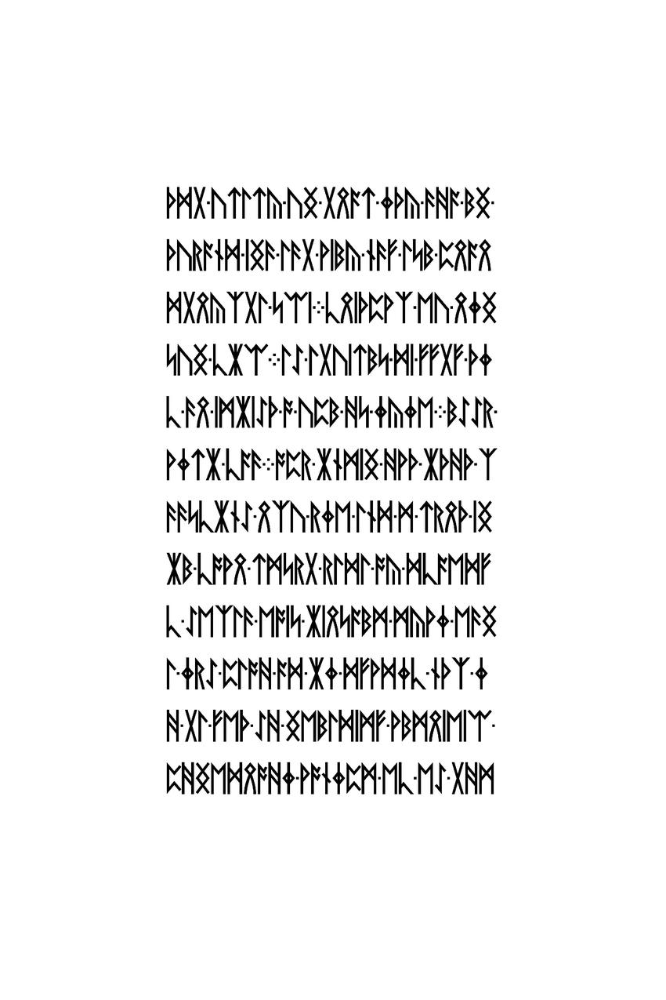

**Ciphertext** (krisyotam verbatim; `-` word separator, `.` = sentence dot (see p56 L1 `END.`), `/` = line end; standalone `&` (18×) / `$` (9×) / `§` (1×, book end p57) are krisyotam's transcription of the red dot-matrix ornaments — cipher-stream content, size mapping unconfirmed; `*` = red ink on owner-confirmed spans; `⟦'⟧`/`⟦"⟧` = image-only punctuation absent from the transcription, ≈word slot estimated. Line numbers = krisyotam lines (≠ image lines on solved pages, which wrap mid-word); printed Roman/Arabic content is omitted by krisyotam and appended below where known):

```
 1  ᚦᛞᚷ-ᚢᛏᛚᛏᚣ-ᚢᛝ-ᚷᛟᚪᛏ-ᛄᚦᚣ-ᚫᚻᚪ-ᛒᛝ-/   = THDG UTLTY UNG GOEAT JTHY AEHA BNG /
 2  ᚦᚢᚱᚪᚾᛞ-ᛁᛝᚫ-ᛚᚫᚷ-ᚹᛁᛒᚣ-ᚾᚫᚠ-ᛚᛋᛒ-ᛈᛟᚪᛟ/   = THURAND INGAE LAEG WIBY NAEF LSB POEAOE/
 3  ᛞᚷᛟᚣᛉᚷᛚ-ᛋᛠᛁ◆4ᚳᛟᛁᚦᛈᚹᛉ-ᛖᚢ-ᛟᛄᛝ/   = DGOEYXGL SEAI.COEITHPWX EU OEJNG/
 4  ᛋᚢᛝ-ᚳᛡᛠ◆4ᛚᛇ-ᛚᚷᚢᛁᛏᛒᛋ-ᛞᛁ-ᚠᚠᚷᚠ-ᚦᛄ/   = SUNG CIAEA.LEO LGUITBS DI FFGF THJ/
 5  ᚳ-ᚫᛟ-ᛁᛗᛡᛁᛇᚦ-ᚩ-ᚢᛈᛒ-ᚻᛋ-ᛄᚣᛄᛖ.ᛒᛇᛇᚱ-/   = C AEOE IMIAIEOTH O UPB HS JYJE.BEOEOR /
 6  ᚹᛄᛏᛡ-ᚳᚪᚫ.ᚩᛈᚱ-ᛡᚾᛗᛁᛝ-ᚻᚹᚦ-ᛡᚦᚻᚦ-ᛉ/   = WJTIA CAAE.OPR IANMING HWTH IATHHTH X/
 7  ᚫᚫᛋᚳᛡᚾᛇ-ᛟᛉᚢ-ᚱᛄᛖ-ᛚᚾᛞ-ᛗ-ᛏᚱᛟᚦ-ᛁᛝ/   = AEAESCIANEO OEXU RJE LND M TROETH ING/
 8  ᛡᛒ-ᚳᚩᚹᛟ-ᛏᛗᛋᚱᚷ-ᚱᛚᛞᛚ-ᚩᚣ-ᛞᚳᚪᛖᛞᚠ/   = IAB COWOE TMSRG RLDL OY DCAEDF/
 9  ᚳ-ᛇᛖᛉᛚᚫ-ᛖᚩᛁᛋ-ᛡᛁᛟᛋᚪᛒᛗ-ᛗᚣᚹᛄ-ᛖᚫᛝ/   = C EOEXLAE EOIS IAIOESABM MYWJ EAENG/
10  ᛚ-ᛄᚱᛇ-ᛈᛚᚩᚻ-ᚪᛞ-ᛡᛄ-ᛞᚠᚹᛞᛄᚳ-ᚾᚦᛉ-ᛄ/   = L JREO PLOH AD IAJ DFWDJC NTHX J/
11  ᚻ-ᚷᛚ-ᚠᛖᚦ-ᛇᚻ-ᛝᛖᛒᛚᛞᛁᛗᚠ-ᚹᛒᛗᛟᛁᛖᛁᛠ-/   = H GL FETH EOH NGEBLDIMF WBMOEIEIEA /
12  ᛈᚻᛝᛖᛞᛟᚩᚻᛄ-ᚹᚩᚾᛄᛈᛗ-ᛖᚳ-ᛖᛇ-ᚷᚻᛗ/   = PHNGEDOEOHJ WONJPM EC EEO GHM/
```

**Notes:**

## p30 (unsolved)

Known: —


**Ciphertext** (krisyotam verbatim; `-` word separator, `.` = sentence dot (see p56 L1 `END.`), `/` = line end; standalone `&` (18×) / `$` (9×) / `§` (1×, book end p57) are krisyotam's transcription of the red dot-matrix ornaments — cipher-stream content, size mapping unconfirmed; `*` = red ink on owner-confirmed spans; `⟦'⟧`/`⟦"⟧` = image-only punctuation absent from the transcription, ≈word slot estimated. Line numbers = krisyotam lines (≠ image lines on solved pages, which wrap mid-word); printed Roman/Arabic content is omitted by krisyotam and appended below where known):

```
 1  ᛞᚪᛈᛖ-ᛗ-ᛉᚫᛒᛇᚱ-ᛖᚣᛟᚣ-ᚱᛠᛈᚢᛠ-ᚣ/   = DAPE M XAEBEOR EYOEY REAPUEA Y/
 2  ᛖᚪᚻ-ᚩᛉᛠᚢᚻᛡᛟ-ᚷᚫᚩᛒᛉ-ᚫᚱᛞᛋᚩᚱ-ᚷ/   = EAH OXEAUHIAOE GAEOBX AERDSOR G/
 3  ᛠ-ᛉᚻᛁ-ᚷᚳᛞᛠᛡᚳ-ᛄᛠᛉᛇᚻᛋᚹ-ᛝᛡᚷ/   = EA XHI GCDEAIAC JEAXEOHSW NGIAG/
 4  ᛖᛡᚣ-ᛠᚩᚷ-ᚱᚦᚠᛟᚩᚦ-ᚦᛁᛏᚱ-ᛇᛉᛇ-ᚢᚷᛠ-/   = EIAY EAOG RTHFOEOTH THITR EOXEO UGEA /
 5  ᛟᛏ-ᚩᚠᛚ-ᛟᛝᛈ-ᚱᛡᚪᚩᛏ-ᚩᛠᚷᚫᛗ-ᛈᛋᚱ-ᛖ/   = OET OFL OENGP RIAAOT OEAGAEM PSR E/
 6  ᚦᚠ-ᛞᚹᚾᛚ-ᛝᚩᛇᛄ-ᚳᛚᚢᚹᛏ-ᚩᛖᛏᚠᚪᛚ-ᛟᛇᛟ-/   = THF DWNL NGOEOJ CLUWT OETFAL OEEOOE /
 7  ᛠᚱᛇ-ᚢᚪᚦᛈᛟᛡᛉ◆4ᛡᛒᚱᛒᚠᚢᛚᚢᛟ-ᛒᛇᛒ-/   = EAREO UATHPOEIAX.IABRBFULUOE BEOB /
 8  ᛉᚦᚹ-ᛝᚣᛖ-ᚳᚫᚣᛟ-ᚹᛁᛝᚫᛏ-ᚫᛇᛈᛡᛟᚠ-ᛚ-ᛝ/   = XTHW NGYE CAEYOE WINGAET AEEOPIAOEF L NG/
 9  ᚠᛡ.ᛞᚪᛚᛈ-ᛋᛁ-ᚢᚣᚪᛚᛠᛝᚹ-ᚪᛏᛈᚳᚣ-ᛝᚫ/   = FIA.DALP SI UYALEANGW ATPCY NGAE/
10  ᚻᛗᛞᚷᛚ◆4ᛠᛉᛒ-ᛇᛡᛋᛖ-ᚣᛁᛚ-ᚣᛠᚣ-ᚻ◆4/   = HMDGL.EAXB EOIASE YIL YEAY H./
11  ᚣᛉᚾᛏᚫᛉᛋᚦᚪᚹᛗ-ᚪᚱ-ᚪᚩᚻ◆4ᛗᛖᚫᛞᛠᛁᛗ/   = YXNTAEXSTHAWM AR AOH.MEAEDEAIM/
12  -ᛒᛟᚾᚳᚩᚱᛉ-ᛋᚹᚫ-ᚻᛖ-ᛋᚠᚾ-ᚢᚦᛟᚷᛖᚪᛟᛇᛇ-/   =  BOENCORX SWAE HE SFN UTHOEGEAOEEOEO /
```

**Notes:**

## p31 (unsolved)

Known: —

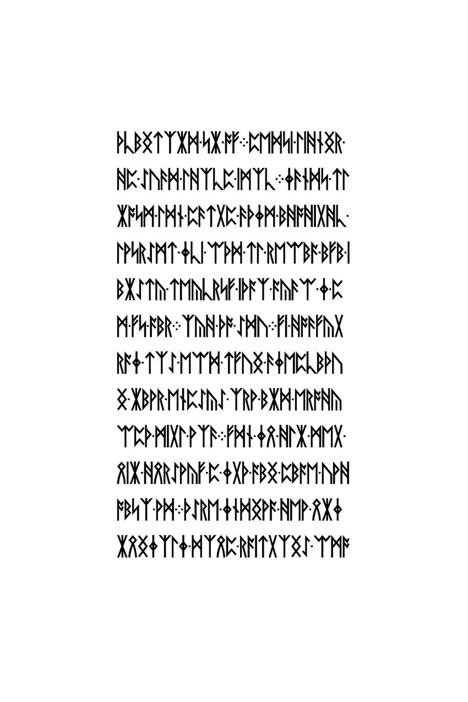

**Ciphertext** (krisyotam verbatim; `-` word separator, `.` = sentence dot (see p56 L1 `END.`), `/` = line end; standalone `&` (18×) / `$` (9×) / `§` (1×, book end p57) are krisyotam's transcription of the red dot-matrix ornaments — cipher-stream content, size mapping unconfirmed; `*` = red ink on owner-confirmed spans; `⟦'⟧`/`⟦"⟧` = image-only punctuation absent from the transcription, ≈word slot estimated. Line numbers = krisyotam lines (≠ image lines on solved pages, which wrap mid-word); printed Roman/Arabic content is omitted by krisyotam and appended below where known):

```
 1  ᚦᚳᛒᛝᛏᛉᛡᛞ-ᛋᛡ-ᚩᚠ◆4ᛈᛖᛞᛋᛁ-ᛚᛁᚻᚾᛝᚱ-/   = THCBNGTXIAD SIA OF.PEDSI LIHNNGR /
 2  ᚻᛈ-ᛇᚢᚫᛞ-ᛚᚻᛉᚳᛈ-ᛁᛗᛉᚳ◆4ᛄᚫᚾᛞᛋ-ᛏᛚ/   = HP EOUAED LHXCP IMXC.JAENDS TL/
 3  ᛡᚩᛋᛗ-ᛚᛞᚾ-ᛈᚫᛏᚷᛈ-ᚫᚦᛄᛗ-ᛒᚻᚩᚻᛁᚷᚻᚳ-/   = IAOSM LDN PAETGP AETHJM BHOHIGHC /
 4  ᛚᚹᛋᚱᛇᛗᛏ-ᛄᚳᛁ-ᛠᚦᛞ-ᛏᛚ-ᚱᛖᛠᛒᚪ-ᛒᚠᛒ-ᛁ/   = LWSREOMT JCI EATHD TL REEABA BFB I/
 5  ᛒᛡᛇᛏᚣ-ᛏᛖᚣᚳᚱᛋᚠ-ᛁᚦᚪᛉ-ᚪᚣᚫᛠ-ᛄ-ᛈ/   = BIAEOTY TEYCRSF ITHAX AYAEEA J P/
 6  ᛗ-ᚠᛋ-ᚪᛒᚱ◆4ᛉᚣᚻ-ᚦᚩ-ᛇᛞᚢ◆4ᚠᛁ-ᚻᚩᚫᚠᚣᚷ/   = M FS ABR.XYH THO EODU.FI HOAEFYG/
 7  ᚱᚪᛄ-ᛏᛉᛇ-ᛖᛠᛞ-ᛏᚠᚢᛝ-ᚫᛄᛖᛈᚳᛒᚦᚢ/   = RAJ TXEO EEAD TFUNG AEJEPCBTHU/
 8  ᛝ-ᛡᛒᚹᚱ-ᛖᚾᛈᛇᚣᛇ-ᛉᚱᚹ-ᛒᛡᛞ-ᛖᚱᚩᚻᚣ/   = NG IABWR ENPEOYEO XRW BIAD EROHY/
 9  ᛠᛈᚦ-ᛗᛁᚷᛚ-ᚹᛉᚫ◆4ᚠᛞᚾ-ᛄᛟ-ᚻᛚᛡ-ᛗᛖᚷ-/   = EAPTH MIGL WXAE.FDN JOE HLIA MEG /
10  ᛟᛁᛡ-ᚻᛟᚱᛇᚹᚣᚠ-ᛈ-ᛄᚷᚦ-ᚪᛒᛝ-ᛈᛒᚪᛖ-ᚢᚹᚻ/   = OEIIA HOEREOWYF P JGTH ABNG PBAE UWH/
11  ᚩᛒᛋᛉ-ᚹᛞ◆4ᚦᛇᚱᛖ-ᛄᚾᛞᛝᚹᚪ-ᚻᛖᚹ-ᛟᛡᛄ/   = OBSX WD.THEORE JNDNGWA HEW OEIAJ/
12  ᛡᛟᛝᛄᛉᛚᛄ-ᛞᛉᛟᛈ-ᚱᚪᛁᛏᚷᛉᛝᛇ-ᛠᛗᚩ/   = IAOENGJXLJ DXOEP RAITGXNGEO EAMO/
```

**Notes:**

## p32 (unsolved)

Known: red only via dot-lattice (section terminator)


**Ciphertext** (krisyotam verbatim; `-` word separator, `.` = sentence dot (see p56 L1 `END.`), `/` = line end; standalone `&` (18×) / `$` (9×) / `§` (1×, book end p57) are krisyotam's transcription of the red dot-matrix ornaments — cipher-stream content, size mapping unconfirmed; `*` = red ink on owner-confirmed spans; `⟦'⟧`/`⟦"⟧` = image-only punctuation absent from the transcription, ≈word slot estimated. Line numbers = krisyotam lines (≠ image lines on solved pages, which wrap mid-word); printed Roman/Arabic content is omitted by krisyotam and appended below where known):

```
 1  ᛚ-ᚦᚫᚹ-ᚫᚢᛈᛡᚳ-ᚹᛝᚻᚹᛒᛗᛋᛟᛖᛁᛡ-ᛟᚹᚦᚻᛒ/   = L THAEW AEUPIAC WNGHWBMSOEEIIA OEWTHHB/
 2  -ᛡᚱᛏᚦᚠ-ᚠᚩᚦ◆4ᚻᚩᛗᛖᛉᚹᛞᛋᛚᚠᛞ-ᛝᛒᛇᛡ/   =  IARTTHF FOTH.HOMEXWDSLFD NGBEOIA/
 3  ᛚᚪ-ᚹᛞᚾᚫᛉᛏᚣᛗᚷ-ᚦᚹᛉᛡᚦ-ᚹᛒᛋᚱᛉᛡᛉ/   = LA WDNAEXTYMG THWXIATH WBSRXIAX/
 4  ᚪ-ᚢᛒᚻᛠ-ᚹᛝᚢᚻᛇᛝᛡᛠᛄ-ᛋᛈᚦᛏ-ᛟᛝᚩ/   = A UBHEA WNGUHEONGIAEAJ SPTHT OENGO/
 5  ᛗᛒᚢᛞᛋ-ᛒᛄ-ᛠᚱᛟ-ᛖᚾ-ᚾᚹᚷᚢᛚᚪᚩᚣ-ᚢᛏ/   = MBUDS BJ EAROE EN NWGULAOY UT/
 6  ᚠᛄᛏ-ᚪᚷᛒᛇ◆13*/   = FJT AGBEO¶*/
 7  &
 8  $   red 13-dot lattice (section terminator)
```

**Notes:**

## p33 (unsolved)

Known: red head word (line 1) ** words, plus terminating red 13 dot lattice line 5**;  **red head words line 6** black stamp device (top; p33 footer). my reading of the black stamp right now: < YYYYYYY < YYY <<<<< YYYYY *

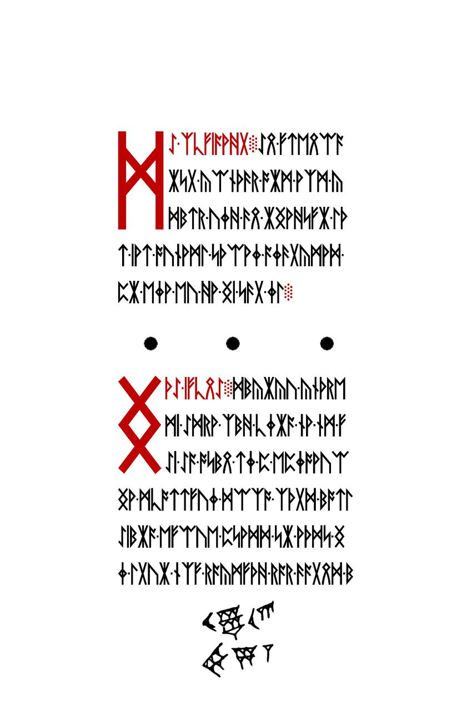

**Ciphertext** (krisyotam verbatim; `-` word separator, `.` = sentence dot (see p56 L1 `END.`), `/` = line end; standalone `&` (18×) / `$` (9×) / `§` (1×, book end p57) are krisyotam's transcription of the red dot-matrix ornaments — cipher-stream content, size mapping unconfirmed; `*` = red ink on owner-confirmed spans; `⟦'⟧`/`⟦"⟧` = image-only punctuation absent from the transcription, ≈word slot estimated. Line numbers = krisyotam lines (≠ image lines on solved pages, which wrap mid-word); printed Roman/Arabic content is omitted by krisyotam and appended below where known):

```
 1  ᛞ*ᛇ*-*ᛉ*ᚳ*ᚠ*ᛁ*ᚪ*ᚹ*ᚻ*ᚷ*◆13*ᛇᛟ-ᚠᛏᛖᛟᛠᚪ/   = D*EO* *X*C*F*I*A*W*H*G*¶*EOOE FTEOEEAA/
 2  ᛡᛋᚷ-ᚣᛠᚾᚦᚫᚱ-ᚩᛡᛗ-ᚹᛉᛗ-ᚣ/   = IASG YEANTHAER OIAM WXM Y/
 3  ᛞᛒᛏᚱ-ᚢᛄᚻ-ᚫᛟ-ᛡᛝᚹᚻᛋᚠᛡ-ᛚᚦ/   = DBTR UJH AEOE IANGWHSFIA LTH/
 4  ᛏ-ᛁᚹᛏ-ᚩᚢᚾᚹᛗᛚ-ᛋᚦᛠᚹᛄ-ᚪᛄᚫᚷᚣᛗᚹᛞ-/   = T IWT OUNWML STHEAWJ AJAEGYMWD /
 5  ᛈᛡ-ᛖᛄᚹ-ᛖᚢ-ᚻᚹ-ᛝᛁ-ᛋᚫᚷ-ᛄᛚ◆13*/   = PIA EJW EU HW NGI SAEG JL¶*/
 6  &
 7  ᛝ*ᚦ*ᛇ*-*ᛁ*ᚠ*ᚳ*ᛟ*ᛇ*◆13*ᛞᛒᚣᛡᚣᚢ-ᚣᚾᚦᚱᛖ/   = NG*TH*EO* *I*F*C*OE*EO*¶*DBYIAYU YNTHRE/
 8  ᛗᛁ-ᛇᛞᚱᚹ-ᛉᛒᚻ-ᚳᛄᛡᚪ-ᚾᚹ-ᚾᛗ-ᚠ/   = MI EODRW XBH CJIAA NW NM F/
 9  ᛇᛁ-ᛇᚪ-ᚩᛋᛒᛟ-ᛏᛄ-ᛈ-ᛖᛈᛄᚩᚹᚢᛠ/   = EOI EOA OSBOE TJ P EPJOWUEA/
10  ᛝᚹ-ᛗᚳᚩᛏᛏᚠᚢᛄ-ᛞᛠᛉᚩ-ᛉᚦᚷᛞ-ᛒᚩᛏᛚ/   = NGW MCOTTFUJ DEAXO XTHGD BOTL/
11  ᛇᛁᛒᛡᚪ-ᛖᚠᛠᚢᛖ-ᛈᛋᚹᛞᛞ-ᛋᛡ-ᚹᚦᛞᛋ-ᛝ/   = EOIBIAA EFEAUE PSWDD SIA WTHDS NG/
12  ᛄ-ᛚᚷᚢᛡ-ᚾᛉᚠ-ᚱᚪᚣᛗᚠᚦᚻ-ᚱᚪᚱ-ᚫᚪᚷᛟᛞ-ᛒ/   = J LGUIA NXF RAYMFTHH RAR AEAGOED B/
```

**Notes:**

## p34 (unsolved)

Known: black stamp device (top; p33 footer) exact same as footer of p33


**Ciphertext** (krisyotam verbatim; `-` word separator, `.` = sentence dot (see p56 L1 `END.`), `/` = line end; standalone `&` (18×) / `$` (9×) / `§` (1×, book end p57) are krisyotam's transcription of the red dot-matrix ornaments — cipher-stream content, size mapping unconfirmed; `*` = red ink on owner-confirmed spans; `⟦'⟧`/`⟦"⟧` = image-only punctuation absent from the transcription, ≈word slot estimated. Line numbers = krisyotam lines (≠ image lines on solved pages, which wrap mid-word); printed Roman/Arabic content is omitted by krisyotam and appended below where known):

```
 1  ᛗᛒ-ᚾᚻ-ᛇᛞ-ᚻᛗᛚᛁ◆4ᛠᚾᛁ-ᚫᛖᚢ◆4ᛏᚦᛇᛋᛈᚻ/   = MB NH EOD HMLI.EANI AEEU.TTHEOSPH/
 2  -ᚻᛇᚳᛠᚫ-ᛞᛚᛋᛝ-ᛁᚹ-ᚪᚳᚩᛏᛇᛝᚷ-ᚳᚦᛋᛠᚠ/   =  HEOCEAAE DLSNG IW ACOTEONGG CTHSEAF/
 3  ᚢᛝᛚᚻ-ᚹᚩᛇᚪᛈᚷ-ᛇᛗᛚᛄᛋᛏ-ᛚᚳᛈ-ᚾᛋᛝ-ᚳᚪ/   = UNGLH WOEOAPG EOMLJST LCP NSNG CA/
 4  ᚳ-ᚾᛉ-ᚾᚢᛉᚫᛗᛏᛞᛏᚫ-ᛟᛗᛋᛉ-ᛏᚣᛉ-ᛇ/   = C NX NUXAEMTDTAE OEMSX TYX EO/
 5  ᛠᚷ-ᚻᛒᚾᚷᛇᚢᛟ-ᛄᚦᛉᚩ-ᚾᚪ-ᛞ-ᚩᛈ-ᛠᛚᛋ/   = EAG HBNGEOUOE JTHXO NA D OP EALS/
 6  ᛏ-ᛒᚷᛁᚢᛟᛖᛁ-ᛄᚦᛖᚻᚹ-ᛄᚫᛄᚾᚻᛉᚹ-ᛒᚪᛋ-ᚠᚱ/   = T BGIUOEEI JTHEHW JAEJNHXW BAS FR/
 7  ᚱᛁᛉᚢᚦᚻ-ᚢᛗᚪ-ᛞᛝᛠᚪ-ᚫᛉᛖᚾᚹ-ᛟ.ᛝᛞ/   = RIXUTHH UMA DNGEAA AEXENW OE.NGD/
 8  ᚾ-ᛈᚫᚳᛡ-ᛈᚠᛉᚩ-ᛒᚷᛗᚫ-ᛚᚻᛞᚣᛖᛉᛒ-ᛄᚹ/   = N PAECIA PFXO BGMAE LHDYEXB JW/
 9  ᛇ-ᛈᚩᛁᚦᚠ-ᚷᚾᛈᛞᛝᛏᛖᚪ-ᛄᛋᛠ-ᛈᛝᚢ-ᛒᚷ/   = EO POITHF GNPDNGTEA JSEA PNGU BG/
10  ᚳᛉ-ᚪᚢᛈᛚ-ᛄᚱᚷᚣᚪ◆4ᚪᚠ-ᛗᛝᚣᚳᛟ-ᚹᚣᚷ/   = CX AUPL JRGYA.AF MNGYCOE WYG/
11  ᛈ-ᛗᛖᚩᚹᚢ-ᛟᛞᛋᚱ-ᚣᛞᛋᚳᛡᛉ-ᚻᚦᚹᛚᛞ/   = P MEOWU OEDSR YDSCIAX HTHWLD/
12  ᛠᚩᛞᛠᚢᛟᛖ◆4ᛠᚹ-ᛉᚻᛡᚹᛞ-ᚪᛗ-ᚠᚦᛈ-/   = EAODEAUOEE.EAW XHIAWD AM FTHP /
```

**Notes:**

## p35 (unsolved)

Known: black stamp device (top; p33 footer) same as p33 footer again

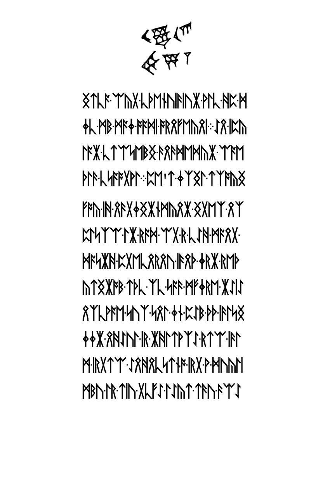

**Ciphertext** (krisyotam verbatim; `-` word separator, `.` = sentence dot (see p56 L1 `END.`), `/` = line end; standalone `&` (18×) / `$` (9×) / `§` (1×, book end p57) are krisyotam's transcription of the red dot-matrix ornaments — cipher-stream content, size mapping unconfirmed; `*` = red ink on owner-confirmed spans; `⟦'⟧`/`⟦"⟧` = image-only punctuation absent from the transcription, ≈word slot estimated. Line numbers = krisyotam lines (≠ image lines on solved pages, which wrap mid-word); printed Roman/Arabic content is omitted by krisyotam and appended below where known):

```
 1  ᛝᛏᚳᚪ-ᛠᚣᚷ-ᚳᚦᛖᚾᚢᛁᚫᛁᚢᛡ-ᚹᛚᚳ-ᚻᛈ-ᛞ/   = NGTCA EAYG CTHENUIAEIUIA WLC HP D/
 2  ᛄᚳ-ᛗᛒ-ᛗᚪᛄ-ᚩᚪᛞᛁ-ᚩᚱᛟᚠᛖᚣᛟᛁ◆4ᛇᛟ-ᛁᛈᚣ/   = JC MB MAJ OADI OROEFEYOEI.EOOE IPY/
 3  ᛚᚪᛡ-ᚳᛏᛠᛋᛖᛒᛝ-ᚫᛟᚫᛞᛖᛞᚣᛡ-ᛠᚪᛖ/   = LAIA CTEASEBNG AEOEAEDEDYIA EAAE/
 4  ᚦᛚᚫ-ᚳᛋᚪᚩᚷᚹᛚ◆4ᛈᛖ'ᛏ-ᛄᛉᛝᛚ-ᛏᛉᚩᚣᛝ/   = THLAE CSAOGWL.PE'T JXNGL TXOYNG/
 5  ᚠᚩᚣ-ᛁᚻ-ᛟᚫᚷᛄᛝᛡᚾᛗᚣᛟᛡ-ᛝᚷᛖᛉ-ᛟᛉ/   = FOY IH OEAEGJNGIANMYOEIA NGGEX OEX/
 6  ᛈᛚᛋᛉᛠ-ᛚᛡ-ᚱᚪᛞ-ᛠᚷ-ᚱ-ᚳᛇᚻ-ᛗᚪᛟᚷ-/   = PLSXEA LIA RAD EAG R CEOH MAOEG /
 7  ᛞᚪᛋᛡᚻ-ᛈᚷᛖᚳᛟᚱᛟᚢ-ᛁᚫᛟᚦ-ᛄᚱᛡ-ᚱᛖᚦ/   = DASIAH PGECOEROEU IAEOETH JRIA RETH/
 8  ᚣᛏᛝᛡᚩᛒ-ᛏᚦᚳ-ᛉᚳ-ᛋᚪᚫ-ᛗᚠᛄᚱᛖ-ᛡᛇᛁᛇ/   = YTNGIAOB TTHC XC SAAE MFJRE IAEOIEO/
 9  ᛟᛉᚳᚹᚪᛖ-ᛋᚢᛉ-ᛋᛟᛚ-ᛄᚾ-ᛈᛇᛒ-ᚦᚦ-ᛁᚫᛚᛋᛝ/   = OEXCWAE SUX SOEL JN PEOB THTH IAELSNG/
10  ᛄᛄᛡ-ᛟᚻᛇᚢᛚ-ᛁᚱ-ᛡᚻᛚᛏᚹᛉᛇ-ᚱᛏᛠ-ᛁᚫᛚ/   = JJIA OEHEOUL IR IAHLTWXEO RTEA IAEL/
11  ᛗ-ᛁᚱᚷᛏᛠ-ᛇᛟᚻᛟᚳᛋᛏᚾᚩ-ᛁᚱᚷ-ᚹ-ᛞᚢᚣᛚᛁ/   = M IRGTEA EOOEHOECSTNO IRG W DUYLI/
12  ᛗᛒᚢ-ᛚᚱ-ᛏᛁᚢ-ᚷᚳᚠᛇ-ᛚᛇᚣᛏ-ᛏᚫᚢ-ᚫᛠᛇ/   = MBU LR TIU GCFEO LEOYT TAEU AEEAEO/
```

**Notes:**

## p36 (unsolved)

Known: black stamp device **same as p33 footer** (top; p33 footer); red digit 1 (L6), red 10 dot lattice end of L5

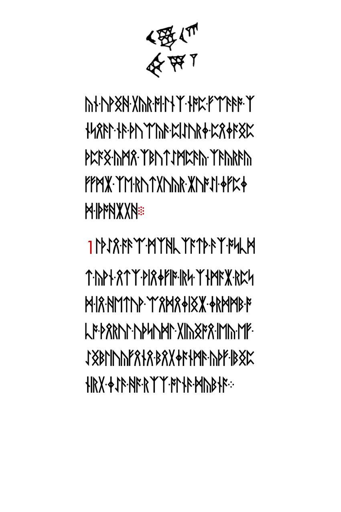

**Ciphertext** (krisyotam verbatim; `-` word separator, `.` = sentence dot (see p56 L1 `END.`), `/` = line end; standalone `&` (18×) / `$` (9×) / `§` (1×, book end p57) are krisyotam's transcription of the red dot-matrix ornaments — cipher-stream content, size mapping unconfirmed; `*` = red ink on owner-confirmed spans; `⟦'⟧`/`⟦"⟧` = image-only punctuation absent from the transcription, ≈word slot estimated. Line numbers = krisyotam lines (≠ image lines on solved pages, which wrap mid-word); printed Roman/Arabic content is omitted by krisyotam and appended below where known):

```
 1  ᚣᚾ-ᚢᚹᛝᚻ-ᚷᚣᚱ-ᚩᛁ-ᛚᚾᛉ-ᚾᚩᛈ-ᚠᛠᚫᚫᚩ-ᛉ/   = YN UWNGH GYR OI LNX NOP FEAAEAEO X/
 2  ᚾᛋᛟᚫᛚ-ᚾᚫ-ᚦᚢᛠᚣᚫ-ᛈᛁᛇᚢᚱᛄ-ᛈᛟᛄᚪᛝᛈ/   = NSOEAEL NAE THUEAYAE PIEOURJ POEJANGP/
 3  ᚦᛈᚪᛝ-ᚣᛗᛟ-ᛉᛒᚢᛏᛇᛗᛈᚫᚣ-ᛉᚫᚣᚱᚫᚣ/   = THPANG YMOE XBUTEOMPAEY XAEYRAEY/
 4  ᚠᚠᛗᛡ-ᛉᛖ-ᚱᚢᛏᚷᚢᚣᚱ-ᛡᚢᚩᛇᛁ-ᛄᚠᛈᛄ/   = FFMIA XE RUTGUYR IAUOEOI JFPJ/
 5  ᛞ-ᛁᚦᚩᚻᛡᚷᚻ◆10*/   = D ITHOHIAGH†*/
 6  1*ᛚᚦᛇᛟ-ᚪᚫᛠ-ᛗᛉᚻᚳᛉᚪᛏᚦ-ᚫᛉ-ᚩᛋᚳᛞ/   = 1*LTHEOOE AAEEA MXHCXATTH AEX OSCD/
 7  ᛏ-ᚣᚹᚾ-ᛟᛏᛉ-ᚹᛁᛟᛄᚠᛁᚩ-ᛁᚱᛋ-ᛉᚾᛗᚪᛡ-ᚱᛈᛋ/   = T YWN OETX WIOEJFIO IRS XNMAIA RPS/
 8  ᛞ-ᛁᛟ-ᚻᛖᛏᚢᚹ-ᛠᛟᛞᛟᛄᛁᛝᛡ-ᛄᚱᛞᛗᛒ-ᚩ/   = D IOE HETUW EAOEDOEJINGIA JRDMB O/
 9  ᚳᚩ-ᚦᛟᚱᚢᛚ-ᚢᚦᛋᚢᛞᛚ-ᚷᛁᚣᛝᚩᛟ-ᛁᛖᚣ-ᛖᚠ-/   = CO THOERUL UTHSUDL GIYNGOOE IEY EF /
10  ᛇᛝᛒᛚᛁᚢᚣᚠᛟᚾᛟ-ᛒᛟᚷᛄᚪᚾᛗᚫ-ᚣᚦᚠ-ᛁᛒᛝᛈ/   = EONGBLIUYFOENOE BOEGJANMAE YTHF IBNGP/
11  ᚾᛁᚱᚷ-ᛄᛇᚫ-ᚻᚪ-ᚱᛉᛉ-ᚩᛚᚾᚫ-ᛞᚣᛒᚾᚪ◆4/   = NIRG JEOAE HA RXX OLNAE DYBNA./
```

**Notes:**

## p37 (unsolved)

Known: red head word (line 1); black stamp device (top; p33 footer); red digits 2/3/4 (L1/L5/L10) + black 4-dot diamonds (owner L2/4/5/8/11) ** only see 4 dot diamonds on line 9

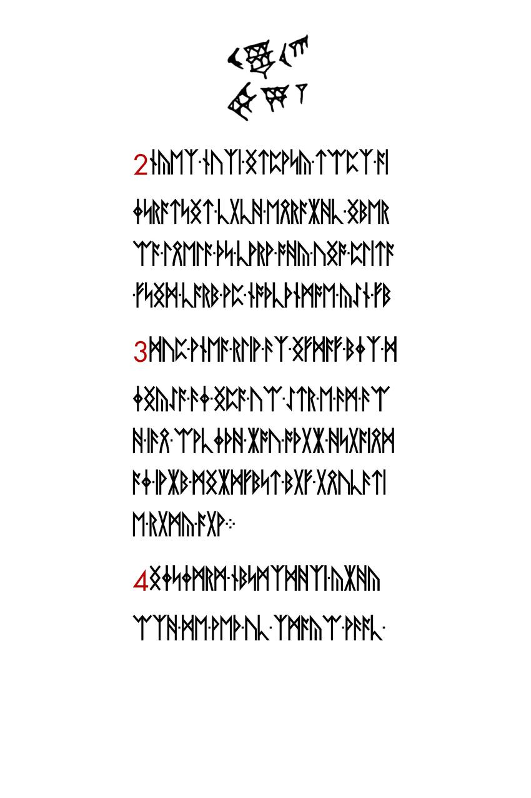

**Ciphertext** (krisyotam verbatim; `-` word separator, `.` = sentence dot (see p56 L1 `END.`), `/` = line end; standalone `&` (18×) / `$` (9×) / `§` (1×, book end p57) are krisyotam's transcription of the red dot-matrix ornaments — cipher-stream content, size mapping unconfirmed; `*` = red ink on owner-confirmed spans; `⟦'⟧`/`⟦"⟧` = image-only punctuation absent from the transcription, ≈word slot estimated. Line numbers = krisyotam lines (≠ image lines on solved pages, which wrap mid-word); printed Roman/Arabic content is omitted by krisyotam and appended below where known):

```
 1  2*ᚾᚣᛖᛉ-ᚾᚢᛉᛁ-ᛝᛏᛈᚹᛋᚣ-ᛏᛠᛈᛉ-ᚪᛁ/   = 2*NYEX NUXI NGTPWSY TEAPX AI/
 2  ᛄᛋᚱᚪᛏᛋᛝᛏ-ᚳᚷᚳᚻ-ᛖᛟᚱᚪᛡᚻᚳ-ᛝᛒᛖᚱ/   = JSRATSNGT CGCH EOERAIAHC NGBER/
 3  ᛠᚪ-ᛚᛟᛖᛚᚪ-ᚦᛋ-ᚳᚹᚱᚹ-ᚩᚻᚣ-ᚢᛝᚩ-ᛈᛚᛁᛏᚪ/   = EAA LOEELA THS CWRW OHY UNGO PLITA/
 4  -ᚠᛋᛝᛞ-ᚳᚪᚱᛒ-ᚹᛈ-ᚾᚩᚦᚳᚦᚾᛗᚩᛖ-ᚣᛇᚾ-ᚠᛒ/   =  FSNGD CARB WP NOTHCTHNMOE YEON FB/
 5  3*ᛞᚢᛈ-ᚹᚾᛖᚪ-ᚱᛚᛁᚹ-ᚫᛉ-ᛝᚠᛞᚪᚠ-ᛒᛄᛉ-ᛞ/   = 3*DUP WNEA RLIW AEX NGFDAF BJX D/
 6  ᛄᛝᚣᛇᚪ-ᚫᛄ-ᛝᛈᚪ-ᚢᛠ-ᛇᛏᚱ-ᛖ-ᚫᛗ-ᚫᛠ/   = JNGYEOA AEJ NGPA UEA EOTR E AEM AEEA/
 7  ᚻ-ᛁᚫᛟ-ᛠᚹᚳᛄᚦᚻ-ᛡᚩᚢ-ᚩᚦᚷᛡ-ᚻᛋᚷᚪᛁᛟᛞ/   = H IAEOE EAWCJTHH IAOU OTHGIA HSGAIOED/
 8  ᚪᛄ-ᛁᚹᛡᛒ-ᛗᛝᛡᛞᚠᛒᛋᛏ-ᛒᚷᚠ-ᚷᛟᚢᚳᚫᛏᛁ/   = AJ IWIAB MNGIADFBST BGF GOEUCAETI/
 9  ᛖ-ᚱᚷᛗᚣ-ᚪᚷᚹ◆4/   = E RGMY AGW./
10  4*ᛝᛄᛋᛄᛗᚱᛗ-ᚾᛒᛋᛗᛉᛞᚻᛉᛁ-ᚣᛡᚻᚣ/   = 4*NGJSJMRM NBSMXDHXI YIAHY/
11  ᛠᛉᚻ-ᛞᛖ-ᚹᛖᚦ-ᚢᚳ-ᛉᛗᚪᚣᛠ-ᚹᚫᚪᚳ-/   = EAXH DE WETH UC XMAYEA WAEAC /
```

**Notes:**

## p38 (unsolved)

Known: black stamp device (top; p33 footer); red digit 5 (L4) + black diamonds right edge (L3/8/9); margin asymmetry S8c; red 10-dot lattice begins line 10

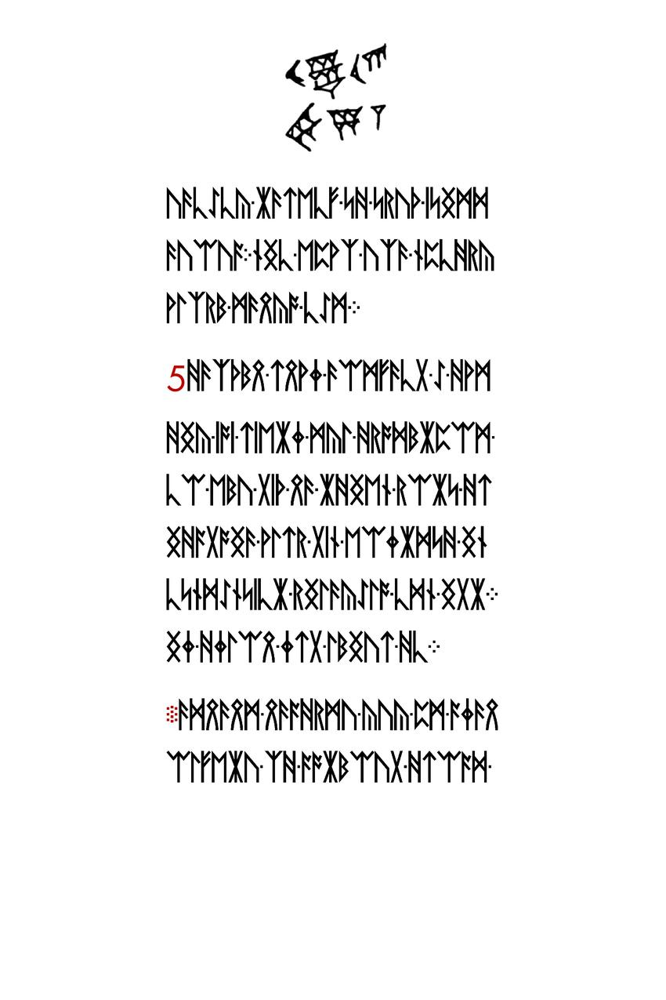

**Ciphertext** (krisyotam verbatim; `-` word separator, `.` = sentence dot (see p56 L1 `END.`), `/` = line end; standalone `&` (18×) / `$` (9×) / `§` (1×, book end p57) are krisyotam's transcription of the red dot-matrix ornaments — cipher-stream content, size mapping unconfirmed; `*` = red ink on owner-confirmed spans; `⟦'⟧`/`⟦"⟧` = image-only punctuation absent from the transcription, ≈word slot estimated. Line numbers = krisyotam lines (≠ image lines on solved pages, which wrap mid-word); printed Roman/Arabic content is omitted by krisyotam and appended below where known):

```
 1  ᚢᚫᚳᛇᚳᚣ-ᛡᚫᛏᛖᚳᚠ-ᛋᚻ-ᛋᚱᚢᚦ-ᛁᛋᛝᛗᛞ/   = UAECEOCY IAAETECF SH SRUTH ISNGMD/
 2  ᚫᚢᛠᚢᚪ◆4ᚾᛝᚳ-ᛖᛈᚹᛉ-ᚢᛉᚫ-ᚾᛈᚳᚻᚱᚣ/   = AEUEAUA.NNGC EPWX UXAE NPCHRY/
 3  ᚹᛚᛉᚱᛒ-ᛗᚫᛟᚣᚩ-ᚳᛇᛗ◆4/   = WLXRB MAEOEYO CEOM./
 4  5*ᚻᚫᛉᚦᛒᛟ-ᛏᛟᚹᛄ-ᚫᛠᛗᚠᚫᚳᚷ-ᛇ-ᚻᚹᛗ/   = 5*HAEXTHBOE TOEWJ AEEAMFAECG EO HWM/
 5  ᚻᛝᚣ-ᛁᚩᛁ-ᛏᛁᛖᛡᛄ-ᛗᚣᛚ-ᚻᚱᚩᛞᛒᛡᛈᛠᛗ-/   = HNGY IOI TIEIAJ MYL HRODBIAPEAM /
 6  ᚳᛠ-ᛖᛒᚢ-ᚷᛁᚦ-ᛟᚫ-ᛡᚻᛝᛖᚾ-ᚱᛠᛡᛋ-ᚻᛏ/   = CEA EBU GITH OEAE IAHNGEN REAIAS HT/
 7  ᛝᚻᚪᚷᚩᛝᚫ-ᚹᛚᛏᚱ-ᚷᛁᚾ-ᛖᛠᛄᛡᛞᛋᚻ-ᛝᚾ/   = NGHAGONGAE WLTR GIN EEAJIADSH NGN/
 8  ᚳᛋᚾᛞᛇᚾᛋᛁᚳᛡ-ᚱᛝᛚᚫᚣᛇᛚᚩ-ᚳᛞᚾ-ᛝᚷᛡ◆4/   = CSNDEONSICIA RNGLAEYEOLO CDN NGGIA./
 9  ᛝᛄ-ᚻᛄᛚᛠᛟ-ᛄᛏᚷ-ᛚᛒᛝᚢᛏ-ᚻᚳ◆4/   = NGJ HJLEAOE JTG LBNGUT HC./
10  &  
11  ◆10*ᚫᛞᛟᚫᛟᛗ-ᛟᚫᚪᚻᚱᛗᚢ-ᚣᚢᚣ-ᛈᛗ-ᚪᛄᚫᛟ/   = †*AEDOEAEOEM OEAEAHRMU YUY PM AJAEOE/
12  ᛠᛚᚠᛖᛡᚢ-ᛉᚻ-ᚪᚩᛡᛒᛠᚢᚷ-ᚻᛏᛠᚪᛞ-/   = EALFEIAU XH AOIABEAUG HTEAAD /
```

**Notes:**

## p39 (unsolved)

Known: red head word (line 1 **line 7 not 1** ); black stamp device (top; p33 footer), terminal 13 dot red lattices on lines 6 and 12

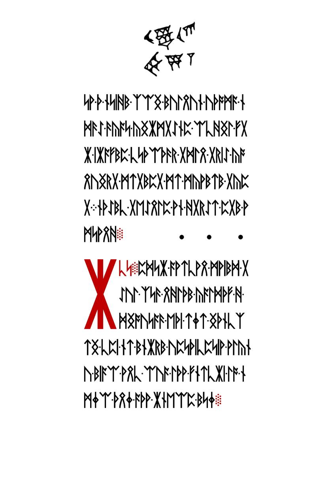

**Ciphertext** (krisyotam verbatim; `-` word separator, `.` = sentence dot (see p56 L1 `END.`), `/` = line end; standalone `&` (18×) / `$` (9×) / `§` (1×, book end p57) are krisyotam's transcription of the red dot-matrix ornaments — cipher-stream content, size mapping unconfirmed; `*` = red ink on owner-confirmed spans; `⟦'⟧`/`⟦"⟧` = image-only punctuation absent from the transcription, ≈word slot estimated. Line numbers = krisyotam lines (≠ image lines on solved pages, which wrap mid-word); printed Roman/Arabic content is omitted by krisyotam and appended below where known):

```
 1  ᛋᚹ-ᚦ-ᚾᛋᛁᚻᛒ-ᛉᛠᛝ-ᛒᚢᛚᛟᚢᚾ-ᚢᚦᚩᛗᚪ-ᚾ/   = SW TH NSIHB XEANG BULOEUN UTHOMA N/
 2  ᛞᚫᛇ-ᚫᚣᚪᛋ-ᚣᛝᛡᛗᚷᛇᚾᛈ-ᛠᚳᚻᛝᛚ-ᚠᚷ/   = DAEEO AEYAS YNGIAMGEONP EACHNGL FG/
 3  ᛡ-ᛁᛡᚪᚠᛒᛈ-ᚳᛋᚦᛠᚦᚫᚱ-ᚷᛞᛚᛟ-ᚷᚱᛁᛇ-ᚣᚩ/   = IA IIAAFBP CSTHEATHAER GDLOE GRIEO YO/
 4  ᛟᚢᛝᚱᚷ-ᛗᛏᚷᛒᛈᚷ-ᛗᛏ-ᛗᚣᚹᛒᛏᛒ-ᚷᚣᛈ/   = OEUNGRG MTGBPG MT MYWBTB GYP/
 5  ᚷ◆4ᚾᚦᛇᛒᚳ-ᚷᛖᛇᛟᛚᛈ-ᚹᚾ-ᚻᚷᚱᛇᛏ-ᛈᚷᛒ-ᚹ/   = G.NTHEOBC GEEOOELP WN HGREOT PGB W/
 6  ᛗᛋᚹᛟᚻ◆13*/   = MSWOEH¶*/
 7  &
 8  ᛡ*ᚳ*ᛋ*◆13*ᛈᛞᛋᛡ-ᚪᚹᛏᚳᚹᛟ-ᛗᚹᛁᛒᛞ-ᚷ/   = IA*C*S*¶*PDSIA AWTCWOE MWIBD G/
 9  ᛇᚢᛚ-ᛉᛋᚫ-ᛟᚻᛚᚦᛒ-ᚣᚪᛚᛞᚦᚠ-ᚻ-/   = EOUL XSAE OEHLTHB YALDTHF H /
10  ᛞᛝᚩᚢᛋᚪᚫ-ᛖᚦᛁ-ᛏᛄᛏ-ᛝᚦᚾᚳᛉ/   = DNGOUSAAE ETHI TJT NGTHNCX/
11  ᛏᛝ-ᚳᛈᛁ-ᚾᛏ-ᛒᚾᛡᚱᛒ-ᚢᛈᛋᚦᛁᚳᛈᛋᛁᚹ-ᚹᛚᚣᚾ/   = TNG CPI NT BNIARB UPSTHICPSIW WLYN/
12  ᚢ-ᛒᛁᚪᛠ-ᚹᛟᚳ-ᛠᚢᚪ-ᛚᚦᚹ-ᚠᚾᛏᚳᛡᛁ-ᛚᚩ-ᚾ/   = U BIAEA WOEC EAUA LTHW FNTCIAI LO N/
13  ᛗᛄᛠ-ᚦᛟᛄ-ᚪᚦᚹ-ᛡᚾᛖᛠᛈ-ᛒᛋᛄ◆13*/   = MJEA THOEJ ATHW IANEEAP BSJ¶*/
14  &
15  $
```

**Notes:**

## p40 (unsolved)

Known: red head word (line 1) **words**; red-opening sentence ENDED by mid-line-2 black diamond (S8a CONFIRMED); margin asymmetry S8c

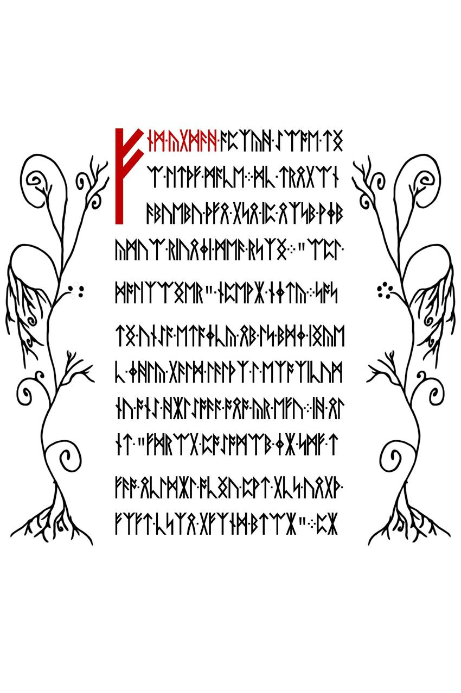

**Ciphertext** (krisyotam verbatim; `-` word separator, `.` = sentence dot (see p56 L1 `END.`), `/` = line end; standalone `&` (18×) / `$` (9×) / `§` (1×, book end p57) are krisyotam's transcription of the red dot-matrix ornaments — cipher-stream content, size mapping unconfirmed; `*` = red ink on owner-confirmed spans; `⟦'⟧`/`⟦"⟧` = image-only punctuation absent from the transcription, ≈word slot estimated. Line numbers = krisyotam lines (≠ image lines on solved pages, which wrap mid-word); printed Roman/Arabic content is omitted by krisyotam and appended below where known):

```
 1  ᚠ*ᚾ*ᛗ*-ᚣ*ᚷ*ᛞ*ᚫ*ᚻ*-ᚪᛈᛉᚣᚻ-ᛇᛠᚩᛖ-ᛏᛝ/   = F*N*M* Y*G*D*AE*H* APXYH EOEAOE TNG/
 2  ᛠ-ᛚᛁᛏᚦᚠ-ᛗᚪᚳᛖ.ᛞᚳ-ᛏᚱᛟᚷᛠᚾ/   = EA LITTHF MACE.DC TROEGEAN/
 3  ᚫᛒᚢᛖᛒᚢ-ᚦᚠᛟ-ᚷᛋᛟ-ᛁᛈ-ᛟᛉᛋᛒ-ᚹᛄᛒ/   = AEBUEBU THFOE GSOE IP OEXSB WJB/
 4  ᚣᛗᚢᛠ-ᚱᛁᚢᛟᛄᛁ-ᛗᛖᚫ-ᚱᛋᛉᛝ◆4"ᛠᛈᛚ-/   = YMUEA RIUOEJI MEAE RSXNG."EAPL /
 5  ᛞᚩᛚᛁᛉᛠᛝᛖᚱ"-ᚾᛈᛖᚹᛡ-ᚾᛄᛏᚣ◆4ᛋᚩᛋ/   = DOLIXEANGER" NPEWIA NJTY.SOS/
 6  ᛏᛝ-ᚢᚾᛇᚪ-ᛖᛏᚪᛄᚳᚣ-ᛟᛒ-ᛚᛋ-ᛒᛞᛄ-ᛁᛝᚣᛖ/   = TNG UNEOA ETAJCY OEB LS BDJ INGYE/
 7  ᚳ-ᛄᚻᛚᚣ-ᚷᚫᛚᛞ-ᛚᚫᛚᚦᛉ-ᛚ-ᛖᛉᚩᛉᛁᚳᚢᛗ/   = C JHLY GAELD LAELTHX L EXOXICUM/
 8  ᚾᚢ-ᚩᚾᛇ-ᚻᛡᛚᛇᚩᚫᚪ-ᚩᛟᚩ-ᚣᚱ-ᛖᚠᚢ◆4ᛁᚻ-ᛟᛚ/   = NU ONEO HIALEOOAEA OOEO YR EFU.IH OEL/
 9  ᚾᛏ-"ᚠᛞᚱᛠᚷ-ᛈᚩᛇᚩᛗᛠᛒ-ᛄᛡ-ᛋᛗᚠ-ᛏ/   = NT "FDREAG POEOOMEAB JIA SMF T/
10  ᚠᚫᚩ-ᛟᚳᛚᛞᛡᛚ-ᚩᚳᛝᚢ-ᛈᚹᛏ-ᚷᚳᛋ-ᚢᛟᚷᚦ-/   = FAEO OECLDIAL OCNGU PWT GCS UOEGTH /
11  ᚠᛉᚠᛏ-ᚳᛋᛉᛟ-ᚷᚠᛉᚾᛞ-ᛒᛏᛠᛡ"◆4ᛈᛡ/   = FXFT CSXOE GFXND BTEAIA".PIA/
```

**Notes:**

## p41 (unsolved)

Known: —


**Ciphertext** (krisyotam verbatim; `-` word separator, `.` = sentence dot (see p56 L1 `END.`), `/` = line end; standalone `&` (18×) / `$` (9×) / `§` (1×, book end p57) are krisyotam's transcription of the red dot-matrix ornaments — cipher-stream content, size mapping unconfirmed; `*` = red ink on owner-confirmed spans; `⟦'⟧`/`⟦"⟧` = image-only punctuation absent from the transcription, ≈word slot estimated. Line numbers = krisyotam lines (≠ image lines on solved pages, which wrap mid-word); printed Roman/Arabic content is omitted by krisyotam and appended below where known):

```
 1  ᛠᛁᚪ-ᛋᚣᛗᛞᚣᛋ-ᛒᛞᛄᛞ.ᚩᚾᛏᛚ-ᚳᚪᛝ-ᚱᚷ/   = EAIA SYMDYS BDJD.ONTL CANG RG/
 2  ᚻᚷ-ᛄᚹᚠ-ᚪᚢᛇ-ᛞᛏᛗᛄᛁ-ᛝᚫ-ᛉᛈᚳᛈᛠ-ᛟᚪ/   = HG JWF AUEO DTMJI NGAE XPCPEA OEA/
 3  ᛒᛁᛁᛋ-ᛇᚷᚻᛋ-ᛇᛡᛒ-ᚠᚹᛝ-ᚫᚪᚠᚩᚣᛡᚪᚾᚻ-ᛒᚦᛟ/   = BIIS EOGHS EOIAB FWNG AEAFOYIAANH BTHOE/
 4  ᛇᚣᛟᛁᛒ-ᛟ-ᚩᛋᚹ-ᛞᚳᚠᚪᛁ.ᛉᛏᛟᚢᚩᛟᚦᛈᛋᚩ-/   = EOYOEIB OE OSW DCFAI.XTOEUOOETHPSO /
 5  ᚻᛇᚦᛝ-ᛏᛠᚠᛝᛠ-ᚩᛗ-ᛏᚠᚣᛚᚣ-ᚹᛚᛞ-ᚪᛉ/   = HEOTHNG TEAFNGEA OM TFYLY WLD AX/
 6  ᛠ-ᚪᛄ-ᚩᛋᛒᛚ-ᚳᛖᚾᚪᚩᚱᛏᚦ-ᚱᛒᚳᚣ-ᛠᛗᚹᛚ-/   = EA AJ OSBL CENAORTTH RBCY EAMWL /
 7  ᚻᛈ-ᛇᛈᛖ-ᛚᛄᚩᛡᚪ-ᛖᛋᚫᚩ-ᛠᛉᛝᚣ-ᛖᚫᛒ/   = HP EOPE LJOIAA ESAEO EAXNGY EAEB/
 8  ᛗ-ᛖᚻᚱ-ᛈᚾᛗ-ᚹᛏᛟᚣᚢ-ᚠᛉᛈᛗᚩᚷᚾ-ᛡᛇᚳ/   = M EHR PNM WTOEYU FXPMOGN IAEOC/
 9  ᚠᛒᛈᛗ-ᛋᛇᛁ-ᛖᛈᚢᚱᛏᚳᚣ-ᛄᛚᚠ.ᚱᛚᚱᚫᛖᚻᛟ/   = FBPM SEOI EPURTCY JLF.RLRAEEHOE/
10  -ᛇᚣᛡ-ᚩᛉ-ᚪᛋᚣᛁᛝ-ᛉᛚᛄ'ᚳ-ᛖᚣᚢᛝᚦᛇᚱ-/   =  EOYIA OX ASYING XLJ'C EYUNGTHEOR /
11  ᛠᛁᚫ-ᚦᚠᛟᚷᛠᛁ-ᛈᛋᛒ-ᛗᛒᛄᚠᚾᚳᛖ-ᚻᚫᚩᛄ-/   = EAIAE THFOEGEAI PSB MBJFNCE HAEOJ /
12  ᛉᛄᛚᛈᚪᛁ-ᛟᚹᚱᛁᚱᚦᛖᛉ-ᚪᚾ-ᛞᛄᚷ-ᛟᛟᚳᛏᛄ/   = XJLPAI OEWRIRTHEX AN DJG OEOECTJ/
```

**Notes: Apostrophe mid line 10**

## p42 (unsolved)

Known: —

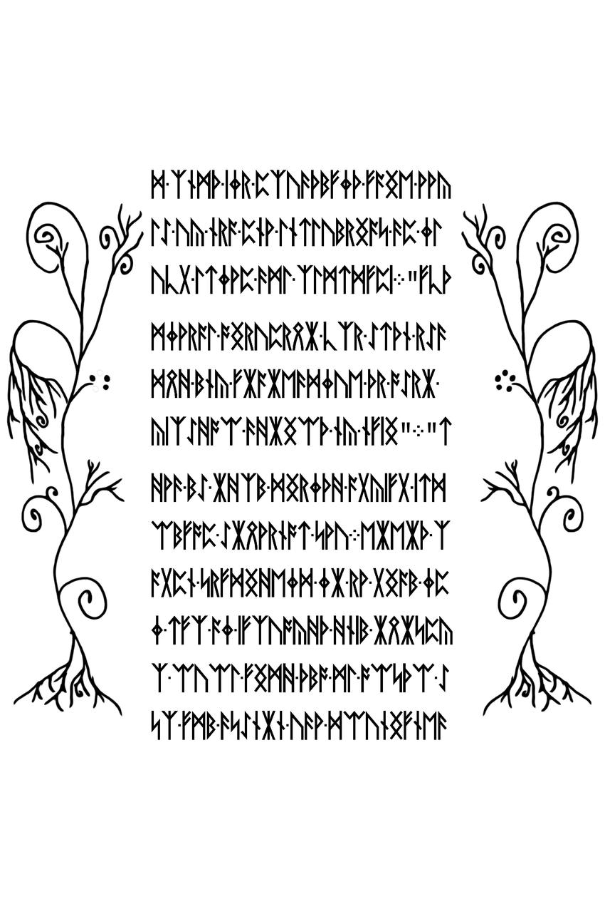

**Ciphertext** (krisyotam verbatim; `-` word separator, `.` = sentence dot (see p56 L1 `END.`), `/` = line end; standalone `&` (18×) / `$` (9×) / `§` (1×, book end p57) are krisyotam's transcription of the red dot-matrix ornaments — cipher-stream content, size mapping unconfirmed; `*` = red ink on owner-confirmed spans; `⟦'⟧`/`⟦"⟧` = image-only punctuation absent from the transcription, ≈word slot estimated. Line numbers = krisyotam lines (≠ image lines on solved pages, which wrap mid-word); printed Roman/Arabic content is omitted by krisyotam and appended below where known):

```
 1  ᛞ-ᛉᚾᛗᚦ-ᛁᛄᚱ-ᛈᛉᚢᚫᚦᛒᚠᛄᚦ-ᚠᚪᛝᛖ-ᚹᚹᚣ/   = D XNMTH IJR PXUAETHBFJTH FANGE WWY/
 2  ᛚᛇ-ᚢᚣ-ᚾᚱᚪ-ᛈᚾᚹ-ᛚᚾᛏᛚᚢᛒᚱᛝᚪᛋ-ᚫᛈ-ᛄᛚ/   = LEO UY NRA PNW LNTLUBRNGAS AEP JL/
 3  ᚢᚳᚷ-ᛚᛏᛄᚹᛈ-ᚫᛗᛚ-ᛉᛚᛗᛏᛞᚠᛈᛁ◆4"ᚠᚳᚦ/   ⟦"⟧pos TBD   = UCG LTJWP AEML XLMTDFPI."FCTH/   ⟦"⟧pos TBD
 4  ᛗᛄᚹᚱᚪᛚ-ᚩᛝᚱᚢᛈᚱᛟᛡ-ᚳᛉᚱ-ᛇᛏᚦᚾ-ᚱᛇᚫ/   = MJWRAL ONGRUPROEIA CXR EOTTHN REOAE/
 5  ᛞᛟᚻ-ᛒᚾᚣ-ᚠᛡᚪᛡᛖᚫᛞᛄᚢᛖ-ᚦᚱ-ᚩᛇᚱᛡ-/   = DOEH BNY FIAAIAEAEDJUE THR OEORIA /
 6  ᚣᛁᛉᛇᚻᚩᛠ-ᚫᚻᛡᛝᛠᚦ-ᚾᚣ-ᚾᚠᛁᛝ"◆4"ᛏ/   ⟦"⟧pos TBD   = YIXEOHOEA AEHIANGEATH NY NFING"."T/   ⟦"⟧pos TBD
 7  ᚻᚹᚫ-ᛒᛇ-ᛡᚻᛉᛒ-ᛞᛝᚱᛄᚦᚻ-ᚪᚷᚣᛁᚠᚷ-ᛁᛏᛞ/   = HWAE BEO IAHXB DNGRJTHH AGYIFG ITD/
 8  ᛠᛒᚠᚩᛈ-ᛇᛡᛟᚹᚱᚾᚩᛏ-ᛋᚹᚢ◆4ᛖᛡᛖᛡᚦ-ᛉ/   = EABFOP EOIAOEWRNOT SWU.EIAEIATH X/
 9  ᚪᚷᛈᚾ-ᛋᚱᚠᛞᛝᚻᛖᛄᛞ-ᛄᛡ-ᚱᚹ-ᚷᛝᚪᛒ-ᛄᛈ/   = AGPN SRFDNGHEJD JIA RW GNGAB JP/
10  ᛄ-ᛏᚠᛉ-ᚪᛄ-ᛁᚠᛉᚢᚩᚣᚻᚦ-ᚻᚾᛁᛒ-ᛡᛟᛡᛋᛈᚣ/   = J TFX AJ IFXUOYHTH HNIB IAOEIASPY/
11  ᛉ-ᛠᚢᛠᛚ-ᚠᛝᛗᚻ-ᚦᛒᚩ-ᛗᛚ-ᚩᛠᛋᚦᛠ-ᛇ/   = X EAUEAL FNGMH THBO ML OEASTHEA EO/
12  ᛋᛉ-ᚠᛗᛒ-ᚫᛋᛇᚾᛡᚾ-ᚢᚫᚹ-ᛞᛠᚢᚾᛝᚠᚾᛖᚫ/   = SX FMB AESEONIAN UAEW DEAUNNGFNEAE/
```

**Notes: double quotes lines 3,6 (twice)**

## p43 (unsolved)

Known: —


**Ciphertext** (krisyotam verbatim; `-` word separator, `.` = sentence dot (see p56 L1 `END.`), `/` = line end; standalone `&` (18×) / `$` (9×) / `§` (1×, book end p57) are krisyotam's transcription of the red dot-matrix ornaments — cipher-stream content, size mapping unconfirmed; `*` = red ink on owner-confirmed spans; `⟦'⟧`/`⟦"⟧` = image-only punctuation absent from the transcription, ≈word slot estimated. Line numbers = krisyotam lines (≠ image lines on solved pages, which wrap mid-word); printed Roman/Arabic content is omitted by krisyotam and appended below where known):

```
 1  ᚻᛄ-ᛁᛖᛏᛡ-ᚷᛁᚩᚾ-ᚳᚢᚫᛗᛈᛋᚪᛡ-ᚷᛚᚣᚹᛟ"-/   = HJ IETIA GION CUAEMPSAIA GLYWOE" /
 2  ᚠᚢ-ᛉᚠᚫᛞᚠᛡᛄᚾ◆4ᚻᛋᚦᚠ-ᛏᚠᛄᚱᚹᚠᛋᚾᚹᛄ/   = FU XFAEDFIAJN.HSTHF TFJRWFSNWJ/
 3  ᛖᛒᚢᚦ-ᚩᛇᚫᛈ-ᛡᛟ◆4ᚢᛁᚩᛄᚩᛇᛟᛄᛞᚩ-ᛈᚹᛞ/   = EBUTH OEOAEP IAOE.UIOJOEOOEJDO PWD/
 4  ᚷᚱ-ᚠᛟ-ᛇᚷ-ᛄᛟᛇᚫᛋᚫᚣ-ᛒᛏᛞᛟ-ᛠᚻᛡᚱᛠ/   = GR FOE EOG JOEEOAESAEY BTDOE EAHIAREA/
 5  ᛠᛉᛋ-ᚠᚾᚣᚱᚠ◆4ᚪᚾᛡᚪᛖᚫ-ᚳᛇᛁᛝ-ᛒᛡᛞᛠ/   = EAXS FNYRF.ANIAAEAE CEOING BIADEA/
 6  ᚫᛒᛠᚳᛉᚠ-ᚫᛏᛁᚱᚪᛗᚩ-ᛚᛉᛋᚪ-ᛒᚩᛈᚫᚩᛝᚻᛇ/   = AEBEACXF AETIRAMO LXSA BOPAEONGHEO/
 7  ᛖᛇᚫ-ᚻᛖᛇᛠ-ᚱᛗᛞ-ᚫᛇᛗ◆4ᚾᚾᚣᛡ-ᚱᚾᛗ/   = EEOAE HEEOEA RMD AEEOM.NNYIA RNM/
 8  ᛠ-ᛄᛉᛋᛄ-ᛟᛖᛒ-ᛏᚻᚾ-ᚠᚪᚠ-ᛒᚾ-ᚩᚾ-ᛖᛋᛏᛒᚹ/   = EA JXSJ OEEB THN FAF BN ON ESTBW/
 9  ᛡ◆4ᚻᛏ-ᚩᛟᚩ-ᛒᚾᛖᚳᛁᚹᚣᛟ-ᛟᚩᛒ-ᛋᛖᚩ-ᚫᚻᛟ/   = IA.HT OOEO BNECIWYOE OEOB SEO AEHOE/
10  ᚠᚫᚷᚩᛄ-ᛟᛒᚻ-ᚳᛖᛁᛚᚫᚣᛚ-ᚢᛚᛁ-ᚾᛟᛏ-ᚫᛈᛟᛈ/   = FAEGOJ OEBH CEILAEYL ULI NOET AEPOEP/
11  ᛝᛗ-ᚳᚢᛁ-ᚣᛋᚳᚢᛡᛇᚩ-ᚠᛖ-ᚷᛟ-ᚻᚫ-ᛝᚠ-ᛗᚠ/   = NGM CUI YSCUIAEOO FE GOE HAE NGF MF/
12  ᛝᛉᛞᛁ-ᛗᛝᚣᚪᛝᚠᛉᛁᛟᚷᛚ-ᛇᚩ-ᚫᛡᛏ-ᛄᛏ/   = NGXDI MNGYANGFXIOEGL EOO AEIAT JT/
```

**Notes:double quotes line 1**

## p44 (unsolved)

Known: —

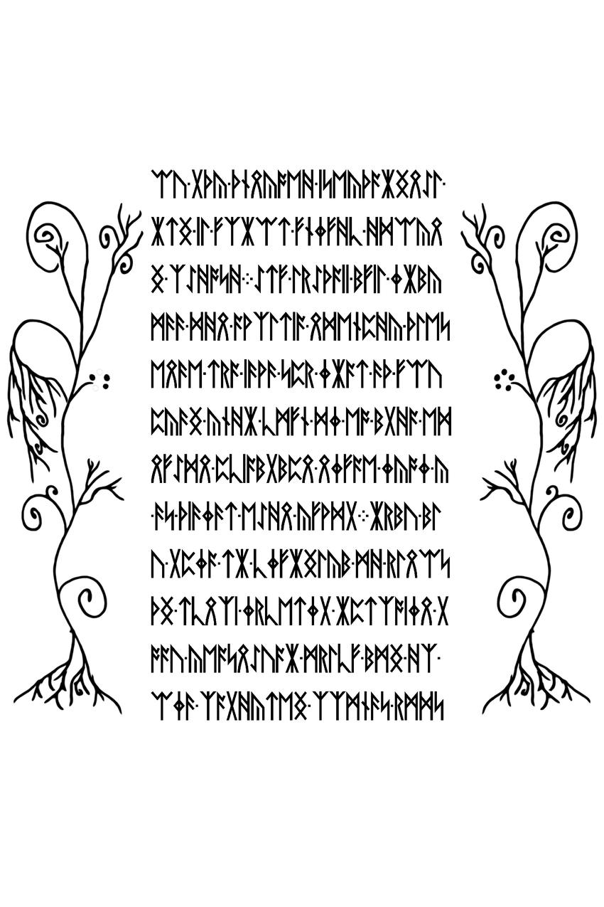

**Ciphertext** (krisyotam verbatim; `-` word separator, `.` = sentence dot (see p56 L1 `END.`), `/` = line end; standalone `&` (18×) / `$` (9×) / `§` (1×, book end p57) are krisyotam's transcription of the red dot-matrix ornaments — cipher-stream content, size mapping unconfirmed; `*` = red ink on owner-confirmed spans; `⟦'⟧`/`⟦"⟧` = image-only punctuation absent from the transcription, ≈word slot estimated. Line numbers = krisyotam lines (≠ image lines on solved pages, which wrap mid-word); printed Roman/Arabic content is omitted by krisyotam and appended below where known):

```
 1  ᛠᚢ-ᚷᚦᚣ-ᚦᚾᛟᚣᚩᛖᚻ-ᛁᛋᛖᚣᚦᚪᛡᛝᛟᛇᛚ-/   = EAU GTHY THNOEYOEH ISEYTHAIANGOEEOL /
 2  ᛡᛏᛝ-ᛁᛚ-ᚠᛉᛡᛠᛏ-ᚠᚾᛄᚠᚻᚳ-ᚻᛞᛠᚣᛟ/   = IATNG IL FXIAEAT FNJFHC HDEAYOE/
 3  ᛝ-ᛉᛇᚻᚩᛋᚻ◆4ᛇᛏᚠ-ᛚᚱᛇᚦᚪᛁᛁ-ᛒᚠᛁᛚ-ᛄᛡᛒᚣ/   = NG XEOHOSH.EOTF LREOTHAII BFIL JIABY/
 4  ᛗᚫᚫ-ᛞᚻᛟ-ᚪᚹᛉᛚᛏᛁᚪ-ᛟᛞᛖᚾᛈᚻᚣ-ᚦᛚᛖᛋ/   = MAEAE DHOE AWXLTIA OEDENPHY THLES/
 5  ᛖᛟᚫᛖ-ᛏᚱᚪ-ᛁᚫᚹᚫ-ᛋᛈᚱ-ᛄᛡᚪᛏ-ᚫᚦ-ᚠᛠᚢ/   = EOEAEE TRA IAEWAE SPR JIAAT AETH FEAU/
 6  ᛈᚣᚫᛝ-ᚣᚾᚻᛡ-ᚳᛗᚠᚾ-ᛞᛄ-ᛖᚩ-ᛒᚷᚻᚪ-ᛖᛞ/   = PYAENG YNHIA CMFN DJ EO BGHA ED/
 7  ᛟᚠᛇᛞᛟ-ᛈᚳᛁᚪᛒᚷᛒᛈᛟ-ᛟᛄᚠᚪᛖ-ᛄᚣᚩᛄ-ᚣ/   = OEFEODOE PCIABGBPOE OEJFAE JYOJ Y/
 8  -ᚫᛋ-ᚦᛁᚫᛄᚫᛏ-ᛖᛇᚻᛟ-ᚣᚠᚹᛞᚷ.ᛡᚱᛒᚢ-ᛒᛚ/   =  AES THIAEJAET EEOHOE YFWDG.IARBU BL/
 9  ᚢ-ᚷᛈᛄᚪ-ᛏᛡ-ᚳᛄᚠᛡᛝᛚᚣᛒ-ᛗᚻ-ᚱᛚᛟᛠᛋ/   = U GPJA TIA CJFIANGLYB MH RLOEEAS/
10  ᚦᛝ-ᛏᚳᛟᛉᛁ-ᛄᚱᚳᛖᛏᛄᚷ-ᛡᛈᛏᛉᚩᛁᛄᛟ-ᚷ/   = THNG TCOEXI JRCETJG IAPTXOIJOE G/
11  ᚩᚪᚢ-ᚣᛖᚪᛋᛟᛇᚢᚪᛡ-ᛗᚱᛚᚳᚠ-ᛒᛗᛝ-ᚻᛉ-/   = OAU YEASOEEOUAIA MRLCF BMNG HX /
12  ᛠᛄᚫ-ᛉᚪᚷᚻᚣᛏᛖᛝ-ᛉᛉᛗᚾᚫᛋ-ᚱᛗᛞᛋ/   = EAJAE XAGHYTENG XXMNAES RMDS/
```

**Notes:**

## p45 (unsolved)

Known: —

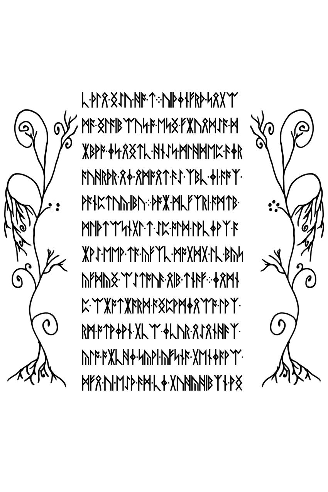

**Ciphertext** (krisyotam verbatim; `-` word separator, `.` = sentence dot (see p56 L1 `END.`), `/` = line end; standalone `&` (18×) / `$` (9×) / `§` (1×, book end p57) are krisyotam's transcription of the red dot-matrix ornaments — cipher-stream content, size mapping unconfirmed; `*` = red ink on owner-confirmed spans; `⟦'⟧`/`⟦"⟧` = image-only punctuation absent from the transcription, ≈word slot estimated. Line numbers = krisyotam lines (≠ image lines on solved pages, which wrap mid-word); printed Roman/Arabic content is omitted by krisyotam and appended below where known):

```
 1  ᚳ-ᚦᛚᛟ-ᛝᛇᚢ-ᚻᚩ-ᛏ◆4ᚢᛁᚦᛄᚾᚠᚱᚦ-ᛋᛟᚷᛠ/   = C THLOE NGEOU HO T.UITHJNFRTH SOEGEA/
 2  ᛗᚪ-ᛝᛚᚪᛁᛒᛠᚢᛋ-ᚩ-ᛖᛋᛝ-ᚠᛡᚢᛟᛞᛇᚪ-ᛞ/   = MA NGLAIBEAUS O ESNG FIAUOEDEOA D/
 3  ᛡᛒᚹᚩ-ᛄᛋ-ᛟᛝᛏᚳ-ᚻᚾᛇᛋ-ᛗᛚᚻᛞᛖᛈ-ᚫᛄᚱ/   = IABWO JS OENGTC HNEOS MLHDEP AEJR/
 4  ᚪᚢᚻᚱᚦᚱ-ᛟᛄ-ᛟᛗᚩᛟᛏ-ᚫᛇ-ᛉᛒᚳ-ᛄᛁ-ᚪᚩᛉ-/   = AUHRTHR OEJ OEMOOET AEEO XBC JI AOX /
 5  ᚹᚪᚾᛈᛏᚢᚣ-ᛁᛒᚢ◆4ᚦᚩᛡ-ᛗᚳᚠᛉᚱᛁ-ᚪᛗᛏᛒ-/   = WANPTUY IBU.THOIA MCFXRI AMTB /
 6  ᛗᛚᛁᚦᛏᛠᛋᚾᚷᛚ-ᛏ-ᛇᛈ-ᚩᛚᛞ-ᛚᚹᚳᛄᚹᛉ-ᚪ/   = MLITHTEASNGL T EOP OLD LWCJWX A/
 7  ᛡᚹᛇ-ᛖᛖᚹ-ᛏᚪ-ᚣᚠᛉᚳ-ᛗᚩᚷᛞᚷ-ᛚᚳ-ᛒᚣᛋ/   = IAWEO EEW TA YFXC MOGDG LC BYS/
 8  ᚣᚠᛞᚣᛝ-ᛠᛇᛏᚩᚢᚫ-ᛟᛁᛒ-ᛏᚾᚫᚠ◆4ᛄᛟᛗᚾ/   = YFDYNG EAEOTOUAE OEIB TNAEF.JOEMN/
 9  ᛈ-ᛠᛡᚩᛏᛡᚪᚱᛞ-ᚪᛝᛈᚹᛗᛄᛟᛠᚩ-ᛚᚹᛉ-/   = P EAIAOTIAARD ANGPWMJOEEAO LWX /
10  ᚱᛗ-ᚩᛏᚹᛄᚹᚾ-ᚷᚳᛠ-ᛄᚳᚢᚱ-ᛟᛇᛟᚾᚻᚫᛉ-/   = RM OTWJWN GCEA JCUR OEEOOENHAEX /
11  ᚣᛚᚩ-ᚩᛡᚳᚻᛄ-ᛋᚣᚹᛁ-ᚣᚠᛋᚾᚪ-ᚷᛖᚾᛄᚪᚹᛠ-/   = YLO OIACHJ SYWI YFSNA GENJAWEA /
12  ᛞᚠᛟ-ᚢᛁ-ᛖᛇᚦ-ᚫᛞ-ᚳᛄ-ᚷᚢᚻᚣᚻᛁᛒᛉᚾ-ᚹᛝ/   = DFOE UI EEOTH AED CJ GUHYHIBXN WNG/
```

**Notes:**

## p46 (unsolved)

Known: —


**Ciphertext** (krisyotam verbatim; `-` word separator, `.` = sentence dot (see p56 L1 `END.`), `/` = line end; standalone `&` (18×) / `$` (9×) / `§` (1×, book end p57) are krisyotam's transcription of the red dot-matrix ornaments — cipher-stream content, size mapping unconfirmed; `*` = red ink on owner-confirmed spans; `⟦'⟧`/`⟦"⟧` = image-only punctuation absent from the transcription, ≈word slot estimated. Line numbers = krisyotam lines (≠ image lines on solved pages, which wrap mid-word); printed Roman/Arabic content is omitted by krisyotam and appended below where known):

```
 1  ᚻᛏᛉᚫᛁᛄᚢ-ᛞᚠᛡᚫ-ᛋᛁᚹᛝᛈ-ᛗᛉᛄᛈ-ᛞᛗ/   = HTXAEIJU DFIAAE SIWNGP MXJP DM/
 2  ᛝ-ᛇᛚᛞᚣ-ᚠᚩᛞ-ᛝᚷᚾᛇ-ᚷᛖ-ᛚᛉᚣ-ᚫᛚᛖᛉ◆4/   = NG EOLDY FOD NGGNEO GE LXY AELEX./
 3  ᛡᛝᛋ-ᚳᛁᚦ-ᚷᛏᚣ-ᚹᚩ-ᛝᛖ-ᛒᚪᛗᛏᚪᚷᛒ◆4ᛈᛡ/   = IANGS CITH GTY WO NGE BAMTAGB.PIA/
 4  ᛟ-ᚪᛉᛝᛒᛞᛉᛄᚦᚢ-ᛏᛇᛖ-ᚣᚪᚳ-ᛠᚦᚹ-ᛏᛉ/   = OE AXNGBDXJTHU TEOE YAC EATHW TX/
 5  ᚩᚳᛞᛒ-ᛟᚩᛠᚾᚠᚪ◆4ᛚᛗᛖᛁᚦᚫᚪᛡᛄᛁᚪᚱ-ᚦᚱᛖ/   = OCDB OEOEANFA.LMEITHAEAIAJIAR THRE/
 6  ᛖᚣᛋᚾ-ᛖᛏᚢᚻᛈᚳᚦᛋ-ᚳᛇᛉᛖᛇᚠ-ᛞᛠᛏ/   = EYSN ETUHPCTHS CEOXEEOF DEAT/
 7  ᛈ-ᚣᛇᛠᚢᛏ-ᛉᚦᚷᚻ-ᚫᚾᛠᚱ-ᛡᛒᛏᛁᛉ-ᚩᚢ/   = P YEOEAUT XTHGH AENEAR IABTIX OU/
 8  ᛝ-ᛚᛒᛇᚩ-ᛟᛉ-ᚦᛞᚷᚠ-ᚩᚱᛈᚪᛏ-ᚫᛋᚪᚦ-ᛖᛟᚪᛝ/   = NG LBEOO OEX THDGF ORPAT AESATH EOEANG/
 9  ᚫ-ᚣᛒᛚ-ᛡᚦᚾᚠᛈᛟᛡᚾ-ᛖᚹ-ᛖᛗᚩ-ᛉᚹᚦᛠ-ᛁᚦ/   = AE YBL IATHNFPOEIAN EW EMO XWTHEA ITH/
10  ᛒᛖᚱ-ᛟᚳᛉ-ᛈᛖ-ᛁᚢᚦ-ᛈᚠᛞᛈᛄ-ᛁᛟᚻ-ᛒᚦᛏᚩ/   = BER OECX PE IUTH PFDPJ IOEH BTHTO/
11  ᚳᚢᛚ-ᛞᛄᛝ-ᚦᛄᛁᚪ-ᚹᚣ-ᚢᛝᚾ-ᛋᚾᛈᚠᚫᛒᛄᚫ-ᛡ/   = CUL DJNG THJIA WY UNGN SNPFAEBJAE IA/
12  ᛗᚹ-ᛇᚪᚩᚾᛄᚳᛚᛒᛉ-ᚣᛠᚦᚹ-ᛝᛚᛗᚳᛡᛇᚠᚫ/   = MW EOAONJCLBX YEATHW NGLMCIAEOFAE/
```

**Notes:**

## p47 (unsolved)

Known: —

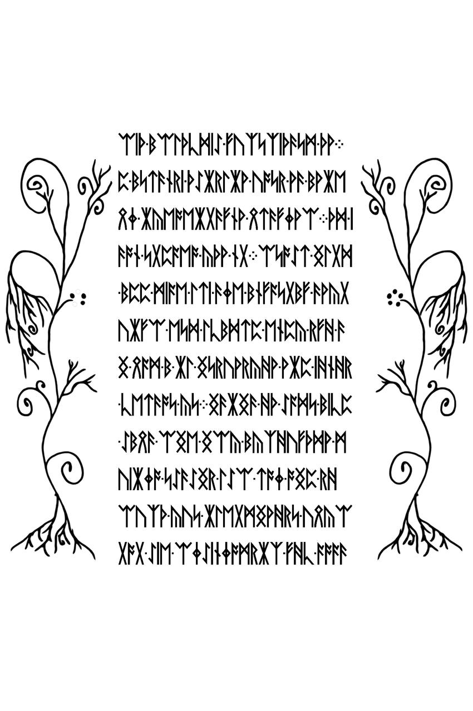

**Ciphertext** (krisyotam verbatim; `-` word separator, `.` = sentence dot (see p56 L1 `END.`), `/` = line end; standalone `&` (18×) / `$` (9×) / `§` (1×, book end p57) are krisyotam's transcription of the red dot-matrix ornaments — cipher-stream content, size mapping unconfirmed; `*` = red ink on owner-confirmed spans; `⟦'⟧`/`⟦"⟧` = image-only punctuation absent from the transcription, ≈word slot estimated. Line numbers = krisyotam lines (≠ image lines on solved pages, which wrap mid-word); printed Roman/Arabic content is omitted by krisyotam and appended below where known):

```
 1  ᛠᛁᚦ-ᛒᛠᛚᚦᚳᛞᛁᛇ-ᚠᚢᛉᛋᛉᛁᚦᚫᛋᛗ-ᚦᚹ◆4/   = EAITH BEALTHCDIEO FUXSXITHAESM THW./
 2  ᛈ-ᛒᛋᛏᚫᚾᚱᛁ-ᚦᛇᛡᚱᛚᛡᚹ-ᚢᚩᛋᚱ-ᚹᚫ-ᛒᚹᛡᛖ/   = P BSTAENRI THEOIARLIAW UOSR WAE BWIAE/
 3  ᛟᛄ-ᛡᚣᛖᚩᛖᛡᚷᚫᚠᚾᚹ-ᛟᛏᚫᚠᛄᚹᛠ.ᚦᛞ-ᛁ/   = OEJ IAYEOEIAGAEFNW OETAEFJWEA.THD I/
 4  ᚫᚩᚾ-ᛋᚷᛈᚪᛖᚩ-ᚣᚦᚹ-ᚾᚷ◆4ᛠᛋᚩᛇᛏ-ᛝᛚᚷᛞ/   = AEON SGPAEO YTHW NG.EASOEOT NGLGD/
 5  -ᛒᛈᛈ-ᛗᛁᚪᛖ-ᛚᛏᛁ-ᚫᛄᛖ-ᛒᚾᚠᚪᛋᚷᛒᚠ-ᚫᚹᚣᚷ/   =  BPP MIAE LTI AEJE BNFASGBF AEWYG/
 6  ᚢᛡᚠᛠ-ᛖᛋᛞ-ᛚᚳᛒᛞᛏᛈ-ᛖᚾᛈᚣ-ᚱᚠᚻ-ᚫ/   = UIAFEA ESD LCBDTP ENPY RFH AE/
 7  ᛝ-ᛟᚪᛗ-ᛒ-ᛡᛚ-ᛝᛋᚱᚢᚹᚱᚣᚻᚹ-ᚹᛡᛈ-ᛁᚻᚾᚻᚱ/   = NG OEAM B IAL NGSRUWRYHW WIAP IHNHR/
 8  -ᚳᛖᛏᚫᚩᛋ-ᚣᛋ◆4ᛝᚫᛡᛝᚫ-ᚻᚦ-ᛇᚪᛞᛋ-ᛒᛁᚳᛈ/   =  CETAEOS YS.NGAEIANGAE HTH EOADS BICP/
 9  -ᛇᛒᛟᚫ-ᛠᛝᛖ-ᛝᛠᚣ-ᛒᚣᛉᚻᚢᚠᚦᛞᚹ-ᛗ/   =  EOBOEAE EANGE NGEAY BYXHUFTHDW M/
10  ᚢᛁᛡᛄᚩ-ᛋᛇᚫᛇᛝᚱ-ᛚᛇᛠ-ᛏᚩᛄ-ᚩᛝᛈ-ᚱᚻ/   = UIIAJO SEOAEEONGR LEOEA TOJ ONGP RH/
11  ᛠᚢᛉᚦ-ᚣᚢᛋ-ᛡᛚᛖᚷᛗᛝᚹᚻᚱᛋ-ᚢᛟᚣᛠ/   = EAUXTH YUS IALEGMNGWHRS UOEYEA/
12  ᚷᚩᚷ-ᛇᛁᛖ-ᛠᛄᛇᛁᚾᛄᚩᛗᚱᛡᛉ-ᚠᚻᚳ-ᚪᚩᚪᚫ/   = GOG EOIE EAJEOINJOMRIAX FHC AOAAE/
```

**Notes:**

## p48 (unsolved)

Known: margin decoration asymmetry (S8c/d)


**Ciphertext** (krisyotam verbatim; `-` word separator, `.` = sentence dot (see p56 L1 `END.`), `/` = line end; standalone `&` (18×) / `$` (9×) / `§` (1×, book end p57) are krisyotam's transcription of the red dot-matrix ornaments — cipher-stream content, size mapping unconfirmed; `*` = red ink on owner-confirmed spans; `⟦'⟧`/`⟦"⟧` = image-only punctuation absent from the transcription, ≈word slot estimated. Line numbers = krisyotam lines (≠ image lines on solved pages, which wrap mid-word); printed Roman/Arabic content is omitted by krisyotam and appended below where known):

```
 1  ᚻᚳᛁᚦ-ᛄᚷ.ᛝᛖᚢ-ᛡᛏᛁ-ᛚᚩᚱᛈ◆4ᚠᚪ-ᛈᛞᚱᛒ-/   = HCITH JG.NGEU IATI LORP.FA PDRB /
 2  ᛝᛁᛋ-ᚷ-ᚠᚾᛈᚠᛒ-ᛟᚦᛁᛠᚪ-ᛡᛏᚾᚳ◆4ᚦᛟᚻᛈᛖᛚ/   = NGIS G FNPFB OETHIEAA IATNC.THOEHPEL/
 3  ᚫ-ᛟᚠᛗ-ᛡᛝ◆4ᛒᛝᚦᛝᛠᚠ-ᛇᛗᛟ-ᚩᛠᛈ-ᛁᛡᚱ/   = AE OEFM IANG.BNGTHNGEAF EOMOE OEAP IIAR/
 4  -ᚹᚹᛟᚩᛒᚩ-ᚾᚩᛄᛟᚾ-ᚦᛡᚠ-ᚩᛄᛞᚦᛏᛁ-ᛈᚾᚪᚱᛄ-/   =  WWOEOBO NOJOEN THIAF OJDTHTI PNARJ /
 5  ᛉᚱᚣ-ᛝᛡ-ᛏᛗ-ᛈᛞᚣᚻ-ᛗᛝᚫᚳᛇ◆4ᛡᚣᛄᛟ/   = XRY NGIA TM PDYH MNGAECEO.IAYJOE/
 6  -ᛝᚩᚢᛇᛁᚱ-ᛏᚪ-ᚩᚻᚪᛚᚫᛚᚪ-ᛋᛈ-ᛏᚪᛄᚳᚦᚢᛏᚹ/   =  NGOUEOIR TA OHALAELA SP TAJCTHUTW/
 7  ᚦ-ᛗᚷᛖᛗᚣᛡᛁᛞ-ᚢᛋᚠᛒ-ᛟᛚᛟ-ᚪᛒ-ᚦᛚᚣ-ᚳ/   = TH MGEMYIAID USFB OELOE AB THLY C/
 8  ᛠᚣ-ᛞᛇᛁ◆4ᚹᛉ-ᛟᛝᛒᚢᛋᛞᚻᛞ-ᚢ-ᛠᚱ-ᚫᚩ/   = EAY DEOI.WX OENGBUSDHD U EAR AEO/
 9  ᚻᛝᛒᚪᚹ-ᛈᛡᚾᛚᛇ-ᛖᛟᛝ-ᛡᚠᛇᛡ-ᚳᚦᚹ◆4ᛚᚦᚪᛁ/   = HNGBAW PIANLEO EOENG IAFEOIA CTHW.LTHAI/
10  ᛈ-ᛞᛟᛄ-ᚢᛉᚢᚾᛠᚠ-ᚩᚾᚪ-ᚱᛠᚷ-ᛗᚢ-ᛗᛁᛄ/   = P DOEJ UXUNEAF ONA REAG MU MIJ/
11  ᛒᛗᚱᚾᛗ-ᚩᚾᚠᚣ-ᛗᚠᛇᚠᛄ-ᛒᛡᛈᛄᛖᛡᛏ-ᛈᛟ/   = BMRNM ONFY MFEOFJ BIAPJEIAT POE/
12  ᚫᛏᛟ-ᚻᛖᚾ-ᚳᛇᚩ-ᛋᚻᚫᛇ-ᛝᛁᛟ-ᛇᚠᚢᛞᚣᚪᛚᚠ/   = AETOE HEN CEOO SHAEEO NGIOE EOFUDYALF/
```

**Notes:**

## p49 (unsolved)

Known: red only via dot-lattice (section terminator)


**Ciphertext** (krisyotam verbatim; `-` word separator, `.` = sentence dot (see p56 L1 `END.`), `/` = line end; standalone `&` (18×) / `$` (9×) / `§` (1×, book end p57) are krisyotam's transcription of the red dot-matrix ornaments — cipher-stream content, size mapping unconfirmed; `*` = red ink on owner-confirmed spans; `⟦'⟧`/`⟦"⟧` = image-only punctuation absent from the transcription, ≈word slot estimated. Line numbers = krisyotam lines (≠ image lines on solved pages, which wrap mid-word); printed Roman/Arabic content is omitted by krisyotam and appended below where known):

```
 1  ᛡ-ᛖᛄ-ᚠᛚᛟ-ᛁᚳ-ᛁᛝᚷᚦ-ᛗᛋᚫᚷᚪᛠ-ᛗᛁ-ᛒᛡᛏ/   = IA EJ FLOE IC INGGTH MSAEGAEA MI BIAT/
 2  ᚾ-ᛝᛗᚦ-ᛏᚣᚫᛄ-ᛖᚻᚠᚪᛡᚷ-ᚪᛗᛁ-ᛞᛉᛏ-ᚢᛖ/   = N NGMTH TYAEJ EHFAIAG AMI DXT UE/
 3  ᚦᚾ-ᛖᚪᛈᚹᛠᛚ-ᛒᚢᚱᛡᛟ-ᚪᚣ-ᛟᛇᚹᛄᛈᛞ◆13*/   = THN EAPWEAL BURIAOE AY OEEOWJPD¶*/
 4  3N 3p 2l 36 1b 3v 26 33/
 5  1W 49 2a 3g 47 04 33 3W/
 6  21 3M 0F 0X 1g 2H 0x 1R/
 7  1n 3I 2r 0P 2U 16 2L 2D/
 8  1t 1s 3H 0d 0s 1K 2D 05/
 9  1K 1O 0S 1D 3o 1l 3J 1G/
10  4D 0G 0l 0x 1Q 2p 2a 1K/
11  4E 1w 2Q 19 1k 3G 24 0p/
12  22 4F 0P 3C 3J 1D 2n 1m/
13  2i 1J 3P 2v 1s 2O 0k 1M/
```

**Machine reply:** your p49 token rows 4–13 are a NEW WITNESS of the
base-60 payload: decoded (base60 = 0-9 A-Z a-x, byte = d0·60+d1) they match
the canonical 256-byte payload's first 80 bytes — after your r6c3 `0s`→`0S`
correction the witness is **80/80 EXACT** (your eye now fully corroborates
the canonical bytes, including the S/s class cells).
And your continuous-stream hope is CONFIRMED: the payload = p49 (80) +
p50 (104) + p51 (72) read as one 256-token stream — the arithmetic is
pinned by idx246 = p51 r8c7 (`3I` = 0xc6). All analysis using it has
always used the combined stream (dukotah `analysis/pp49_51/`, our
campaigns #12/#14).

**Notes: r6c3 was error; corrected to 0S. **

## p50 (solved)

Known: token table page (0 runes)


**Ciphertext** (token page — 0 runes; the page IS key material; tokens as printed, community base60 reading):

```
2M 0w 3L 3D 2r 0S 1p 15
3V 3e 3I 0n 3u 1O 0u 0Z
3g 2U 1C 0Y 1N 3n 0W 3Q
22 13 0V 3c 0E 34 0W 1t
1D 2N 3H 47 0s 2p 0Z 34
0g 3v 1Q 0s 0D 0K 2h 3D
3L 2x 1Q 20 2n 2L 1C 2p
0A 29 3r 0D 45 0k 2e 2W
25 3U 1W 2r 46 2s 2X 39
3p 0X 0E 1q 0q 4B 49 48
3r 3b 3C 1M 1j 0I 4A 48
40 3m 4E 0s 2S 1v 3T 0I
3t 2B 2k 2t 2O 0e 2l 1L
```

**Notes:**

## p51 (unsolved)

Known: —


**Ciphertext** (krisyotam verbatim; `-` word separator, `.` = sentence dot (see p56 L1 `END.`), `/` = line end; standalone `&` (18×) / `$` (9×) / `§` (1×, book end p57) are krisyotam's transcription of the red dot-matrix ornaments — cipher-stream content, size mapping unconfirmed; `*` = red ink on owner-confirmed spans; `⟦'⟧`/`⟦"⟧` = image-only punctuation absent from the transcription, ≈word slot estimated. Line numbers = krisyotam lines (≠ image lines on solved pages, which wrap mid-word); printed Roman/Arabic content is omitted by krisyotam and appended below where known):

```
 1  ᚹᚹᛈ-ᚠᛡᛚᛉᛒᚾ-ᚳᛗᚾᚱᛗ-ᚻᚦᚫᛞᛄ-ᛒᛡᚫ-ᛇᚹ/   = WWP FIALXBN CMNRM HTHAEDJ BIAAE EOW/
 2  ᛗᚢ-ᚪᛈᛡ-ᛈᛁᛄ-ᚪᚢᚾᛠᛖᛞᛗᚪ-ᛏᛟᛗ-ᛋᛞ/   = MU APIA PIJ AUNEAEDMA TOEM SD/
 3  ᛝᚷᛚᛋᛞᛝ-ᛟ-ᛋᛄᛞ-ᛚᛟᚠᛄᚫᚠᚪ-ᛝᛟᚣᛈ-ᚣᚩ/   = NGGLSDNG OE SJD LOEFJAEFA NGOEYP YO/
 4  ᛒᚷᚳᛖᛏᚹ-ᚪᛋᛒ-ᛗᛠᚣᛇᛗᚫᛚᚱ-ᚹᛇᛄᛒ-ᛈᛚᚠ/   = BGCETW ASB MEAYEOMAELR WEOJB PLF/
```

Printed token table on this page (Roman/Arabic, omitted by krisyotam; idx246 = r8c7 `3I` pixel-confirmed 0xc6; community base60 reading):

```
28 2a 0J 1L 0c 3C 2o 0X
00 2Z 2d 1T 2u 1t 1j 0l
1o 1E 3T 18 3E 1G 27 0L
0v 2t 06 11 1A 2U 4B 1O
2M 3d 2S 0x 0w 0q 0p 2V
18 0q 1D 49 2O 00 1v 2t
1k 3s 3G 21 3w 0W 29 2r
2O 2L 0g 3Y 0M 0u 3I 3C
1r 2c 2q 3o 30 0a 39 1K
```

**Notes:**

## p52 (unsolved)

Known: —


**Ciphertext** (krisyotam verbatim; `-` word separator, `.` = sentence dot (see p56 L1 `END.`), `/` = line end; standalone `&` (18×) / `$` (9×) / `§` (1×, book end p57) are krisyotam's transcription of the red dot-matrix ornaments — cipher-stream content, size mapping unconfirmed; `*` = red ink on owner-confirmed spans; `⟦'⟧`/`⟦"⟧` = image-only punctuation absent from the transcription, ≈word slot estimated. Line numbers = krisyotam lines (≠ image lines on solved pages, which wrap mid-word); printed Roman/Arabic content is omitted by krisyotam and appended below where known):

```
 1  ᛈ-ᚠᛗ-ᛝᚪᛇᚾᛟᚹᛇᛉ-ᚣᚫᛉᛞᛟᚱᛒ-ᛡᚱᛟ-ᚹᛏ/   = P FM NGAEONOEWEOX YAEXDOERB IAROE WT/
 2  ᚷᚱᛄᛖ-ᛠ-ᛈᛚᛞ-ᚻᚦᚱ-ᚦᚣᛚᛉ-ᛠᛈᚫᚠᚪ-ᚫᚪ/   = GRJE EA PLD HTHR THYLX EAPAEFA AEA/
 3  ᛒ-ᛈᛋ-ᛗ-ᛏᚫᚳᛈᛝᚹᚦ-ᚻᛠ-ᛞᚩᛄᚷ-ᛋᚩᛠᚳ/   = B PS M TAECPNGWTH HEA DOJG SOEAC/
 4  ᛖᛋ-ᚣᛖᚫ-ᛈᚦ-ᛁᛇᛈᚳᛝ.ᛈᚳᛇᚢᛏᚳᛡᛇᛝᚾ/   = ES YEAE PTH IEOPCNG.PCEOUTCIAEONGN/
 5  ᚢᚻᚦ-ᚣᚠᛗᚾ-ᛝᚠᛄᛉᛟᚱᛗ-ᛝᛠᛄᛏᚳ-ᚢᚷ/   = UHTH YFMN NGFJXOERM NGEAJTC UG/
 6  ᚦ-ᚠᚦᛋ-ᚪᛈᚩᚪᚫᛞᛋᛝ-ᛒᛗᚩᚷ-ᚹᚠᛗᛖ-ᛠᛇᚻᚠ/   = TH FTHS APOAAEDSNG BMOG WFME EAEOHF/
 7  ᚻᚳᚱᚫ-ᛝᛗᛉᚳ-ᛋᚪᚹᛋᛠ-ᚩᚣᛚᛉᛝ-ᛠᛟᛉ/   = HCRAE NGMXC SAWSEA OYLXNG EAOEX/
 8  ᛟᛠᛡᛝᛒ-ᛝᚳᚫᛁᚱ◆4ᛒᚠ-ᛏᚣᚣ-ᛠᛒ-ᚣᛚᚩ-ᛇ/   = OEEAIANGB NGCAEIR.BF TYY EAB YLO EO/
 9  ᛉ-ᚩᚷᛗᚩ-ᚠᛚᛟᛝᚦᛠ-ᚦᚣᛖᚣ-ᚾᚷᚾ◆4ᛡᛏ-ᛄ/   = X OGMO FLOENGTHEA THYEY NGN.IAT J/
10  ᛟᚾᛁ-ᛋᛟ-ᛠᚦᚣ-ᛋᛒ-ᚫᛚᚪᛄᛡᛖᚷᛉᛡᚾᛉᛏ-/   = OENI SOE EATHY SB AELAJIAEGXIANXT /
11  ᛡᛒᚻᛚᚷ-ᚢᚦᛠ-ᚢᚾᛁᚩᛗᛠᛁᚷ-ᛟᚦᚱᚣ-ᛒᛖ/   = IABHLG UTHEA UNIOMEAIG OETHRY BE/
12  ᛠᚩᛈ-ᛗᛏᚱᚫᚢᚻᛁᛝ-ᛇᚳᚠ-ᛄᚾᚱᚷ-ᛟᚷᚻᚣᚻ/   = EAOP MTRAEUHING EOCF JNRG OEGHYH/
```

**Notes:**

## p53 (unsolved)

Known: red head word (line 1); stream L7/L8/L9 entirely red + red arrow after L6 (owner F4)

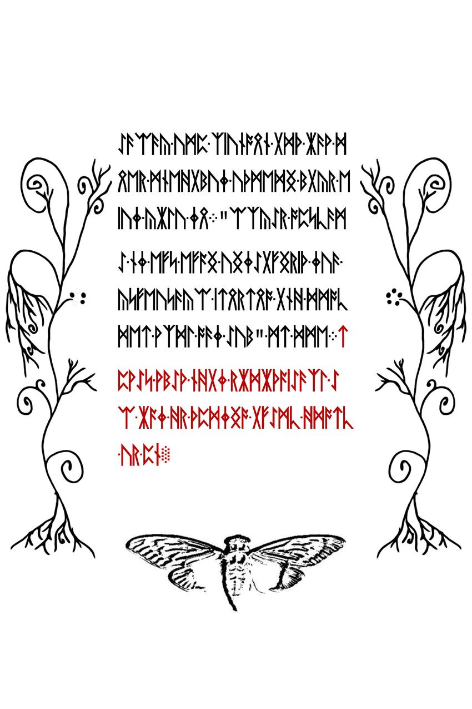

**Ciphertext** (krisyotam verbatim; `-` word separator, `.` = sentence dot (see p56 L1 `END.`), `/` = line end; standalone `&` (18×) / `$` (9×) / `§` (1×, book end p57) are krisyotam's transcription of the red dot-matrix ornaments — cipher-stream content, size mapping unconfirmed; `*` = red ink on owner-confirmed spans; `⟦'⟧`/`⟦"⟧` = image-only punctuation absent from the transcription, ≈word slot estimated. Line numbers = krisyotam lines (≠ image lines on solved pages, which wrap mid-word); printed Roman/Arabic content is omitted by krisyotam and appended below where known):

```
 1  ᛇᚫᛠᚫᚣ-ᚢᛗᛈ-ᛉᛁᚢᚾᚩᛟᚾ-ᚷᛞᚦ-ᛡᚫᚹ-ᛞ/   = EOAEEAAEY UMP XIUNOOEN GDTH IAAEW D/
 2  ᛟᛖᚱ-ᛗᚾᛖᚻᚷᛒᚢᛄ-ᚢᚦᛗᛖᛞᛝ-ᛒᚷᚣᚱ-ᛖ/   = OEER MNEHGBUJ UTHMEDNG BGYR E/
 3  ᛁᚢᛄ-ᚣᛡᛚᚢ-ᛄᛟ◆4"ᛠᛉᚣᛇᚱ-ᚩᛈᛋᚳᚫᛗ/   = IUJ YIALU JOE."EAXYEOR OPSCAEM/
 4  ᛇ-ᚾᛄ-ᛖᚠᛋ-ᛖᚠᚪᛝ-ᚢᛝᛄᛇᚷᚠᛝᚱᛁᚦ-ᛄᚢᚫ-/   = EO NJ EFS EFANG UNGJEOGFNGRITH JUAE /
 5  ᚣᛋᚠᛖᚢᛋᚫᚣᛠ-ᛁᛏᛟᚱᛏᛟᚩ-ᚷᚾᚻ-ᛞᛗᚩᚳ/   = YSFEUSAEYEA ITOERTOEO GNH DMOC/
 6  ᛞᛖᛏ-ᚹᛉᛞᛚ-ᚩᚫᛄ-ᛇᚢᛒ"-ᛗᛏ-ᛞᛗᛖ◆4ᛏ*/   = DET WXDL OAEJ EOUB" MT DME.T*/
 7  ᛈ*ᚹ*ᛇ*ᛋ*-*ᚹ*ᛒ*ᛇ*ᚦ*-*ᚾ*ᚻ*ᚷ*ᛄ*-*ᚱ*ᛡ*ᛞ*ᛡ*ᚦ*ᚪ*ᛁ*ᛇ*ᚫ*ᛉ*ᛚ*-*ᛇ*/   = P*W*EO*S* *W*B*EO*TH* *N*H*G*J* *R*IA*D*IA*TH*A*I*EO*AE*X*L* *EO*/
 8  ᛠ*-*ᛡ*ᚪ*ᛄ*-*ᚻ*ᚱ*-*ᚦ*ᛈ*ᛞ*ᛄ*ᛝ*ᚩ*-*ᚷ*ᚠ*ᛇ*ᛗ*ᚳ*-*ᚻ*ᛞ*ᚩ*ᛏ*ᚳ*/   = EA* *IA*A*J* *H*R* *TH*P*D*J*NG*O* *G*F*EO*M*C* *H*D*O*T*C*/
 9  -*ᚢ*ᚱ*-*ᛈ*ᚾ*◆13*/   =  *U*R* *P*N*¶*/
10  &
```

**Notes:incorrect, red letters begin last letter of line 6 and continue to end. Also, double quote mid lines 3 and 6**

## p54 (unsolved)

Known: red head **words** (line 1)

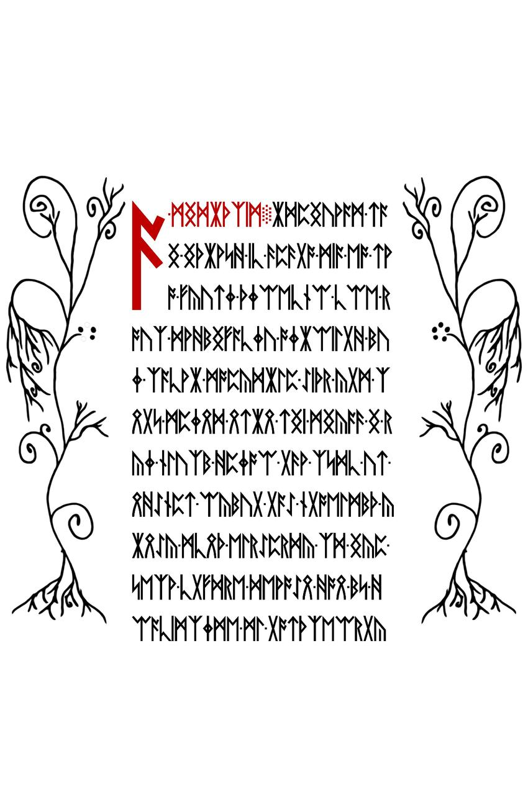

**Ciphertext** (krisyotam verbatim; `-` word separator, `.` = sentence dot (see p56 L1 `END.`), `/` = line end; standalone `&` (18×) / `$` (9×) / `§` (1×, book end p57) are krisyotam's transcription of the red dot-matrix ornaments — cipher-stream content, size mapping unconfirmed; `*` = red ink on owner-confirmed spans; `⟦'⟧`/`⟦"⟧` = image-only punctuation absent from the transcription, ≈word slot estimated. Line numbers = krisyotam lines (≠ image lines on solved pages, which wrap mid-word); printed Roman/Arabic content is omitted by krisyotam and appended below where known):

```
 1  ᚪ*-*ᛗ*ᛝ*ᛞ*ᛡ*ᚦ*ᛉ*ᛁ*ᛗ*◆13*ᛡᛞᛈᛝᚢᚹᚪᛗ-ᛏᚪ/   = A* *M*NG*D*IA*TH*X*I*M*¶*IADPNGUWAM TA/
 2  ᛝ-ᛝᚦᛡᚹᛋᚻ-ᛁᚳ-ᚫᛈᚫᚷᚩ-ᛗᛁᚪ-ᛖᚩ-ᛏᚹ/   = NG NGTHIAWSH IC AEPAEGO MIA EO TW/
 3  ᚩ-ᚠᚣᚢᛏᛄ-ᚦᛄᛠᛖᚳᚾᛠ-ᚳᛠᛖ-ᚱ/   = O FYUTJ THJEAECNEA CEAE R/
 4  ᚩᚢᛉ-ᛞᚹᚻᛒᛝᚠᚪᚳᛄᚢ-ᚩᛄᛡᛠᛁᛚᚷᚻ-ᛒᚢ/   = OUX DWHBNGFACJU OJIAEAILGH BU/
 5  ᛄ-ᛉᚪᚳᚹᛡ-ᛗᚩᛈᚣᛞᛡᛚᛈ-ᛇᛁᚦᚱ-ᚣᚷᛗ-ᛉ/   = J XACWIA MOPYDIALP EOITHR YGM X/
 6  ᛟᚷᛋ-ᛗᛈᛄᛟᛞ-ᛟᛏᛡᛟ-ᛏᛝᛁ-ᛗᛝᚣᚪᚫ-ᛝ-ᚱ/   = OEGS MPJOED OETIAOE TNGI MNGYAAE NG R/
 7  ᚣᛄ-ᚾᛚᚢᛉᛒ-ᚻᛈᛄᚩᛠ-ᚷᚫᚹ-ᛉᛋᛞᚳ-ᚢᛏ-/   = YJ NLUXB HPJOEA GAEW XSDC UT /
 8  ᛟᚻᛇᚾᛈᛏ-ᛠᚣᛒᚢᚷ-ᚷᚪᛇ-ᚾᚷᚩᛖᛚᛗᛒᚦ-ᚣ/   = OEHEONPT EAYBUG GAEO NGOELMBTH Y/
 9  ᛡᛟᛇᚣ-ᛗᚳᛟᚦ-ᛖᛚᚱᛇᛈᚱᛞᚣ-ᛉᛞ-ᛝᚣᛈ-/   = IAOEEOY MCOETH ELREOPRDY XD NGYP /
10  ᛋᛖᛉᚹ-ᚳᚷᚠᛞᚱᛖ-ᛞᛖᚹᚩᛇᛟ-ᚻᚩᛟ-ᛒᛋ-ᚻ/   = SEXW CGFDRE DEWOEOOE HOOE BS H/
11  ᛠᚪᚳᛁᛗᛉᛄᛗᛖ-ᛗᛚ-ᚷᚩᛏᚦᛉᛖᛠᚱᚷᚣ/   = EAACIMXJME ML GOTTHXEEARGY/
```

**Notes:**

## p55 (unsolved)

Known: red only via dot-lattice (section terminator)


**Ciphertext** (krisyotam verbatim; `-` word separator, `.` = sentence dot (see p56 L1 `END.`), `/` = line end; standalone `&` (18×) / `$` (9×) / `§` (1×, book end p57) are krisyotam's transcription of the red dot-matrix ornaments — cipher-stream content, size mapping unconfirmed; `*` = red ink on owner-confirmed spans; `⟦'⟧`/`⟦"⟧` = image-only punctuation absent from the transcription, ≈word slot estimated. Line numbers = krisyotam lines (≠ image lines on solved pages, which wrap mid-word); printed Roman/Arabic content is omitted by krisyotam and appended below where known):

```
 1  ᛝ-ᚫᛗᛁᚹ-ᛋᛒ-ᛉᛗ-ᛋᛇᚷᛞᚦᚫ-ᚠᛡᚪᛒᚳᚢ-ᚹᚱ-ᛒ/   = NG AEMIW SB XM SEOGDTHAE FIAABCU WR B/
 2  ᛠᚠᛉᛁᛗᚢᚳᛈᚻᛝᛚᛇ-ᛗᛋᛞᛡᛈᚠ-ᛒᚻᛇᚳ-/   = EAFXIMUCPHNGLEO MSDIAPF BHEOC /
 3  ᛇᛖ-ᛠᛖᛁᚷᛉᚷᛋ-ᛖᛋᛇᚦᚦᛖᛋ-ᚦᛟ-ᚳᛠᛁᛗ/   = EOE EAEIGXGS ESEOTHTHES THOE CEAIM/
 4  ᚳᛉ-ᛞᛄᚢ-ᛒᛖᛁ◆13*/   = CX DJU BEI¶*/
 5  &
 6  $  
```

**Notes:**

## p56 (solved)

Known: SOLVED closing page


**Ciphertext** (krisyotam verbatim; `-` word separator, `.` = sentence dot (see p56 L1 `END.`), `/` = line end; standalone `&` (18×) / `$` (9×) / `§` (1×, book end p57) are krisyotam's transcription of the red dot-matrix ornaments — cipher-stream content, size mapping unconfirmed; `*` = red ink on owner-confirmed spans; `⟦'⟧`/`⟦"⟧` = image-only punctuation absent from the transcription, ≈word slot estimated. Line numbers = krisyotam lines (≠ image lines on solved pages, which wrap mid-word); printed Roman/Arabic content is omitted by krisyotam and appended below where known):

```
 1  ᚫ*ᛄ*-*ᛟ*ᛋ*ᚱ*◆13*ᛗᚣᛚᚩᚻ-ᚩᚫ-ᚳᚦᚷᚹ-ᚹᛚᚫ◆4ᛉ/   = AE*J* *OE*S*R*¶*MYLOH OAE CTHGW WLAE.X/
 2  ᚩᚪᛈ-ᛗᛞᛞᚢᚷᚹ-ᛚ-ᛞᚾᚣᛄ-ᚳᚠᛡ-ᚫᛏ/   = OAP MDDUGW L DNYJ CFIA AET/
 3  ᛈᛇᚪᚦ-ᚳᚫ◆10*/   = PEOATH CAE†*/
 4  ᚳᛞ-ᚠᚾ-ᛡᛖ-ᚠᚾᚳᛝ-ᚱᚠ-ᚫᛁᚱᛞᛖ-ᛋᚣᛄᛠᚢ/   = CD FN IAE FNCNG RF AEIRDE SYJEAU/
 5  ᛝᚹ-ᛉᚩ-ᛗᛠᚹᚠ-ᚱᚷᛡ-ᛝᚱᛒ-ᚫᚾᚢᛋ◆13*/   = NGW XO MEAWF RGIA NGRB AENUS¶*/
 6  &
 7  $
```

Printed hex lines (omitted by krisyotam — runes-only extraction; the onion address):

```
36367763ab73783c7af284446c
59466b4cd653239a311cb7116
d4618dee09a8425893dc7500b
464fdaf1672d7bef5e891c6e227
4568926a49fb4f45132c2a8b4
```

**Plaintext** (phi(prime) shift + skip-F decode; community-verified,
scream314 lineage; the image wraps mid-word at its column width — wraps
shown as printed, `EUERY` = V-for-U spelling):

```
AN END
WITHIN THE DEEP WEB THERE EXISTS A PAGE THAT HASHES TO
[the five hex lines above — the hash target, not an address]
IT IS THE DUTY OF EUERY PILGRIM TO SEEK OUT THIS PAGE
```

**Notes:** Not sure what "every clear-text F is an ᚠ to be skipped" means; I only just figured out that "th" is drawn as a single symbol in the runic plaintext (presumably 'thorn') which affects how we run cryptanalysis!

**Machine reply:** (1) skip-F: on p56 every rune is shifted by the phi(prime)
key EXCEPT the letter F — the encoder wrote plaintext F's unshifted as plain
ᚠ, so when decoding you don't un-shift an ᚠ, you just read F. Visible in
`ᚱᚠ` = OF (ᚱ un-shifts to O, ᚠ is already F). (2) Thorn: correct — ᚦ is ONE
symbol = TH (it's value 2 in our core table; several other values are
multi-letter too). Symbol counts ≠ English letter counts; our value streams
already treat ᚦ as one glyph, so the corpus is safe, but any letter-frequency
work must use the letter expansion, not raw symbol counts.

## p57 (solved)

Known: 23-dot lattice (book end) + RED inline matrix after red word (S8b CONFIRMED) + bottom decoration; SOLVED closing page


**Ciphertext** (krisyotam verbatim; `-` word separator, `.` = sentence dot (see p56 L1 `END.`), `/` = line end; standalone `&` (18×) / `$` (9×) / `§` (1×, book end p57) are krisyotam's transcription of the red dot-matrix ornaments — cipher-stream content, size mapping unconfirmed; `*` = red ink on owner-confirmed spans; `⟦'⟧`/`⟦"⟧` = image-only punctuation absent from the transcription, ≈word slot estimated. Line numbers = krisyotam lines (≠ image lines on solved pages, which wrap mid-word); printed Roman/Arabic content is omitted by krisyotam and appended below where known):

```
 1  ᛈ*ᚪ*ᚱ*ᚪ*ᛒ*ᛚ*ᛖ*◆13*ᛚᛁᚳᛖ-ᚦᛖ-ᛁᚾᛋᛏᚪᚱ-ᛏ/   = P*A*R*A*B*L*E*¶*LICE THE INSTAR T/
 2  ᚢᚾᚾᛖᛚᛝ-ᛏᚩ-ᚦᛖ-ᛋᚢᚱᚠᚪᚳᛖ◆4/   = UNNELNG TO THE SURFACE./
 3  ᚹᛖ-ᛗᚢᛋᛏ-ᛋᚻᛖᛞ-ᚩᚢᚱ-ᚩᚹᚾ-ᚳ/   = WE MUST SHED OUR OWN C/
 4  ᛁᚱᚳᚢᛗᚠᛖᚱᛖᚾᚳᛖᛋ◆4ᚠᛁᚾᛞ-ᚦ/   = IRCUMFERENCES.FIND TH/
 5  ᛖ-ᛞᛁᚢᛁᚾᛁᛏᚣ-ᚹᛁᚦᛁᚾ-ᚪᚾᛞ-ᛖᛗᛖᚱᚷᛖ◆23*/   = E DIUINITY WITHIN AND EMERGE§*/
 6  §
```

**Plaintext** (default gematria — no shift; read straight off the runes;
community-verified, scream314 lineage; `◆13*` = the red inline matrix you
confirmed at L1, sitting where the colon is):

```
Parable : like the instar tunneling to the surface.
We must shed our own circumferences. Find the
divinity within and emerge.
```

**Notes: So this is in runic plaintext!! Is this the only page we can read without decryption?**

**Machine reply:** Effectively yes — p57 uses the DEFAULT gematria (no shift),
so transliterating runes→letters reads straight as English; it's still a
substitution, just the identity one. p56 is the same mapping + the phi(prime)
shift + skip-F. No other page reads without an unbroken key (p50/p51 are
readable Roman/Arabic tokens but they're key material, not English).

---

## Broad observations (anything not tied to one page)

I don't know if it needs to be said, but I believe the base 60 Roman/Arabic data on pages 49, 50, and 51 represent one continuous stream of data across those 3 pages, and I am hoping that they have generally been combined throughout most analysis rather than treating them as separate artifacts.

__

__