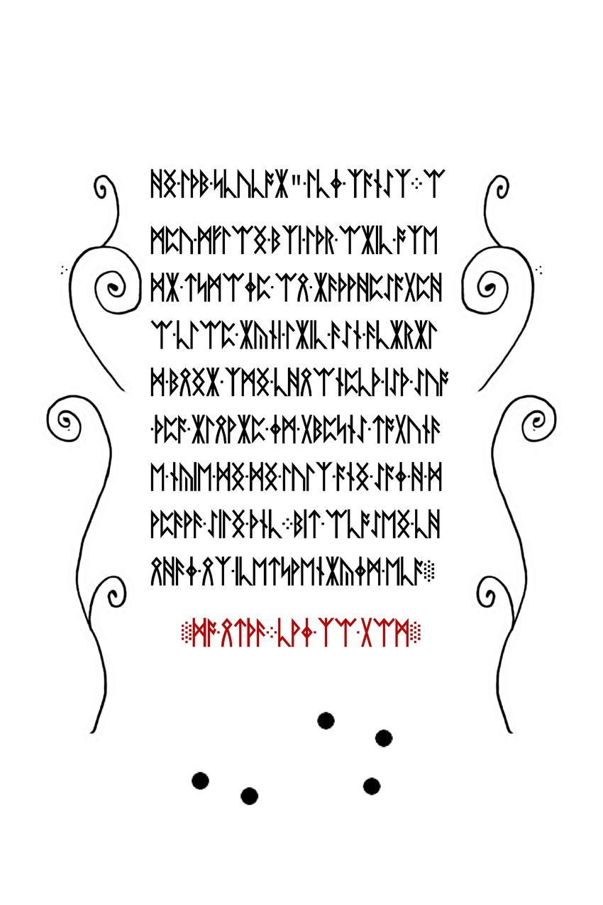
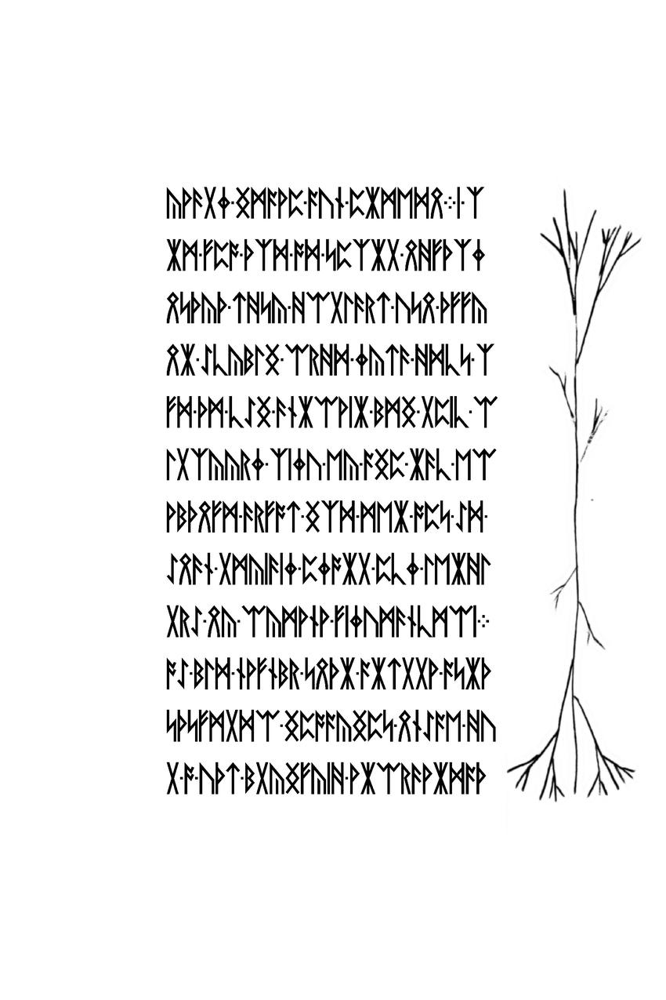
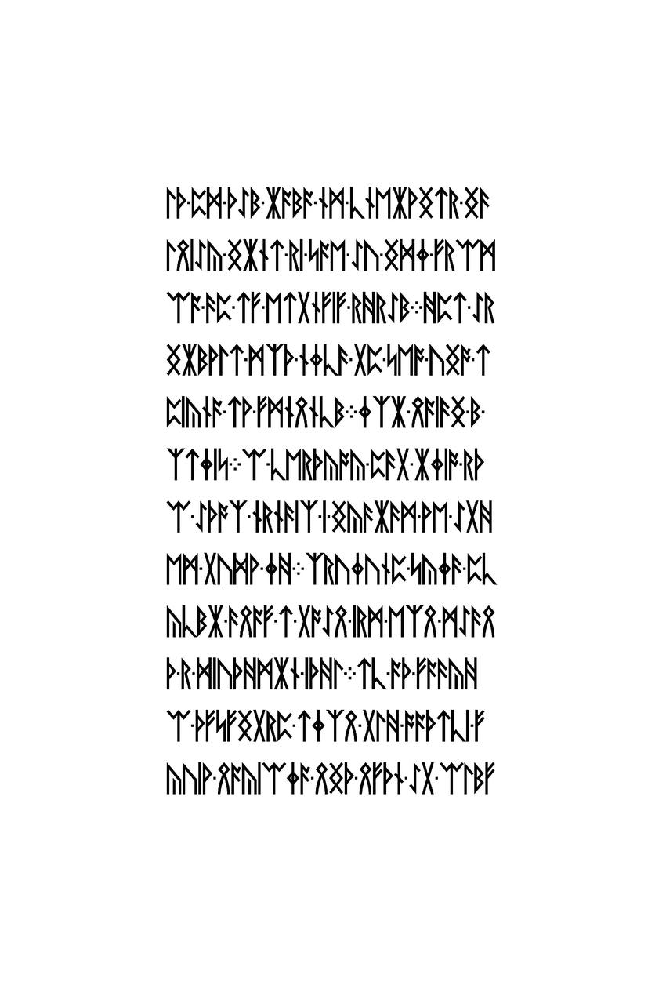
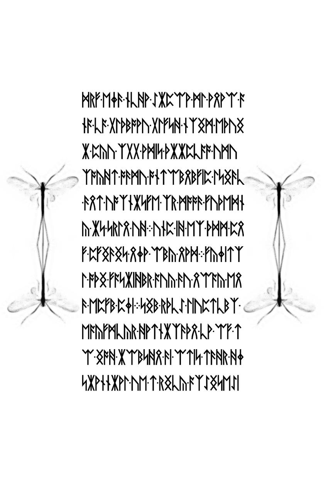
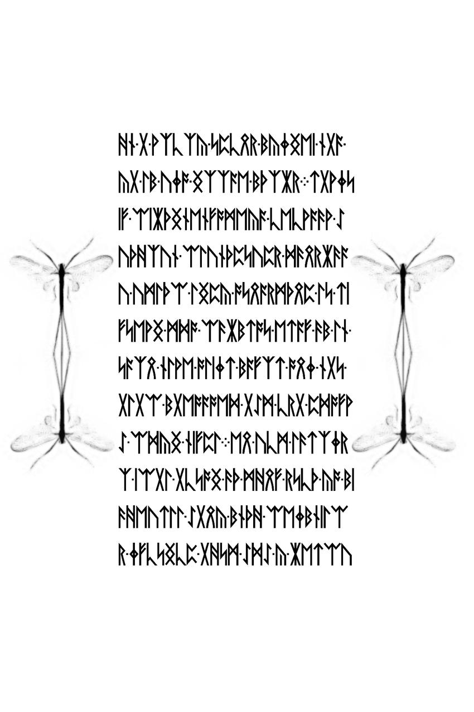
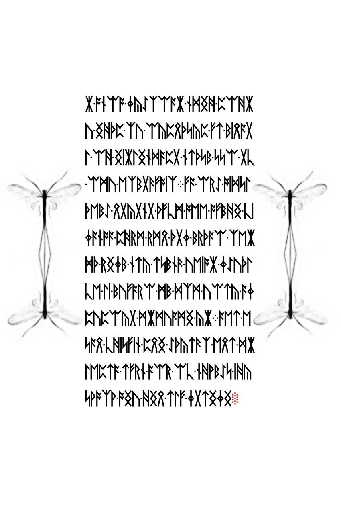
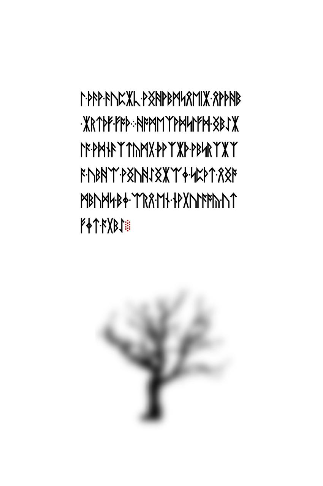
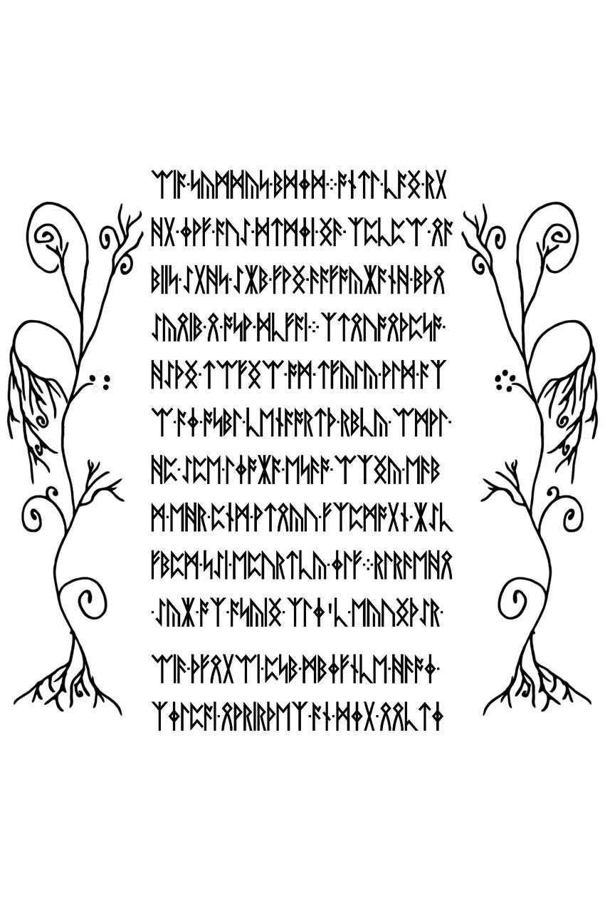
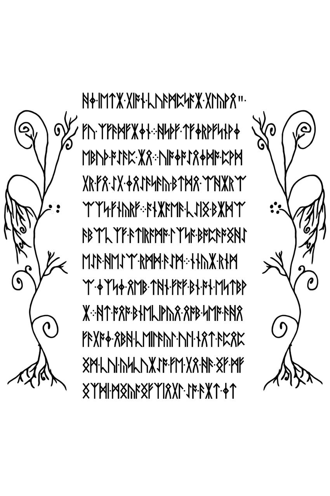
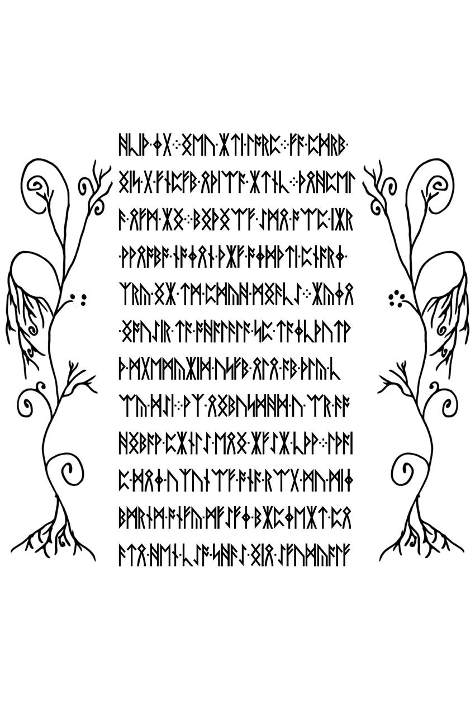

# Oracle page walkthrough — all LP2 pages, open notes

Companion to ORACLE_QUEUE.md: the queue asks *specific* questions; this file
is for *anything you notice* on a page that we may have missed. You do not
have to fill every page — partial notes on any subset are gold. Skip a page
by leaving its Notes line empty.

Conventions: page numbers = BOOK numbers (0–57; p50 = runeless token page;
pp56–57 = solved closing pages). Red ink uses `*` per red glyph. "Known"
lists what the machine census + your previous answers already account for —
anything NOT in that list is news to us.

### Legend — copy/paste runes & symbols

Runes (value = our corpus code, letter = Gematria reading):

    ᚠ F  ᚢ U  ᚦ TH  ᚩ O  ᚱ R  ᚳ C  ᚷ G  ᚹ W  ᚻ H  ᚾ N  ᛁ I  ᛄ J  ᛇ EO
    ᛈ P  ᛉ X  ᛋ S  ᛏ T  ᛒ B  ᛖ E  ᛗ M  ᛚ L  ᛝ NG  ᛟ OE  ᛞ D  ᚪ A  ᚫ AE
    ᚣ Y  ᛡ IA  ᛠ EA

Transcription symbols (krisyotam): `-` word dot · `.` sentence dot · `/`
line end · `*` after a rune = red ink · `⟦'⟧` `⟦"⟧` = apostrophe / double
quote seen in the image but ABSENT from the transcription.

Owner annotation symbols (adopted 2026-11-17, pp0–7 pass — you fill these
directly into the Ciphertext lines; the generator never overwrites a line
containing them):

- `◆N` = dot-lattice/diamond of N dots rendered at that position (replaces
  krisyotam's `.` or `&` there). `◆4` black 4-dot diamond · `◆10` red 10-dot
  · `◆13` red 13-dot · `◆23` red 23-dot (book end). `◆3` = 3-dot, assumed a
  line-wrapped `◆4` for decryption purposes (your p5 note).
- `*` after `◆` = red lattice (same red-ink convention).
- `//` = small vertical break (paragraph-style) · `///` = large vertical
  break (section boundary).
- Line numbers stay **krisyotam's** (his `&`/`$`/`§` blank lines count as
  numbered lines — every campaign index uses his numbering), so a page's
  numbering can exceed the visible text lines.

Ornaments — two alphabets, keep them straight:

- Krisyotam's own (in the Ciphertext lines): `&` (18×), `$` (9×), `§` (1×,
  p57 book end) — standalone segments where you saw dot-lattices. Which
  size is which is UNCONFIRMED (that's a question for you below).
- Your pp0–7 pass suggests: `&` at section ends ↔ `◆13` (p2 L9–11, p3 L6–8,
  p6 L4–6, p7 L9–13), and many `.` sentence dots are actually rendered
  `◆4` black diamonds. Confirm/correct as you continue past p7.

Broad questions worth a thought as you flip (answer inline anywhere):

- Do word-separator dots (·) ever differ in size/shape from page to page?
- Any pages where the margin decoration differs from the usual scroll motif?
- Do the 4-dot black diamonds and the red dot-matrices ever appear on the
  SAME page? Same line?
- Anything that repeats visually across pages but is not in the Known list?

---

## p0 (unsolved)

Known: red head word (line 1) ** words, since they contain one - and terminated by red 13 dot lattice


**Ciphertext** (krisyotam verbatim; `-` word separator, `.` = sentence dot (see p56 L1 `END.`), `/` = line end; standalone `&` (18×) / `$` (9×) / `§` (1×, book end p57) are krisyotam's transcription of the red dot-matrix ornaments — cipher-stream content, size mapping unconfirmed; `*` = red ink on owner-confirmed spans; `⟦'⟧`/`⟦"⟧` = image-only punctuation absent from the transcription, ≈word slot estimated. Line numbers = krisyotam lines (≠ image lines on solved pages, which wrap mid-word); printed Roman/Arabic content is omitted by krisyotam and appended below where known):

```
 1  ᛋ*ᚻ*ᛖ*ᚩ*ᚷ*ᛗ*ᛡ*ᚠ*-*ᛋ*ᚣ*ᛖ*ᛝ*ᚳ*◆13ᚦᛄᚷᚫ-ᚠᛄᛟ-/   red 13-dot lattice
 2  ᚩᚾᚦ-ᚾᛖᚹᛒᚪᛋᛟᛇᛁᛝᚢ-ᚾᚫᚷᛁᚦ-ᚻᛒᚾᛡ-/
 3  ᛈᛒᚾ-ᛇᛄᚦ-ᚪᛝᚣᛉ-ᛒᛞᛈ-ᛖᛡᚠᛉᚷᚠ-/
 4  ᛋᛈᛏᚠᛈᚢᛝᚣᛝᛉᛡ-ᚣᚻ-ᛒᚢ-ᚷᚩᛈ-ᛝᚫᚦ-ᛁ/
 5  ᚫᚻᛉᚦᛈᚷ-ᚣᚠᛝᚳᛄ-ᚦᚪᛗᛁᛝᛁᛡᚣ-ᚻᛇ-ᛏᚻᚫ/
 6  ᛡ-ᛉᚣ-ᛖᚢᛝ-ᚳᚠᚾ-ᛇᚦᛄᛁᚦ-ᚦᛈ-ᚣᛝᛠ-ᚣᚾ/
 7  ᛖᚣ-ᛞᛉᛝᚹ-ᛒᚳᛉᛞᛒᚠ-ᛗᛏᚾᛖ-ᛠᛄᚾᛚᚷ/
 8  ᛒ-ᛉᚷᚦ◆4ᚣᛁᛞᚪ-ᛝᚷᛗᛄᚱᚩᛚᛇ-ᚣᛏᛈᛁᚦᛞᛄ-/
 9  ᛟᚻᛚ-ᛠ-ᚠᛉᚫᛈᚷᛉ-ᚠᛚᚹᛇᛏᚫ-ᚠᚷᚾ-ᛗᛇᛚᚾ-/
10  ᛝᛗᚠᚱᛡ-ᚪᛋ-ᛠᛗᛝᛉᛉᛇᛞᛒ-ᛟᛞᛗᚩ-ᛠ/
11  ᛇᚻ-ᛞᛝᚷ-ᛟᛝᛚᚢᚱᚾᛏ-ᚫᛋᚣᚢᚻᚱᛏ-ᚻᚳ-ᛋᛟ/
12  ᛏᛟᛝᚢᚱ-ᛋ-ᚠᚩᛖᚹᛠᛟᛚᚠᚫ-ᛗᚱᛝ-ᛞᚪᛗᚱ-ᚹ/
```

**Notes:**

## p1 (unsolved)

Known: —


**Ciphertext** (krisyotam verbatim; `-` word separator, `.` = sentence dot (see p56 L1 `END.`), `/` = line end; standalone `&` (18×) / `$` (9×) / `§` (1×, book end p57) are krisyotam's transcription of the red dot-matrix ornaments — cipher-stream content, size mapping unconfirmed; `*` = red ink on owner-confirmed spans; `⟦'⟧`/`⟦"⟧` = image-only punctuation absent from the transcription, ≈word slot estimated. Line numbers = krisyotam lines (≠ image lines on solved pages, which wrap mid-word); printed Roman/Arabic content is omitted by krisyotam and appended below where known):

```
 1  ᚪᛁᛗᛋᚾ-ᛋᛟᚱᚢᚹᛋᛚᛡ◆4ᛟᚪᚫᛝᛋᛞᛈᛏ-ᚳᚱᚦ/
 2  ᛡ-ᚱᛒᚩᛞᚦᚠ-ᚣᛉᛁᛏ◆4ᛟᛁ-ᚠᛚᚩ-ᚠᛠ-ᚱᚩᛟᛗᚻ/
 3  ᛗᚷᛈᚻ-ᚫᚻᚾᚩᚻᚣ-ᛟᛋᛚ-ᚾᚷ-ᚫᚣ-ᛟᚳᛒᛚᛄ-ᛝ/
 4  ᛚᛟ-ᚫᛄᛠᚹ-ᛠᚦᚩ-ᛒᛟᚣ-ᚳᚠᚳᛄ-ᛚᚫ◆4ᚾ-ᚦᛈ-/
 5  ᚢᛉ-ᛟᛉᚷ-ᛈᚠᛋᛇᚫᛟ-ᛝᛈᛇᚩᛖᚪ-ᚷᚫᛡᛝᚦᚩ/
 6  -ᛈᚪᛟᚦᚱᛝᚫ-ᚳᛋᛒᛇᚣᚻ-ᛏᛉᛖᛚᚱ◆4ᚷᚹᚣ-ᛄᚠ/
 7  ᛁᚾᛡᚳᚣᛠᛁᛡ-ᚩᚦ-ᛖᚳᚫᚳᛉᛡᛠ-ᚩᛚᚳ-ᚠᚱ/
 8  ᛞᛝᛖᚢ-ᛞᚳᛚᛠᛋᛉᚳᚷᛡ◆4ᚹᛋᚦ-ᚠᛞᛝ-ᛁᛡ/
 9  ᛗᚪᚫᚷ-ᚹᛋ-ᚾᛞ-ᚳᛈᚦᛉᛈᛠᛠ-ᚹᚢ-ᛠᚹ-ᚠᚹ/
10  ᛄᚣ-ᛉᛞᚹᚳᚷᚳᛟ-ᛞᛉᛟ-ᚱᛡᚷ-ᚾᛈᚪᚣᛈ-ᚳ/
11  ᚣᚻ-ᚠᛖᛄᛠᚾ-ᛟᚫ-ᚢᚪ-ᚻᚱ-ᛖᛠᚦᚠᛄᚪ-ᛚᛉ/
12  ᛋᛏ-ᛗᚠᛚᚠᛏ-ᚷᛁᚦ-ᚢᛚᚷ-ᛉᛠᛏᛋᛚᛄᛈ-ᛚᛉᛁ/
```

**Notes:**

## p2 (unsolved)

Known: red only via dot-lattice (13 dot section terminator)


**Ciphertext** (krisyotam verbatim; `-` word separator, `.` = sentence dot (see p56 L1 `END.`), `/` = line end; standalone `&` (18×) / `$` (9×) / `§` (1×, book end p57) are krisyotam's transcription of the red dot-matrix ornaments — cipher-stream content, size mapping unconfirmed; `*` = red ink on owner-confirmed spans; `⟦'⟧`/`⟦"⟧` = image-only punctuation absent from the transcription, ≈word slot estimated. Line numbers = krisyotam lines (≠ image lines on solved pages, which wrap mid-word); printed Roman/Arabic content is omitted by krisyotam and appended below where known):

```
 1  ᛟᛗ-ᚢ◆4ᚻᛏ-ᛒᛇᛚᛞᚻᛒᛗ-ᛠᚱᛒ-ᚾᚻᛒᛖᚷᛇ-/
 2  ᛞᛚᚹᛇᛡᛈᚩ-ᚻᛖᛠ-ᚹᛁᚱᛁᚻ-ᚢᚦᚻᚣ-ᚾᛉᛒᚷᛄ/
 3  ᛈᚢ-ᛝᛠᚠᚾᛁᛖᛞᛡᛝᚱ-ᛞᛒᛄᛡᛟᛗᛁ-ᚠᛏ-ᛄ/
 4  ᛞᛁᚦᚱᛚᛋ-ᛖᛇᚩᚷᛒᛏᛞ-ᚦᚪᚾᚳᚣ-ᛡᛋᚦᛞ-ᛝᚠᛚ/
 5  ᛖᚷᚻᚳ-ᛖᚩᛁᛏᚾᛉ-ᛈᛏᚠᚻᚱᛞᛖᚠᛏ-ᚫᚹᚻ-ᛒ/
 6  ᚳ-ᚠ-ᛈᚪᛚᚢᛠᚾᛚᛄ-ᛄᚳᛚᚹᛠᛞᚢᛞᛇ-ᛠᛉ/
 7  ᛞᚹᚻᛠ-ᚦᛡᚫᚳᛚᛏᚹᛖᛁᚳ-ᛈᛟᛞᚳ-ᚾᚻᚪ-ᚱᛁᚷ/
 8  ᚦᛠᛖᛏᚷ-ᚦᚻᚩᛡᚹᚫᛄᛖ-ᛝᛠᛞ-ᚩᚫ-ᚪᛚ-ᛒᛄ/
 9  ᚳᚢᛉᛏᚪᛒᛄᛈ-ᚠᛠ-ᚻᛞᚾᛡᚢᛈᛋᚢᚹ◆13*/
10  &
11  $
```

**Notes:**

## p3 (unsolved)

Known: red head word (line 1); red inline dot-matrix ** 13 dot lattice ** after red word (seen 2026-11-16) ** red head word line 7, 3 glyphs followed by 13 dot lattice ** 


**Ciphertext** (krisyotam verbatim; `-` word separator, `.` = sentence dot (see p56 L1 `END.`), `/` = line end; standalone `&` (18×) / `$` (9×) / `§` (1×, book end p57) are krisyotam's transcription of the red dot-matrix ornaments — cipher-stream content, size mapping unconfirmed; `*` = red ink on owner-confirmed spans; `⟦'⟧`/`⟦"⟧` = image-only punctuation absent from the transcription, ≈word slot estimated. Line numbers = krisyotam lines (≠ image lines on solved pages, which wrap mid-word); printed Roman/Arabic content is omitted by krisyotam and appended below where known):

```
 1  ᛚ*ᛄ*-*ᛇ*ᚻ*ᛝ*ᚳ*ᚦ*ᛏ*ᚫ*ᛄ*ᛏ*ᛉ*ᚻ*-*ᛏ*ᚢ*ᛟ*◆13ᛋᛈᚱᚷ/   red inline dot-matrix
 2  -ᚣᚾᚪᚷᛇᛝᚾ-ᚹᚠᚣᚾᛒᛠᛡ-ᛈᚾᚣᚪᛋᛗ/
 3  ᛒ-ᛡᛠᛡᛁ-ᚩᛒᚱᚾᛚᛠ-ᚱᛚᛚᛖᛒᚹᚾᚻᛗᚠ/
 4  ᛟᛒ-ᛝ-ᚱᚪᛡᚷᛟᛇᛏᛗᛉ-ᛞᛇ-ᛗᚣᚻᛠ-ᛁᛚᛋ-ᚾ/
 5  ᚹᚳᚠᛈᛗᛈᛚ-ᛠᛋᚦᚠᛟᛡ-ᚦᛖᚣ-ᚳᛄᛚᚳᛡᛗ-/
 6  ᛒᛞᚳᛇ-ᛄᛁᛏᛟ-ᛞᛠᛖᛡᚾᛏ◆13///  
 7  &
 8  ᛈ*ᛞ*ᚦ*◆13*ᛇᛞᛇ-ᚫᛚᚳ-ᛡᛇ-ᛠᚻ-ᚹᛗᚣᚦ/
 9  ᚢ-ᚻᛏᚦᚱᚻᛝ-ᛚᛝᛋ-ᚾᚫᛠᚷᛋᛚ-ᛋᛉ/
10  ᚩᚻᚹᛞᛗᛖᛗᚪᚠ-ᚳᚣᚳᚫᚾ-ᛏᚦᚷ-ᛁᛄᛁ/
11  -ᚳᛞᛡᛉ-ᚻᚫᚫᛠᚷ-ᛠᛝ-ᚠᛏᚩᚱᛞᚳᛇ-ᚠᚢ/
12  ᛉᛠᛒᚩ-ᛉᛁᚣᚷᛋᛋᛒᛠ-ᚩᛁᛈ-ᛁᛄᛁᚩᛖ-ᚻᛠᚻ/
```

**Notes: /// is large vertical break between sections**

## p4 (unsolved)

Known: —


**Ciphertext** (krisyotam verbatim; `-` word separator, `.` = sentence dot (see p56 L1 `END.`), `/` = line end; standalone `&` (18×) / `$` (9×) / `§` (1×, book end p57) are krisyotam's transcription of the red dot-matrix ornaments — cipher-stream content, size mapping unconfirmed; `*` = red ink on owner-confirmed spans; `⟦'⟧`/`⟦"⟧` = image-only punctuation absent from the transcription, ≈word slot estimated. Line numbers = krisyotam lines (≠ image lines on solved pages, which wrap mid-word); printed Roman/Arabic content is omitted by krisyotam and appended below where known):

```
 1  ᛚᛡ-ᚣᛈᛉᛁᚹᛗᚳᛁ-ᛚᚷᚠᚾᛡᚳᛉ-ᛈᚩᚱᛡ-ᚻ-ᛄ/
 2  ᛗ-ᛟᛉᛝ-ᚢᛗᛇᛠᚷᛝ-ᛝᚹᚳ-ᛚᛝᚢ-ᛉᛄᚠᛟ/
 3  ᚢ-ᚷᛠ-ᛗᛉ-ᚪᚹ-ᛚᚢᛉᚫ-ᛗᛞᛝᚻᚱᚣ-ᚻᚪ-ᚷᛁ/
 4  ᚠᚷᚳ-ᚫᛝᛄᛇᛉᛡ-ᚾᚦᛒᚢᛄᚱ◆4ᚹ-ᚷᛚᛟᚷ-ᚦᛇᚠ-/
 5  ᚦᛠᛁ-ᛋᚷ-ᚷᚣ-ᛠᛡᛈ-ᛡᚫᛚ◆4ᚦᛠᛉᚫ-ᛖᛗ/
 6  ᛖᛏᛟᛏ-ᛠᚳᚠ-ᚳᛠᚷ-ᚦ-ᛈᛁᚳᚾ◆4ᛇᚣᛝᛄᛝ/
 7  ᛗᚹᚳᚾ-ᛒᚣᛠ-ᚩᛟᚷᚱ-ᛗᚱᛗᛈᛡᚹ-ᚫᛟᚦᛟ-ᛈ/
 8  ᛉᛄᛚ-ᚱᛚᚱᛒᚪᛈᛏᛉᛚᛏ-ᛗᛉᛁᚹ◆4ᛄᛋᛟᛗᚾᚱ//
 9  ᛖᛒᛋ-ᚳᛏᛚᛟ-ᛋᛒᚠᛉᚦᚪᛠᚢ-ᛇᛉ-ᚱᚷᛏᛇᛠ/
10  ᛁᛄᛒᛟ-ᛉᚷᛄᛝ-ᛠᚦ-ᚱᛝᛒ-ᚾᚢᚪᛝᛒᛈᛋᛠ-ᛈ/
11  ᚹᚩᚻᛖ-ᚫᛇᚷᚾᚫᛋᛇ-ᚩᛈᛗ-ᛖᛉᛡᛒᚹ-ᚢᛖᛁᛞ-/
12  ᛈᚪᛇᚷᛋᚳᚷᛞᛈᚣ-ᛡᛚᚦᚱ-ᚳᚢᚠᛇᚦ-ᛉᛖᛚ-ᚢ/
```

**Notes: // is small vertical break between sets of lines, like a paragraph end/begin?**

## p5 (unsolved)

Known: —


**Ciphertext** (krisyotam verbatim; `-` word separator, `.` = sentence dot (see p56 L1 `END.`), `/` = line end; standalone `&` (18×) / `$` (9×) / `§` (1×, book end p57) are krisyotam's transcription of the red dot-matrix ornaments — cipher-stream content, size mapping unconfirmed; `*` = red ink on owner-confirmed spans; `⟦'⟧`/`⟦"⟧` = image-only punctuation absent from the transcription, ≈word slot estimated. Line numbers = krisyotam lines (≠ image lines on solved pages, which wrap mid-word); printed Roman/Arabic content is omitted by krisyotam and appended below where known):

```
 1  ᚱᚫ-ᛉᚻᛄᚫᛗᛚᚠ-ᚳᛝᛞ-ᛁᛝᚩ-ᚳᛋᛟᛖᚣᛟᚻᚢ-/
 2  ᚷᛞᚹᚪ-ᛖᛋᚷᛝᚠᛉ-ᛞᛉᛄ-ᛠᚻᛁ-ᚦᛈᛉᚣ-ᛡ-/
 3  ᛇᛞᛇᛝᛇᛝ-ᛖᛠᛞᚱ-ᛚᛇᛏ-ᛉᛏᚣ-ᚱᛇ-ᛈᛝᛇ/
 4  ᛈᚩᛁᛚᛖᚠ-ᛇᚫᚪ-ᚣᛝᚠᚣ-ᚠᛞᚾᛚ-ᛉᛏᚾᚫᛋ◆4ᛁᚩ/
 5  ᚳᚢ-ᚣᛠᚾᛏᚷᚳᚪ-ᛉᛡᛇ-ᚦᛄᚣᛄᛚᛟᛖᛚ-ᚣ◆3/
 6  -ᛈᛡ-ᛖᚹᛟ-ᛇᚾᚪ-ᚻᛞᛇᛋ-ᚦᚣᛇᚦᛄᚦᚱᚢ-ᚳᛠ/
 7  ᚪ-ᚢᛄᛡᛈ-ᚣᚫᛇᛋ-ᚻᛠᛏᚣᛞᚣᚫᚠᚻᚩ-ᛟᛗ/
 8  ᛉᛟᛄᚷ-ᚢᛡᚱᛡᚳ-ᛁᚠᛟ-ᛁᛄᛈᛒ-ᛖᛝᚣᚦᚩᚫᚣ-/
 9  ᛠᛉᛡᛖᛚ-ᛁᚱᚣᛞᛠᛄ-ᚫᚳ-ᛗᚷᛁᚫᚢᚪᚫ-ᛄᚪ/
10  ᚻᛈ-ᚠᛞᛚᛁᛠᛈᛟᚣᚩ-ᚢᛒᚷᛝᛟᚢᛝᛋᚢᚳ-ᛏ/
11  ᛞ◆4ᚫᛈᚩᛄ-ᛒᚻᚱᛁᚷᚻᛄ-ᚣᚹᛗᛇᚾᚫ-ᛞᛝᛇ-ᛟᛄ/
12  ᛝᚳᛖᛠ-ᛉᚪᚱᚣ-ᚪᚢᛏ-ᚳᛈᚳ-ᚩᛇᛟ-ᚫᛈ-ᛏ/
```

**Notes:** ◆3 with - on next line may just be a word wrapped ◆4; let's assume this for now for decryption purposes

## p6 (unsolved)

Known: red head word (line 1) ** incorrect, red 13-dot lattice ends line 4, red head words (4) line 5 terminated by red 13 dot lattice


**Ciphertext** (krisyotam verbatim; `-` word separator, `.` = sentence dot (see p56 L1 `END.`), `/` = line end; standalone `&` (18×) / `$` (9×) / `§` (1×, book end p57) are krisyotam's transcription of the red dot-matrix ornaments — cipher-stream content, size mapping unconfirmed; `*` = red ink on owner-confirmed spans; `⟦'⟧`/`⟦"⟧` = image-only punctuation absent from the transcription, ≈word slot estimated. Line numbers = krisyotam lines (≠ image lines on solved pages, which wrap mid-word); printed Roman/Arabic content is omitted by krisyotam and appended below where known):

```
 1  ᛉᚳᛏᚻᛞᛇ-ᛉᛒᛠ-ᚫᚾᛄ-ᛠᚪᛒ-ᛖᛠᚹ-ᛡᛚ-/
 2  ᚹᛁᛡᛋᛈᛚᚦᚪᛋᛄ-ᛡᛞᚣᚱᛞᛟ-ᚦᚱᛉᛟᚹ-ᚣᛞᛏ-/
 3  ᚷᛚᛡᚻᚹᛗᚱ-ᛝᚠᚳ-ᚱᚫᛁᛒᚷᛈᚣ-ᛞᚪᚱᚪᛉᛟ-ᚢ/
 4  ᚩᛁᛠ◆13*///
 5  &
 6  ᚪ*ᛏ*ᛉ*ᛒ*-*ᛗ*-*ᚷ*ᛡ*ᛋ*ᛒ*-*ᛉ*ᛇ*◆13*ᚷᚾᛠᚫᚷᛝᛞ-/
 7  ᛉᛖᛏᚩᚷᛡ-ᛝᚻᛏ-ᚳᛁᚣ-ᛄᛏ-ᛟᚩᚻᚱᛄ-/
 8  ᚳᛖᛡᚩ-ᛞᚪᛏᚣᚢᚾᚱᛇ-ᚫᚫᛁᛖᚠᛝᚦᚻ-/
 9  ᛉᛁᛟᛋᛁ-ᛗᚪ-ᚢᛄᚳᛋᚹᚾᚣ-ᚩᛈᛉᚱ-ᛚᚫᛟᛏᛡ-ᛄ/
10  ᛈᛗ-ᛞᛋᚠᛗ-ᛟᚹ-ᛞᛚᛏ-ᚷᚱ-ᚩᚢᛋᚻᚪ-ᚣᛇᛡᛚ/
11  ᚢᚻ-ᛈᚹᛄᛚᚷᛒ-ᛗᚢᛄᛗ-ᛇᚾᛇ◆4"ᚫᛚᚪᛚᚷᚪ-ᛋ/
```

**Notes:**

## p7 (unsolved)

Known: red head word (line 1) ** incorrect, red tail words line 10, begins and ends with red 13 dot lattice



**Ciphertext** (krisyotam verbatim; `-` word separator, `.` = sentence dot (see p56 L1 `END.`), `/` = line end; standalone `&` (18×) / `$` (9×) / `§` (1×, book end p57) are krisyotam's transcription of the red dot-matrix ornaments — cipher-stream content, size mapping unconfirmed; `*` = red ink on owner-confirmed spans; `⟦'⟧`/`⟦"⟧` = image-only punctuation absent from the transcription, ≈word slot estimated. Line numbers = krisyotam lines (≠ image lines on solved pages, which wrap mid-word); printed Roman/Arabic content is omitted by krisyotam and appended below where known):

```
 1  ᚻᛝ-ᛚᚦᛒ-ᛋᚳᚢᚳᚩᛡ"-ᛚᚳᛄ-ᛉᚪᚾᛇᛉ◆4ᛠ/
 2  ᛗᛈᚢ-ᛗᚠᛚᛠᛝ-ᛒᛉᛁ-ᛚᚦᚱ-ᛠᛡᛁᚳ-ᚩᛉᛖ/
 3  ᛞᛡ-ᛏᛋᛗᛠᛄᛈ-ᛠᛟ-ᛡᚫᚦᚹᚻᛈᛇᚪᚷᛈᚻ/
 4  ᛠ-ᚳᛚᛠᛈ-ᛡᚣᚾᛁ-ᛚᛡᛁᚳ-ᚫᛇᚾ-ᚫᚳᛡᚱᛡᛚ/
 5  ᛞ-ᛒᛟᛝᛡ-ᛉᛗᛝ-ᚳᚻᛟᛠᚾᛈᚳᚦ-ᛁᛇᚦ-ᛇᚢᚩ/
 6  -ᚦᛈᚪ-ᛡᛚᛟᚹᛡᛈ-ᛄᛗ-ᚷᛒᛈᛋᚾᛇ-ᛏᚩᚷᚢᚾᚫ/
 7  ᛖ-ᚾᚣᛁᛖ-ᛞᛝ-ᛞᛝ-ᛚᚢᛚᛉ-ᚪᚾᛝ-ᛇᚪᛄ-ᚻ-ᛞ/
 8  ᚹᛈᚫᚹᚫ-ᛇᛁᛚᛝ-ᚦᚾᚳ.ᛒᛁᛏ-ᛠᚳᚩᛇᛖᛝ-ᚳᚻ/
 9  ᛟᚻᚫᛄ-ᛟᛉ-ᛁᚳᛖᛏᛋᚹᛖᚾᛡᚣᛄᛗ-ᛖᚳᚪ◆13///
10  &
11  ◆13*ᛞ*ᚩ*-*ᛟ*ᛏ*ᚦ*ᚫ*◆4*ᚳ*ᚹ*ᛄ*-*ᛉ*ᛠ*-*ᚷ*ᛠ*ᛗ*◆13*/
12  &
13  $
```

**Notes:**

## p8 (unsolved)

Known: red head word (line 1); black 4-dot diamonds L3/L7/L11 (L6-left = noise per owner S7) ** incorrect, red head words (2)


**Ciphertext** (krisyotam verbatim; `-` word separator, `.` = sentence dot (see p56 L1 `END.`), `/` = line end; standalone `&` (18×) / `$` (9×) / `§` (1×, book end p57) are krisyotam's transcription of the red dot-matrix ornaments — cipher-stream content, size mapping unconfirmed; `*` = red ink on owner-confirmed spans; `⟦'⟧`/`⟦"⟧` = image-only punctuation absent from the transcription, ≈word slot estimated. Line numbers = krisyotam lines (≠ image lines on solved pages, which wrap mid-word); printed Roman/Arabic content is omitted by krisyotam and appended below where known):

```
 1  ᛉ*ᛁ*ᛉ*ᛗ*-ᚢ*ᛉ*ᛗ*ᚳ*ᚦ*ᛈ*ᚩ*ᛒ*-ᛡᚾᛏ-ᛠᛉ/
 2  -ᛈᚱᚣ-ᚩᚳᛠᛗᛝᚷᛉᛚᚢ-ᛝᛁᛏᚩ-/
 3  ᛄᚠᛝ-ᛋᛚᚾᛞ.ᚩᛗ-ᛇᚫ-ᚱᛞᚹᛏᛄᚦ-/
 4  ᚣᚦᛋ-ᚫᚣᛖᛋᛉᛟᛒ-ᛠᚱᛇ-ᛈᛝᚢᛈ-ᚩᚦᛉ-ᚪᚻ/
 5  ᛟᚱᛝᚢᛖᚱ-ᚣᛚᛉᛚ-ᛡᛚᚱ-ᛈᚹᛇᚾ-ᛠᚪᚱᛉᛝ-/
 6  ᚣᛋᚻᚢᛚ-ᛋᚣ-ᚷᚾᚢ-ᛇᚫᚾᚾ-ᚩᚫᛖᛞ-ᚪᚩᛄᛡᚢ/
 7  ᚪᛉ-ᚱᛉᛡᛟᛄ-ᛗᛁᛇᛚᛠᚻᚦᛗᛠᚣ.ᚷᛒᚳᛈ/
 8  ᛉᚳ-ᚾᛟᛟᛋᚷᛗᛈᛖᛏᛚᚾᛄ-ᛄᚳᛝᚩ-ᛁᚹᛚᛠᛒ-/
 9  ᚠᚪᛖ-ᛏᛝ-ᚾᛈᛠᚩᛏᚦ-ᚻᛝᛉᛈᚻᛈᚳᛈᚱᚢ-ᛚ/
10  ᚠᛖᛟ-ᚷᚪᛒᚠᛁᚫᚠᚢᛟ-ᛗᚠᚣᛝᛄᚳ-ᚻᛏᚠᛚᚫ-ᛖ/
11  ᚦᛋᛚᚩᚢ-ᚫᚩᚪᛗᛟᚢᚹᛇ.ᛒᚾᛋᛚᛝᛄᛟᚾ-ᛗᛚᛒ-/
12  ᛟᛏ-ᚾᛞᛒᚩᚾᚦᛡᚻᛟ-ᚱᛈᚾᚠᛈᛞ-ᛋᚩᛁᛠᚣᚾ-ᛇ/
```

**Notes:**

## p9 (unsolved)

Known: —



**Ciphertext** (krisyotam verbatim; `-` word separator, `.` = sentence dot (see p56 L1 `END.`), `/` = line end; standalone `&` (18×) / `$` (9×) / `§` (1×, book end p57) are krisyotam's transcription of the red dot-matrix ornaments — cipher-stream content, size mapping unconfirmed; `*` = red ink on owner-confirmed spans; `⟦'⟧`/`⟦"⟧` = image-only punctuation absent from the transcription, ≈word slot estimated. Line numbers = krisyotam lines (≠ image lines on solved pages, which wrap mid-word); printed Roman/Arabic content is omitted by krisyotam and appended below where known):

```
 1  ᚣᚹᚫᚷᛄ-ᛝᛗᚪᚹᛈ-ᚪᚢᚾ-ᛈᛡᛗᛖᛞᛟ.ᛁ-ᛉ/
 2  ᛡᛗ-ᚠᛈᚩ-ᚦᛉᛞ-ᚩᛞ-ᛋᛈᛉᛡᚷ-ᛟᚻᚠᚦᛉᛄ/
 3  ᛟᛋᚦᚣᚦ-ᛏᚻᛋᚣ-ᚻᛠᚷᛚᚫᚱᛏ-ᚢᛋᛟ-ᚦᚠᚠᚣ/
 4  ᛟᛡ-ᛇᚳᚣᛒᛚᛝ-ᛠᚱᚻᛞ-ᛄᚣᛏᚫ-ᚻᛞᚳᛋ-ᛉ/
 5  ᚠᛞ-ᚦᛗ-ᚳᛇᛝ-ᚫᚾᛡᛠᚹᛁᛡ-ᛒᛗᛝ-ᚷᛈᛁᚳ-ᛠ/
 6  ᛚᚷᛉᚣᚣᚱᛄ-ᛉᛁᛄᚢ-ᛖᚣ-ᚪᛝᛈ-ᛡᚫᚳ-ᛖᛠ/
 7  ᚹᛒᚦᛟᚠᛗ-ᚫᚱᚠᚩᛏ-ᛝᛉᛞ-ᛗᛖᛡ-ᚩᛈᛋ-ᛇᛞ-/
 8  ᛇᛟᚫᚾ-ᚷᛗᚣᛁᚫᛁᛄ-ᛈᛄᚩᛡᚷ-ᛈᚳᛄ-ᛚᛖᛡᚻᛚ/
 9  ᚷᚱᛇ-ᛟᚣ-ᛠᚣᛗᚹᚾᚹ-ᚠᛁᛄᚢᛗᚫᚾᚳᛗᛠᛁ./
10  ᚩᛇ-ᛒᛚᛞ-ᚾᚹᚠᚾᛒᚱ-ᛋᛟᚦᛡ-ᚪᛡᛏᚷᚷᚹ-ᚪᛋᛡᚦ/
11  ᛋᚦᛋᚠᛗᚷᛞᛠ-ᛝᛈᚩᚪᚣᛝᛈᛋ-ᛟᚾᛇᚪᛖ-ᚻᚢ/
12  ᚷ-ᚩ-ᚢᚦᛏ-ᛒᚷᚣᛝᚠᚣᛁᚻ-ᚹᛡᛠᚱᚫᚹᛡᛞᚪᚦ/
```

**Notes:**

## p10 (unsolved)

Known: black inline digit 7 (L8)


**Ciphertext** (krisyotam verbatim; `-` word separator, `.` = sentence dot (see p56 L1 `END.`), `/` = line end; standalone `&` (18×) / `$` (9×) / `§` (1×, book end p57) are krisyotam's transcription of the red dot-matrix ornaments — cipher-stream content, size mapping unconfirmed; `*` = red ink on owner-confirmed spans; `⟦'⟧`/`⟦"⟧` = image-only punctuation absent from the transcription, ≈word slot estimated. Line numbers = krisyotam lines (≠ image lines on solved pages, which wrap mid-word); printed Roman/Arabic content is omitted by krisyotam and appended below where known):

```
 1  ᚳ-ᛉᚢ-ᛈᛏᛋᚢᛖ-ᚷᚦᛡᛚ-ᛖᛋᛠᛝᛉᛈᛉ-ᚾ/
 2  ᛟ-ᛞᛟᛒ-ᚾᚹᚢᛁᛇᛚᛞ-ᛁ-ᚦᚣᚷ-ᛟᛈᛡ-ᛖᚪ.ᚠᛋᛉ/
 3  ᛞ-ᛖᚷᚦᛠ-ᚾᛋ-ᛞᛟᛗᛖ-ᛗᚾᛉ-ᚹᛒᛠᛈᛟ-ᛗ/
 4  ᛉᚫ-ᛄᚩᛞᚻᛡᚷᚠ-ᚣᛗ-ᛁᚷᛉᚻᚹ-ᚾ-ᛋᛗᚷᛠ-/
 5  ᚣᛚᚱᛄᛗᛉᚣ-ᛇᚱᚢᛟ-ᚣᚦᚢᛟᚩ-ᚱᚢᚹ-ᛁᛒᚳ./
 6  ᛠᛏᛞ-ᛚᛖᛋᛄ-ᚳᛟ-ᚷᛞᛡ-ᚢᚹᛝᚻᚫᚢᛈ-ᛏᛈ/
 7  ᚩᚣ-ᚾᛇᚦᛟᛏᛇᚳᚠ-ᛒᚪᚾ-ᛗᚦᛝ-ᛟᛠᚢᛁᚪ-ᚾᚻᛝ/
 8  ᛉᚩ-ᛇᛁᛡᚠᛟᛒᚦᚠ-ᛋᛒ-ᚠᛞᛇ-ᚩᚦᛏ-7-ᚷ-ᛚᛄᛖᚫ/   black inline digit 7
 9  .ᚣᛁᚫᚹᚻ-ᚫᛏ.ᛁᛉ-ᛉᚻᛞᚩᛠ-ᚫᛋᛝᛚᛝ-ᛖᚩ/
10  ᚻᛗᚩᛟᛒᚦ-ᚱᛚᛋ-ᚳᚻ-ᚪᛡᚾᛇᚱᛉᚦ-ᚣᛉᚻ-ᛡᚾ/
11  ᚢ-ᛗᛉᚹ-ᛖᛈᛖ-ᚩᚳᛈᚳᛞᚪᛉᚢᛗᛝᛟ-ᛋᚾᛟ/
12  ᛉ-ᚠᚱᚳᛒᚢᛄᚱᚫᛝ-ᛒᛋᛟᛠᛡᚪᛚ-ᛏᛟᚾᚫᛟᚪ-ᛁ-/
```

**Notes:**

## p11 (unsolved)

Known: —


**Ciphertext** (krisyotam verbatim; `-` word separator, `.` = sentence dot (see p56 L1 `END.`), `/` = line end; standalone `&` (18×) / `$` (9×) / `§` (1×, book end p57) are krisyotam's transcription of the red dot-matrix ornaments — cipher-stream content, size mapping unconfirmed; `*` = red ink on owner-confirmed spans; `⟦'⟧`/`⟦"⟧` = image-only punctuation absent from the transcription, ≈word slot estimated. Line numbers = krisyotam lines (≠ image lines on solved pages, which wrap mid-word); printed Roman/Arabic content is omitted by krisyotam and appended below where known):

```
 1  ᛡᛋᚳᛖ-ᚹᛒ.ᚾᛚᛝ-ᚦᚾᛁᛠ-ᛒᛡᚱᚠᛖᛁᚹ-ᚾᚠᛗᚢ/
 2  ᚷᚾ-ᛄᛚᚳᚱ.ᛝᚣᛉᛋᚪᛟᚱᛉᚳ-ᛒᚫ-ᚠᚢᚪᛖᚪᚹ-/
 3  ᛚᚾ-ᛄᛉ-ᚻᚦᛉ-ᛗᛚᚾᛖ-ᛏᛝᚦᚪᚩᚢᛗᚣ-ᚠᛝᚪ-/
 4  ᚻᛡᛇᛡ-ᛚᛏᛁ-ᛇᛁ-ᚳᚢᚢᛖ-ᚳᛒ-ᚫᛇᚠᚦᚳᛚᚩᛉᛚ/
 5  ᚩᛚ-ᚠᚳᛠ-ᚪᚠᛟᚫᚠ-ᚾᚳ-ᚢᛒᚱ-ᚾᛇᚩᛉ-ᛁᚳᛟ-ᛞ/
 6  ᛉᛠᛝᚠᚱᛡᚳᛇ-ᛉᛟᛈᛗᛞᚳᚦᚹᛈ.ᛡᚻ-ᚾᚦ/
 7  ᛇᛏᚹᛖᚢ-ᚫᛇᚦ-ᛝᛟᛏᚳᚷᛒᛠ-ᚪᚳᛒᚪᚩᚹᚫ-ᛉ/
 8  ᚢ-ᚫᛖᛒ.ᛇᛏᚢᚩ-ᛟᛞᚠᚢᛋ.ᛡᛄᛗᚦᛠᛏᚪ-ᛒ/
 9  ᚹᚣ-ᛏᛄᚻᚦᚫ-ᛚᚪᚱᚫᛟᚦᚩᚾᛟᛁᛖ-ᛡᚠᚷ-ᛋᚠᚦᛏ-/
10  ᛠᛡᛠᛁᚢᛡᛇᛝᛞ-ᛉᛏᚠᛒᚻᚢᛋᚳᚱᛇᚹ-ᛇᛈ/
11  ᛋᚢᛚᚪᛈᚢᚳᛖᚠᛞᛉ-ᚦᛠᛇᛝᚻ-ᚣᚱᛗ-ᛟᚾᛚ./
12  ᛈᚹᛞᚱᛄ-ᚪᛝᛞ-ᛁᚦᛏᚷᚢᚹᚳᚻᛖᚩᚪᛖ-ᛉᚪᚢ-/
```

**Notes:**

## p12 (unsolved)

Known: —


**Ciphertext** (krisyotam verbatim; `-` word separator, `.` = sentence dot (see p56 L1 `END.`), `/` = line end; standalone `&` (18×) / `$` (9×) / `§` (1×, book end p57) are krisyotam's transcription of the red dot-matrix ornaments — cipher-stream content, size mapping unconfirmed; `*` = red ink on owner-confirmed spans; `⟦'⟧`/`⟦"⟧` = image-only punctuation absent from the transcription, ≈word slot estimated. Line numbers = krisyotam lines (≠ image lines on solved pages, which wrap mid-word); printed Roman/Arabic content is omitted by krisyotam and appended below where known):

```
 1  ᚳᛁ-ᚱᚳᚹ-ᛠᛇᛏ-ᚦᚳᚻᚢ.ᛡᚹᛟ-ᚷᛇᛈ-ᚢᛈᚦ-/
 2  ᚷᚣᚢᚪᛗ-ᚹᚳᛖᛝᚱᛠᛞᛏᚻ-ᛄᛁᛈᚻᚠᛉᛝᛈ/
 3  ᚾ-ᛒᚳᚪᚷᛋᛟ-ᛉᛠᛈᚪᚩᚷᚠᚳᛡᛄ-ᛠᚢᚠᛋᛚ-/
 4  ᚣᛚ-ᚢᛒ-ᛉ.ᚱᚣᚾ-ᛁᛠ-ᛚᚹᛋ-ᚠᚦᚪᛠ-ᛈᚷ.ᛏ/
 5  ᚷᛡᛟᛠᛡᛒ-ᛉᛄᛒ-ᛖᚾ-ᛞᚠᛠᛗ-ᚦᚪᛗᚠᚪ./
 6  ᚻᛡ-ᛗᛁᛏᛟ-ᚻᚣᚹᛏ-ᚠᛒᛁ-ᚫᛖ-ᛝᛒ-ᛚᛏᛠᛉ-ᛟ/
 7  ᛋᚾᛉ-ᚹᛏᛠᛏ-ᛖᚢᛡᛖ-ᛉᚾᛇ-ᛟᚳᚾᚠᚩᚾᚠ-ᚳ/
 8  ᚪ-ᚷᚱᚩ-ᛠᚦᚹᚣ-ᛒᛁ-ᛝᛇᛟ-ᚣ-ᚷᛗᚩ-ᛁᚷᛄ-ᚩᛇ-ᚢ/
 9  ᛁᛉᛝᚪᚱᛉ-ᛏᛄᛞᛈ-ᚾᛝᚷᛏᚢ-ᛚᚷᚳᛏ-ᚢᛒᛇ-/
10  ᛈᚩᚣᚢᛏ-ᛡᚫᛏᚹᛏᛇ-ᛡᚫᚫ-ᚦᛏᛝ.ᛠᚳᛁᛉ/
11  ᚻᚦᚣ-ᚻᛚᚾᛋᚱᛡᚫᛚᚫ-ᛖᚷᚻ-ᛞᚾᚻᛠ-ᚠᚪᚹᛖᚠ/
12  ᛄ-ᛒᛇᚱᚹᛏᛉᚾᛠᛖᛁ-ᚠᚾᛡᚳ.ᛋᛟᚹ-ᛈᚷᛝᛟ-/
```

**Notes:**

## p13 (unsolved)

Known: —


**Ciphertext** (krisyotam verbatim; `-` word separator, `.` = sentence dot (see p56 L1 `END.`), `/` = line end; standalone `&` (18×) / `$` (9×) / `§` (1×, book end p57) are krisyotam's transcription of the red dot-matrix ornaments — cipher-stream content, size mapping unconfirmed; `*` = red ink on owner-confirmed spans; `⟦'⟧`/`⟦"⟧` = image-only punctuation absent from the transcription, ≈word slot estimated. Line numbers = krisyotam lines (≠ image lines on solved pages, which wrap mid-word); printed Roman/Arabic content is omitted by krisyotam and appended below where known):

```
 1  ᚷᚦᚠᛄᚷᚳ-ᛒᛁᛗᛚᛇᛠᚹ-ᚾᚫᚹᚷ.ᚩᚻᚪᛏᚾᛄ-ᚣ/
 2  ᛝᛏᛡᛝ-ᚢ-ᚩᚠᚣ-ᛗᚢᛒ-ᛏᚠᛈ.ᚱᚩ-ᛉᚩᛝᛒ-ᛖ/
 3  ᛏᚩᛉ-ᚣᛗᚠᛉ-ᛖᚩᚫᚷᚣᛚ-ᚩᛇ-ᚠᛋᚫᛇᛗ-ᛡᛟᚹ/
 4  ᚾᚩᚢᚹᛖᛁ-ᚾᚦᚫᛠᚪ-ᛠᛚ-ᚹ-ᛡᚩ-ᚢᚦᛗ-ᛝᛚᚪᚠ/
 5  ᛝ-ᛚᚠᛚᚳᛒᚢᛝᛉ-ᚣᛡᚪᚷ-ᚹᛟᚪᚻᚹᚢ-ᛖᛠᚷ-/
 6  ᛁᚪᛏᛄᛗ-ᛏᛖᛁ-ᚣᛡ-ᚦᚾᚠᚦ-ᚩᛈᚻᚪ-ᚻᛋᛠ-ᛡᛉ/
 7  ᚪᚫ-ᚠᚣᛞᛠᛇᚠᚫ-ᛏᛗ-ᚳᛡᚷ-ᚱᚢᛞ-ᛄ-ᛋᛡᛇᚩ/
 8  -ᛚᛟ-ᚦᚱᚫᛒᛚᚦ-ᛖᚪᚦᛗᛚ-ᚦᛉᚪᚱ-ᛟᛖᛒᛄᚱᛄᛖᛁ/
 9  ᛈ-ᚪᛖᛠᚠᛄᚢ-ᛞᚹᚦᚣ-ᛉᚷᚩᚳᛡ-ᛇᛗᛞᚳᛏ-/
10  ᚻᛚᚦᛝᛖᛗᚱ-ᛒᚷᛞᛉᛗᛒᛉᚳᛝᚦᚣᛞᚫᛠ-ᛋ/
11  ᛏᛗᛏᚻᚹ-ᛇᚳᚪᛞ-ᛠᚢᛒᛉ-ᛡᛁᛡᛚ-ᚷᛋᚦᛞ-ᚠ/
12  ᚢᚩᛠ-ᛚᛋᚣᛏ-ᛋᚪᛞᚫᚹᛄᛞ-ᛋᛈᛋᛄ-ᚪᛖᛁᛇᛒᛟ/
```

**Notes:**

## p14 (unsolved)

Known: red only via dot-lattice (section terminator)


**Ciphertext** (krisyotam verbatim; `-` word separator, `.` = sentence dot (see p56 L1 `END.`), `/` = line end; standalone `&` (18×) / `$` (9×) / `§` (1×, book end p57) are krisyotam's transcription of the red dot-matrix ornaments — cipher-stream content, size mapping unconfirmed; `*` = red ink on owner-confirmed spans; `⟦'⟧`/`⟦"⟧` = image-only punctuation absent from the transcription, ≈word slot estimated. Line numbers = krisyotam lines (≠ image lines on solved pages, which wrap mid-word); printed Roman/Arabic content is omitted by krisyotam and appended below where known):

```
 1  -ᛏᛄ-ᚠᚩᛚᛞ-ᚾᚷᚳ-ᛚᚷᛗ-ᛠᚦᚢ-ᛟᚻᚾᛟᚣᛡ./
 2  ᛇᚻᚣᚪᛈ-ᚾᛋ.ᛞᚫᛠᚳᛉᛄ-ᚦᚹᛋᚱᚦᚫᚾ-ᛡᛚᚣ/
 3  ᚫᛋᛖ-ᛟᚣᛝᛡ-ᚦᚣᚷᛇᚱ-ᛋᛠᛏ-ᛡᚳᛉ-ᛠᚷ-/
 4  ᚳᛒᛋ-ᚹᚾᚻᛖᛝᛋ-ᚩᛡᛗᛉᛝ-ᛉᚦ-ᛠᛞᚳᛒᚷ/
 5  ᛉᚹᛝᚢ-ᛉᛞᛈ.ᛉᛡᛈᛟ-ᚾᛡᚠᛡᚢᛋ-ᛉᚪᛖ/
 6  ᚻᚱᚣᛠᛇ-ᛒᛟ-ᚪᛝᛡ-ᚳᚱᚳᛈᚩᛏ-ᚻᚣᚫᛁᛋᚩᚦᛚ/
 7  -ᛟᛚ-ᛋᚪᚢᚪᛈᚻ./
 8  &   red 13-dot lattice (section terminator)
```

**Notes:**

## p15 (unsolved)

Known: red head **words** (line 1); printed digit group 3278/3299*(red)/3298/2838; red head words line 6 (after 4 lines of printed digits)


**Ciphertext** (krisyotam verbatim; `-` word separator, `.` = sentence dot (see p56 L1 `END.`), `/` = line end; standalone `&` (18×) / `$` (9×) / `§` (1×, book end p57) are krisyotam's transcription of the red dot-matrix ornaments — cipher-stream content, size mapping unconfirmed; `*` = red ink on owner-confirmed spans; `⟦'⟧`/`⟦"⟧` = image-only punctuation absent from the transcription, ≈word slot estimated. Line numbers = krisyotam lines (≠ image lines on solved pages, which wrap mid-word); printed Roman/Arabic content is omitted by krisyotam and appended below where known):

```
 1  ᚠ*ᚢ*ᛚ*ᛗ*-ᚪᛠᚣᛟᚪ./   printed digits 3278/3299*/3298/2838 above
 2  &
 3  $
 4  ᛚᚢᛝᚾ-ᚳᚢ-ᛒᚾᛏᚠᛝ.ᛁᚢᛁᚢ-ᛟᚫᛄᚠᚫ-ᚢ/
 5  ᚷᛉᛇᛈᛉ-ᚣᛠᛚᚪᛉ-ᛟᛉᛡᚦᚻᛠ-ᚾ/
 6  ᚪ*ᚳ*-ᚢᚷᚾ-ᛈᛖᚾᚦᚩᚢᛁᛡᚱ-ᛏᛁᛒᛇᚳᚠᚷ-ᚩ/
 7  ᚦᚪ-ᛁᛈᚻᛡᛒ-ᚹᛈᚻᚱᛞᛉᛏᚢ-ᚣᛒ-ᚠᛋᛉᚢ-ᛗᛁ-/
 8  ᛡᚱ-ᛝᚢᚠᚦᛝ-ᛈᛟᛒ-ᚻᚷᚻᛡᛚ-ᚩᛞᚪᚳ-ᚦᛈᛞᛋ/
 9  ᛡᚻᛇᛚ-ᚢᛏᛋᛞ-ᚦᚢᛞᛝ-ᛚᛉᛝ-ᛏᚩᛚ-ᚪᛚ-ᚣ-ᛟ/
10  ᛡᛉᚣ-ᛒᚻᚫᛄᛡᛁ-ᚱᚦᛚᚠ-ᛠᚾᛝ-ᛉᛗᛒᚩᛠᛈ-/
```

**Notes:**

## p16 (unsolved)

Known: —


**Ciphertext** (krisyotam verbatim; `-` word separator, `.` = sentence dot (see p56 L1 `END.`), `/` = line end; standalone `&` (18×) / `$` (9×) / `§` (1×, book end p57) are krisyotam's transcription of the red dot-matrix ornaments — cipher-stream content, size mapping unconfirmed; `*` = red ink on owner-confirmed spans; `⟦'⟧`/`⟦"⟧` = image-only punctuation absent from the transcription, ≈word slot estimated. Line numbers = krisyotam lines (≠ image lines on solved pages, which wrap mid-word); printed Roman/Arabic content is omitted by krisyotam and appended below where known):

```
 1  ᛖᛞᚪᚫᛏᚩᛠᛖᛠᛉᚳᛠᛏ-ᚩᛞᚳᛠᚾᚳᚦ/
 2  ᛗ-ᛞ-ᚷᛁᚳᚹᛟ-ᚪᚢᛒᚳᚫ-ᚦᚱ-ᛋᚣᚪ-ᛏᚦᛒ-ᛝᚹᛋᚱᛁ/
 3  ᛝ-ᛒᛁᚪᚫᛚ-ᛏᚱᛡᚫᚠᛞ-ᛝᛄᚩ-ᛡᛠᛉ-ᚪᛡᚻ-ᚱᛒ/
 4  ᛁ-ᛞᛡᛄᚪᛈᚱᛋ-ᚢᛡ-ᚻᚷ-ᛚᛟᚠ-ᚻᚷᚫᛋ.ᛈᚹᚷᚷ/
 5  -ᛗᛟᚪᚾᚱ-ᚩᛟᛞ-ᚷᛟᚠᛠ-ᛡᚷᚳ-ᛉᛠᚠᛚ-ᛒᚫ/
 6  ᛈ-ᚩᛄᛈ-ᛄᛗᛠ-ᚾ-ᛉᚪ.ᛡᛖᛋᚷᚫᚦ-ᛄᚷᛉᚩᚦ/
 7  ᛄᚳᚣ-ᚢᛄᚦᛄᚪᚾᛏᛒ-ᚳᛈᛡᛄᛋᚫ-ᛋᛗ-ᚻᛞᛠ/
 8  ᛉᚢᛗ-ᛏᛠᛖᚣᚠ-ᛄᛏᛋᛗᛞᛟᛁᛝᚪᛉᛖᛈ-ᛚ/
 9  ᛇᛞᚦ-ᚪᛋᛉ-ᚳᛒᚢᛟᚳᛒᛚᚾᛟᛝᛉᚩ-ᛖᚳ-ᛝᛟ/
10  ᚳᛁᛒᛈᚫ-ᚣᛖᛄᛝ-ᛞᚢᚱ-ᛉᛟᚩ-ᚠᚹᚩ-ᚣᛁᚠᚢᛇ-ᛚ/
11  ᛏᛈᛒᛗ-ᛇᛝ-ᚢᚳᚱᛡ-ᛖᚩᛁᚣᛄᛏᛡ-ᛖᚠᛇᚠᛚ-ᛁ/
12  .ᚣᚷᚠᛝᛡᛈᚷᛒ-ᛡᚩᚷᛡ-ᛟᚾᚹᛡᛈᛟ-ᚦᛈ-ᛟᚷ/
```

**Notes:**

## p17 (unsolved)

Known: —



**Ciphertext** (krisyotam verbatim; `-` word separator, `.` = sentence dot (see p56 L1 `END.`), `/` = line end; standalone `&` (18×) / `$` (9×) / `§` (1×, book end p57) are krisyotam's transcription of the red dot-matrix ornaments — cipher-stream content, size mapping unconfirmed; `*` = red ink on owner-confirmed spans; `⟦'⟧`/`⟦"⟧` = image-only punctuation absent from the transcription, ≈word slot estimated. Line numbers = krisyotam lines (≠ image lines on solved pages, which wrap mid-word); printed Roman/Arabic content is omitted by krisyotam and appended below where known):

```
 1  ᛚᚦ-ᛈᛞ-ᚦᛇᛒ-ᛡᚪᛒᚪ-ᚾᛗ-ᚳᚾᛖᛡᚹᛝᛏᚱ-ᛝᚫ/
 2  ᛚᛟᛁᛇᚣ-ᛝᛡᚾᛏ-ᚱᛁ-ᛋᚪᛖ-ᛇᚢ-ᛝᛞᛄ-ᚠᚱᛠᛗ/
 3  ᛠᚪ-ᚫᛈ-ᛏᚠ-ᛖᛏᚷᚾᚠᛁᚠ-ᚱᚻᚱᛇᛒ.ᚻᛈᛏ-ᛇᚱ/
 4  ᛝᛡᛒᚹᛚᛏ-ᛗᛉᚦ-ᚾᛄᚳᚫ-ᚷᛈ-ᛋᛖᚩ-ᚢᛝᚩ-ᛏ/
 5  ᛈᛁᚣᚾᚪ-ᛏᚹ-ᚠᛗᚾᛟᚾᚳᛒ.ᛄᛉᛡ-ᛟᚪᛁᚫᛝ-ᛒ-/
 6  ᛉᛏᛄᛁᛋ.ᛠ-ᚳᛖᚱᚦᚣᚩᚣ-ᛈᚫᚷ-ᛡᛄᛁᚩ-ᚱᚦ/
 7  ᛠ-ᛇᚦᚩᛉ-ᚾᚱᚾᚫᛁᛉ-ᛁ-ᛝᚣᚫᛡᚫᛗ-ᚹᛖ-ᛇᚷᚻ/
 8  ᛖᛗ-ᚷᚢᛞᚹ-ᛄᚻ.ᛉᚱᚢᛄᚢᚾᛈ-ᛋᚣᛄᚫ-ᛈᚳ/
 9  ᚣᚳᛒᛡ-ᚫᛟᚪᚠ-ᛏ-ᚷᚩᛇᛟ-ᛁᚱᛗ-ᛖᛉᛟ-ᛗᛇᚫᛟ/
10  ᚦ-ᚱ-ᛞᛁᚢᚦᚻᛗᛡᚾ-ᛁᚦᚻᛚ.ᛏᚳ-ᚪᚦ-ᚠᚪᚫᚣᚻ/
11  ᛠ-ᚦᚠᛋᚠᛝᚷᚱᛈ-ᛏᛄᛉᛟ-ᚷᛚᚻ-ᚩᚪᚦᛏᚳᛁ-ᚠ/
12  ᚣᚢᛁᚹ-ᛟᚪᚣᛁᛠᛄᚪ-ᛟᛝᚦ-ᛟᚠᚦᚾ-ᛇᚷ-ᛠᛚᛒᚠ/
```

**Notes:**

## p18 (unsolved)

Known: —


**Ciphertext** (krisyotam verbatim; `-` word separator, `.` = sentence dot (see p56 L1 `END.`), `/` = line end; standalone `&` (18×) / `$` (9×) / `§` (1×, book end p57) are krisyotam's transcription of the red dot-matrix ornaments — cipher-stream content, size mapping unconfirmed; `*` = red ink on owner-confirmed spans; `⟦'⟧`/`⟦"⟧` = image-only punctuation absent from the transcription, ≈word slot estimated. Line numbers = krisyotam lines (≠ image lines on solved pages, which wrap mid-word); printed Roman/Arabic content is omitted by krisyotam and appended below where known):

```
 1  -ᛠᚪᛄᛇᛠᛚ-ᚱᚷᛋ-ᚹᚩᛒᛁ-ᛠᚳ-ᛁᛞᛄ-ᛖᛗᚱ-ᚷ/
 2  ᚪᚻᛠᛚᚷᚩ-ᛉᚻ-ᛡᛝ-ᛞᚱᚹᚩᛈᛡ-ᚣᚳᚦ-ᛁᛇᚢᛁ-/
 3  ᛟᚦᚠᚳᚻ-ᚩᛁ-ᛝᚾᛁᛞ-ᛏ-ᚫᚱᛝᚫᛈ-ᛠᛞᛇᛉᚳ/
 4  ᛠᚩᛟᛖ.ᛗᛈᛒᚦᛝᛋᚢᛡ-ᚻᛡᛏ-ᛉᛇᚷᚠᛡᛡ/
 5  ᛟᚢ-ᛡᚦᚣᛞᚪᚫᛝᛒ-ᚳᚩᚷ-ᛏᛞᚦᛁ-ᚠᛒᛖ-ᚦᛟᚳ-/
 6  ᚠᚻ-ᛞᚠᚣᛋᚾᛟ-ᛠᛇᛄ-ᛖᛉ-ᚩᛈᛠᛚᚪ-ᛟᚩᚾ-/
 7  ᛄᛉᛋ-ᚣᚫᚷᛖᚩᛟᚢᚱᚹᚢ-ᛟᛡᛄᛇᚢᛞᛉ-ᛒᛇ/
 8  ᚳ-ᛝᛚᛗᛠᛗ-ᚪᚱᛡᛗᛒᚩᚹ-ᛋᛖᚾᚻᚣ-ᛈ-ᛞᛚᛞ/
 9  -ᛈᛏ-ᚪᛞᛚᛉ-ᛟᚱᚾᚹ.ᛠᚠᛁ-ᛟᚾᛒ-ᛇᛟᛖᛝᚳᚠ/
10  ᛏᛞᛏ-ᛇᚫ-ᛝᚢ-ᛠᛡᚫᛖᛟᛞᛝᛠ-ᚠᛗᛒᛚ-ᛏ/
11  ᚢ-ᛈᚱᚹᛟᛇᛉ-ᚳᛟᛈᛏ-ᚢᚠᚳᛞ-ᛄᛋᛞᛈᛚ-ᚠᛝ/
12  ᚱᛄᚣ-ᛞᛗᛖᚣ-ᚢᛖᛝᛠᚳᛞᛈᚩᛠ-ᛏᛒᚳ-ᚷ/
```

**Notes:**

## p19 (unsolved)

Known: —


**Ciphertext** (krisyotam verbatim; `-` word separator, `.` = sentence dot (see p56 L1 `END.`), `/` = line end; standalone `&` (18×) / `$` (9×) / `§` (1×, book end p57) are krisyotam's transcription of the red dot-matrix ornaments — cipher-stream content, size mapping unconfirmed; `*` = red ink on owner-confirmed spans; `⟦'⟧`/`⟦"⟧` = image-only punctuation absent from the transcription, ≈word slot estimated. Line numbers = krisyotam lines (≠ image lines on solved pages, which wrap mid-word); printed Roman/Arabic content is omitted by krisyotam and appended below where known):

```
 1  ᚾᚩᛟᚾᚠ-ᚩᛁᚠᚢᛋᚾ-ᛞᚹᛠᛇᛈ-ᚱᚩᚩᛄ-ᚪᛟ-ᛇᛠ/
 2  ᛄᛁ-ᛟᛄᛞᚢᚳᛝᚩ-ᚱᛝᛋ-ᛄᛁᛈᛉᛖ-ᛞᛁᚾᛗᛗᚳ/
 3  .ᛉᚩᛁᛄᛞᚳ-ᚢᚪᛇ-ᚦᛡᛇᚻᛠᚣ-ᛠᚻ-ᚠᚩ-ᛡ/
 4  ᛠᛋᛟᚪ-ᚹ-ᚫᚻᚩᛄᚢᚱᚩᚣ-ᛏᚫᚪᛡᚷ-ᛄᛚᛄ-ᛝᛏ/
 5  ᛖᛒᛚᛉᚻ-ᚱᚩᚫᛇᛈᛄᛠ-ᚳᛈᛚᚣᛈ-ᚪᛠᚻᚻᛋ/
 6  ᚫ-ᚩᛝᚹ-ᛋᛞᚠᚳᛠ-ᚩᛇᚫᚪᚩᚹᛗᚪ-ᚣᚫᚷᚫᛄᚱᚹ/
 7  ᛞ-ᚱ-ᚦᚷᚳᚹ-ᚾᚷᛡ-ᛚᛒᚳ-ᛄᚷᚹᚹ.ᚱᛁᚠᛏ-ᚠᛚ-ᛋᛄ/
 8  ᛚᚪᛄᚱᛏ-ᛞᚷᚫᛠᚠᛉᛞ-ᚫᚷᚻᛏ-ᛗᚣᛈ-ᛏᛒᛟ/
 9  ᛝ-ᛄᛋᚾ-ᛝᛁᚹ-ᚦ-ᛠᛝᛞᚾᛟᚷᚫ-ᛁᛗ-ᛝᛉᚱᛞᛋ/
10  ᛗ-ᚠᚫᚹ-ᛟᛋ-ᚦᛞᛞᛈᛝ-ᛞᛡᚷᛒ-ᚪᛟ.ᚦᛡᛒ-ᚪᚹ-/
11  ᚾᛉᚫ-ᛚᛈᛁ-ᛒ-ᚠᚾᚠ-ᛡᚩᛏᛞᚾᛋᛖᚳᚻ-ᛖᚻ-ᚢᛟ-/
12  ᚪᛖᛗᛝ-ᛠᚫ-ᛈᚩᚪᛞ-ᚠᚫᚻ-ᚠᛏᚦᛄᛚᛄᛒ-ᛗᛇ/
```

**Notes:**

## p20 (unsolved)

Known: —


**Ciphertext** (krisyotam verbatim; `-` word separator, `.` = sentence dot (see p56 L1 `END.`), `/` = line end; standalone `&` (18×) / `$` (9×) / `§` (1×, book end p57) are krisyotam's transcription of the red dot-matrix ornaments — cipher-stream content, size mapping unconfirmed; `*` = red ink on owner-confirmed spans; `⟦'⟧`/`⟦"⟧` = image-only punctuation absent from the transcription, ≈word slot estimated. Line numbers = krisyotam lines (≠ image lines on solved pages, which wrap mid-word); printed Roman/Arabic content is omitted by krisyotam and appended below where known):

```
 1  ᛈ-ᛄᚢᛒ-ᚷᛁᛇ-ᛈᛉᚣ-ᛈᛟᚦᛞᚱᛠᚪᛡ-ᛝᛡᛒᛚ/
 2  ᚻᚦᚫᛉ-ᛟᚫ-ᚪᛇ-ᛉᚳ-ᛠᚠᚫ-ᚢᚣᚦᛋ-ᚠᛝᚠᚱᚹ-/
 3  ᛟᛒᛗᚷᛞᚾᛡ-ᛞᚪ-ᚻᚣᛇ-ᚱᛚ-ᛖᚣᛇᚻᛠᚩ-ᚢ/
 4  ᚳᚱᚻ-ᛡᛟᛗᛠᛝᛄᚦ-ᛄᚢᛁᛇ-ᛄᛁ-ᛖᚷᛁ-ᚪᛇᛏ-ᛝ/
 5  ᛡᚳᛚ-ᛇᚠᛗᚪ-ᚷᛚᛒᛋ-ᛉᛞᚫᛟᛋᛚ-ᚹᛏᛠᛗ-ᛚᚦ/
 6  ᛗ-ᛝᚦ-ᚣᛈᚠ-ᚪᛞᛚᚪᛖᛚᚩ-ᚱᚷ-ᛚᚳᛇᛏᚷᚣᛟᛗ./
 7  ᚪᛁ-ᚷᛄᛒᛡᛗ-ᛞᛈᚪᚳᛠᚷᛋ-ᛏᛈ-ᚩᛋᛏᛗᚱᚣ/
 8  ᛋᛉ-ᛁᛄᛚᛝᛚᛁ-ᛉᚢᛠᛗᛇᚢᛋᚻ-ᚳᛉᛄᚩ-ᚠᛄᚠ-/
 9  ᛁᚣᛁᛟ-ᛏᚷᚱᚦ-ᛡᛒᛋᚳ-ᛇᚢᚷ-ᛚᚱ-ᛁᛗᚱ-ᛗᛝᚻᛈ/
10  ᚫ-ᛝᛋᚫ-ᛖᛈᛁ-ᛒᛇᚹᚫᚢᛄᚳᛒ-ᚦᛋᚹᚦᚫ-ᛡᛟᚷᛚ-/
11  ᛞᛚᚢᛟᛡ-ᚱᛞᚱᛒᛄᚳᚢᛠ-ᚩᛉᛉ-ᛝᛡᛄ-ᛁᚫᛟ/
12  -ᛖᛗᚹ-ᛖᛉᚦᛗᚪᛋᛉ-ᛞᚦ-ᛡᚢ-ᛉᛗᚫᛋᚳᛖ-/
```

**Notes:**

## p21 (unsolved)

Known: —


**Ciphertext** (krisyotam verbatim; `-` word separator, `.` = sentence dot (see p56 L1 `END.`), `/` = line end; standalone `&` (18×) / `$` (9×) / `§` (1×, book end p57) are krisyotam's transcription of the red dot-matrix ornaments — cipher-stream content, size mapping unconfirmed; `*` = red ink on owner-confirmed spans; `⟦'⟧`/`⟦"⟧` = image-only punctuation absent from the transcription, ≈word slot estimated. Line numbers = krisyotam lines (≠ image lines on solved pages, which wrap mid-word); printed Roman/Arabic content is omitted by krisyotam and appended below where known):

```
 1  ᚳᚫᛠ-ᛞᚳᚷ-ᚩᛁᛇ-ᚾᛟᚷᚣᚳᚦᚳᚦ-ᛗᚣ-ᛈᚪᛒ/
 2  ᛈ-ᚻᚢᚻᚾᛏᚫᛒᛇᚩᛁᛈ-ᚫᚩᚣ-ᛡᚣᛗᚷ-ᚠᚱᛡᛚ/
 3  ᛏ-ᛖᛟᚩᛈᛚᚩᚷᛁᛟᛠ-ᛞᛖᚳᛗᛁᚣ-ᛈᛚ-ᛁᚹᛋᛄᚹ-/
 4  ᛟᛡᚪ-ᚦᛖᚩᛄᚷᛋᛝᚣᛗᛟᚻ-ᛗᚠᚦᛉᚦᚫᛋᛈᚣᚩ/
 5  ᚠ-ᛈᛟᛋᛖᚫᛇᛗᛚᛈᚾ-ᛡᚠᚳᚾᚩᛄᛋᛡ-ᚫᛄᚦᚪᛠ/
 6  -ᛈᚻᛋᛟ-ᛗᚹ-ᚱᚣᛁᚢ-ᛉᚹᛋᚱ-ᛞᛈᚦᛈᚩ-ᛞᛄᚩ-/
 7  ᚢᛈᛖᚪᚫᛉᚫ-ᛏᚱᛟᛏᛒ-ᛠ-ᚫᚳᚾ-ᛖᛝᚦᛄᛄᚠ/
 8  ᛚᚾᚩᛒ-ᛉᚷ-ᚪᚩᛚ-ᚪᚢ-ᛞᚻᚳᚹᛚᛡᛞᛇ-ᛟᚩᛡᛚᚳ/
 9  -ᛡᚳᛉ-ᛝᛠᛝᚷᛝᛞᛄᛏ-ᛠᛈ-ᚹᛈᛗ-ᛈᚱ-ᚫ/
10  ᛏᛖᚢᛝᚫᛡ-ᚾᛁᛠᚻᚦᚣᛠ-ᚫ-ᚩᛉᛋᚩ-ᛄᚠᛏᚷ-/
11  ᚹᛁᚪᛁᚩᛁ-ᛝᛠ-ᚾ-ᚷᛗᚹᚦᛖ.ᚷᛟᚪᚹᛞᚻᚢ-ᛡᚹ-/
12  ᚣᚷᛉᛒᚪᚾᛝᛡᛄᛡ-ᚠᚷᛈᚦᚠᚦ-ᛁᛈᚪᛝᛋᛞᛟᚩ/
```

**Notes:**

## p22 (unsolved)

Known: red only via dot-lattice (section terminator)


**Ciphertext** (krisyotam verbatim; `-` word separator, `.` = sentence dot (see p56 L1 `END.`), `/` = line end; standalone `&` (18×) / `$` (9×) / `§` (1×, book end p57) are krisyotam's transcription of the red dot-matrix ornaments — cipher-stream content, size mapping unconfirmed; `*` = red ink on owner-confirmed spans; `⟦'⟧`/`⟦"⟧` = image-only punctuation absent from the transcription, ≈word slot estimated. Line numbers = krisyotam lines (≠ image lines on solved pages, which wrap mid-word); printed Roman/Arabic content is omitted by krisyotam and appended below where known):

```
 1  ᛝᛗ-ᛁᚷ-ᛄᚷ-ᚳᚩᚦᛖᚦᛄ-ᚣᚠ-ᚦᚳᛄᛡᛖᚢ-ᛉᛄ/
 2  ᚳᚻᛄᚱᛄ-ᚪᚻᚾᚦ-ᛚᚷ-ᚱᚦ.ᛒᚪᚩᛖᚢᛡᛄᚹᛏᚱᚹ/
 3  ᛟ-ᚦᚳᛗᚦᚠᚫᚻ-ᛡᚠᛠᚣᚪᚦᛚᛏᛒᚢᛝ-ᛖᛋᛗᚱ-/
 4  ᚪᚹᛒ-ᚹᛒᛗᚱᚾᛗᚻᛗᛁᚾᚪᛞ-ᛡᛖᚩ-ᚾᚹᛡ-ᚢᛄ/
 5  ᚦᛠ-ᛚᚳᚷᛚᛇ-ᛟᛠᛠᚪ.ᛇᛉᚣᚪ-ᚷᛏᚩ-ᛖ/
 6  ᚹᛒᛈᚷᛝᛒ.ᛡᚦᚠᛋᚾ-ᛒᚦᚠ-ᛇᛝᛠ-ᚠᚾᛉ./
 7  &
 8  $   red 13-dot lattice (section terminator)
```

**Notes:**

## p23 (unsolved)

Known: red head word (line 1)


**Ciphertext** (krisyotam verbatim; `-` word separator, `.` = sentence dot (see p56 L1 `END.`), `/` = line end; standalone `&` (18×) / `$` (9×) / `§` (1×, book end p57) are krisyotam's transcription of the red dot-matrix ornaments — cipher-stream content, size mapping unconfirmed; `*` = red ink on owner-confirmed spans; `⟦'⟧`/`⟦"⟧` = image-only punctuation absent from the transcription, ≈word slot estimated. Line numbers = krisyotam lines (≠ image lines on solved pages, which wrap mid-word); printed Roman/Arabic content is omitted by krisyotam and appended below where known):

```
 1  ᚢ*ᚪ*-ᚹᛝᚷᛉᛞᚷ-ᛁᛒᛁ-ᛇᛏᛒᛁᚣ.ᛠᚷᛋᚫ/
 2  ᛈᚹᛗᛠ-ᛇᛄᛇ-ᚹᚻᛁ-ᚷᛠᛒᚢᚣᚻᚣ-/
 3  ᛝᚹᚢᚱᛋ-ᚩᛡᚠᛡᛠ-ᛞᛟᚦᛗᚳᚾᛉ-/
 4  ᛞᚦᛖᚱᛇᚳ-ᚪᛄᛋᛟ-ᚢᚹᚱᛏ-ᛋᛖᛋᛏ-ᚣᚱᛠᚫᚾ/
 5  ᛞ-ᛈᛒᛡᛋᚢᛞᛖᚣᚦ-ᛚᚹᛟᛋ-ᚷᛚᛄ-ᚫᛖᚩᚳᚦᚹ/
 6  ᛗ-ᚢᚩᚷ-ᚠᚪᚩᛡᛝᛒᛠᚦᚳᚪ-ᚱᛡᛏ-ᛟᚹᚠᚣᛝᚢ/
 7  ᚣᛁ-ᛚᛏᚫᚫ-ᚪ-ᚱᛈᚠᛗᚹᚩᛞ-ᛠᛒᛈ-ᛝᛟ-ᚾᚷᛗ-/
 8  ᛡᛖᚩ-ᚾᛚᛉᛝ-ᛁᛡᚫᛗ-ᚻᛖᚹᛗ-ᛝᛈᛇᛗᛡᛄ-ᚫ/
 9  ᚩᛡ-ᚠᚣᛉᛟᚫᚦ-ᚫᛒᚩ-ᚪᚦᛄᚱᛄᚾᚦ-ᛡᚠᚪᛏᚾᚻ-ᚷ/
10  ᚢ-ᛞ-ᚳᚦᚢᚱᚢᛟ-ᛞᚻᚱ-ᚷᚹᛏᛈᛖᚠ-ᚪᚻᛠᚦ/
```

**Notes: dots at top could be "decoration" or could be clue**

## p24 (unsolved)

Known: —



**Ciphertext** (krisyotam verbatim; `-` word separator, `.` = sentence dot (see p56 L1 `END.`), `/` = line end; standalone `&` (18×) / `$` (9×) / `§` (1×, book end p57) are krisyotam's transcription of the red dot-matrix ornaments — cipher-stream content, size mapping unconfirmed; `*` = red ink on owner-confirmed spans; `⟦'⟧`/`⟦"⟧` = image-only punctuation absent from the transcription, ≈word slot estimated. Line numbers = krisyotam lines (≠ image lines on solved pages, which wrap mid-word); printed Roman/Arabic content is omitted by krisyotam and appended below where known):

```
 1  ᛞᚱᚠ-ᛖᛄᚫ-ᚾᚳᚻᚹ-ᛇᛡᛈᛠᚹ-ᛗᛚ-ᚹᛟᚹᛠ-ᚪ/
 2  ᚾᚪ-ᚳᚪ-ᚷᛚᚦᛒᚩᚹᚢ-ᚷᛚᚠᛋᚻ-ᚾᛉᛝᛗ-ᛖᚦᚢᛝ/
 3  ᛡ-ᛈᚣᚢ-ᛉᚷᚷ-ᚹᛞᛁᛋ-ᚦᛡᛡᛈᚳᚪᚩ-ᚢᛗᚢ/
 4  ᛉᚩᚣᚻᛏ-ᚩᚫᛗᚢ-ᚩᚾᛏᛠᛒᛟᛒᚠᛁᛈ-ᛚᛋᛝᚫᚳ/
 5  -ᚫᛟᛏ-ᚢᚩᛉᚾᛡᛋᚠᛖ-ᛉᚱ-ᛗᚩᚩᚫ-ᚠᚢᚦᛖᛞᚾ/
 6  ᚣ-ᛡᛋ-ᛋᚱᛚᛟ-ᚢᚻ.ᚢᚾᛈ-ᛁᚻ-ᛖᛉ-ᚦᛞᛗ-ᛈᛟ/
 7  ᚠ-ᛈᚠᛝᚫᛝᛋ-ᛟᛄᚹ-ᛠᛒᚣ-ᛟᚹᛞ.ᚠᚣᛄᛁᛏᛉ/
 8  ᛚ-ᚩᚦᛝ-ᚠᚪᛋᛡᛁᚻᛒᚱ-ᚪᚢᚣ-ᚫᚢ-ᛟᛠᚪᚣ-ᛖᛟ/
 9  ᚫ-ᛖᛈᚠᛒ-ᛈᛄᛁ.ᛋᛝᛒ-ᚱᚦᚳᛇ-ᛚᛁᚢᛈᛏᚳᛒᛉ-/
10  ᛖᚪᚣᚠᛗᚳᚣᚱ-ᚻᚹᛏᚾᛡᛉᚫᚦᛟ-ᚳᚹ-ᛠᚠ-ᛏ/
11  ᛠ-ᛝᚩᚻ-ᛡᛠᛒᛋᚻᛟ-ᚫᛁ-ᛠᛏᛁᛋ-ᛏᚫᚻᚱ-ᚻᛄ/
12  ᛋᛡᚹᚾᚾᛡᚹᛚ-ᚢᛖ-ᛏ-ᚱᛝᚳᚣ-ᚪᛉᛇᛝᛋᛖᛇᛁ/
```

**Notes:**

## p25 (unsolved)

Known: —



**Ciphertext** (krisyotam verbatim; `-` word separator, `.` = sentence dot (see p56 L1 `END.`), `/` = line end; standalone `&` (18×) / `$` (9×) / `§` (1×, book end p57) are krisyotam's transcription of the red dot-matrix ornaments — cipher-stream content, size mapping unconfirmed; `*` = red ink on owner-confirmed spans; `⟦'⟧`/`⟦"⟧` = image-only punctuation absent from the transcription, ≈word slot estimated. Line numbers = krisyotam lines (≠ image lines on solved pages, which wrap mid-word); printed Roman/Arabic content is omitted by krisyotam and appended below where known):

```
 1  ᚻᚾ-ᚷ-ᚹᛉᚳᛉᚣ-ᛋᛈᚳᛟᚱ-ᛒᚣᛄᛝᛖᛁ-ᚾᚷᚪ-/
 2  ᚣᚷ-ᛚᛒ-ᚢᛄᚩ-ᛝᛉᛉᚪᛖ-ᛒᚦᛉᛡᚱ.ᛏᚷᚹᛄᛋ/
 3  ᛁᚠ-ᛠᛁᛡᚦᛝᚾᛖᚾᚠᚩᛗᛖᚣᚪ-ᚳᛖᚳᚹᚪᚫᚹ-ᛇ/
 4  ᚢᚦᚻᛉᚢᚾ-ᛠᛚᚢᚾᚦᛈᛋᚢᛈᚱ-ᛞᚫᛟᚱᛡᚫᚪ/
 5  ᚢ-ᚢᛗᛚᚦᛠ-ᛚᛝᛈᚣ-ᚩᛋᛟᚪᚱᛗᚦᛟᛈ-ᛚᛋ-ᛏᛁ/
 6  ᚠᛋᛖᚹᛝ-ᛗᛞᚩ-ᛠᚫᛡᛒᛏᚩᛋ-ᛖᛏᚪᚠ-ᚫᛒ-ᛚᚾ-/
 7  ᛋᚪᛉᛟ-ᚾᛚᚹᛖ-ᚩᛚᛁᛄᛏ-ᛒᚪᚠᛉᛏ-ᚩᛟᛄ-ᚾᚷᛋ-/
 8  ᚷᛚᚷᛠ-ᛒᚷᛖᚩᚪᚩᛖᛞ-ᚷᛇᛗ-ᚳᚱᚷ-ᛈᛞᚩᚠᚹ/
 9  ᛇ-ᛠᛞᚣᛝ-ᚾᛁᚠᛈᛚ.ᛖᛟ-ᚢᚳᛗ-ᛚᚫᛏᛉᛄᚱ/
10  ᛉ-ᛁᛠᚷᛚ-ᚷᚳᛋᚩᛝ-ᚫᚦ-ᛗᚻᛟᚠ-ᚱᛋᚳᚦ-ᚣᚩ-ᛒᛁ/
11  ᚫᚻᛖᚢᛏᛚᛚ-ᛇᚷᛟᚣ-ᛒᚾᚦᚻ-ᛠᛖᛄᛒᚾᛁᛚᛠ/
12  ᚱ-ᛄᚠᚳᛋᛝᚳᛈ-ᚷᚻᛋᛗ-ᛇᛞᛇ-ᚣ-ᛡᛖᛏᛠᚢ/
```

**Notes:**

## p26 (unsolved)

Known: red only via dot-lattice (section terminator)



**Ciphertext** (krisyotam verbatim; `-` word separator, `.` = sentence dot (see p56 L1 `END.`), `/` = line end; standalone `&` (18×) / `$` (9×) / `§` (1×, book end p57) are krisyotam's transcription of the red dot-matrix ornaments — cipher-stream content, size mapping unconfirmed; `*` = red ink on owner-confirmed spans; `⟦'⟧`/`⟦"⟧` = image-only punctuation absent from the transcription, ≈word slot estimated. Line numbers = krisyotam lines (≠ image lines on solved pages, which wrap mid-word); printed Roman/Arabic content is omitted by krisyotam and appended below where known):

```
 1  ᛡ-ᚩᚾᛠᚩ-ᛄᚣᛇᛉᛠᚪᛡ-ᚾᛞᛝᚻ-ᛈᛠᚻᛡ/
 2  ᚢ-ᛝᚻᚦᛈ-ᛉᚢ-ᛠᚣᛈᛟᚦᛋᚣᛈ-ᚠᛏ-ᛒᛁᛟᚪᚷ/
 3  ᛚ-ᛠᚻ-ᛝᛁᛡᛚᛝᚾᛞᚪᛈᚷ-ᚾᛏᚦᛋᛒ-ᛋᛋᛠ-ᚷᚳ/
 4  -ᛠᛗᚢ-ᛖᛉᛒᚷᚫᚠᚩᛁᛉ.ᚠᚪ-ᛠᚱᛇ-ᚩᛁᛞᛋᛚ/
 5  ᚦᛖᛒᛇ-ᛟᚷᚣᚷᚾᚷ-ᚦᚠᚳᛗ-ᚩᛖᛖ-ᚩᚠᛒᚻᛝ-ᚳᛁ/
 6  ᛄᚪᚾᚩᚪ-ᛈᚻᚱᛗ-ᚱᛗᛟ-ᚦᚷᛄ-ᛒᚱᚦᚪᛠ-ᛉᛖᛡ/
 7  ᛞᚦ-ᚱᛝᛄᛒ-ᚾᛏᚣ-ᛏᛋᛒᚾᚫ-ᚢᛖᛁᚩᛡ-ᛄᛇᚢᚦᛚ/
 8  ᚳᛖ-ᛚᛁ-ᛒᚢᚠᚪᚱᛠ-ᛗᛒ-ᛞᛉᛗ-ᚢᛠᛏᚣ-ᚪᛄ/
 9  ᛈᚢᛈᛠᚣᚷ-ᛗᛡᛗᚢᚪᛗᛝ-ᚣᛡ.ᚪᛖᛏ-ᛖ/
10  ᛋᚪᛟ-ᚳᚻᛁᛋᚠᛁᚾ-ᛈᛟᛝ-ᛇᚦᚣᛏᚫᛉ-ᛖᛟᛏ-ᛞᛡ/
11  ᛚᛖᛈᛏᚪ-ᛏᚠᚱᚾ-ᚪᛠᚱ-ᛠᚳ-ᚾᚻᚹᛒᛇᛋ-ᛁᚻᚣ/
12  ᛋᚹᚩᛉᚹ-ᚩᛝᚢ-ᚻᛝᛟ-ᛏᛚᚠ-ᛄᚷᛏᛝᛄᛝ./
13  &
14  $   red 13-dot lattice (section terminator)
```

**Notes:**

## p27 (unsolved)

Known: red head word (line 1) ** red words with red 13 dot lattice at end


**Ciphertext** (krisyotam verbatim; `-` word separator, `.` = sentence dot (see p56 L1 `END.`), `/` = line end; standalone `&` (18×) / `$` (9×) / `§` (1×, book end p57) are krisyotam's transcription of the red dot-matrix ornaments — cipher-stream content, size mapping unconfirmed; `*` = red ink on owner-confirmed spans; `⟦'⟧`/`⟦"⟧` = image-only punctuation absent from the transcription, ≈word slot estimated. Line numbers = krisyotam lines (≠ image lines on solved pages, which wrap mid-word); printed Roman/Arabic content is omitted by krisyotam and appended below where known):

```
 1  ᛗ*ᛈ*ᚣ*-ᛚᛋᚩᚪᚫᚻᛚᛖᛇᛁᛗᛚ-ᛚᛋᚳᛈ.ᚾ/   terminating red 13-dot lattice
 2  ᚻᚷᚢᛡᚻᚢ-ᛒᚠ-ᛞᛄᚢ-ᛒᛖᛁ-ᚫᚠ-ᛈ-/
 3  ᚫᛈᚦ-ᚱᛗᛚᚳ-ᛒᚷᚣᛗᛠᛒᚫ-ᚾᚦ-ᛗᚠ/
 4  ᛡᛠᚳᛒᚷᚫᚠ-ᛖᛄᚱᚩ-ᛈᛒ-ᚠᛒᚩ-ᛇᚱᛠᚱ-ᛠᚷ/
 5  ᛖᛚ-ᛇᚱᚾᛋᚩᚩᚳᚪᛖᚣᛖᛖ-ᛏᚱ-ᚢᚣ-ᛟᛄᛉ-/
 6  ᛠᚷᛝ-ᚣᛏᛝᚾ-ᚪᛏᛋ-ᛝᚪᛄ-ᚠᛚᛋᚢ-ᚹᛠᛈᛁᛏ-/
 7  ᛁᚾ-ᚱᚱᛝᛗ-ᚣᛗᚠᛁᚫᛁᚪ-ᚢᛟᛒᚹ-ᛗᛁᚻᚣᚹᛞᛚ.ᛟ/
 8  ᛏᛞ-ᛟᚳᛒ-ᛡᛒ-ᚪᛏ-ᚹᛏᛈ-ᚹᛠᚩᚱᚩᛖ-ᚣᛚᛋ./
 9  ᚢᛡᚱᚠᛄᛇᚱᛡᚦᛖᚢᛏ-ᛝᚫ-ᚾᚪᛠᚩᚪᚾᚪᚦᚷᚩ-/
10  ᚫᛉᛒᛏᛖᛠᛗᚷᚱᛗ-ᚣᛝᚠᛒ-ᛞᛟᛞᚪ-ᛠᚱᚳᛁ/
11  ᛈᛞᚠᛗᛝᚻ-ᛋᚩ-ᛞᛈᛉᚾ-ᛟᚱᛡᚾᚳᚳᛏ-ᚾᛈᚠ/
```

**Notes:**

## p28 (unsolved)

Known: —


**Ciphertext** (krisyotam verbatim; `-` word separator, `.` = sentence dot (see p56 L1 `END.`), `/` = line end; standalone `&` (18×) / `$` (9×) / `§` (1×, book end p57) are krisyotam's transcription of the red dot-matrix ornaments — cipher-stream content, size mapping unconfirmed; `*` = red ink on owner-confirmed spans; `⟦'⟧`/`⟦"⟧` = image-only punctuation absent from the transcription, ≈word slot estimated. Line numbers = krisyotam lines (≠ image lines on solved pages, which wrap mid-word); printed Roman/Arabic content is omitted by krisyotam and appended below where known):

```
 1  ᛈᚳ-ᛄᚦᛒᛁᚹ-ᛞᚹᛝᛠᛡᚹᛚ-ᚹᛄᚾᚪᛟ-ᛏᛞᛉᚣ/
 2  ᛖᚱᛞ-ᚱᛏᛇᛁᚳᛈ-ᛝ-ᚦᛟᚷᛄᚦ-ᚣᛋ-ᛠᚻ-ᚠᛒᛚ-ᛁ/
 3  ᚫᛚᛞᛉᚪ-ᛁᚹᚷ-ᛒᚩᚹᚾᛠ-ᛋᛖᛗᛒᛋ-ᚳᚹᚦᛟᚠᚻᚫ/
 4  -ᛞᚢᛁᛒᛞ-ᛇᛝᛈᚠᛁ-ᛟᚢᚣᛏ-ᚻᚱᛖᚾᚳᛈᛡᛈᛞ/
 5  ᛄ-ᛁᛏᛗᛋᚫᛉᚩᚣ-ᚪᛄᛗᛡᛖ-ᛇᛄᚠᛗᚱ.ᛞᛟᚪᛒ/
 6  ᛞᚻ-ᚾᛈᚪ-ᛇᚱᚻᚾᛝᛠᚠᚾᚠ-ᚩᛗᛋᚾ-ᛠᚪᛁᚢᛚ-/
 7  ᚪᚫ-ᛄᛉᛡᚠ-ᛁᛖᛈᛠᚻ-ᚠᛇᚩᚹ-ᛠᛄᛇᛁᛠᚫ-ᛄ/
 8  ᛒ-ᛋ-ᚠᛖᚷ-ᛋᛁ-ᛟᛗᛒᛁᛝᛏᚪᚢᛁᚦ-ᚩᛝᛗᚠ-ᚹᛟᛒᛟ/
 9  ᛡ-ᚠᚣᛝᚩᛠ-ᚳᛚᛈᚱ-ᛞᛄᚩᛝᛄ-ᚪᛖᛗᛈᚾ-ᚠ/
10  ᛠᚷᛞᛒ-ᚩᛉᚷᚾᚣᚷ-ᛠᛈᛄᛞᚾᛟᚩᚢᚾᚹᛗ./
11  ᛄ-ᚢᚷᛠ-ᛗ-ᛇᚪ.ᚻᚦᛡ-ᛝᛈᛞᛒ-ᚳᛉᚳ-ᛠ/
12  ᛉ-ᛟᚣ-ᛒᚦᛁᛄᛚᛡᛝᛡ-ᚹᛄᚫ-ᛋᛗᚪᛡᛠᛇᛝᛏ-/
```

**Notes:**

## p29 (unsolved)

Known: —


**Ciphertext** (krisyotam verbatim; `-` word separator, `.` = sentence dot (see p56 L1 `END.`), `/` = line end; standalone `&` (18×) / `$` (9×) / `§` (1×, book end p57) are krisyotam's transcription of the red dot-matrix ornaments — cipher-stream content, size mapping unconfirmed; `*` = red ink on owner-confirmed spans; `⟦'⟧`/`⟦"⟧` = image-only punctuation absent from the transcription, ≈word slot estimated. Line numbers = krisyotam lines (≠ image lines on solved pages, which wrap mid-word); printed Roman/Arabic content is omitted by krisyotam and appended below where known):

```
 1  ᚦᛞᚷ-ᚢᛏᛚᛏᚣ-ᚢᛝ-ᚷᛟᚪᛏ-ᛄᚦᚣ-ᚫᚻᚪ-ᛒᛝ-/
 2  ᚦᚢᚱᚪᚾᛞ-ᛁᛝᚫ-ᛚᚫᚷ-ᚹᛁᛒᚣ-ᚾᚫᚠ-ᛚᛋᛒ-ᛈᛟᚪᛟ/
 3  ᛞᚷᛟᚣᛉᚷᛚ-ᛋᛠᛁ.ᚳᛟᛁᚦᛈᚹᛉ-ᛖᚢ-ᛟᛄᛝ/
 4  ᛋᚢᛝ-ᚳᛡᛠ.ᛚᛇ-ᛚᚷᚢᛁᛏᛒᛋ-ᛞᛁ-ᚠᚠᚷᚠ-ᚦᛄ/
 5  ᚳ-ᚫᛟ-ᛁᛗᛡᛁᛇᚦ-ᚩ-ᚢᛈᛒ-ᚻᛋ-ᛄᚣᛄᛖ.ᛒᛇᛇᚱ-/
 6  ᚹᛄᛏᛡ-ᚳᚪᚫ.ᚩᛈᚱ-ᛡᚾᛗᛁᛝ-ᚻᚹᚦ-ᛡᚦᚻᚦ-ᛉ/
 7  ᚫᚫᛋᚳᛡᚾᛇ-ᛟᛉᚢ-ᚱᛄᛖ-ᛚᚾᛞ-ᛗ-ᛏᚱᛟᚦ-ᛁᛝ/
 8  ᛡᛒ-ᚳᚩᚹᛟ-ᛏᛗᛋᚱᚷ-ᚱᛚᛞᛚ-ᚩᚣ-ᛞᚳᚪᛖᛞᚠ/
 9  ᚳ-ᛇᛖᛉᛚᚫ-ᛖᚩᛁᛋ-ᛡᛁᛟᛋᚪᛒᛗ-ᛗᚣᚹᛄ-ᛖᚫᛝ/
10  ᛚ-ᛄᚱᛇ-ᛈᛚᚩᚻ-ᚪᛞ-ᛡᛄ-ᛞᚠᚹᛞᛄᚳ-ᚾᚦᛉ-ᛄ/
11  ᚻ-ᚷᛚ-ᚠᛖᚦ-ᛇᚻ-ᛝᛖᛒᛚᛞᛁᛗᚠ-ᚹᛒᛗᛟᛁᛖᛁᛠ-/
12  ᛈᚻᛝᛖᛞᛟᚩᚻᛄ-ᚹᚩᚾᛄᛈᛗ-ᛖᚳ-ᛖᛇ-ᚷᚻᛗ/
```

**Notes:**

## p30 (unsolved)

Known: —


**Ciphertext** (krisyotam verbatim; `-` word separator, `.` = sentence dot (see p56 L1 `END.`), `/` = line end; standalone `&` (18×) / `$` (9×) / `§` (1×, book end p57) are krisyotam's transcription of the red dot-matrix ornaments — cipher-stream content, size mapping unconfirmed; `*` = red ink on owner-confirmed spans; `⟦'⟧`/`⟦"⟧` = image-only punctuation absent from the transcription, ≈word slot estimated. Line numbers = krisyotam lines (≠ image lines on solved pages, which wrap mid-word); printed Roman/Arabic content is omitted by krisyotam and appended below where known):

```
 1  ᛞᚪᛈᛖ-ᛗ-ᛉᚫᛒᛇᚱ-ᛖᚣᛟᚣ-ᚱᛠᛈᚢᛠ-ᚣ/
 2  ᛖᚪᚻ-ᚩᛉᛠᚢᚻᛡᛟ-ᚷᚫᚩᛒᛉ-ᚫᚱᛞᛋᚩᚱ-ᚷ/
 3  ᛠ-ᛉᚻᛁ-ᚷᚳᛞᛠᛡᚳ-ᛄᛠᛉᛇᚻᛋᚹ-ᛝᛡᚷ/
 4  ᛖᛡᚣ-ᛠᚩᚷ-ᚱᚦᚠᛟᚩᚦ-ᚦᛁᛏᚱ-ᛇᛉᛇ-ᚢᚷᛠ-/
 5  ᛟᛏ-ᚩᚠᛚ-ᛟᛝᛈ-ᚱᛡᚪᚩᛏ-ᚩᛠᚷᚫᛗ-ᛈᛋᚱ-ᛖ/
 6  ᚦᚠ-ᛞᚹᚾᛚ-ᛝᚩᛇᛄ-ᚳᛚᚢᚹᛏ-ᚩᛖᛏᚠᚪᛚ-ᛟᛇᛟ-/
 7  ᛠᚱᛇ-ᚢᚪᚦᛈᛟᛡᛉ.ᛡᛒᚱᛒᚠᚢᛚᚢᛟ-ᛒᛇᛒ-/
 8  ᛉᚦᚹ-ᛝᚣᛖ-ᚳᚫᚣᛟ-ᚹᛁᛝᚫᛏ-ᚫᛇᛈᛡᛟᚠ-ᛚ-ᛝ/
 9  ᚠᛡ.ᛞᚪᛚᛈ-ᛋᛁ-ᚢᚣᚪᛚᛠᛝᚹ-ᚪᛏᛈᚳᚣ-ᛝᚫ/
10  ᚻᛗᛞᚷᛚ.ᛠᛉᛒ-ᛇᛡᛋᛖ-ᚣᛁᛚ-ᚣᛠᚣ-ᚻ./
11  ᚣᛉᚾᛏᚫᛉᛋᚦᚪᚹᛗ-ᚪᚱ-ᚪᚩᚻ.ᛗᛖᚫᛞᛠᛁᛗ/
12  -ᛒᛟᚾᚳᚩᚱᛉ-ᛋᚹᚫ-ᚻᛖ-ᛋᚠᚾ-ᚢᚦᛟᚷᛖᚪᛟᛇᛇ-/
```

**Notes:**

## p31 (unsolved)

Known: —


**Ciphertext** (krisyotam verbatim; `-` word separator, `.` = sentence dot (see p56 L1 `END.`), `/` = line end; standalone `&` (18×) / `$` (9×) / `§` (1×, book end p57) are krisyotam's transcription of the red dot-matrix ornaments — cipher-stream content, size mapping unconfirmed; `*` = red ink on owner-confirmed spans; `⟦'⟧`/`⟦"⟧` = image-only punctuation absent from the transcription, ≈word slot estimated. Line numbers = krisyotam lines (≠ image lines on solved pages, which wrap mid-word); printed Roman/Arabic content is omitted by krisyotam and appended below where known):

```
 1  ᚦᚳᛒᛝᛏᛉᛡᛞ-ᛋᛡ-ᚩᚠ.ᛈᛖᛞᛋᛁ-ᛚᛁᚻᚾᛝᚱ-/
 2  ᚻᛈ-ᛇᚢᚫᛞ-ᛚᚻᛉᚳᛈ-ᛁᛗᛉᚳ.ᛄᚫᚾᛞᛋ-ᛏᛚ/
 3  ᛡᚩᛋᛗ-ᛚᛞᚾ-ᛈᚫᛏᚷᛈ-ᚫᚦᛄᛗ-ᛒᚻᚩᚻᛁᚷᚻᚳ-/
 4  ᛚᚹᛋᚱᛇᛗᛏ-ᛄᚳᛁ-ᛠᚦᛞ-ᛏᛚ-ᚱᛖᛠᛒᚪ-ᛒᚠᛒ-ᛁ/
 5  ᛒᛡᛇᛏᚣ-ᛏᛖᚣᚳᚱᛋᚠ-ᛁᚦᚪᛉ-ᚪᚣᚫᛠ-ᛄ-ᛈ/
 6  ᛗ-ᚠᛋ-ᚪᛒᚱ.ᛉᚣᚻ-ᚦᚩ-ᛇᛞᚢ.ᚠᛁ-ᚻᚩᚫᚠᚣᚷ/
 7  ᚱᚪᛄ-ᛏᛉᛇ-ᛖᛠᛞ-ᛏᚠᚢᛝ-ᚫᛄᛖᛈᚳᛒᚦᚢ/
 8  ᛝ-ᛡᛒᚹᚱ-ᛖᚾᛈᛇᚣᛇ-ᛉᚱᚹ-ᛒᛡᛞ-ᛖᚱᚩᚻᚣ/
 9  ᛠᛈᚦ-ᛗᛁᚷᛚ-ᚹᛉᚫ.ᚠᛞᚾ-ᛄᛟ-ᚻᛚᛡ-ᛗᛖᚷ-/
10  ᛟᛁᛡ-ᚻᛟᚱᛇᚹᚣᚠ-ᛈ-ᛄᚷᚦ-ᚪᛒᛝ-ᛈᛒᚪᛖ-ᚢᚹᚻ/
11  ᚩᛒᛋᛉ-ᚹᛞ.ᚦᛇᚱᛖ-ᛄᚾᛞᛝᚹᚪ-ᚻᛖᚹ-ᛟᛡᛄ/
12  ᛡᛟᛝᛄᛉᛚᛄ-ᛞᛉᛟᛈ-ᚱᚪᛁᛏᚷᛉᛝᛇ-ᛠᛗᚩ/
```

**Notes:**

## p32 (unsolved)

Known: red only via dot-lattice (section terminator)



**Ciphertext** (krisyotam verbatim; `-` word separator, `.` = sentence dot (see p56 L1 `END.`), `/` = line end; standalone `&` (18×) / `$` (9×) / `§` (1×, book end p57) are krisyotam's transcription of the red dot-matrix ornaments — cipher-stream content, size mapping unconfirmed; `*` = red ink on owner-confirmed spans; `⟦'⟧`/`⟦"⟧` = image-only punctuation absent from the transcription, ≈word slot estimated. Line numbers = krisyotam lines (≠ image lines on solved pages, which wrap mid-word); printed Roman/Arabic content is omitted by krisyotam and appended below where known):

```
 1  ᛚ-ᚦᚫᚹ-ᚫᚢᛈᛡᚳ-ᚹᛝᚻᚹᛒᛗᛋᛟᛖᛁᛡ-ᛟᚹᚦᚻᛒ/
 2  -ᛡᚱᛏᚦᚠ-ᚠᚩᚦ.ᚻᚩᛗᛖᛉᚹᛞᛋᛚᚠᛞ-ᛝᛒᛇᛡ/
 3  ᛚᚪ-ᚹᛞᚾᚫᛉᛏᚣᛗᚷ-ᚦᚹᛉᛡᚦ-ᚹᛒᛋᚱᛉᛡᛉ/
 4  ᚪ-ᚢᛒᚻᛠ-ᚹᛝᚢᚻᛇᛝᛡᛠᛄ-ᛋᛈᚦᛏ-ᛟᛝᚩ/
 5  ᛗᛒᚢᛞᛋ-ᛒᛄ-ᛠᚱᛟ-ᛖᚾ-ᚾᚹᚷᚢᛚᚪᚩᚣ-ᚢᛏ/
 6  ᚠᛄᛏ-ᚪᚷᛒᛇ./
 7  &
 8  $   red 13-dot lattice (section terminator)
```

**Notes:**

## p33 (unsolved)

Known: red head word (line 1) ** words, plus terminating red 13 dot lattice line 5**;  **red head words line 6** black stamp device (top; p33 footer). my reading of the black stamp right now: < YYYYYYY < YYY <<<<< YYYYY *


**Ciphertext** (krisyotam verbatim; `-` word separator, `.` = sentence dot (see p56 L1 `END.`), `/` = line end; standalone `&` (18×) / `$` (9×) / `§` (1×, book end p57) are krisyotam's transcription of the red dot-matrix ornaments — cipher-stream content, size mapping unconfirmed; `*` = red ink on owner-confirmed spans; `⟦'⟧`/`⟦"⟧` = image-only punctuation absent from the transcription, ≈word slot estimated. Line numbers = krisyotam lines (≠ image lines on solved pages, which wrap mid-word); printed Roman/Arabic content is omitted by krisyotam and appended below where known):

```
 1  ᛞ*ᛇ*-ᛉᚳᚠᛁᚪᚹᚻᚷ.ᛇᛟ-ᚠᛏᛖᛟᛠᚪ/
 2  ᛡᛋᚷ-ᚣᛠᚾᚦᚫᚱ-ᚩᛡᛗ-ᚹᛉᛗ-ᚣ/
 3  ᛞᛒᛏᚱ-ᚢᛄᚻ-ᚫᛟ-ᛡᛝᚹᚻᛋᚠᛡ-ᛚᚦ/
 4  ᛏ-ᛁᚹᛏ-ᚩᚢᚾᚹᛗᛚ-ᛋᚦᛠᚹᛄ-ᚪᛄᚫᚷᚣᛗᚹᛞ-/
 5  ᛈᛡ-ᛖᛄᚹ-ᛖᚢ-ᚻᚹ-ᛝᛁ-ᛋᚫᚷ-ᛄᛚ./   terminating red 13-dot lattice
 6  &
 7  ᛝᚦᛇ-ᛁᚠᚳᛟᛇ.ᛞᛒᚣᛡᚣᚢ-ᚣᚾᚦᚱᛖ/
 8  ᛗᛁ-ᛇᛞᚱᚹ-ᛉᛒᚻ-ᚳᛄᛡᚪ-ᚾᚹ-ᚾᛗ-ᚠ/
 9  ᛇᛁ-ᛇᚪ-ᚩᛋᛒᛟ-ᛏᛄ-ᛈ-ᛖᛈᛄᚩᚹᚢᛠ/
10  ᛝᚹ-ᛗᚳᚩᛏᛏᚠᚢᛄ-ᛞᛠᛉᚩ-ᛉᚦᚷᛞ-ᛒᚩᛏᛚ/
11  ᛇᛁᛒᛡᚪ-ᛖᚠᛠᚢᛖ-ᛈᛋᚹᛞᛞ-ᛋᛡ-ᚹᚦᛞᛋ-ᛝ/
12  ᛄ-ᛚᚷᚢᛡ-ᚾᛉᚠ-ᚱᚪᚣᛗᚠᚦᚻ-ᚱᚪᚱ-ᚫᚪᚷᛟᛞ-ᛒ/
```

**Notes:**

## p34 (unsolved)

Known: black stamp device (top; p33 footer) exact same as footer of p33


**Ciphertext** (krisyotam verbatim; `-` word separator, `.` = sentence dot (see p56 L1 `END.`), `/` = line end; standalone `&` (18×) / `$` (9×) / `§` (1×, book end p57) are krisyotam's transcription of the red dot-matrix ornaments — cipher-stream content, size mapping unconfirmed; `*` = red ink on owner-confirmed spans; `⟦'⟧`/`⟦"⟧` = image-only punctuation absent from the transcription, ≈word slot estimated. Line numbers = krisyotam lines (≠ image lines on solved pages, which wrap mid-word); printed Roman/Arabic content is omitted by krisyotam and appended below where known):

```
 1  ᛗᛒ-ᚾᚻ-ᛇᛞ-ᚻᛗᛚᛁ.ᛠᚾᛁ-ᚫᛖᚢ.ᛏᚦᛇᛋᛈᚻ/
 2  -ᚻᛇᚳᛠᚫ-ᛞᛚᛋᛝ-ᛁᚹ-ᚪᚳᚩᛏᛇᛝᚷ-ᚳᚦᛋᛠᚠ/
 3  ᚢᛝᛚᚻ-ᚹᚩᛇᚪᛈᚷ-ᛇᛗᛚᛄᛋᛏ-ᛚᚳᛈ-ᚾᛋᛝ-ᚳᚪ/
 4  ᚳ-ᚾᛉ-ᚾᚢᛉᚫᛗᛏᛞᛏᚫ-ᛟᛗᛋᛉ-ᛏᚣᛉ-ᛇ/
 5  ᛠᚷ-ᚻᛒᚾᚷᛇᚢᛟ-ᛄᚦᛉᚩ-ᚾᚪ-ᛞ-ᚩᛈ-ᛠᛚᛋ/
 6  ᛏ-ᛒᚷᛁᚢᛟᛖᛁ-ᛄᚦᛖᚻᚹ-ᛄᚫᛄᚾᚻᛉᚹ-ᛒᚪᛋ-ᚠᚱ/
 7  ᚱᛁᛉᚢᚦᚻ-ᚢᛗᚪ-ᛞᛝᛠᚪ-ᚫᛉᛖᚾᚹ-ᛟ.ᛝᛞ/
 8  ᚾ-ᛈᚫᚳᛡ-ᛈᚠᛉᚩ-ᛒᚷᛗᚫ-ᛚᚻᛞᚣᛖᛉᛒ-ᛄᚹ/
 9  ᛇ-ᛈᚩᛁᚦᚠ-ᚷᚾᛈᛞᛝᛏᛖᚪ-ᛄᛋᛠ-ᛈᛝᚢ-ᛒᚷ/
10  ᚳᛉ-ᚪᚢᛈᛚ-ᛄᚱᚷᚣᚪ.ᚪᚠ-ᛗᛝᚣᚳᛟ-ᚹᚣᚷ/
11  ᛈ-ᛗᛖᚩᚹᚢ-ᛟᛞᛋᚱ-ᚣᛞᛋᚳᛡᛉ-ᚻᚦᚹᛚᛞ/
12  ᛠᚩᛞᛠᚢᛟᛖ.ᛠᚹ-ᛉᚻᛡᚹᛞ-ᚪᛗ-ᚠᚦᛈ-/
```

**Notes:**

## p35 (unsolved)

Known: black stamp device (top; p33 footer) same as p33 footer again


**Ciphertext** (krisyotam verbatim; `-` word separator, `.` = sentence dot (see p56 L1 `END.`), `/` = line end; standalone `&` (18×) / `$` (9×) / `§` (1×, book end p57) are krisyotam's transcription of the red dot-matrix ornaments — cipher-stream content, size mapping unconfirmed; `*` = red ink on owner-confirmed spans; `⟦'⟧`/`⟦"⟧` = image-only punctuation absent from the transcription, ≈word slot estimated. Line numbers = krisyotam lines (≠ image lines on solved pages, which wrap mid-word); printed Roman/Arabic content is omitted by krisyotam and appended below where known):

```
 1  ᛝᛏᚳᚪ-ᛠᚣᚷ-ᚳᚦᛖᚾᚢᛁᚫᛁᚢᛡ-ᚹᛚᚳ-ᚻᛈ-ᛞ/
 2  ᛄᚳ-ᛗᛒ-ᛗᚪᛄ-ᚩᚪᛞᛁ-ᚩᚱᛟᚠᛖᚣᛟᛁ.ᛇᛟ-ᛁᛈᚣ/
 3  ᛚᚪᛡ-ᚳᛏᛠᛋᛖᛒᛝ-ᚫᛟᚫᛞᛖᛞᚣᛡ-ᛠᚪᛖ/
 4  ᚦᛚᚫ-ᚳᛋᚪᚩᚷᚹᛚ.ᛈᛖᛏ-ᛄᛉᛝᛚ-ᛏᛉᚩᚣᛝ/
 5  ᚠᚩᚣ-ᛁᚻ-ᛟᚫᚷᛄᛝᛡᚾᛗᚣᛟᛡ-ᛝᚷᛖᛉ-ᛟᛉ/
 6  ᛈᛚᛋᛉᛠ-ᛚᛡ-ᚱᚪᛞ-ᛠᚷ-ᚱ-ᚳᛇᚻ-ᛗᚪᛟᚷ-/
 7  ᛞᚪᛋᛡᚻ-ᛈᚷᛖᚳᛟᚱᛟᚢ-ᛁᚫᛟᚦ-ᛄᚱᛡ-ᚱᛖᚦ/
 8  ᚣᛏᛝᛡᚩᛒ-ᛏᚦᚳ-ᛉᚳ-ᛋᚪᚫ-ᛗᚠᛄᚱᛖ-ᛡᛇᛁᛇ/
 9  ᛟᛉᚳᚹᚪᛖ-ᛋᚢᛉ-ᛋᛟᛚ-ᛄᚾ-ᛈᛇᛒ-ᚦᚦ-ᛁᚫᛚᛋᛝ/
10  ᛄᛄᛡ-ᛟᚻᛇᚢᛚ-ᛁᚱ-ᛡᚻᛚᛏᚹᛉᛇ-ᚱᛏᛠ-ᛁᚫᛚ/
11  ᛗ-ᛁᚱᚷᛏᛠ-ᛇᛟᚻᛟᚳᛋᛏᚾᚩ-ᛁᚱᚷ-ᚹ-ᛞᚢᚣᛚᛁ/
12  ᛗᛒᚢ-ᛚᚱ-ᛏᛁᚢ-ᚷᚳᚠᛇ-ᛚᛇᚣᛏ-ᛏᚫᚢ-ᚫᛠᛇ/
```

**Notes:**

## p36 (unsolved)

Known: black stamp device **same as p33 footer** (top; p33 footer); red digit 1 (L6), red 10 dot lattice end of L5


**Ciphertext** (krisyotam verbatim; `-` word separator, `.` = sentence dot (see p56 L1 `END.`), `/` = line end; standalone `&` (18×) / `$` (9×) / `§` (1×, book end p57) are krisyotam's transcription of the red dot-matrix ornaments — cipher-stream content, size mapping unconfirmed; `*` = red ink on owner-confirmed spans; `⟦'⟧`/`⟦"⟧` = image-only punctuation absent from the transcription, ≈word slot estimated. Line numbers = krisyotam lines (≠ image lines on solved pages, which wrap mid-word); printed Roman/Arabic content is omitted by krisyotam and appended below where known):

```
 1  ᚣᚾ-ᚢᚹᛝᚻ-ᚷᚣᚱ-ᚩᛁ-ᛚᚾᛉ-ᚾᚩᛈ-ᚠᛠᚫᚫᚩ-ᛉ/
 2  ᚾᛋᛟᚫᛚ-ᚾᚫ-ᚦᚢᛠᚣᚫ-ᛈᛁᛇᚢᚱᛄ-ᛈᛟᛄᚪᛝᛈ/
 3  ᚦᛈᚪᛝ-ᚣᛗᛟ-ᛉᛒᚢᛏᛇᛗᛈᚫᚣ-ᛉᚫᚣᚱᚫᚣ/
 4  ᚠᚠᛗᛡ-ᛉᛖ-ᚱᚢᛏᚷᚢᚣᚱ-ᛡᚢᚩᛇᛁ-ᛄᚠᛈᛄ/
 5  ᛞ-ᛁᚦᚩᚻᛡᚷᚻ./   red 10-dot lattice at end of L5
 6  1-ᛚᚦᛇᛟ-ᚪᚫᛠ-ᛗᛉᚻᚳᛉᚪᛏᚦ-ᚫᛉ-ᚩᛋᚳᛞ/   red digit 1*
 7  ᛏ-ᚣᚹᚾ-ᛟᛏᛉ-ᚹᛁᛟᛄᚠᛁᚩ-ᛁᚱᛋ-ᛉᚾᛗᚪᛡ-ᚱᛈᛋ/
 8  ᛞ-ᛁᛟ-ᚻᛖᛏᚢᚹ-ᛠᛟᛞᛟᛄᛁᛝᛡ-ᛄᚱᛞᛗᛒ-ᚩ/
 9  ᚳᚩ-ᚦᛟᚱᚢᛚ-ᚢᚦᛋᚢᛞᛚ-ᚷᛁᚣᛝᚩᛟ-ᛁᛖᚣ-ᛖᚠ-/
10  ᛇᛝᛒᛚᛁᚢᚣᚠᛟᚾᛟ-ᛒᛟᚷᛄᚪᚾᛗᚫ-ᚣᚦᚠ-ᛁᛒᛝᛈ/
11  ᚾᛁᚱᚷ-ᛄᛇᚫ-ᚻᚪ-ᚱᛉᛉ-ᚩᛚᚾᚫ-ᛞᚣᛒᚾᚪ./
```

**Notes:**

## p37 (unsolved)

Known: red head word (line 1); black stamp device (top; p33 footer); red digits 2/3/4 (L1/L5/L10) + black 4-dot diamonds (owner L2/4/5/8/11) ** only see 4 dot diamonds on line 9


**Ciphertext** (krisyotam verbatim; `-` word separator, `.` = sentence dot (see p56 L1 `END.`), `/` = line end; standalone `&` (18×) / `$` (9×) / `§` (1×, book end p57) are krisyotam's transcription of the red dot-matrix ornaments — cipher-stream content, size mapping unconfirmed; `*` = red ink on owner-confirmed spans; `⟦'⟧`/`⟦"⟧` = image-only punctuation absent from the transcription, ≈word slot estimated. Line numbers = krisyotam lines (≠ image lines on solved pages, which wrap mid-word); printed Roman/Arabic content is omitted by krisyotam and appended below where known):

```
 1  2-ᚾᚣᛖᛉ-ᚾᚢᛉᛁ-ᛝᛏᛈᚹᛋᚣ-ᛏᛠᛈᛉ-ᚪᛁ/   red digit 2*
 2  ᛄᛋᚱᚪᛏᛋᛝᛏ-ᚳᚷᚳᚻ-ᛖᛟᚱᚪᛡᚻᚳ-ᛝᛒᛖᚱ/
 3  ᛠᚪ-ᛚᛟᛖᛚᚪ-ᚦᛋ-ᚳᚹᚱᚹ-ᚩᚻᚣ-ᚢᛝᚩ-ᛈᛚᛁᛏᚪ/
 4  -ᚠᛋᛝᛞ-ᚳᚪᚱᛒ-ᚹᛈ-ᚾᚩᚦᚳᚦᚾᛗᚩᛖ-ᚣᛇᚾ-ᚠᛒ./
 5  3-ᛞᚢᛈ-ᚹᚾᛖᚪ-ᚱᛚᛁᚹ-ᚫᛉ-ᛝᚠᛞᚪᚠ-ᛒᛄᛉ-ᛞ/   red digit 3*
 6  ᛄᛝᚣᛇᚪ-ᚫᛄ-ᛝᛈᚪ-ᚢᛠ-ᛇᛏᚱ-ᛖ-ᚫᛗ-ᚫᛠ/
 7  ᚻ-ᛁᚫᛟ-ᛠᚹᚳᛄᚦᚻ-ᛡᚩᚢ-ᚩᚦᚷᛡ-ᚻᛋᚷᚪᛁᛟᛞ/
 8  ᚪᛄ-ᛁᚹᛡᛒ-ᛗᛝᛡᛞᚠᛒᛋᛏ-ᛒᚷᚠ-ᚷᛟᚢᚳᚫᛏᛁ/
 9  ᛖ-ᚱᚷᛗᚣ-ᚪᚷᚹ./   black 4-dot diamonds (owner)
10  4-ᛝᛄᛋᛄᛗᚱᛗ-ᚾᛒᛋᛗᛉᛞᚻᛉᛁ-ᚣᛡᚻᚣ/   red digit 4*
11  ᛠᛉᚻ-ᛞᛖ-ᚹᛖᚦ-ᚢᚳ-ᛉᛗᚪᚣᛠ-ᚹᚫᚪᚳ-/
```

**Notes:**

## p38 (unsolved)

Known: black stamp device (top; p33 footer); red digit 5 (L4) + black diamonds right edge (L3/8/9); margin asymmetry S8c; red 10-dot lattice begins line 10


**Ciphertext** (krisyotam verbatim; `-` word separator, `.` = sentence dot (see p56 L1 `END.`), `/` = line end; standalone `&` (18×) / `$` (9×) / `§` (1×, book end p57) are krisyotam's transcription of the red dot-matrix ornaments — cipher-stream content, size mapping unconfirmed; `*` = red ink on owner-confirmed spans; `⟦'⟧`/`⟦"⟧` = image-only punctuation absent from the transcription, ≈word slot estimated. Line numbers = krisyotam lines (≠ image lines on solved pages, which wrap mid-word); printed Roman/Arabic content is omitted by krisyotam and appended below where known):

```
 1  ᚢᚫᚳᛇᚳᚣ-ᛡᚫᛏᛖᚳᚠ-ᛋᚻ-ᛋᚱᚢᚦ-ᛁᛋᛝᛗᛞ/
 2  ᚫᚢᛠᚢᚪ.ᚾᛝᚳ-ᛖᛈᚹᛉ-ᚢᛉᚫ-ᚾᛈᚳᚻᚱᚣ/
 3  ᚹᛚᛉᚱᛒ-ᛗᚫᛟᚣᚩ-ᚳᛇᛗ./
 4  5-ᚻᚫᛉᚦᛒᛟ-ᛏᛟᚹᛄ-ᚫᛠᛗᚠᚫᚳᚷ-ᛇ-ᚻᚹᛗ/   red digit 5*
 5  ᚻᛝᚣ-ᛁᚩᛁ-ᛏᛁᛖᛡᛄ-ᛗᚣᛚ-ᚻᚱᚩᛞᛒᛡᛈᛠᛗ-/
 6  ᚳᛠ-ᛖᛒᚢ-ᚷᛁᚦ-ᛟᚫ-ᛡᚻᛝᛖᚾ-ᚱᛠᛡᛋ-ᚻᛏ/
 7  ᛝᚻᚪᚷᚩᛝᚫ-ᚹᛚᛏᚱ-ᚷᛁᚾ-ᛖᛠᛄᛡᛞᛋᚻ-ᛝᚾ/
 8  ᚳᛋᚾᛞᛇᚾᛋᛁᚳᛡ-ᚱᛝᛚᚫᚣᛇᛚᚩ-ᚳᛞᚾ-ᛝᚷᛡ./
 9  ᛝᛄ-ᚻᛄᛚᛠᛟ-ᛄᛏᚷ-ᛚᛒᛝᚢᛏ-ᚻᚳ./
10  &   red 10-dot lattice begins L10
11  ᚫᛞᛟᚫᛟᛗ-ᛟᚫᚪᚻᚱᛗᚢ-ᚣᚢᚣ-ᛈᛗ-ᚪᛄᚫᛟ/
12  ᛠᛚᚠᛖᛡᚢ-ᛉᚻ-ᚪᚩᛡᛒᛠᚢᚷ-ᚻᛏᛠᚪᛞ-/
```

**Notes:**

## p39 (unsolved)

Known: red head word (line 1 **line 7 not 1** ); black stamp device (top; p33 footer), terminal 13 dot red lattices on lines 6 and 12


**Ciphertext** (krisyotam verbatim; `-` word separator, `.` = sentence dot (see p56 L1 `END.`), `/` = line end; standalone `&` (18×) / `$` (9×) / `§` (1×, book end p57) are krisyotam's transcription of the red dot-matrix ornaments — cipher-stream content, size mapping unconfirmed; `*` = red ink on owner-confirmed spans; `⟦'⟧`/`⟦"⟧` = image-only punctuation absent from the transcription, ≈word slot estimated. Line numbers = krisyotam lines (≠ image lines on solved pages, which wrap mid-word); printed Roman/Arabic content is omitted by krisyotam and appended below where known):

```
 1  ᛋᚹ-ᚦ-ᚾᛋᛁᚻᛒ-ᛉᛠᛝ-ᛒᚢᛚᛟᚢᚾ-ᚢᚦᚩᛗᚪ-ᚾ/
 2  ᛞᚫᛇ-ᚫᚣᚪᛋ-ᚣᛝᛡᛗᚷᛇᚾᛈ-ᛠᚳᚻᛝᛚ-ᚠᚷ/
 3  ᛡ-ᛁᛡᚪᚠᛒᛈ-ᚳᛋᚦᛠᚦᚫᚱ-ᚷᛞᛚᛟ-ᚷᚱᛁᛇ-ᚣᚩ/
 4  ᛟᚢᛝᚱᚷ-ᛗᛏᚷᛒᛈᚷ-ᛗᛏ-ᛗᚣᚹᛒᛏᛒ-ᚷᚣᛈ/
 5  ᚷ.ᚾᚦᛇᛒᚳ-ᚷᛖᛇᛟᛚᛈ-ᚹᚾ-ᚻᚷᚱᛇᛏ-ᛈᚷᛒ-ᚹ/
 6  ᛗᛋᚹᛟᚻ./   red 13-dot lattice
 7  &
 8  ᛡᚳᛋ.ᛈᛞᛋᛡ-ᚪᚹᛏᚳᚹᛟ-ᛗᚹᛁᛒᛞ-ᚷ/
 9  ᛇᚢᛚ-ᛉᛋᚫ-ᛟᚻᛚᚦᛒ-ᚣᚪᛚᛞᚦᚠ-ᚻ-/
10  ᛞᛝᚩᚢᛋᚪᚫ-ᛖᚦᛁ-ᛏᛄᛏ-ᛝᚦᚾᚳᛉ/
11  ᛏᛝ-ᚳᛈᛁ-ᚾᛏ-ᛒᚾᛡᚱᛒ-ᚢᛈᛋᚦᛁᚳᛈᛋᛁᚹ-ᚹᛚᚣᚾ/
12  ᚢ-ᛒᛁᚪᛠ-ᚹᛟᚳ-ᛠᚢᚪ-ᛚᚦᚹ-ᚠᚾᛏᚳᛡᛁ-ᛚᚩ-ᚾ/   red 13-dot lattice
13  ᛗᛄᛠ-ᚦᛟᛄ-ᚪᚦᚹ-ᛡᚾᛖᛠᛈ-ᛒᛋᛄ./
14  &
15  $
```

**Notes:**

## p40 (unsolved)

Known: red head word (line 1) **words**; red-opening sentence ENDED by mid-line-2 black diamond (S8a CONFIRMED); margin asymmetry S8c


**Ciphertext** (krisyotam verbatim; `-` word separator, `.` = sentence dot (see p56 L1 `END.`), `/` = line end; standalone `&` (18×) / `$` (9×) / `§` (1×, book end p57) are krisyotam's transcription of the red dot-matrix ornaments — cipher-stream content, size mapping unconfirmed; `*` = red ink on owner-confirmed spans; `⟦'⟧`/`⟦"⟧` = image-only punctuation absent from the transcription, ≈word slot estimated. Line numbers = krisyotam lines (≠ image lines on solved pages, which wrap mid-word); printed Roman/Arabic content is omitted by krisyotam and appended below where known):

```
 1  ᚠ*ᚾ*ᛗ*-ᚣ*ᚷ*ᛞ*ᚫ*ᚻ*-ᚪᛈᛉᚣᚻ-ᛇᛠᚩᛖ-ᛏᛝ/
 2  ᛠ-ᛚᛁᛏᚦᚠ-ᛗᚪᚳᛖ.ᛞᚳ-ᛏᚱᛟᚷᛠᚾ/
 3  ᚫᛒᚢᛖᛒᚢ-ᚦᚠᛟ-ᚷᛋᛟ-ᛁᛈ-ᛟᛉᛋᛒ-ᚹᛄᛒ/
 4  ᚣᛗᚢᛠ-ᚱᛁᚢᛟᛄᛁ-ᛗᛖᚫ-ᚱᛋᛉᛝ.ᛠᛈᛚ-/
 5  ᛞᚩᛚᛁᛉᛠᛝᛖᚱ-ᚾᛈᛖᚹᛡ-ᚾᛄᛏᚣ.ᛋᚩᛋ/
 6  ᛏᛝ-ᚢᚾᛇᚪ-ᛖᛏᚪᛄᚳᚣ-ᛟᛒ-ᛚᛋ-ᛒᛞᛄ-ᛁᛝᚣᛖ/
 7  ᚳ-ᛄᚻᛚᚣ-ᚷᚫᛚᛞ-ᛚᚫᛚᚦᛉ-ᛚ-ᛖᛉᚩᛉᛁᚳᚢᛗ/
 8  ᚾᚢ-ᚩᚾᛇ-ᚻᛡᛚᛇᚩᚫᚪ-ᚩᛟᚩ-ᚣᚱ-ᛖᚠᚢ.ᛁᚻ-ᛟᛚ/
 9  ᚾᛏ-ᚠᛞᚱᛠᚷ-ᛈᚩᛇᚩᛗᛠᛒ-ᛄᛡ-ᛋᛗᚠ-ᛏ/
10  ᚠᚫᚩ-ᛟᚳᛚᛞᛡᛚ-ᚩᚳᛝᚢ-ᛈᚹᛏ-ᚷᚳᛋ-ᚢᛟᚷᚦ-/
11  ᚠᛉᚠᛏ-ᚳᛋᛉᛟ-ᚷᚠᛉᚾᛞ-ᛒᛏᛠᛡ.ᛈᛡ/
```

**Notes:**

## p41 (unsolved)

Known: —



**Ciphertext** (krisyotam verbatim; `-` word separator, `.` = sentence dot (see p56 L1 `END.`), `/` = line end; standalone `&` (18×) / `$` (9×) / `§` (1×, book end p57) are krisyotam's transcription of the red dot-matrix ornaments — cipher-stream content, size mapping unconfirmed; `*` = red ink on owner-confirmed spans; `⟦'⟧`/`⟦"⟧` = image-only punctuation absent from the transcription, ≈word slot estimated. Line numbers = krisyotam lines (≠ image lines on solved pages, which wrap mid-word); printed Roman/Arabic content is omitted by krisyotam and appended below where known):

```
 1  ᛠᛁᚪ-ᛋᚣᛗᛞᚣᛋ-ᛒᛞᛄᛞ.ᚩᚾᛏᛚ-ᚳᚪᛝ-ᚱᚷ/
 2  ᚻᚷ-ᛄᚹᚠ-ᚪᚢᛇ-ᛞᛏᛗᛄᛁ-ᛝᚫ-ᛉᛈᚳᛈᛠ-ᛟᚪ/
 3  ᛒᛁᛁᛋ-ᛇᚷᚻᛋ-ᛇᛡᛒ-ᚠᚹᛝ-ᚫᚪᚠᚩᚣᛡᚪᚾᚻ-ᛒᚦᛟ/
 4  ᛇᚣᛟᛁᛒ-ᛟ-ᚩᛋᚹ-ᛞᚳᚠᚪᛁ.ᛉᛏᛟᚢᚩᛟᚦᛈᛋᚩ-/
 5  ᚻᛇᚦᛝ-ᛏᛠᚠᛝᛠ-ᚩᛗ-ᛏᚠᚣᛚᚣ-ᚹᛚᛞ-ᚪᛉ/
 6  ᛠ-ᚪᛄ-ᚩᛋᛒᛚ-ᚳᛖᚾᚪᚩᚱᛏᚦ-ᚱᛒᚳᚣ-ᛠᛗᚹᛚ-/
 7  ᚻᛈ-ᛇᛈᛖ-ᛚᛄᚩᛡᚪ-ᛖᛋᚫᚩ-ᛠᛉᛝᚣ-ᛖᚫᛒ/
 8  ᛗ-ᛖᚻᚱ-ᛈᚾᛗ-ᚹᛏᛟᚣᚢ-ᚠᛉᛈᛗᚩᚷᚾ-ᛡᛇᚳ/
 9  ᚠᛒᛈᛗ-ᛋᛇᛁ-ᛖᛈᚢᚱᛏᚳᚣ-ᛄᛚᚠ.ᚱᛚᚱᚫᛖᚻᛟ/
10  -ᛇᚣᛡ-ᚩᛉ-ᚪᛋᚣᛁᛝ-ᛉᛚᛄᚳ-ᛖᚣᚢᛝᚦᛇᚱ-/   ⟦'⟧≈w7
11  ᛠᛁᚫ-ᚦᚠᛟᚷᛠᛁ-ᛈᛋᛒ-ᛗᛒᛄᚠᚾᚳᛖ-ᚻᚫᚩᛄ-/
12  ᛉᛄᛚᛈᚪᛁ-ᛟᚹᚱᛁᚱᚦᛖᛉ-ᚪᚾ-ᛞᛄᚷ-ᛟᛟᚳᛏᛄ/
```

**Notes: Apostrophe mid line 10**

## p42 (unsolved)

Known: —


**Ciphertext** (krisyotam verbatim; `-` word separator, `.` = sentence dot (see p56 L1 `END.`), `/` = line end; standalone `&` (18×) / `$` (9×) / `§` (1×, book end p57) are krisyotam's transcription of the red dot-matrix ornaments — cipher-stream content, size mapping unconfirmed; `*` = red ink on owner-confirmed spans; `⟦'⟧`/`⟦"⟧` = image-only punctuation absent from the transcription, ≈word slot estimated. Line numbers = krisyotam lines (≠ image lines on solved pages, which wrap mid-word); printed Roman/Arabic content is omitted by krisyotam and appended below where known):

```
 1  ᛞ-ᛉᚾᛗᚦ-ᛁᛄᚱ-ᛈᛉᚢᚫᚦᛒᚠᛄᚦ-ᚠᚪᛝᛖ-ᚹᚹᚣ/
 2  ᛚᛇ-ᚢᚣ-ᚾᚱᚪ-ᛈᚾᚹ-ᛚᚾᛏᛚᚢᛒᚱᛝᚪᛋ-ᚫᛈ-ᛄᛚ/
 3  ᚢᚳᚷ-ᛚᛏᛄᚹᛈ-ᚫᛗᛚ-ᛉᛚᛗᛏᛞᚠᛈᛁ.ᚠᚳᚦ/   ⟦"⟧pos TBD
 4  ᛗᛄᚹᚱᚪᛚ-ᚩᛝᚱᚢᛈᚱᛟᛡ-ᚳᛉᚱ-ᛇᛏᚦᚾ-ᚱᛇᚫ/
 5  ᛞᛟᚻ-ᛒᚾᚣ-ᚠᛡᚪᛡᛖᚫᛞᛄᚢᛖ-ᚦᚱ-ᚩᛇᚱᛡ-/
 6  ᚣᛁᛉᛇᚻᚩᛠ-ᚫᚻᛡᛝᛠᚦ-ᚾᚣ-ᚾᚠᛁᛝ.ᛏ/   ⟦"⟧pos TBD
 7  ᚻᚹᚫ-ᛒᛇ-ᛡᚻᛉᛒ-ᛞᛝᚱᛄᚦᚻ-ᚪᚷᚣᛁᚠᚷ-ᛁᛏᛞ/
 8  ᛠᛒᚠᚩᛈ-ᛇᛡᛟᚹᚱᚾᚩᛏ-ᛋᚹᚢ.ᛖᛡᛖᛡᚦ-ᛉ/
 9  ᚪᚷᛈᚾ-ᛋᚱᚠᛞᛝᚻᛖᛄᛞ-ᛄᛡ-ᚱᚹ-ᚷᛝᚪᛒ-ᛄᛈ/
10  ᛄ-ᛏᚠᛉ-ᚪᛄ-ᛁᚠᛉᚢᚩᚣᚻᚦ-ᚻᚾᛁᛒ-ᛡᛟᛡᛋᛈᚣ/
11  ᛉ-ᛠᚢᛠᛚ-ᚠᛝᛗᚻ-ᚦᛒᚩ-ᛗᛚ-ᚩᛠᛋᚦᛠ-ᛇ/
12  ᛋᛉ-ᚠᛗᛒ-ᚫᛋᛇᚾᛡᚾ-ᚢᚫᚹ-ᛞᛠᚢᚾᛝᚠᚾᛖᚫ/
```

**Notes: double quotes lines 3,6 (twice)**

## p43 (unsolved)

Known: —



**Ciphertext** (krisyotam verbatim; `-` word separator, `.` = sentence dot (see p56 L1 `END.`), `/` = line end; standalone `&` (18×) / `$` (9×) / `§` (1×, book end p57) are krisyotam's transcription of the red dot-matrix ornaments — cipher-stream content, size mapping unconfirmed; `*` = red ink on owner-confirmed spans; `⟦'⟧`/`⟦"⟧` = image-only punctuation absent from the transcription, ≈word slot estimated. Line numbers = krisyotam lines (≠ image lines on solved pages, which wrap mid-word); printed Roman/Arabic content is omitted by krisyotam and appended below where known):

```
 1  ᚻᛄ-ᛁᛖᛏᛡ-ᚷᛁᚩᚾ-ᚳᚢᚫᛗᛈᛋᚪᛡ-ᚷᛚᚣᚹᛟ-/   ⟦"⟧≈w6
 2  ᚠᚢ-ᛉᚠᚫᛞᚠᛡᛄᚾ.ᚻᛋᚦᚠ-ᛏᚠᛄᚱᚹᚠᛋᚾᚹᛄ/
 3  ᛖᛒᚢᚦ-ᚩᛇᚫᛈ-ᛡᛟ.ᚢᛁᚩᛄᚩᛇᛟᛄᛞᚩ-ᛈᚹᛞ/
 4  ᚷᚱ-ᚠᛟ-ᛇᚷ-ᛄᛟᛇᚫᛋᚫᚣ-ᛒᛏᛞᛟ-ᛠᚻᛡᚱᛠ/
 5  ᛠᛉᛋ-ᚠᚾᚣᚱᚠ.ᚪᚾᛡᚪᛖᚫ-ᚳᛇᛁᛝ-ᛒᛡᛞᛠ/
 6  ᚫᛒᛠᚳᛉᚠ-ᚫᛏᛁᚱᚪᛗᚩ-ᛚᛉᛋᚪ-ᛒᚩᛈᚫᚩᛝᚻᛇ/
 7  ᛖᛇᚫ-ᚻᛖᛇᛠ-ᚱᛗᛞ-ᚫᛇᛗ.ᚾᚾᚣᛡ-ᚱᚾᛗ/
 8  ᛠ-ᛄᛉᛋᛄ-ᛟᛖᛒ-ᛏᚻᚾ-ᚠᚪᚠ-ᛒᚾ-ᚩᚾ-ᛖᛋᛏᛒᚹ/
 9  ᛡ.ᚻᛏ-ᚩᛟᚩ-ᛒᚾᛖᚳᛁᚹᚣᛟ-ᛟᚩᛒ-ᛋᛖᚩ-ᚫᚻᛟ/
10  ᚠᚫᚷᚩᛄ-ᛟᛒᚻ-ᚳᛖᛁᛚᚫᚣᛚ-ᚢᛚᛁ-ᚾᛟᛏ-ᚫᛈᛟᛈ/
11  ᛝᛗ-ᚳᚢᛁ-ᚣᛋᚳᚢᛡᛇᚩ-ᚠᛖ-ᚷᛟ-ᚻᚫ-ᛝᚠ-ᛗᚠ/
12  ᛝᛉᛞᛁ-ᛗᛝᚣᚪᛝᚠᛉᛁᛟᚷᛚ-ᛇᚩ-ᚫᛡᛏ-ᛄᛏ/
```

**Notes:double quotes line 1**

## p44 (unsolved)

Known: —


**Ciphertext** (krisyotam verbatim; `-` word separator, `.` = sentence dot (see p56 L1 `END.`), `/` = line end; standalone `&` (18×) / `$` (9×) / `§` (1×, book end p57) are krisyotam's transcription of the red dot-matrix ornaments — cipher-stream content, size mapping unconfirmed; `*` = red ink on owner-confirmed spans; `⟦'⟧`/`⟦"⟧` = image-only punctuation absent from the transcription, ≈word slot estimated. Line numbers = krisyotam lines (≠ image lines on solved pages, which wrap mid-word); printed Roman/Arabic content is omitted by krisyotam and appended below where known):

```
 1  ᛠᚢ-ᚷᚦᚣ-ᚦᚾᛟᚣᚩᛖᚻ-ᛁᛋᛖᚣᚦᚪᛡᛝᛟᛇᛚ-/
 2  ᛡᛏᛝ-ᛁᛚ-ᚠᛉᛡᛠᛏ-ᚠᚾᛄᚠᚻᚳ-ᚻᛞᛠᚣᛟ/
 3  ᛝ-ᛉᛇᚻᚩᛋᚻ.ᛇᛏᚠ-ᛚᚱᛇᚦᚪᛁᛁ-ᛒᚠᛁᛚ-ᛄᛡᛒᚣ/
 4  ᛗᚫᚫ-ᛞᚻᛟ-ᚪᚹᛉᛚᛏᛁᚪ-ᛟᛞᛖᚾᛈᚻᚣ-ᚦᛚᛖᛋ/
 5  ᛖᛟᚫᛖ-ᛏᚱᚪ-ᛁᚫᚹᚫ-ᛋᛈᚱ-ᛄᛡᚪᛏ-ᚫᚦ-ᚠᛠᚢ/
 6  ᛈᚣᚫᛝ-ᚣᚾᚻᛡ-ᚳᛗᚠᚾ-ᛞᛄ-ᛖᚩ-ᛒᚷᚻᚪ-ᛖᛞ/
 7  ᛟᚠᛇᛞᛟ-ᛈᚳᛁᚪᛒᚷᛒᛈᛟ-ᛟᛄᚠᚪᛖ-ᛄᚣᚩᛄ-ᚣ/
 8  -ᚫᛋ-ᚦᛁᚫᛄᚫᛏ-ᛖᛇᚻᛟ-ᚣᚠᚹᛞᚷ.ᛡᚱᛒᚢ-ᛒᛚ/
 9  ᚢ-ᚷᛈᛄᚪ-ᛏᛡ-ᚳᛄᚠᛡᛝᛚᚣᛒ-ᛗᚻ-ᚱᛚᛟᛠᛋ/
10  ᚦᛝ-ᛏᚳᛟᛉᛁ-ᛄᚱᚳᛖᛏᛄᚷ-ᛡᛈᛏᛉᚩᛁᛄᛟ-ᚷ/
11  ᚩᚪᚢ-ᚣᛖᚪᛋᛟᛇᚢᚪᛡ-ᛗᚱᛚᚳᚠ-ᛒᛗᛝ-ᚻᛉ-/
12  ᛠᛄᚫ-ᛉᚪᚷᚻᚣᛏᛖᛝ-ᛉᛉᛗᚾᚫᛋ-ᚱᛗᛞᛋ/
```

**Notes:**

## p45 (unsolved)

Known: —


**Ciphertext** (krisyotam verbatim; `-` word separator, `.` = sentence dot (see p56 L1 `END.`), `/` = line end; standalone `&` (18×) / `$` (9×) / `§` (1×, book end p57) are krisyotam's transcription of the red dot-matrix ornaments — cipher-stream content, size mapping unconfirmed; `*` = red ink on owner-confirmed spans; `⟦'⟧`/`⟦"⟧` = image-only punctuation absent from the transcription, ≈word slot estimated. Line numbers = krisyotam lines (≠ image lines on solved pages, which wrap mid-word); printed Roman/Arabic content is omitted by krisyotam and appended below where known):

```
 1  ᚳ-ᚦᛚᛟ-ᛝᛇᚢ-ᚻᚩ-ᛏ.ᚢᛁᚦᛄᚾᚠᚱᚦ-ᛋᛟᚷᛠ/
 2  ᛗᚪ-ᛝᛚᚪᛁᛒᛠᚢᛋ-ᚩ-ᛖᛋᛝ-ᚠᛡᚢᛟᛞᛇᚪ-ᛞ/
 3  ᛡᛒᚹᚩ-ᛄᛋ-ᛟᛝᛏᚳ-ᚻᚾᛇᛋ-ᛗᛚᚻᛞᛖᛈ-ᚫᛄᚱ/
 4  ᚪᚢᚻᚱᚦᚱ-ᛟᛄ-ᛟᛗᚩᛟᛏ-ᚫᛇ-ᛉᛒᚳ-ᛄᛁ-ᚪᚩᛉ-/
 5  ᚹᚪᚾᛈᛏᚢᚣ-ᛁᛒᚢ.ᚦᚩᛡ-ᛗᚳᚠᛉᚱᛁ-ᚪᛗᛏᛒ-/
 6  ᛗᛚᛁᚦᛏᛠᛋᚾᚷᛚ-ᛏ-ᛇᛈ-ᚩᛚᛞ-ᛚᚹᚳᛄᚹᛉ-ᚪ/
 7  ᛡᚹᛇ-ᛖᛖᚹ-ᛏᚪ-ᚣᚠᛉᚳ-ᛗᚩᚷᛞᚷ-ᛚᚳ-ᛒᚣᛋ/
 8  ᚣᚠᛞᚣᛝ-ᛠᛇᛏᚩᚢᚫ-ᛟᛁᛒ-ᛏᚾᚫᚠ.ᛄᛟᛗᚾ/
 9  ᛈ-ᛠᛡᚩᛏᛡᚪᚱᛞ-ᚪᛝᛈᚹᛗᛄᛟᛠᚩ-ᛚᚹᛉ-/
10  ᚱᛗ-ᚩᛏᚹᛄᚹᚾ-ᚷᚳᛠ-ᛄᚳᚢᚱ-ᛟᛇᛟᚾᚻᚫᛉ-/
11  ᚣᛚᚩ-ᚩᛡᚳᚻᛄ-ᛋᚣᚹᛁ-ᚣᚠᛋᚾᚪ-ᚷᛖᚾᛄᚪᚹᛠ-/
12  ᛞᚠᛟ-ᚢᛁ-ᛖᛇᚦ-ᚫᛞ-ᚳᛄ-ᚷᚢᚻᚣᚻᛁᛒᛉᚾ-ᚹᛝ/
```

**Notes:**

## p46 (unsolved)

Known: —


**Ciphertext** (krisyotam verbatim; `-` word separator, `.` = sentence dot (see p56 L1 `END.`), `/` = line end; standalone `&` (18×) / `$` (9×) / `§` (1×, book end p57) are krisyotam's transcription of the red dot-matrix ornaments — cipher-stream content, size mapping unconfirmed; `*` = red ink on owner-confirmed spans; `⟦'⟧`/`⟦"⟧` = image-only punctuation absent from the transcription, ≈word slot estimated. Line numbers = krisyotam lines (≠ image lines on solved pages, which wrap mid-word); printed Roman/Arabic content is omitted by krisyotam and appended below where known):

```
 1  ᚻᛏᛉᚫᛁᛄᚢ-ᛞᚠᛡᚫ-ᛋᛁᚹᛝᛈ-ᛗᛉᛄᛈ-ᛞᛗ/
 2  ᛝ-ᛇᛚᛞᚣ-ᚠᚩᛞ-ᛝᚷᚾᛇ-ᚷᛖ-ᛚᛉᚣ-ᚫᛚᛖᛉ./
 3  ᛡᛝᛋ-ᚳᛁᚦ-ᚷᛏᚣ-ᚹᚩ-ᛝᛖ-ᛒᚪᛗᛏᚪᚷᛒ.ᛈᛡ/
 4  ᛟ-ᚪᛉᛝᛒᛞᛉᛄᚦᚢ-ᛏᛇᛖ-ᚣᚪᚳ-ᛠᚦᚹ-ᛏᛉ/
 5  ᚩᚳᛞᛒ-ᛟᚩᛠᚾᚠᚪ.ᛚᛗᛖᛁᚦᚫᚪᛡᛄᛁᚪᚱ-ᚦᚱᛖ/
 6  ᛖᚣᛋᚾ-ᛖᛏᚢᚻᛈᚳᚦᛋ-ᚳᛇᛉᛖᛇᚠ-ᛞᛠᛏ/
 7  ᛈ-ᚣᛇᛠᚢᛏ-ᛉᚦᚷᚻ-ᚫᚾᛠᚱ-ᛡᛒᛏᛁᛉ-ᚩᚢ/
 8  ᛝ-ᛚᛒᛇᚩ-ᛟᛉ-ᚦᛞᚷᚠ-ᚩᚱᛈᚪᛏ-ᚫᛋᚪᚦ-ᛖᛟᚪᛝ/
 9  ᚫ-ᚣᛒᛚ-ᛡᚦᚾᚠᛈᛟᛡᚾ-ᛖᚹ-ᛖᛗᚩ-ᛉᚹᚦᛠ-ᛁᚦ/
10  ᛒᛖᚱ-ᛟᚳᛉ-ᛈᛖ-ᛁᚢᚦ-ᛈᚠᛞᛈᛄ-ᛁᛟᚻ-ᛒᚦᛏᚩ/
11  ᚳᚢᛚ-ᛞᛄᛝ-ᚦᛄᛁᚪ-ᚹᚣ-ᚢᛝᚾ-ᛋᚾᛈᚠᚫᛒᛄᚫ-ᛡ/
12  ᛗᚹ-ᛇᚪᚩᚾᛄᚳᛚᛒᛉ-ᚣᛠᚦᚹ-ᛝᛚᛗᚳᛡᛇᚠᚫ/
```

**Notes:**

## p47 (unsolved)

Known: —


**Ciphertext** (krisyotam verbatim; `-` word separator, `.` = sentence dot (see p56 L1 `END.`), `/` = line end; standalone `&` (18×) / `$` (9×) / `§` (1×, book end p57) are krisyotam's transcription of the red dot-matrix ornaments — cipher-stream content, size mapping unconfirmed; `*` = red ink on owner-confirmed spans; `⟦'⟧`/`⟦"⟧` = image-only punctuation absent from the transcription, ≈word slot estimated. Line numbers = krisyotam lines (≠ image lines on solved pages, which wrap mid-word); printed Roman/Arabic content is omitted by krisyotam and appended below where known):

```
 1  ᛠᛁᚦ-ᛒᛠᛚᚦᚳᛞᛁᛇ-ᚠᚢᛉᛋᛉᛁᚦᚫᛋᛗ-ᚦᚹ./
 2  ᛈ-ᛒᛋᛏᚫᚾᚱᛁ-ᚦᛇᛡᚱᛚᛡᚹ-ᚢᚩᛋᚱ-ᚹᚫ-ᛒᚹᛡᛖ/
 3  ᛟᛄ-ᛡᚣᛖᚩᛖᛡᚷᚫᚠᚾᚹ-ᛟᛏᚫᚠᛄᚹᛠ.ᚦᛞ-ᛁ/
 4  ᚫᚩᚾ-ᛋᚷᛈᚪᛖᚩ-ᚣᚦᚹ-ᚾᚷ.ᛠᛋᚩᛇᛏ-ᛝᛚᚷᛞ/
 5  -ᛒᛈᛈ-ᛗᛁᚪᛖ-ᛚᛏᛁ-ᚫᛄᛖ-ᛒᚾᚠᚪᛋᚷᛒᚠ-ᚫᚹᚣᚷ/
 6  ᚢᛡᚠᛠ-ᛖᛋᛞ-ᛚᚳᛒᛞᛏᛈ-ᛖᚾᛈᚣ-ᚱᚠᚻ-ᚫ/
 7  ᛝ-ᛟᚪᛗ-ᛒ-ᛡᛚ-ᛝᛋᚱᚢᚹᚱᚣᚻᚹ-ᚹᛡᛈ-ᛁᚻᚾᚻᚱ/
 8  -ᚳᛖᛏᚫᚩᛋ-ᚣᛋ.ᛝᚫᛡᛝᚫ-ᚻᚦ-ᛇᚪᛞᛋ-ᛒᛁᚳᛈ/
 9  -ᛇᛒᛟᚫ-ᛠᛝᛖ-ᛝᛠᚣ-ᛒᚣᛉᚻᚢᚠᚦᛞᚹ-ᛗ/
10  ᚢᛁᛡᛄᚩ-ᛋᛇᚫᛇᛝᚱ-ᛚᛇᛠ-ᛏᚩᛄ-ᚩᛝᛈ-ᚱᚻ/
11  ᛠᚢᛉᚦ-ᚣᚢᛋ-ᛡᛚᛖᚷᛗᛝᚹᚻᚱᛋ-ᚢᛟᚣᛠ/
12  ᚷᚩᚷ-ᛇᛁᛖ-ᛠᛄᛇᛁᚾᛄᚩᛗᚱᛡᛉ-ᚠᚻᚳ-ᚪᚩᚪᚫ/
```

**Notes:**

## p48 (unsolved)

Known: margin decoration asymmetry (S8c/d)



**Ciphertext** (krisyotam verbatim; `-` word separator, `.` = sentence dot (see p56 L1 `END.`), `/` = line end; standalone `&` (18×) / `$` (9×) / `§` (1×, book end p57) are krisyotam's transcription of the red dot-matrix ornaments — cipher-stream content, size mapping unconfirmed; `*` = red ink on owner-confirmed spans; `⟦'⟧`/`⟦"⟧` = image-only punctuation absent from the transcription, ≈word slot estimated. Line numbers = krisyotam lines (≠ image lines on solved pages, which wrap mid-word); printed Roman/Arabic content is omitted by krisyotam and appended below where known):

```
 1  ᚻᚳᛁᚦ-ᛄᚷ.ᛝᛖᚢ-ᛡᛏᛁ-ᛚᚩᚱᛈ.ᚠᚪ-ᛈᛞᚱᛒ-/
 2  ᛝᛁᛋ-ᚷ-ᚠᚾᛈᚠᛒ-ᛟᚦᛁᛠᚪ-ᛡᛏᚾᚳ.ᚦᛟᚻᛈᛖᛚ/
 3  ᚫ-ᛟᚠᛗ-ᛡᛝ.ᛒᛝᚦᛝᛠᚠ-ᛇᛗᛟ-ᚩᛠᛈ-ᛁᛡᚱ/
 4  -ᚹᚹᛟᚩᛒᚩ-ᚾᚩᛄᛟᚾ-ᚦᛡᚠ-ᚩᛄᛞᚦᛏᛁ-ᛈᚾᚪᚱᛄ-/
 5  ᛉᚱᚣ-ᛝᛡ-ᛏᛗ-ᛈᛞᚣᚻ-ᛗᛝᚫᚳᛇ.ᛡᚣᛄᛟ/
 6  -ᛝᚩᚢᛇᛁᚱ-ᛏᚪ-ᚩᚻᚪᛚᚫᛚᚪ-ᛋᛈ-ᛏᚪᛄᚳᚦᚢᛏᚹ/
 7  ᚦ-ᛗᚷᛖᛗᚣᛡᛁᛞ-ᚢᛋᚠᛒ-ᛟᛚᛟ-ᚪᛒ-ᚦᛚᚣ-ᚳ/
 8  ᛠᚣ-ᛞᛇᛁ.ᚹᛉ-ᛟᛝᛒᚢᛋᛞᚻᛞ-ᚢ-ᛠᚱ-ᚫᚩ/
 9  ᚻᛝᛒᚪᚹ-ᛈᛡᚾᛚᛇ-ᛖᛟᛝ-ᛡᚠᛇᛡ-ᚳᚦᚹ.ᛚᚦᚪᛁ/
10  ᛈ-ᛞᛟᛄ-ᚢᛉᚢᚾᛠᚠ-ᚩᚾᚪ-ᚱᛠᚷ-ᛗᚢ-ᛗᛁᛄ/
11  ᛒᛗᚱᚾᛗ-ᚩᚾᚠᚣ-ᛗᚠᛇᚠᛄ-ᛒᛡᛈᛄᛖᛡᛏ-ᛈᛟ/
12  ᚫᛏᛟ-ᚻᛖᚾ-ᚳᛇᚩ-ᛋᚻᚫᛇ-ᛝᛁᛟ-ᛇᚠᚢᛞᚣᚪᛚᚠ/
```

**Notes:**

## p49 (unsolved)

Known: red only via dot-lattice (section terminator)


**Ciphertext** (krisyotam verbatim; `-` word separator, `.` = sentence dot (see p56 L1 `END.`), `/` = line end; standalone `&` (18×) / `$` (9×) / `§` (1×, book end p57) are krisyotam's transcription of the red dot-matrix ornaments — cipher-stream content, size mapping unconfirmed; `*` = red ink on owner-confirmed spans; `⟦'⟧`/`⟦"⟧` = image-only punctuation absent from the transcription, ≈word slot estimated. Line numbers = krisyotam lines (≠ image lines on solved pages, which wrap mid-word); printed Roman/Arabic content is omitted by krisyotam and appended below where known):

```
 1  ᛡ-ᛖᛄ-ᚠᛚᛟ-ᛁᚳ-ᛁᛝᚷᚦ-ᛗᛋᚫᚷᚪᛠ-ᛗᛁ-ᛒᛡᛏ/
 2  ᚾ-ᛝᛗᚦ-ᛏᚣᚫᛄ-ᛖᚻᚠᚪᛡᚷ-ᚪᛗᛁ-ᛞᛉᛏ-ᚢᛖ/
 3  ᚦᚾ-ᛖᚪᛈᚹᛠᛚ-ᛒᚢᚱᛡᛟ-ᚪᚣ-ᛟᛇᚹᛄᛈᛞ./
 4  &   red 13-dot lattice (section terminator)
```

**Notes:**

## p50 (solved)

Known: token table page (0 runes)


**Ciphertext** (token page — 0 runes; the page IS key material; tokens as printed, community base60 reading):

```
2M 0w 3L 3D 2r 0S 1p 15
3V 3e 3I 0n 3u 1O 0u 0Z
3g 2U 1C 0Y 1N 3n 0W 3Q
22 13 0V 3c 0E 34 0W 1t
1D 2N 3H 47 0s 2p 0Z 34
0g 3v 1Q 0s 0D 0K 2h 3D
3L 2x 1Q 20 2n 2L 1C 2p
0A 29 3r 0D 45 0k 2e 2W
25 3U 1W 2r 46 2s 2X 39
3p 0X 0E 1q 0q 4B 49 48
3r 3b 3C 1M 1j 0I 4A 48
40 3m 4E 0s 2S 1v 3T 0I
3t 2B 2k 2t 2O 0e 2l 1L
```

**Notes:**

## p51 (unsolved)

Known: —


**Ciphertext** (krisyotam verbatim; `-` word separator, `.` = sentence dot (see p56 L1 `END.`), `/` = line end; standalone `&` (18×) / `$` (9×) / `§` (1×, book end p57) are krisyotam's transcription of the red dot-matrix ornaments — cipher-stream content, size mapping unconfirmed; `*` = red ink on owner-confirmed spans; `⟦'⟧`/`⟦"⟧` = image-only punctuation absent from the transcription, ≈word slot estimated. Line numbers = krisyotam lines (≠ image lines on solved pages, which wrap mid-word); printed Roman/Arabic content is omitted by krisyotam and appended below where known):

```
 1  ᚹᚹᛈ-ᚠᛡᛚᛉᛒᚾ-ᚳᛗᚾᚱᛗ-ᚻᚦᚫᛞᛄ-ᛒᛡᚫ-ᛇᚹ/
 2  ᛗᚢ-ᚪᛈᛡ-ᛈᛁᛄ-ᚪᚢᚾᛠᛖᛞᛗᚪ-ᛏᛟᛗ-ᛋᛞ/
 3  ᛝᚷᛚᛋᛞᛝ-ᛟ-ᛋᛄᛞ-ᛚᛟᚠᛄᚫᚠᚪ-ᛝᛟᚣᛈ-ᚣᚩ/
 4  ᛒᚷᚳᛖᛏᚹ-ᚪᛋᛒ-ᛗᛠᚣᛇᛗᚫᛚᚱ-ᚹᛇᛄᛒ-ᛈᛚᚠ/
```

Printed token table on this page (Roman/Arabic, omitted by krisyotam; idx246 = r8c7 `3I` pixel-confirmed 0xc6; community base60 reading):

```
28 2a 0J 1L 0c 3C 2o 0X
00 2Z 2d 1T 2u 1t 1j 0l
1o 1E 3T 18 3E 1G 27 0L
0v 2t 06 11 1A 2U 4B 1O
2M 3d 2S 0x 0w 0q 0p 2V
18 0q 1D 49 2O 00 1v 2t
1k 3s 3G 21 3w 0W 29 2r
2O 2L 0g 3Y 0M 0u 3I 3C
1r 2c 2q 3o 30 0a 39 1K
```

**Notes:**

## p52 (unsolved)

Known: —


**Ciphertext** (krisyotam verbatim; `-` word separator, `.` = sentence dot (see p56 L1 `END.`), `/` = line end; standalone `&` (18×) / `$` (9×) / `§` (1×, book end p57) are krisyotam's transcription of the red dot-matrix ornaments — cipher-stream content, size mapping unconfirmed; `*` = red ink on owner-confirmed spans; `⟦'⟧`/`⟦"⟧` = image-only punctuation absent from the transcription, ≈word slot estimated. Line numbers = krisyotam lines (≠ image lines on solved pages, which wrap mid-word); printed Roman/Arabic content is omitted by krisyotam and appended below where known):

```
 1  ᛈ-ᚠᛗ-ᛝᚪᛇᚾᛟᚹᛇᛉ-ᚣᚫᛉᛞᛟᚱᛒ-ᛡᚱᛟ-ᚹᛏ/
 2  ᚷᚱᛄᛖ-ᛠ-ᛈᛚᛞ-ᚻᚦᚱ-ᚦᚣᛚᛉ-ᛠᛈᚫᚠᚪ-ᚫᚪ/
 3  ᛒ-ᛈᛋ-ᛗ-ᛏᚫᚳᛈᛝᚹᚦ-ᚻᛠ-ᛞᚩᛄᚷ-ᛋᚩᛠᚳ/
 4  ᛖᛋ-ᚣᛖᚫ-ᛈᚦ-ᛁᛇᛈᚳᛝ.ᛈᚳᛇᚢᛏᚳᛡᛇᛝᚾ/
 5  ᚢᚻᚦ-ᚣᚠᛗᚾ-ᛝᚠᛄᛉᛟᚱᛗ-ᛝᛠᛄᛏᚳ-ᚢᚷ/
 6  ᚦ-ᚠᚦᛋ-ᚪᛈᚩᚪᚫᛞᛋᛝ-ᛒᛗᚩᚷ-ᚹᚠᛗᛖ-ᛠᛇᚻᚠ/
 7  ᚻᚳᚱᚫ-ᛝᛗᛉᚳ-ᛋᚪᚹᛋᛠ-ᚩᚣᛚᛉᛝ-ᛠᛟᛉ/
 8  ᛟᛠᛡᛝᛒ-ᛝᚳᚫᛁᚱ.ᛒᚠ-ᛏᚣᚣ-ᛠᛒ-ᚣᛚᚩ-ᛇ/
 9  ᛉ-ᚩᚷᛗᚩ-ᚠᛚᛟᛝᚦᛠ-ᚦᚣᛖᚣ-ᚾᚷᚾ.ᛡᛏ-ᛄ/
10  ᛟᚾᛁ-ᛋᛟ-ᛠᚦᚣ-ᛋᛒ-ᚫᛚᚪᛄᛡᛖᚷᛉᛡᚾᛉᛏ-/
11  ᛡᛒᚻᛚᚷ-ᚢᚦᛠ-ᚢᚾᛁᚩᛗᛠᛁᚷ-ᛟᚦᚱᚣ-ᛒᛖ/
12  ᛠᚩᛈ-ᛗᛏᚱᚫᚢᚻᛁᛝ-ᛇᚳᚠ-ᛄᚾᚱᚷ-ᛟᚷᚻᚣᚻ/
```

**Notes:**

## p53 (unsolved)

Known: red head word (line 1); stream L7/L8/L9 entirely red + red arrow after L6 (owner F4)


**Ciphertext** (krisyotam verbatim; `-` word separator, `.` = sentence dot (see p56 L1 `END.`), `/` = line end; standalone `&` (18×) / `$` (9×) / `§` (1×, book end p57) are krisyotam's transcription of the red dot-matrix ornaments — cipher-stream content, size mapping unconfirmed; `*` = red ink on owner-confirmed spans; `⟦'⟧`/`⟦"⟧` = image-only punctuation absent from the transcription, ≈word slot estimated. Line numbers = krisyotam lines (≠ image lines on solved pages, which wrap mid-word); printed Roman/Arabic content is omitted by krisyotam and appended below where known):

```
 1  ᛇᚫᛠᚫᚣ-ᚢᛗᛈ-ᛉᛁᚢᚾᚩᛟᚾ-ᚷᛞᚦ-ᛡᚫᚹ-ᛞ/
 2  ᛟᛖᚱ-ᛗᚾᛖᚻᚷᛒᚢᛄ-ᚢᚦᛗᛖᛞᛝ-ᛒᚷᚣᚱ-ᛖ/
 3  ᛁᚢᛄ-ᚣᛡᛚᚢ-ᛄᛟ.ᛠᛉᚣᛇᚱ-ᚩᛈᛋᚳᚫᛗ/   ⟦"⟧pos TBD
 4  ᛇ-ᚾᛄ-ᛖᚠᛋ-ᛖᚠᚪᛝ-ᚢᛝᛄᛇᚷᚠᛝᚱᛁᚦ-ᛄᚢᚫ-/
 5  ᚣᛋᚠᛖᚢᛋᚫᚣᛠ-ᛁᛏᛟᚱᛏᛟᚩ-ᚷᚾᚻ-ᛞᛗᚩᚳ/
 6  ᛞᛖᛏ-ᚹᛉᛞᛚ-ᚩᚫᛄ-ᛇᚢᛒ-ᛗᛏ-ᛞᛗᛖ.ᛏ*/   ⟦"⟧pos TBD; red arrow after L6
 7  ᛈ*ᚹ*ᛇ*ᛋ*-ᚹ*ᛒ*ᛇ*ᚦ*-ᚾ*ᚻ*ᚷ*ᛄ*-ᚱ*ᛡ*ᛞ*ᛡ*ᚦ*ᚪ*ᛁ*ᛇ*ᚫ*ᛉ*ᛚ*-ᛇ*/
 8  ᛠ*-ᛡ*ᚪ*ᛄ*-ᚻ*ᚱ*-ᚦ*ᛈ*ᛞ*ᛄ*ᛝ*ᚩ*-ᚷ*ᚠ*ᛇ*ᛗ*ᚳ*-ᚻ*ᛞ*ᚩ*ᛏ*ᚳ*/
 9  -ᚢ*ᚱ*-ᛈ*ᚾ*./
10  &
```

**Notes:incorrect, red letters begin last letter of line 6 and continue to end. Also, double quote mid lines 3 and 6**

## p54 (unsolved)

Known: red head **words** (line 1)


**Ciphertext** (krisyotam verbatim; `-` word separator, `.` = sentence dot (see p56 L1 `END.`), `/` = line end; standalone `&` (18×) / `$` (9×) / `§` (1×, book end p57) are krisyotam's transcription of the red dot-matrix ornaments — cipher-stream content, size mapping unconfirmed; `*` = red ink on owner-confirmed spans; `⟦'⟧`/`⟦"⟧` = image-only punctuation absent from the transcription, ≈word slot estimated. Line numbers = krisyotam lines (≠ image lines on solved pages, which wrap mid-word); printed Roman/Arabic content is omitted by krisyotam and appended below where known):

```
 1  ᚪ*-ᛗᛝᛞᛡᚦᛉᛁᛗ.ᛡᛞᛈᛝᚢᚹᚪᛗ-ᛏᚪ/
 2  ᛝ-ᛝᚦᛡᚹᛋᚻ-ᛁᚳ-ᚫᛈᚫᚷᚩ-ᛗᛁᚪ-ᛖᚩ-ᛏᚹ/
 3  ᚩ-ᚠᚣᚢᛏᛄ-ᚦᛄᛠᛖᚳᚾᛠ-ᚳᛠᛖ-ᚱ/
 4  ᚩᚢᛉ-ᛞᚹᚻᛒᛝᚠᚪᚳᛄᚢ-ᚩᛄᛡᛠᛁᛚᚷᚻ-ᛒᚢ/
 5  ᛄ-ᛉᚪᚳᚹᛡ-ᛗᚩᛈᚣᛞᛡᛚᛈ-ᛇᛁᚦᚱ-ᚣᚷᛗ-ᛉ/
 6  ᛟᚷᛋ-ᛗᛈᛄᛟᛞ-ᛟᛏᛡᛟ-ᛏᛝᛁ-ᛗᛝᚣᚪᚫ-ᛝ-ᚱ/
 7  ᚣᛄ-ᚾᛚᚢᛉᛒ-ᚻᛈᛄᚩᛠ-ᚷᚫᚹ-ᛉᛋᛞᚳ-ᚢᛏ-/
 8  ᛟᚻᛇᚾᛈᛏ-ᛠᚣᛒᚢᚷ-ᚷᚪᛇ-ᚾᚷᚩᛖᛚᛗᛒᚦ-ᚣ/
 9  ᛡᛟᛇᚣ-ᛗᚳᛟᚦ-ᛖᛚᚱᛇᛈᚱᛞᚣ-ᛉᛞ-ᛝᚣᛈ-/
10  ᛋᛖᛉᚹ-ᚳᚷᚠᛞᚱᛖ-ᛞᛖᚹᚩᛇᛟ-ᚻᚩᛟ-ᛒᛋ-ᚻ/
11  ᛠᚪᚳᛁᛗᛉᛄᛗᛖ-ᛗᛚ-ᚷᚩᛏᚦᛉᛖᛠᚱᚷᚣ/
```

**Notes:**

## p55 (unsolved)

Known: red only via dot-lattice (section terminator)


**Ciphertext** (krisyotam verbatim; `-` word separator, `.` = sentence dot (see p56 L1 `END.`), `/` = line end; standalone `&` (18×) / `$` (9×) / `§` (1×, book end p57) are krisyotam's transcription of the red dot-matrix ornaments — cipher-stream content, size mapping unconfirmed; `*` = red ink on owner-confirmed spans; `⟦'⟧`/`⟦"⟧` = image-only punctuation absent from the transcription, ≈word slot estimated. Line numbers = krisyotam lines (≠ image lines on solved pages, which wrap mid-word); printed Roman/Arabic content is omitted by krisyotam and appended below where known):

```
 1  ᛝ-ᚫᛗᛁᚹ-ᛋᛒ-ᛉᛗ-ᛋᛇᚷᛞᚦᚫ-ᚠᛡᚪᛒᚳᚢ-ᚹᚱ-ᛒ/
 2  ᛠᚠᛉᛁᛗᚢᚳᛈᚻᛝᛚᛇ-ᛗᛋᛞᛡᛈᚠ-ᛒᚻᛇᚳ-/
 3  ᛇᛖ-ᛠᛖᛁᚷᛉᚷᛋ-ᛖᛋᛇᚦᚦᛖᛋ-ᚦᛟ-ᚳᛠᛁᛗ/
 4  ᚳᛉ-ᛞᛄᚢ-ᛒᛖᛁ./
 5  &
 6  $   red 13-dot lattice (section terminator)
```

**Notes:**

## p56 (solved)

Known: SOLVED closing page


**Ciphertext** (krisyotam verbatim; `-` word separator, `.` = sentence dot (see p56 L1 `END.`), `/` = line end; standalone `&` (18×) / `$` (9×) / `§` (1×, book end p57) are krisyotam's transcription of the red dot-matrix ornaments — cipher-stream content, size mapping unconfirmed; `*` = red ink on owner-confirmed spans; `⟦'⟧`/`⟦"⟧` = image-only punctuation absent from the transcription, ≈word slot estimated. Line numbers = krisyotam lines (≠ image lines on solved pages, which wrap mid-word); printed Roman/Arabic content is omitted by krisyotam and appended below where known):

```
 1  ᚫᛄ-ᛟᛋᚱ.ᛗᚣᛚᚩᚻ-ᚩᚫ-ᚳᚦᚷᚹ-ᚹᛚᚫ.ᛉ/
 2  ᚩᚪᛈ-ᛗᛞᛞᚢᚷᚹ-ᛚ-ᛞᚾᚣᛄ-ᚳᚠᛡ-ᚫᛏ/
 3  ᛈᛇᚪᚦ-ᚳᚫ./
 4  ᚳᛞ-ᚠᚾ-ᛡᛖ-ᚠᚾᚳᛝ-ᚱᚠ-ᚫᛁᚱᛞᛖ-ᛋᚣᛄᛠᚢ/
 5  ᛝᚹ-ᛉᚩ-ᛗᛠᚹᚠ-ᚱᚷᛡ-ᛝᚱᛒ-ᚫᚾᚢᛋ./
 6  &
 7  $
```

Printed hex lines (omitted by krisyotam — runes-only extraction; the onion address):

```
36367763ab73783c7af284446c
59466b4cd653239a311cb7116
d4618dee09a8425893dc7500b
464fdaf1672d7bef5e891c6e227
4568926a49fb4f45132c2a8b4
```

**Notes:** Not sure what "every clear-text F is an ᚠ to be skipped" means; I only just figured out that "th" is drawn as a single symbol in the runic plaintext (presumably 'thorn') which affects how we run cryptanalysis!

**Machine reply:** (1) skip-F: on p56 every rune is shifted by the phi(prime)
key EXCEPT the letter F — the encoder wrote plaintext F's unshifted as plain
ᚠ, so when decoding you don't un-shift an ᚠ, you just read F. Visible in
`ᚱᚠ` = OF (ᚱ un-shifts to O, ᚠ is already F). (2) Thorn: correct — ᚦ is ONE
symbol = TH (it's value 2 in our core table; several other values are
multi-letter too). Symbol counts ≠ English letter counts; our value streams
already treat ᚦ as one glyph, so the corpus is safe, but any letter-frequency
work must use the letter expansion, not raw symbol counts.

## p57 (solved)

Known: 23-dot lattice (book end) + RED inline matrix after red word (S8b CONFIRMED) + bottom decoration; SOLVED closing page


**Ciphertext** (krisyotam verbatim; `-` word separator, `.` = sentence dot (see p56 L1 `END.`), `/` = line end; standalone `&` (18×) / `$` (9×) / `§` (1×, book end p57) are krisyotam's transcription of the red dot-matrix ornaments — cipher-stream content, size mapping unconfirmed; `*` = red ink on owner-confirmed spans; `⟦'⟧`/`⟦"⟧` = image-only punctuation absent from the transcription, ≈word slot estimated. Line numbers = krisyotam lines (≠ image lines on solved pages, which wrap mid-word); printed Roman/Arabic content is omitted by krisyotam and appended below where known):

```
 1  ᛈᚪᚱᚪᛒᛚᛖ.ᛚᛁᚳᛖ-ᚦᛖ-ᛁᚾᛋᛏᚪᚱ-ᛏ/   RED inline 13-dot matrix (S8b)
 2  ᚢᚾᚾᛖᛚᛝ-ᛏᚩ-ᚦᛖ-ᛋᚢᚱᚠᚪᚳᛖ./
 3  ᚹᛖ-ᛗᚢᛋᛏ-ᛋᚻᛖᛞ-ᚩᚢᚱ-ᚩᚹᚾ-ᚳ/
 4  ᛁᚱᚳᚢᛗᚠᛖᚱᛖᚾᚳᛖᛋ.ᚠᛁᚾᛞ-ᚦ/
 5  ᛖ-ᛞᛁᚢᛁᚾᛁᛏᚣ-ᚹᛁᚦᛁᚾ-ᚪᚾᛞ-ᛖᛗᛖᚱᚷᛖ./
 6  §
```

**Notes: So this is in runic plaintext!! Is this the only page we can read without decryption?**

**Machine reply:** Effectively yes — p57 uses the DEFAULT gematria (no shift),
so transliterating runes→letters reads straight as English; it's still a
substitution, just the identity one. p56 is the same mapping + the phi(prime)
shift + skip-F. No other page reads without an unbroken key (p50/p51 are
readable Roman/Arabic tokens but they're key material, not English).

---

## Broad observations (anything not tied to one page)

__

__

__