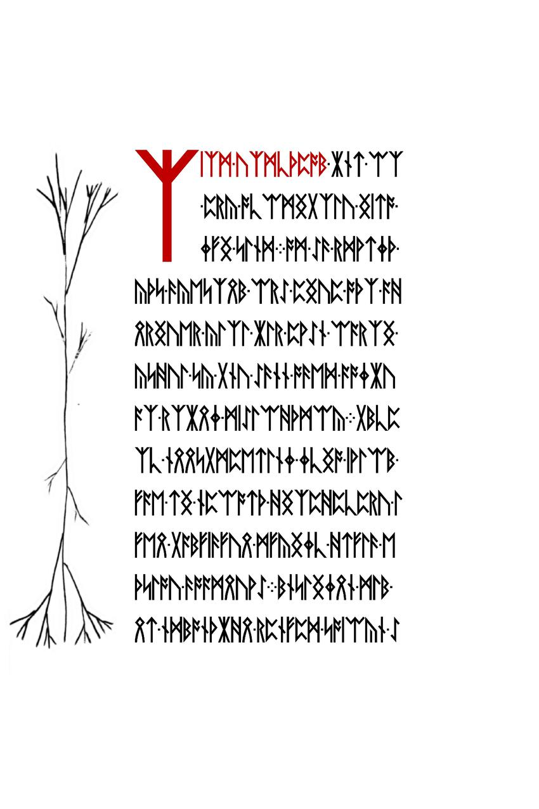
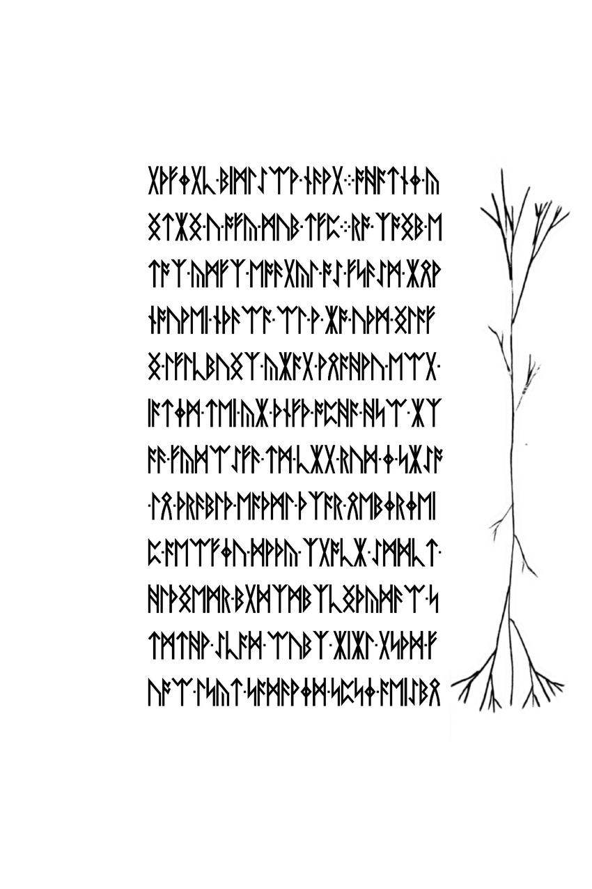
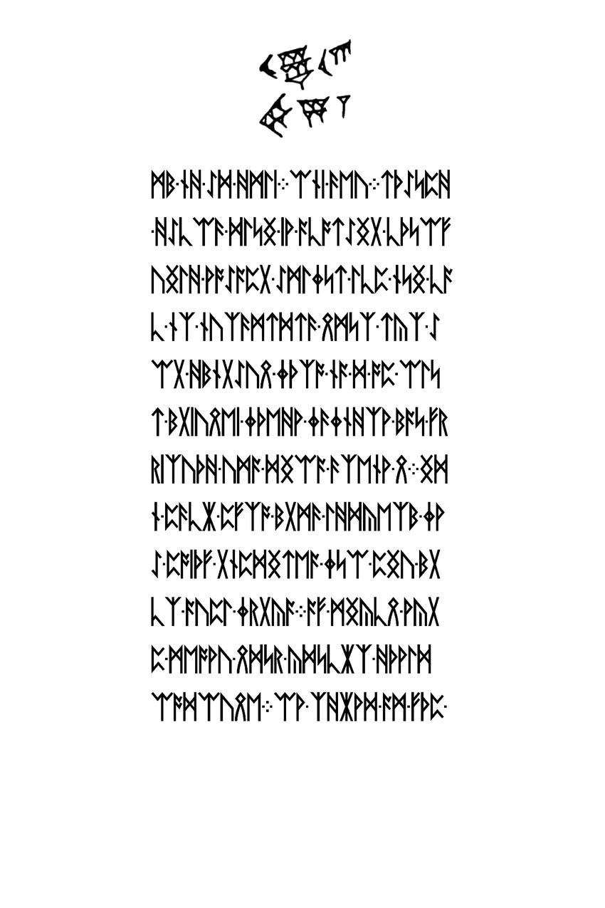
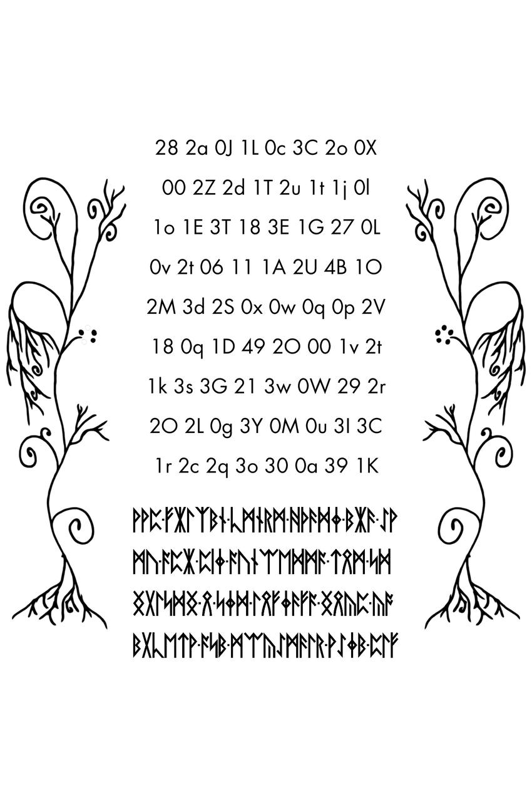
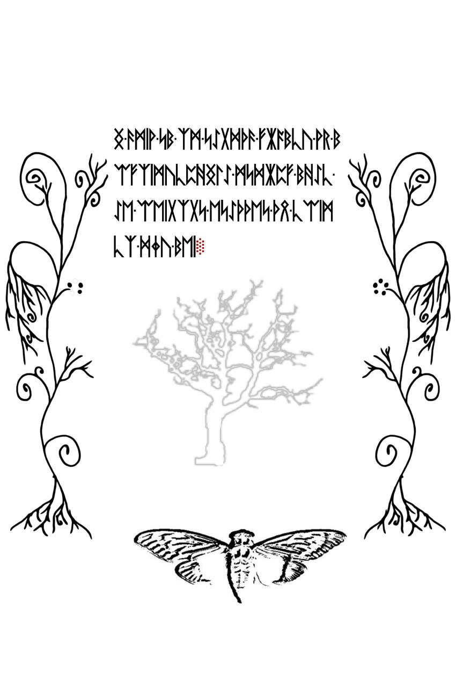

# Oracle page walkthrough — all LP2 pages, open notes

Companion to ORACLE_QUEUE.md: the queue asks *specific* questions; this file
is for *anything you notice* on a page that we may have missed. You do not
have to fill every page — partial notes on any subset are gold. Skip a page
by leaving its Notes line empty.

Conventions: page numbers = BOOK numbers (0–57; p50 = runeless token page;
pp56–57 = solved closing pages). Red ink uses `*` per red glyph. "Known"
lists what the machine census + your previous answers already account for —
anything NOT in that list is news to us.

Broad questions worth a thought as you flip (answer inline anywhere):

- Do word-separator dots (·) ever differ in size/shape from page to page?
- Any pages where the margin decoration differs from the usual scroll motif?
- Do the 4-dot black diamonds and the red dot-matrices ever appear on the
  SAME page? Same line?
- Anything that repeats visually across pages but is not in the Known list?

---

## p0 (unsolved)

Known: red head word (line 1) ** words, since they contain one - and terminated by red 13 dot lattice

**Notes:**

## p1 (unsolved)

Known: —

**Notes:**

## p2 (unsolved)

Known: red only via dot-lattice (13 dot section terminator)

**Notes:**

## p3 (unsolved)

Known: red head word (line 1); red inline dot-matrix ** 13 dot lattice ** after red word (seen 2026-11-16) ** red head word line 7, 3 glyphs followed by 13 dot lattice ** 

**Notes:**

## p4 (unsolved)

Known: —

**Notes:**

## p5 (unsolved)

Known: —

**Notes:**

## p6 (unsolved)

Known: red head word (line 1) ** incorrect, red 13-dot lattice ends line 4, red head words (4) line 5 terminated by red 13 dot lattice

**Notes:**

## p7 (unsolved)

Known: red head word (line 1) ** incorrect, red tail words line 10, begins and ends with red 13 dot lattice

**Notes:**

## p8 (unsolved)

Known: red head word (line 1); black 4-dot diamonds L3/L7/L11 (L6-left = noise per owner S7) ** incorrect, red head words (2)

**Notes:**

## p9 (unsolved)

Known: —

**Notes:**

## p10 (unsolved)

Known: black inline digit 7 (L8)

**Notes:**

## p11 (unsolved)

Known: —

**Notes:**

## p12 (unsolved)

Known: —

**Notes:**

## p13 (unsolved)

Known: —

**Notes:**

## p14 (unsolved)

Known: red only via dot-lattice (section terminator)

**Notes:**

## p15 (unsolved)

Known: red head **words** (line 1); printed digit group 3278/3299*(red)/3298/2838; red head words line 6 (after 4 lines of printed digits)

**Notes:**

## p16 (unsolved)

Known: —

**Notes:**

## p17 (unsolved)

Known: —

**Notes:**

## p18 (unsolved)

Known: —

**Notes:**

## p19 (unsolved)

Known: —

**Notes:**

## p20 (unsolved)

Known: —

**Notes:**

## p21 (unsolved)

Known: —

**Notes:**

## p22 (unsolved)

Known: red only via dot-lattice (section terminator)

**Notes:**

## p23 (unsolved)

Known: red head word (line 1)

**Notes: dots at top could be "decoration" or could be clue**

## p24 (unsolved)

Known: —

**Notes:**

## p25 (unsolved)

Known: —

**Notes:**

## p26 (unsolved)

Known: red only via dot-lattice (section terminator)

**Notes:**

## p27 (unsolved)

Known: red head word (line 1) ** red words with red 13 dot lattice at end

**Notes:**

## p28 (unsolved)

Known: —

**Notes:**

## p29 (unsolved)

Known: —

**Notes:**

## p30 (unsolved)

Known: —

**Notes:**

## p31 (unsolved)

Known: —

**Notes:**

## p32 (unsolved)

Known: red only via dot-lattice (section terminator)

**Notes:**

## p33 (unsolved)

Known: red head word (line 1) ** words, plus terminating red 13 dot lattice line 5**;  **red head words line 6** black stamp device (top; p33 footer). my reading of the black stamp right now: < YYYYYYY < YYY <<<<< YYYYY *

**Notes:**

## p34 (unsolved)

Known: black stamp device (top; p33 footer) exact same as footer of p33

**Notes:**

## p35 (unsolved)

Known: black stamp device (top; p33 footer) same as p33 footer again

**Notes:**

## p36 (unsolved)

Known: black stamp device **same as p33 footer** (top; p33 footer); red digit 1 (L6), red 10 dot lattice end of L5

**Notes:**

## p37 (unsolved)

Known: red head word (line 1); black stamp device (top; p33 footer); red digits 2/3/4 (L1/L5/L10) + black 4-dot diamonds (owner L2/4/5/8/11) ** only see 4 dot diamonds on line 9

**Notes:**

## p38 (unsolved)

Known: black stamp device (top; p33 footer); red digit 5 (L4) + black diamonds right edge (L3/8/9); margin asymmetry S8c; red 10-dot lattice begins line 10

**Notes:**

## p39 (unsolved)

Known: red head word (line 1 **line 7 not 1** ); black stamp device (top; p33 footer), terminal 13 dot red lattices on lines 6 and 12

**Notes:**

## p40 (unsolved)

Known: red head word (line 1) **words**; red-opening sentence ENDED by mid-line-2 black diamond (S8a CONFIRMED); margin asymmetry S8c

**Notes:**

## p41 (unsolved)

Known: —

**Notes: Apostrophe mid line 10**

## p42 (unsolved)

Known: —

**Notes: double quotes lines 3,6 (twice)**

## p43 (unsolved)

Known: —

**Notes:double quotes line 1**

## p44 (unsolved)

Known: —

**Notes:**

## p45 (unsolved)

Known: —

**Notes:**

## p46 (unsolved)

Known: —

**Notes:**

## p47 (unsolved)

Known: —

**Notes:**

## p48 (unsolved)

Known: margin decoration asymmetry (S8c/d)

**Notes:**

## p49 (unsolved)

Known: red only via dot-lattice (section terminator)

**Notes:**

## p50 (solved)

Known: token table page (0 runes)

**Solution (what "solved" means here):** the page is a 13×8 table of 104
mixed Roman/Arabic tokens; each token = 2 bytes of the 256-byte
`canon_256.bin` (sha256 3b9b07d9…4b290) — the pad used in the pp49–51
campaigns. There is no English plaintext; the page IS the key material.
Row/column token values are pixel-verified in
`sweeps/2026-11-targets/` (idx246 = 0xc6 confirmed).

**Notes:**

## p51 (unsolved)

Known: —

**Notes:**

## p52 (unsolved)

Known: —

**Notes:**

## p53 (unsolved)

Known: red head word (line 1); stream L7/L8/L9 entirely red + red arrow after L6 (owner F4)

**Notes:incorrect, red letters begin last letter of line 6 and continue to end. Also, double quote mid lines 3 and 6**

## p54 (unsolved)

Known: red head **words** (line 1)

**Notes:**

## p55 (unsolved)

Known: red only via dot-lattice (section terminator)

**Notes:**

## p56 (solved)

Known: SOLVED closing page

**Solution** (key: phi(prime)-shifted forward Gematria; every clear-text F
is an ᚠ to be skipped; source: scream314 compilation via pinned dukotah
clone — community-known since 2014, verified against our corpus conventions):

    AN END

    WITHIN THE DEEP WEB TH
    ERE EXISTS A PAGE THAT HA
    SHES TO

    [5 hex lines — the onion address, left as printed]

    IT IS THE DUTY OF EUERY PILGR
    IM TO SEEK OUT THIS PAGE

Note for pattern work: line breaks fall MID-WORD (TH|ERE, HA|SHES,
PILGR|IM) — the solved pages show the line-wrap convention directly, and
"EUERY" shows V-for-U. Word separators render as •.

**Notes:**

## p57 (solved)

Known: 23-dot lattice (book end) + RED inline matrix after red word (S8b CONFIRMED) + bottom decoration; SOLVED closing page

**Solution** (key: plain substitution, default Gematria; same source):

    Parable : like the instar tunneling to the surface.
    We must shed our own circumferences. Find the
    divinity within and emerge.

Note: this page's transcription in our corpus is the PARABLE (pos-80 ᚣ
adjudication lives in data/SOURCES.md); punctuation here includes the
colon after "Parable" — compare with the double-quote channel you spotted
on pp42/43/53.

**Notes:**

---

## Broad observations (anything not tied to one page)

__

__

__
