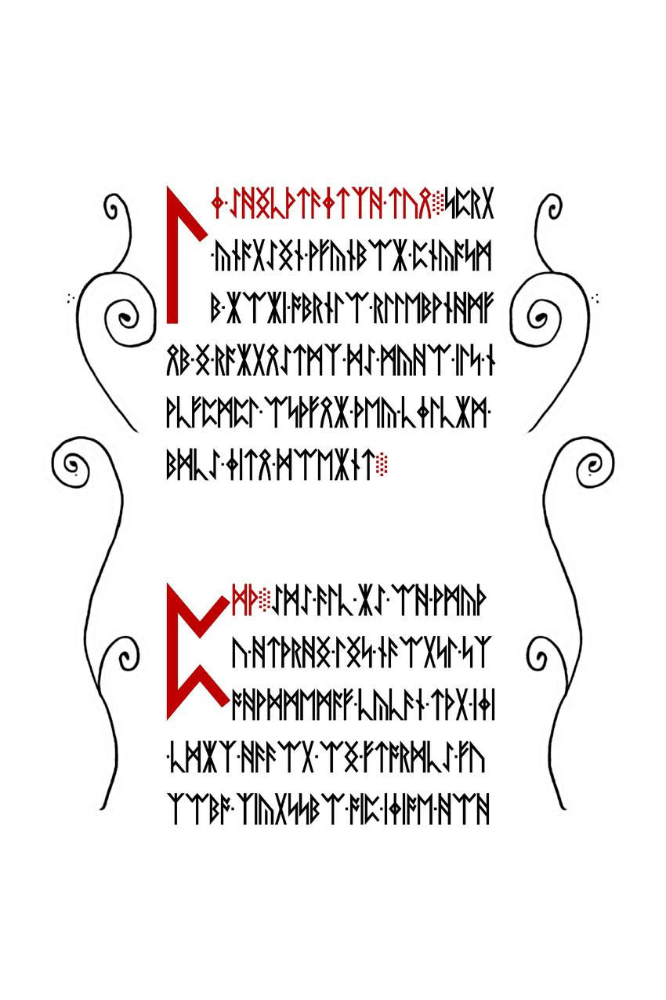
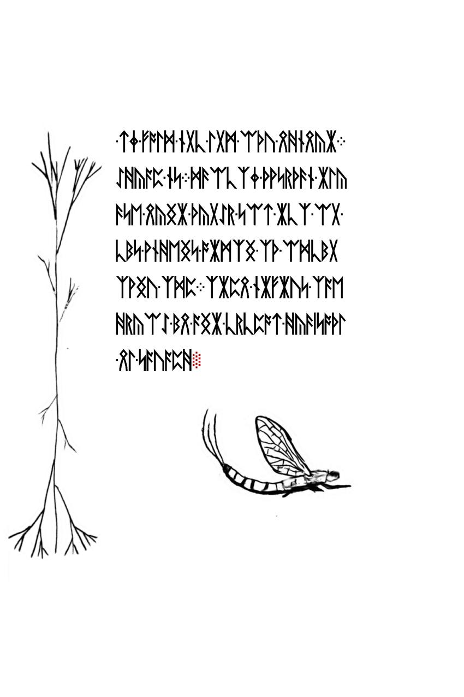
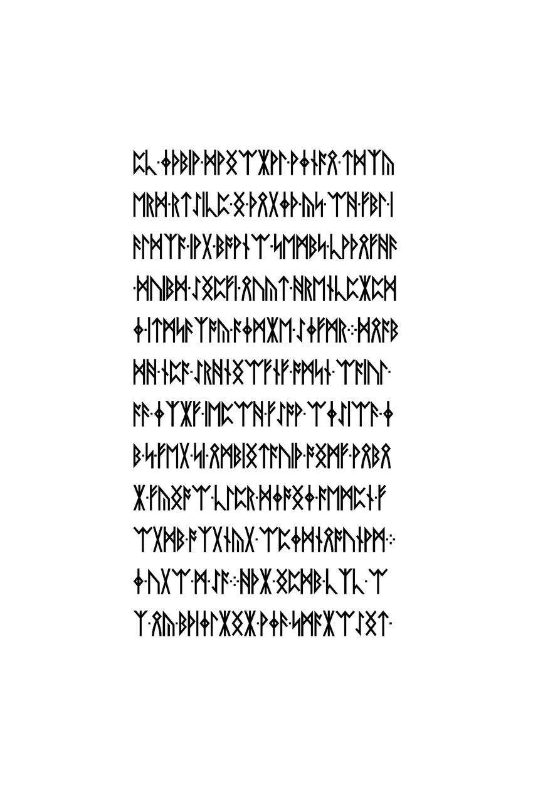
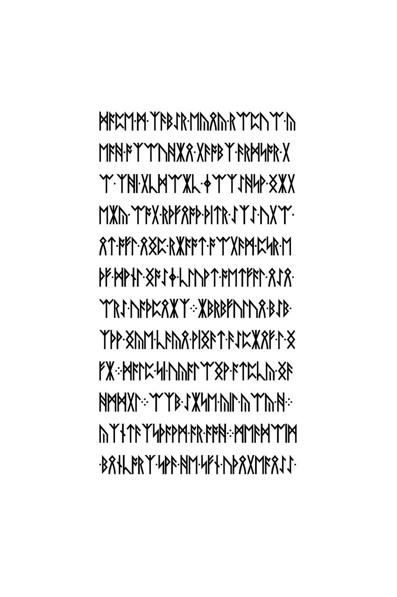
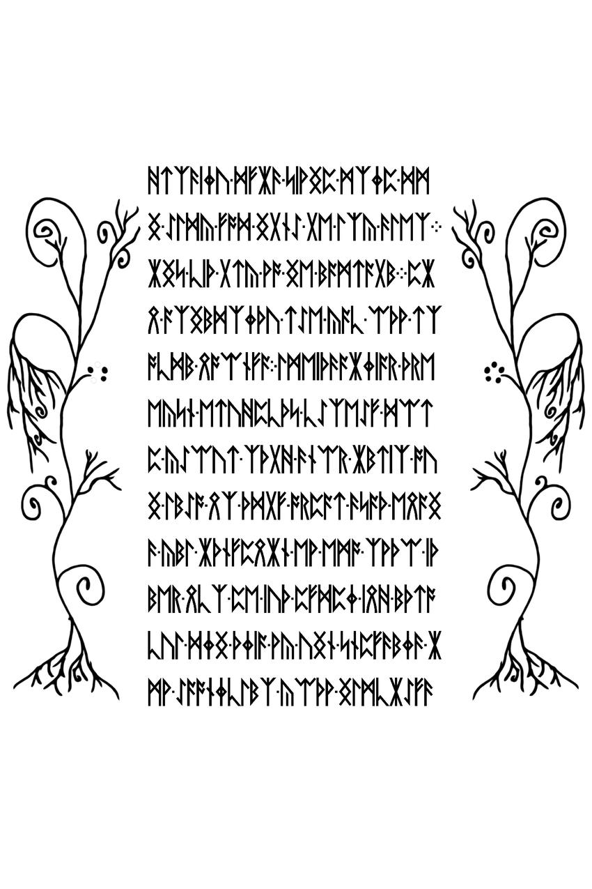
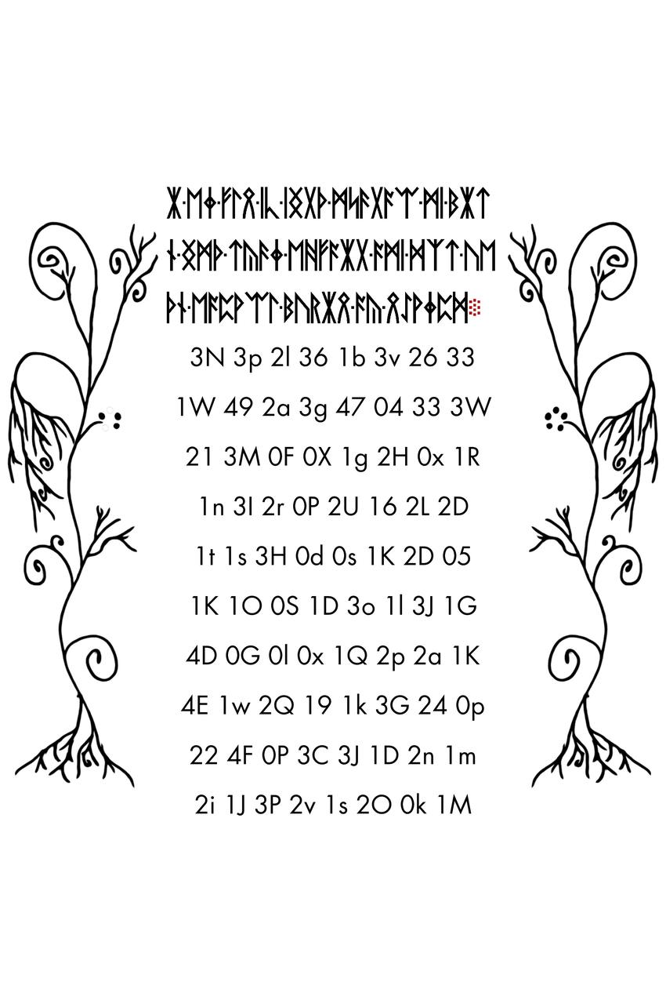
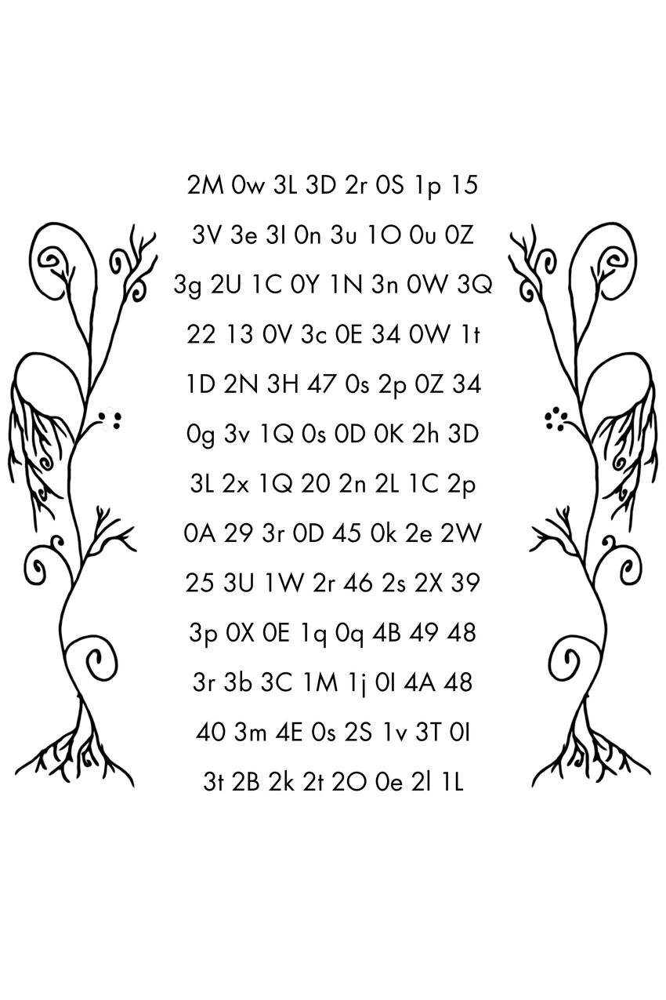
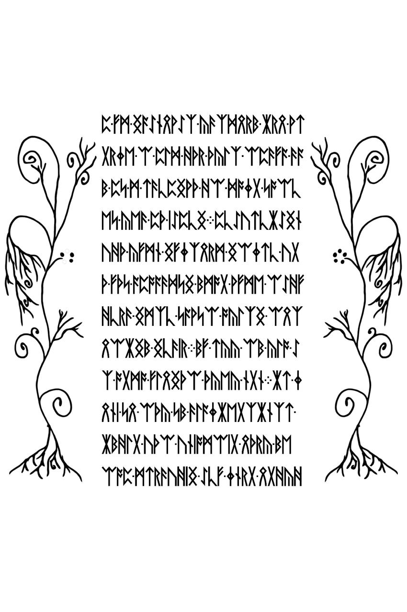
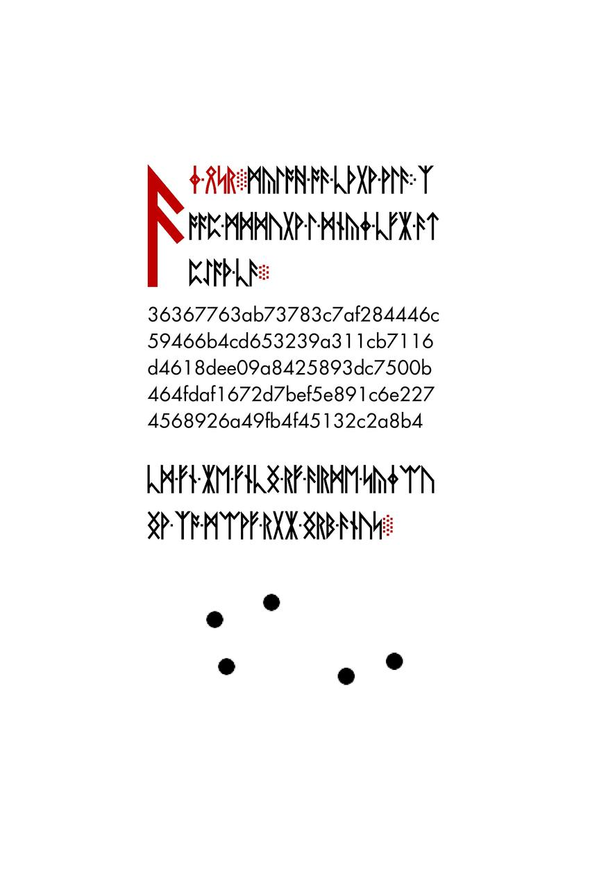
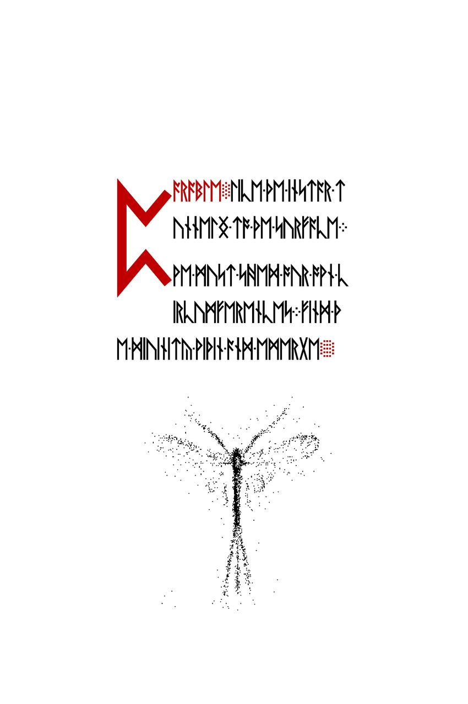

# Oracle page walkthrough — all LP2 pages, open notes

Companion to ORACLE_QUEUE.md: the queue asks *specific* questions; this file
is for *anything you notice* on a page that we may have missed. You do not
have to fill every page — partial notes on any subset are gold. Skip a page
by leaving its Notes line empty.

Conventions: page numbers = BOOK numbers (0–57; p50 = runeless token page;
pp56–57 = solved closing pages). Red ink uses `*` per red glyph. "Known"
lists what the machine census + your previous answers already account for —
anything NOT in that list is news to us.

Broad questions worth a thought as you flip (answer inline anywhere):
- Do word-separator dots (·) ever differ in size/shape from page to page?
- Any pages where the margin decoration differs from the usual scroll motif?
- Do the 4-dot black diamonds and the red dot-matrices ever appear on the
  SAME page? Same line?
- Anything that repeats visually across pages but is not in the Known list?

---

## p0 (unsolved)

Known: red head word (line 1)

**Notes:**

## p1 (unsolved)

Known: —

**Notes:**

## p2 (unsolved)

Known: red only via dot-lattice (section terminator)

**Notes:**

## p3 (unsolved)

Known: red head word (line 1); red inline dot-matrix after red word (seen 2026-11-16)

**Notes:**

## p4 (unsolved)

Known: —

**Notes:**

## p5 (unsolved)

Known: —

**Notes:**

## p6 (unsolved)

Known: red head word (line 1)

**Notes:**

## p7 (unsolved)

Known: red head word (line 1)

**Notes:**

## p8 (unsolved)

Known: red head word (line 1); black 4-dot diamonds L3/L7/L11 (L6-left = noise per owner S7)

**Notes:**

## p9 (unsolved)

Known: —

**Notes:**

## p10 (unsolved)

Known: black inline digit 7 (L8)

**Notes:**

## p11 (unsolved)

Known: —

**Notes:**

## p12 (unsolved)

Known: —

**Notes:**

## p13 (unsolved)

Known: —

**Notes:**

## p14 (unsolved)

Known: red only via dot-lattice (section terminator)

**Notes:**

## p15 (unsolved)

Known: red head word (line 1); printed digit group 3278/3299*(red)/3298/2838

**Notes:**

## p16 (unsolved)

Known: —

**Notes:**

## p17 (unsolved)

Known: —

**Notes:**

## p18 (unsolved)

Known: —

**Notes:**

## p19 (unsolved)

Known: —

**Notes:**

## p20 (unsolved)

Known: —

**Notes:**

## p21 (unsolved)

Known: —

**Notes:**

## p22 (unsolved)

Known: red only via dot-lattice (section terminator)

**Notes:**

## p23 (unsolved)

Known: red head word (line 1)

**Notes:**

## p24 (unsolved)

Known: —

**Notes:**

## p25 (unsolved)

Known: —

**Notes:**

## p26 (unsolved)

Known: red only via dot-lattice (section terminator)

**Notes:**

## p27 (unsolved)

Known: red head word (line 1)

**Notes:**

## p28 (unsolved)

Known: —

**Notes:**

## p29 (unsolved)

Known: —

**Notes:**

## p30 (unsolved)

Known: —

**Notes:**

## p31 (unsolved)

Known: —

**Notes:**

## p32 (unsolved)

Known: red only via dot-lattice (section terminator)

**Notes:**

## p33 (unsolved)

Known: red head word (line 1); black stamp device (top; p33 footer)

**Notes:**

## p34 (unsolved)

Known: black stamp device (top; p33 footer)

**Notes:**

## p35 (unsolved)

Known: black stamp device (top; p33 footer)

**Notes:**

## p36 (unsolved)

Known: black stamp device (top; p33 footer); red digit 1 (L6)

**Notes:**

## p37 (unsolved)

Known: red head word (line 1); black stamp device (top; p33 footer); red digits 2/3/4 (L1/L5/L10) + black 4-dot diamonds (owner L2/4/5/8/11)

**Notes:**

## p38 (unsolved)

Known: black stamp device (top; p33 footer); red digit 5 (L4) + black diamonds right edge (L3/8/9); margin asymmetry S8c

**Notes:**

## p39 (unsolved)

Known: red head word (line 1); black stamp device (top; p33 footer)

**Notes:**

## p40 (unsolved)

Known: red head word (line 1); red-opening sentence ENDED by mid-line-2 black diamond (S8a CONFIRMED); margin asymmetry S8c

**Notes:**

## p41 (unsolved)

Known: —

**Notes:**

## p42 (unsolved)

Known: —

**Notes:**

## p43 (unsolved)

Known: —

**Notes:**

## p44 (unsolved)

Known: —

**Notes:**

## p45 (unsolved)

Known: —

**Notes:**

## p46 (unsolved)

Known: —

**Notes:**

## p47 (unsolved)

Known: —

**Notes:**

## p48 (unsolved)

Known: margin decoration asymmetry (S8c/d)

**Notes:**

## p49 (unsolved)

Known: red only via dot-lattice (section terminator)

**Notes:**

## p50 (solved)

Known: token table page (0 runes)

**Notes:**

## p51 (unsolved)

Known: —

**Notes:**

## p52 (unsolved)

Known: —

**Notes:**

## p53 (unsolved)

Known: red head word (line 1); stream L7/L8/L9 entirely red + red arrow after L6 (owner F4)

**Notes:**

## p54 (unsolved)

Known: red head word (line 1)

**Notes:**

## p55 (unsolved)

Known: red only via dot-lattice (section terminator)

**Notes:**

## p56 (solved)

Known: SOLVED closing page

**Notes:**

## p57 (solved)

Known: 23-dot lattice (book end) + RED inline matrix after red word (S8b CONFIRMED) + bottom decoration; SOLVED closing page

**Notes:**

---

## Broad observations (anything not tied to one page)

__

__

__
