# Oracle queue #1 — human-eye tasks (2026-11-16)

Everything below is a crop we already cut, with our read stated and a blank
for yours. Fill any ☐ / __ you can; partial answers are fine — each c
onfirmed item unblocks a frontier (see [MAP.md](MAP.md) §D: F2/F8/F9). 
Crops live in `docs/img/oracle/` (tracked); full-page context crops stay in
`work/red_census/crops/`. Red notation: `*` suffix per red glyph.

**Rune oracle for Task 5** (the only glyph-identity call here):

|       | shape                                                                                       | name           |
| ----- | ------------------------------------------------------------------------------------------- | -------------- |
| ᚢ (U) | two vertical staves joined at the **bottom by a curve/brace** — a cup; no right-side bulges | úr "aurochs"   |
| ᛒ (B) | **one** vertical stave with **two closed bulges on the right** (like a Latin B)             | bercan "birch" |

Key discriminator: count the staves (2 vs 1) and look for the right-side
loops (absent in U, present in B).

---

## Task 1 — the red margin digits (pp36–38) → unblocks F2/F9

Our read: p36 line 6 margin = `1*`; p37 lines 1/5/10 margins = `2*` `3*`
`4*`; p38 line 4 margin = `5*`. All five RED, all in the margin, sequence
1–5 across three pages.

| crop                                  | our read                   | yours                                                                                                |
| ------------------------------------- | -------------------------- | ---------------------------------------------------------------------------------------------------- |
|   | `1*` red, margin           | X agree ☐ disagree: __                                                                               |
|  | `2*` red, margin of L1     | X agree ☐ disagree: __                                                                               |
| 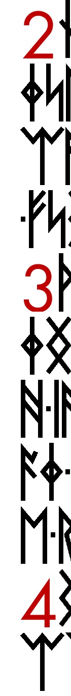   | `2* 3* 4*` red (L1/L5/L10) | X agree ☐ disagree: __                                                                               |
| 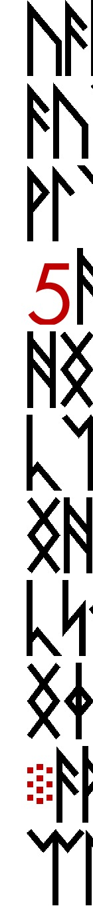   | `5*` red (L4)              | ☐ agree X disagree: Yes 5* red L4, but also "10 dots" pattern I have seen at the end of... sentences? paragraphs? in red on L10 |

Extra question (matters for F18): do these digits look **Babylonian/
sexagesimal-style** (wedge-shaped) or like the p10/p15 Arabic-style printed
digits? ☐ wedge ☐ printed X can't tell (please provide examples of both types so I can compare)

## Task 2 — the other digit channels

Our read: p10's inline `7` is **black** (not red); p15's four digit lines
read `3278 3299 3298 2838` with **3299 red**. (It's 2nd of 4 digit-lines reads as this, yes.)

| crop                                       | our read                          | yours                  |
| ------------------------------------------ | --------------------------------- | ---------------------- |
|            | `7` black, inline                 | ☐ agree ☐ disagree: __ |
|  | 4 groups; `3299*` red, rest black | ☐ agree ☐ disagree: __ |

## Task 3 — p53 red lines + arrow → unblocks F8

Our read: stream lines 7–9 are **entirely red**, and there is a red arrow
glyph immediately after line 6.

| crop                                | our read                           | yours                                                                                 |
| ----------------------------------- | ---------------------------------- | ------------------------------------------------------------------------------------- |
|  | red arrow after L6 — direction: up | X agree ☐ disagree: __                                                                |
|     | line 7 all-red                     | ☐ agree X disagree: cropped too tight to see all of line 7 but the excerpt is all red |
|    | line 8 all-red                     | ☐ agree X disagree: cropped too tight to see all but the excerpt is red               |
| 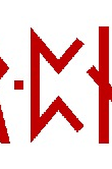   | line 9 all-red                     | ☐ agree X disagree: cropped tight, excerpt red                                        |

## Task 4 — dot-lattice size classes + matrix-only pages

Our read: three lattice sizes — 13-dot standard, 10-dot small, 23-dot large
(p57 only); pages 2, 14, 22, 26, 32, 49, 55 carry red ONLY as a dot lattice
(no rubric). Confirm dot counts and that the six "matrix-only" pages have no
other red ink we missed.

| crop                                 | our read        | yours                                                                                                |
| ------------------------------------ | --------------- | ---------------------------------------------------------------------------------------------------- |
| 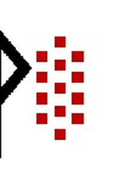   | 13-dot standard | count: 13                                                                                            |
|  | 10-dot small    | count: 10                                                                                            |
|  | 23-dot large    | count: 23                                                                                            |
|    | p14 lattice     | other red on page? X no (not in visible portion. Also, isn't this just a 13-dot standard?) ☐ yes: __ |
|    | p22 lattice     | other red? X not visible (this is a 13 dot standard) ☐ yes: __                                       |
|    | p26 lattice     | other red? X no (13 dot) ☐ yes: __                                                                   |
| 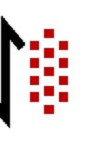   | p32 lattice     | other red? X no (13 dot) ☐ yes: __                                                                   |
|    | p49 lattice     | other red? X no (10 dot) ☐ yes: __                                                                   |
| 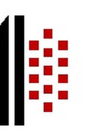   | p55 lattice     | other red? X no (13 dot) ☐ yes: __                                                                   |

## Task 5 — p27 position 93: ᚢ or ᛒ? (dukotah's open human item)

Their classifier reads **U (ᚢ)** with the runner-up **B (ᛒ) at margin 5** —
the only unresolved glyph in their whole tree (`p27:93`, flagged
UNRESOLVED). Ours records ᚢ. It is the 17th glyph in this strip, the lone
stave-pair in `-ᛏᚱ-ᚢ-ᚣ-` (between ᛏᚱ and ᚣ):

Your read: ☐ ᚢ U ☐ ᛒ B ☐ neither: X (cropped too tight to see entire large glyph) U
se the chart above (stave count + right-side loops). This one is worth 
posting upstream when settled — their ledger explicitly waits on a human. (I still can't read it -- it is cropped too short vertically to see the top of the large red glyph at margin 5!)

**RE-ASKED 2026-11-16 (apologies — two confusions, both ours):**
"margin 5" meant the classifier's CONFIDENCE margin (ᛒ trails ᚢ by 5
points), not a location — and the target glyph is BLACK ink on line 4, not
red. New crop with 190 px of headroom above the glyph (4× zoom), plus the
line with the target boxed in red:

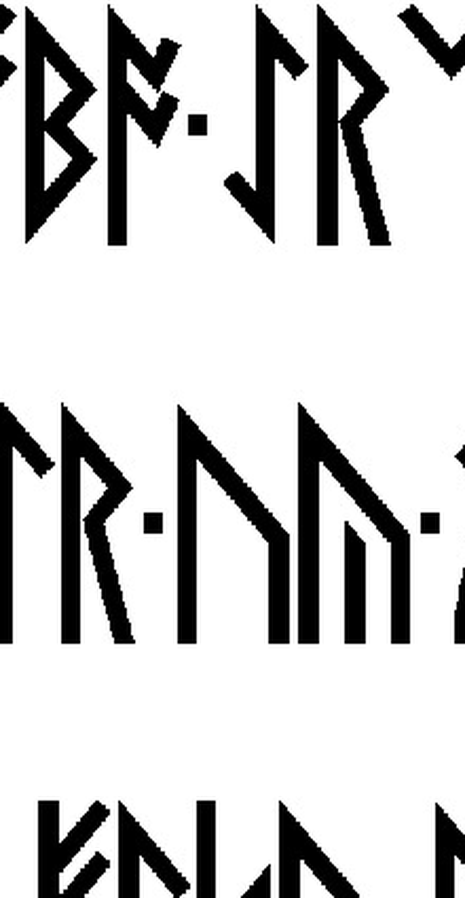
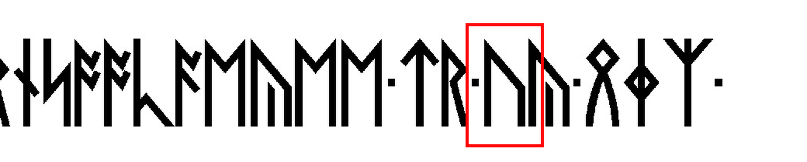

One-line question: the boxed glyph, between ᚱ and ᚣ — ☐ ᚢ U ☐ ᛒ B ☐ neither: __

## Task 6 (larger, whenever convenient) — page readthroughs

p49 / p51 / p55 strip checklists are ready in `work/audit/page_49|51|55/`
(same format as the strip above: read off the image, mark OK or list
diffs). p51 is now correctly labelled book p51 post-relabel. These feed
divider-fidelity for campaign #11 (word-sums).

---

# Follow-up round #2 (2026-11-16) — answers to your answers

Thank you — everything you confirmed is banked. Four follow-ups below;
fill the ☐ boxes in place. **One honest correction first:**

> **p27 correction.** Your Task-5 "U" was asked against a crop that was
> **off by one line** — on p27 the top band is the mayfly-wing ornament and
> the second band holds three stream lines (line 1 in red + two black), so
> our band→line mapping was shifted and the old crop showed line 5, not
> line 4. We re-anchored by matching separator-dot patterns against the
> transcription; the crops below are cluster-anchored (verified against the
> dot pattern, not proportional spacing).

## F1 — p27:93, the real target + same-page references

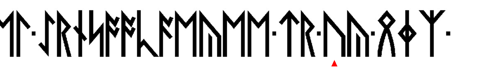
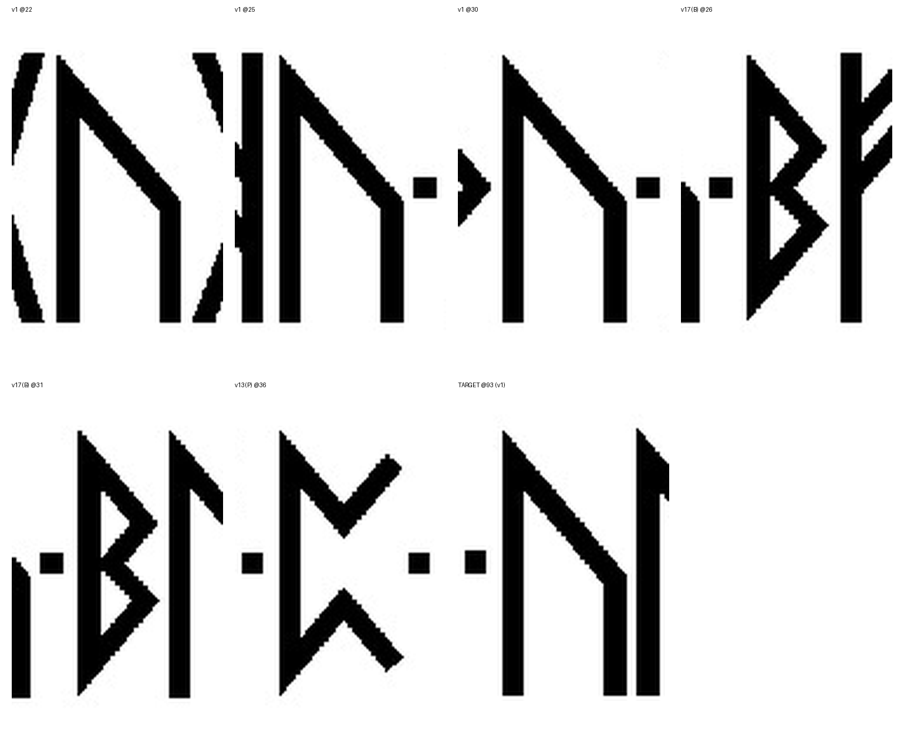

The ticked glyph is position 93 (between the dots after `ᛏᚱ`, before the
pair before `ᛞ`). The compare sheet puts it against its own page-mates:
three glyphs our corpus records with the **same value as the target**
(@22/@25/@30 — all "arch": two staves joined at the top by a diagonal —
note our round-#1 shape chart said ᚢ joins at the *bottom*; that describes
the classic rune, not this angular font), plus the ᛒ candidates (@26/@31,
clear two-bulge) and ᛈ (@36, diamond). **Our read now: the target matches
the three arch references — ᚢ confirmed.** Your call:
☐ agree ᚢ ☐ disagree: __
☐ the tick points at the right glyph ☐ wrong glyph: __ I don't understand the question, which is very wordy: what I see after ᛏᚱ is -ᚢᚣ-ᛟᛄᛉ-

**ANSWERED, I think — just confirm:** your sequence puts **ᚢ** exactly
where our tick is (right after ᛏᚱ, before ᚣ). That settles both parts —
tick correct, glyph ᚢ. If yes, tick here: ☐ confirmed ᚢ ☐ no, I meant: __

## F2 — your "10 dots in red on L10" — found it

That is a red **10-dot diamond lattice in the LEFT margin** of line 10
(centre column of 4 + 3 each side) — machine-verified: exactly 10 red
connected components, RGB ≈ (175,5,5). Same motif as the p49 lattice you
counted (10 dots):

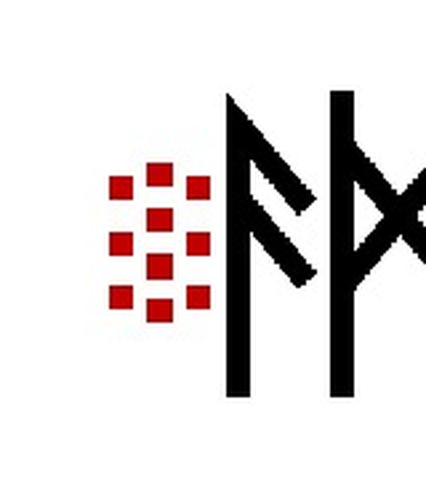 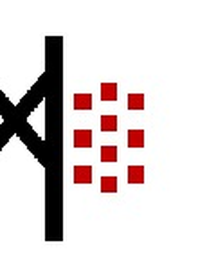
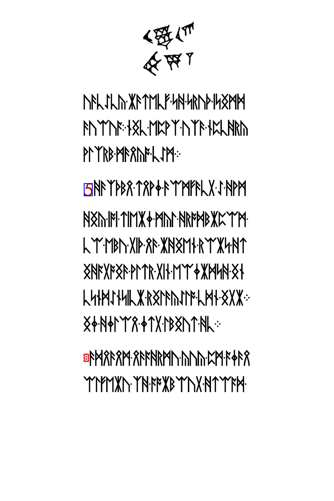

Red box = the 10-dot lattice; blue box = your confirmed `5*` (L4). The
dark marks at the RIGHT edge of L10 are black, not red
([zoom](img/oracle/p38_l10_rightedge_v2.png)).
☐ the red box is what you saw ☐ no, I meant something else: __ Unless you're counting the weird drawings at the very top as a "line", I see dark marks at the right edge of L3, L8, and L9 that are 4 dots in a diamond pattern in black.

## F3 — wedge vs printed digits, examples as requested

Top: the pp36–38 margin digits. Middle: p10/p15 printed digits. Bottom:
**drawn schematic** (not a scan) of Babylonian wedge forms for 1–5 and 10.
☐ margin digits look wedge ☐ printed X neither/unclear: I do not see any appreciable difference between the margin digits, the printed digits, and the 7 that appears in the middle of the runes. None of them look like "wedges."

> **Editor note (2026-11-16, owner: "I have no idea how to read Babylonian
> numbers")** — you never needed to. This test is about **stroke shape**, not
> legibility: cuneiform digits are built only from triangular wedge
> impressions (vertical 𒁹 = 1, corner 𒌋 = 10 — e.g. 5 = five side-by-side
> verticals, a comb-like block), while printed Arabic 1–5 have curved strokes.
> Your shape-match against the known-printed p10/p15 digits is the complete
> answer, and it is recorded as **printed** — F3 CLOSED, sexagesimal reading
> of the margin digits dead. No further action needed from you here.

## F4 — p53 lines 7–9, full width this time

Ten full-width bands (band 0 is ornament; stream lines follow — map
them yourself). Inline as requested:

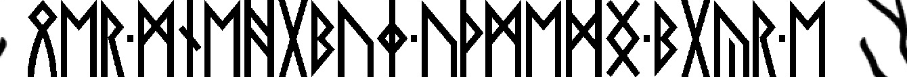

Which stream lines are entirely red? lines: _L7, L8, L9 are entirely red. Last symbol of L6 is red._

# Round #3 (2026-11-16) — the black "cuneiform" stamp on pp33–39

Campaign #12 census finding: the "Babylonian sexagesimal art" of pp34–39
is ONE black stamp repeated identically (pixel-verified, maxdiff 0) on the
tops of pp34–39, plus a footer instance on p33. It brackets the pp33–39
section. Its only information is (a) what its glyphs mean and (b) where it
sits — and machine wedge-counting fails on it (strokes fused; see
`sweeps/2026-11-sex60/CENSUS.md`). Your eye, please:

G1–G7 are reading order (top row 4, bottom row 3). Tiles crop slightly into
neighbours — read counts on the full stamp.

**S1 — what is it?**
☐ Babylonian **numbers** (then: digit values G1–G7 = __ __ __ __ __ __ __)
☐ cuneiform **signs** (if you can transliterate: __)
☐ ornament, not language
X unclear

**S2 — per-glyph tally** (vertical wedges = 1s, corner wedges = 10s;
"bar" = horizontal wedge, not a number digit). No reading skill needed —
just count stroke types: a vertical wedge is a downward triangle-head stroke
(▼ with a tail), a corner wedge is a left-pointing angle (< with a thick
head). Three verticals + one corner = 13, etc. Skip S2 entirely if S1 stays
"unclear" — it only matters if the stamp really is numeric.

| glyph | verticals | corners | bar? |
| ----- | --------- | ------- | ---- |
| G1    | __        | __      | ☐    |
| G2    | __        | __      | ☐    |
| G3    | __        | __      | ☐    |
| G4    | __        | __      | ☐    |
| G5    | __        | __      | ☐    |
| G6    | __        | __      | ☐    |
| G7    | __        | __      | ☐    |

**S3 — p33 vs pp34–39** (same stamp, resampled — confirm visually):
☐ same device ☐ visibly different: __

---

# Round #4 (2026-11-16) — lattice ↔ red-head alignment (campaign #13, O1 FLAG)

Campaign #13 measured it: 11 of your 14 red-word head pages also carry a red
dot-lattice (independence expects 5.4; p = 0.0007). Before we interpret that
as anything, we must rule out census misses on both sides — your eye:

**S4 — do these three red-head pages hide a lattice we missed?**
Lattices are small red dot diamonds, 13-dot ≈ 84 px tall at full scan
(~34 px here). One sheet per page; fill the line under each.

**p8** — lattice present? X yes ☐ no · if yes dots = _4_ · location _L3, L7, L11_
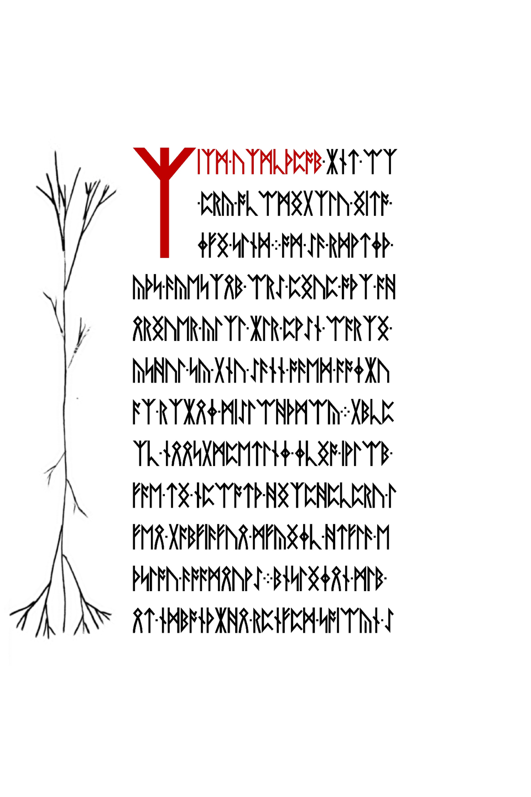

**p37** — lattice present? X yes ☐ no · if yes dots = _4_ · location _end of L9 (just before the red 4 line)

 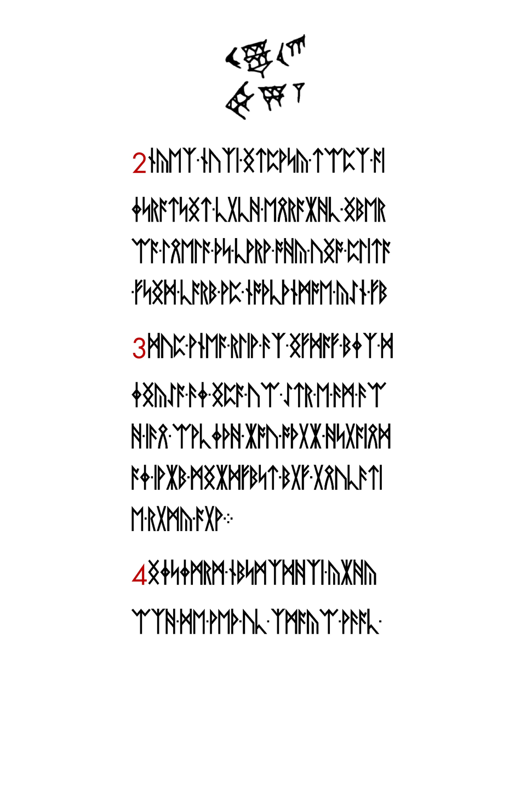

**p40** — lattice present? X yes ☐ no · if yes dots = _4_ · location _L2, L4 just before ", L5, L8, L11_

 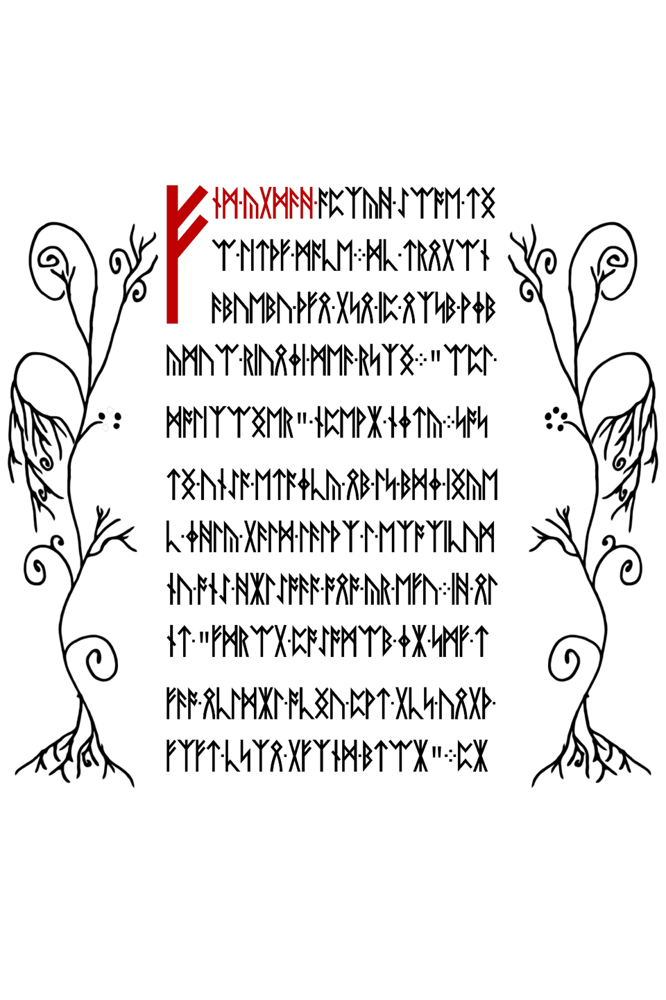

**S5 — do these lattice-only pages hide a red head word** (red drop-cap /
red opening word in the title band, like pp0/3/6/…)? One sheet per page.

**p2** — red head word? ☐ yes X no · if yes, the word __
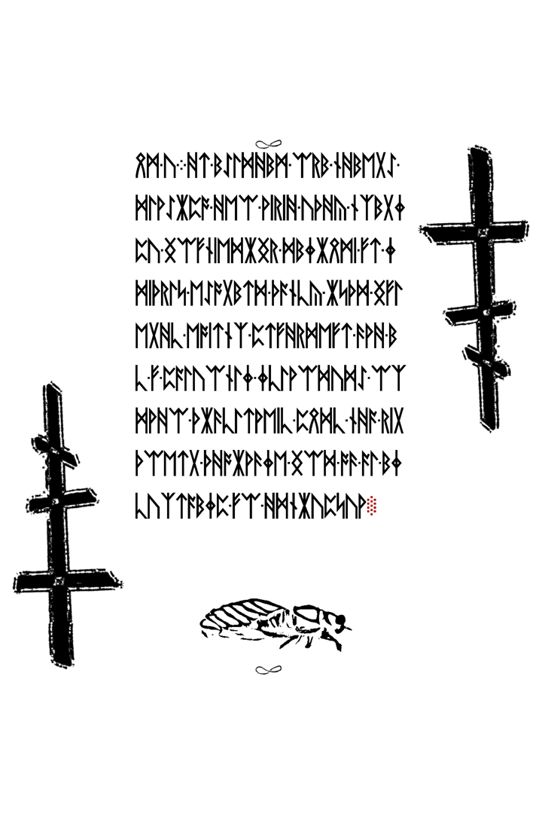

**p14** — red head word? ☐ yes X no · if yes, the word __
(but it does end with a 13 dot red lattice)

**p22** — red head word? ☐ yes X no · if yes, the word __
(ends with 13 dot red lattice)

**p26** — red head word? ☐ yes X no · if yes, the word __
(ends with 13 dot red lattice)

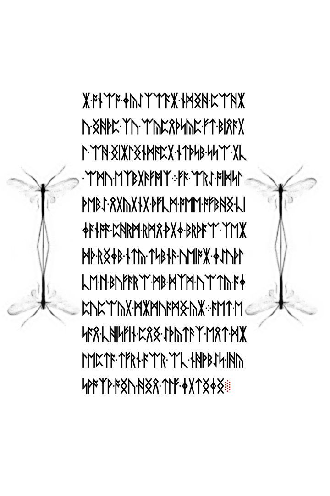

**p32** — red head word? ☐ yes X no · if yes, the word __
(ends with 13 dot red lattice)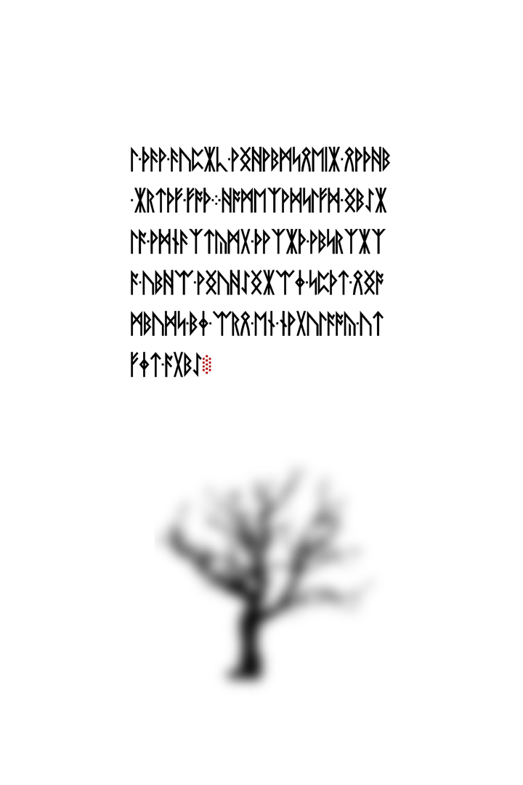

**p49** — red head word? ☐ yes X no · if yes, the word __
(glyphs end with 10 dot red lattice)

**p55** — red head word? ☐ yes X no · if yes, the word __
(ends with 13 dot red lattice)

Reading key: all "no" on S4 + all "no" on S5 ⇒ the two red features are
independent-but-correlated section markers (flag stands as census fact).
S4 misses ⇒ flag weakens. S5 misses ⇒ heads are the complete marker and
lattices the subset ⇒ worth a re-test with the corrected head list.

**S6 — what FUNCTION does each non-13-dot lattice perform?** (added 2026-11-16
after owner question: "is sentence-dot always the 10-dot pattern?" — machine
adjacency says size ≠ position, so your eye: for each crop, does the lattice
END a text line (text to its left), START one, sit in the margin clear of
text, or interrupt mid-line?)

| crop                                          | dots | function                                                    |
| --------------------------------------------- | ---- | ----------------------------------------------------------- |
| p36 band6    | 10   | ☐ line-ender ☐ line-starter ☐ margin ☐ mid-line ☐ other: __ |
| p38 band11  | 10   | ☐ line-ender ☐ line-starter ☐ margin ☐ mid-line ☐ other: __ |
| p49 band2 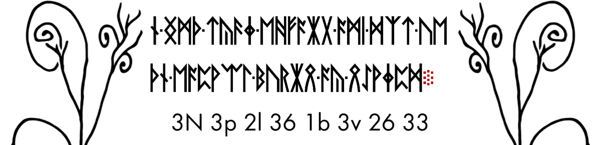   | 10   | ☐ line-ender ☐ line-starter ☐ margin ☐ mid-line ☐ other: __ |
| p56 band1    | 10   | ☐ line-ender ☐ line-starter ☐ margin ☐ mid-line ☐ other: __ |
| p57 band2    | 23   | ☐ line-ender ☐ line-starter ☐ margin ☐ mid-line ☐ other: __ |

Context: 13-dot is the default section ornament (30/35); 10-dot ×4 and the
lone 23-dot (end of book) are the exceptions — if the exceptions cluster in
one function, dot-count becomes a typed marker (F7 follow-up). Machine
adjacency (ink left/right in the lattice's y-band): 10-dot = END,START,END,
BOTH; 13-dot = END 8 / START 9 / BOTH 11 / ALONE 2 — no clean split.
(Your S5 notes already answer half of this — "ends with 13-dot lattice" ×6 —
so S6 is mainly about whether the 10-dot ones behave differently.)
**S7 — black 4-dot diamonds: machine census verification** (added 2026-11-16
after your S4/F2 answers revealed the class). Machine scan (black ink,
4-dot clusters) found **169 clusters on 51/57 pages** — far more than the
lines you happened to cite, so the key questions are false positives and
misses. Red boxes = machine detections.

| sheet                                       | question                                                                                             |
| ------------------------------------------- | ---------------------------------------------------------------------------------------------------- |
| p8 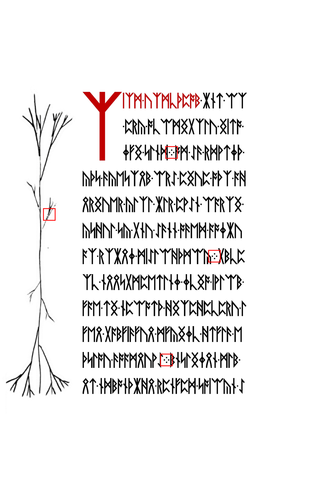   | your L3/L7/L11 all found ✓ — is the LEFT one (L6, x≈358) real or noise? any MISSED diamonds on the page? missed: __ |
| p40 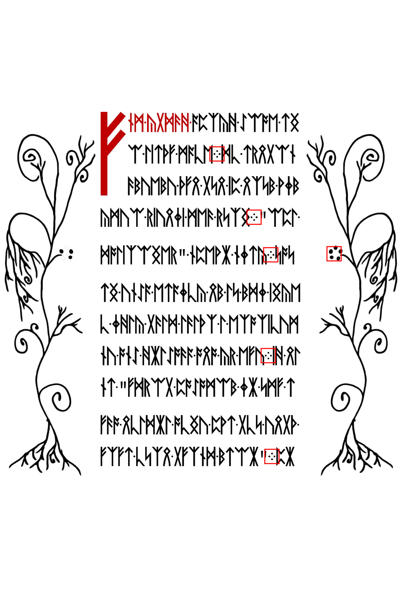 | 6 found vs your 5 — the far-right pair on L5 (one at x≈1994, off-page-edge?): real or noise? missed: __ |
| p48 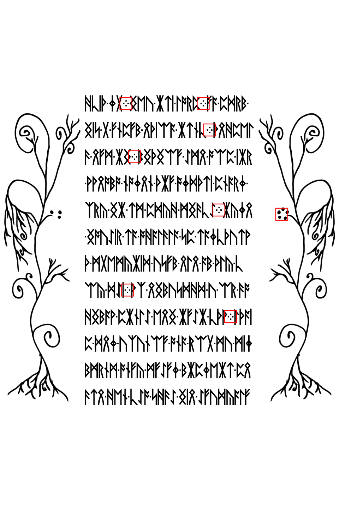 | 8 detections — do they look like the same 4-dot class, or woodcut/punctuation noise? real: __/8      |
| p57 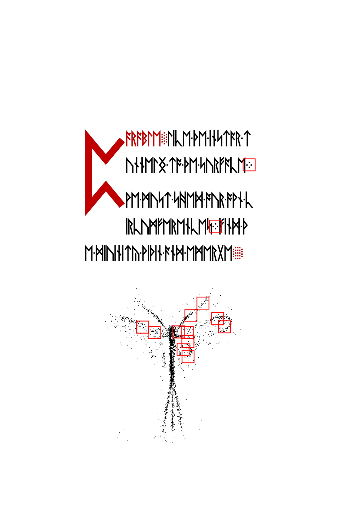 | 13 detections, 10 clustered at bottom — same class, or ornament texture? real: __/13                 |
|                                             |                                                                                                      |

p8:
left one is noise, none missed.

p40: far right is "decoration" not body text -- but interestingly an *asymmetry* between the designs on the left and right margins -- 3 dots on the left, where you have identified 5 dots on the right.

p48: same observation as p40. so in both cases, false positive for body text "4 dot diamond", but an interesting observation.

p57: ten clusters at bottom are decoration

Also useful if you spot them: do any 4-dot diamonds appear at the END of red-head lines (would link this channel to the red section markers)? YES, p40 and p57, the opening sentence begins in red, and the 4-dot diamond appears at the end of both "sentences"

# Round #5 (2026-11-16) — S8: pinning your "sentence-end diamond" link

Thank you — your S7 answers were decisive. Two follow-ups to pin exactly
what you saw, because we found TWO different motifs near red openings and
want to know which one you meant (both are interesting):

**S8a — p40.** Is THIS the diamond you meant? Red box marks a black 4-dot
diamond sitting between two word-dots mid-line-2 — plausibly ENDING the
sentence that BEGAN with the red opening word on line 1:
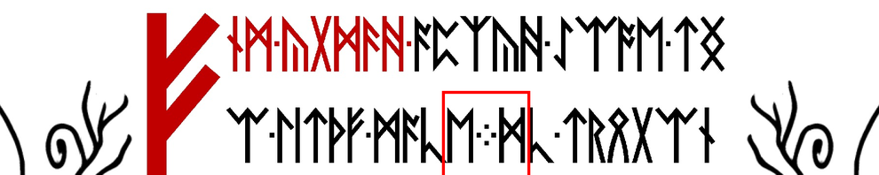
X yes, this one ☐ no, I meant another: __

**S8b — p57.** Immediately after the red opening word there is a RED
dot-matrix (13 dots, diamond-shaped arrangement — the section-ornament
motif used INLINE). Red box marks it:

Is this what you meant for p57? X yes ☐ no, I meant a black 4-dot diamond: __

**S8c — margin decoration (new channel you spotted).** Your 3-left/5-right
asymmetry on p40 and p48. Left margin | right margin, p40 then p48:
RE-ASK 2026-11-17 (your note: cropped too closely) — full-height strips now,
left margin | right margin, p40 then p48:
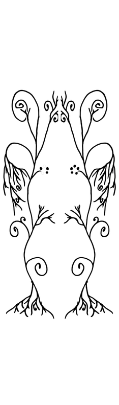 
(old tight crops kept:  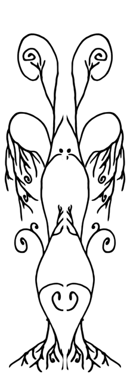)
Questions: is the asymmetry (fewer dot-trees left, more right) the SAME on
both pages? X same pattern both pages ☐ differs: __
(Can't see, we have cropped them too closely.) And do these margin designs carry dot counts you can read reliably?
counts L/R p40: 3__/5__ p48: 3__/5__ (decoration is fine as an answer — we just
want to know whether to keep a machine census of them.)

S8c RESOLVED 2026-11-17: same pattern both pages; ~3 left / ~5 right, exact
counts not reliably readable → margin decoration CLOSED, no machine census of
margins. (The "(can't see)" line above was my re-ask preamble, now moot.)

# Round #6 (2026-11-17) — FULL PAGES ONLY (your policy, adopted)

Per your note: audits now use full pages — no more crops. Generate the
marked pages yourself (bulk images are yours to run):

    python3 scripts/audit/mark_full_pages.py

→ docs/img/oracle/audit/pNN_marked.png (+ pNN_markers.txt sidecar giving
marker coordinates). Cyan **D** circles = machine 4-dot-diamond census;
orange **L** boxes = red-lattice census (label = dot count).

**S9 — what does krisyotam's `$` sit on?** (9 pages: 2, 7, 15, 22, 26,
32, 39, 55, 56 — every `$` follows an `&` immediately.) Early read of
marked p2/p7/p15: at the `$` position we see LARGE graphics, not red
lattices — p2: mayfly woodcut + small ∞ loops (top and bottom); p15: a
∞ (lemniscus) loop directly under the digit block; p7: a scattered
diamond of LARGE black dots (~5–6, much bigger than word-dots) under the
red line. For each `$` page, what do you see there?
shape p2: __ p7: __ p15: __ p22: __ p26: __ p32: __ p39: __ p55: __ p56: __
(mayfly / ∞ loop / large-dot diamond / other: __ — "decoration, no
consistent shape" is a valid answer; it retires $ as a symbol.)

**S10 — the 19 plain dots you left unstarred** (pages 7, 10, 17, 20, 26,
27, 29, 30, 34, 40, 41, 44, 47, 48, 52 — the sidecar names the krisyotam
line each sits on). On each marked page, is one of the cyan D circles
exactly that dot? If yes note its D-number; if none matches, say "not
circled" and we add a detector miss to the v2 list.
p7 (line 8, mid-line): D__ / not circled ☐   p10 (L9): D__ / ☐
p17 (L3): D__ / ☐   p20 (L6): D__ / ☐   p26 (L9): D__ / ☐
p27 (L7): D__ / ☐   p27 (L8): D__ / ☐   p29 (L5): D__ / ☐   p29 (L6): D__ / ☐
p30 (L9): D__ / ☐   p34 (L7): D__ / ☐   p40 (L2): D__ / ☐   p41 (L1): D__ / ☐
p41 (L4): D__ / ☐   p41 (L9): D__ / ☐   p44 (L8): D__ / ☐   p47 (L3): D__ / ☐
p48 (L1): D__ / ☐   p52 (L4): D__ / ☐

---

# Round #7 (2026-11-17) — campaign #20 confirmation, owner-performable

Where #20 stands (refresher): p15's printed digit grid **3278 / 3299(red)
/ 3298 / 2838**. Machine found three things — all four values fall inside
the T7 rune void [2740,4389] (p=2.6e-4); all four inside the pre-axis span
[1874,3602] (p=3.2e-4); digit sums {20,21,22,23} consecutive (p=0.0039);
Holm survives all. BUT I saw all three during the design pass (post-hoc),
so by our own rule they FLAG, they don't ADOPT. What adoption needs: a
prediction written down BEFORE the data, about data the design never
touched. The three predictions below were committed before your answer —
that is what makes them confirmation-grade. Full pages, your policy.

**S11 — recurrence sweep (PRIMARY).** A channel that occurs exactly once
cannot be confirmed: it is either a channel (recurs) or a one-off device.
PREDICTION (frozen): somewhere in the book OTHER than p15 there is at
least one more printed Arabic-decimal digit group. krisyotam is lossy for
non-rune content (p56's hex lines and p51's Roman numerals reached us only
through the images), so more could exist image-side only. Task: sweep all
58 full pages for printed Arabic decimal digits other than p15. Report
page + the digits — do NOT interpret them; the void/span/digit-sum
battery on the new group is then the registered confirmation test.
Found: page ___ digits   (or: "none — all pages checked" → that retir
es the channel reading: decimals = one-off device, adoption stays bloc
ked, no hard feelings, the p-values stand as a curiosity)

Page 10 has that "7" in the middle of the runes. And there are the red numbers that appear at the beginning of consecutive paragraphs from p36-38 (1, 2, 3, 4, 5). And of course the sexagesimal numbers from p49-51 contain many Arabic numerals (and Roman letters). And the presumed hexadecimal on p56. That's all I see.

**S12 — grid geometry + red anchor.** PREDICTION (frozen): the red 3299
sits at one END of the grid's physical reading order (first or last
position), i.e. red marks an anchor/terminator, consistent with our
terminator convention. Task, no interpretation: record the grid's
geometry — how many rows/columns, exact digits per row, which digits are
red, relative sizes/spacing, ink tone.
Geometry notes: __  3299 position: first / last / middle ☐

This is already recorded: 3258 3222 3152 3038/ 3278 3*2*9*9* 3298 2838/ 3288 3294 3296 2472/ 4516 1206 708 1820/. So 4 rows, 4 columns, 3299 is row 2, column 2. 

**S13 — axis through the digit block.** You already saw the ∞ (lemniscus)
loop directly under the digit block (your S9 lead). PREDICTION (frozen):
the vertical line through the ∞ loop's centre passes THROUGH the digit
block (not beside it) and lands on or immediately adjacent to the red
3299 column. Task: on the full p15, sight along that axis; say where it
lands relative to the grid.
Axis lands: through 3299 / other column / beside block / no alignment ☐ The loop's center cuts the 4 columns in half.

Scoring (pre-registered): S11 found → I run the FROZEN battery (same
nulls as #20: void C(1650,4)/C(12956,4), span, digit-sum MC) on the NEW
group — survives Holm → DECIMALS-CONFIRMED, adopted; fails → one-off
device. S11 none → one-off device, closed. S12/S13 corroborating only
(4 objects = low power): agreement strengthens, disagreement weakens but
does not refute. S11 alone can decide.