# Oracle queue #1 — human-eye tasks (2026-11-16)

Everything below is a crop we already cut, with our read stated and a blank
for yours. Fill any ☐ / __ you can; partial answers are fine — each c
onfirmed item unblocks a frontier (see [MAP.md](MAP.md) §D: F2/F8/F9). 
Crops live in `docs/img/oracle/` (tracked); full-page context crops stay in
`work/red_census/crops/`. Red notation: `*` suffix per red glyph.

**Rune oracle for Task 5** (the only glyph-identity call here):

|       | shape                                                                                       | name           |
| ----- | ------------------------------------------------------------------------------------------- | -------------- |
| ᚢ (U) | two vertical staves joined at the **bottom by a curve/brace** — a cup; no right-side bulges | úr "aurochs"   |
| ᛒ (B) | **one** vertical stave with **two closed bulges on the right** (like a Latin B)             | bercan "birch" |

Key discriminator: count the staves (2 vs 1) and look for the right-side
loops (absent in U, present in B).

---

## Task 1 — the red margin digits (pp36–38) → unblocks F2/F9

Our read: p36 line 6 margin = `1*`; p37 lines 1/5/10 margins = `2*` `3*`
`4*`; p38 line 4 margin = `5*`. All five RED, all in the margin, sequence
1–5 across three pages.

| crop                                  | our read                   | yours                                                                                                |
| ------------------------------------- | -------------------------- | ---------------------------------------------------------------------------------------------------- |
|   | `1*` red, margin           | X agree ☐ disagree: __                                                                               |
| 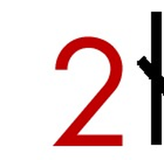 | `2*` red, margin of L1     | X agree ☐ disagree: __                                                                               |
|    | `2* 3* 4*` red (L1/L5/L10) | X agree ☐ disagree: __                                                                               |
|    | `5*` red (L4)              | ☐ agree X disagree: Yes 5* red L4, but also "10 dots" pattern I have seen at the end of... sentences? paragraphs? in red on L10 |

Extra question (matters for F18): do these digits look **Babylonian/
sexagesimal-style** (wedge-shaped) or like the p10/p15 Arabic-style printed
digits? ☐ wedge ☐ printed X can't tell (please provide examples of both types so I can compare)

## Task 2 — the other digit channels

Our read: p10's inline `7` is **black** (not red); p15's four digit lines
read `3278 3299 3298 2838` with **3299 red**. (It's 2nd of 4 digit-lines reads as this, yes.)

| crop                                       | our read                          | yours                  |
| ------------------------------------------ | --------------------------------- | ---------------------- |
| 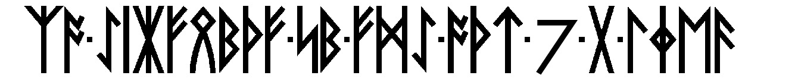           | `7` black, inline                 | ☐ agree ☐ disagree: __ |
| 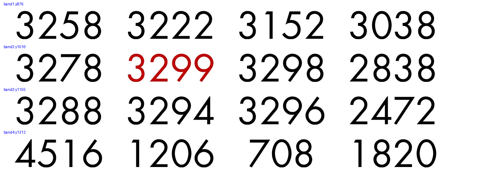 | 4 groups; `3299*` red, rest black | ☐ agree ☐ disagree: __ |

## Task 3 — p53 red lines + arrow → unblocks F8

Our read: stream lines 7–9 are **entirely red**, and there is a red arrow
glyph immediately after line 6.

| crop                                | our read                           | yours                                                                                 |
| ----------------------------------- | ---------------------------------- | ------------------------------------------------------------------------------------- |
|  | red arrow after L6 — direction: up | X agree ☐ disagree: __                                                                |
|     | line 7 all-red                     | ☐ agree X disagree: cropped too tight to see all of line 7 but the excerpt is all red |
| 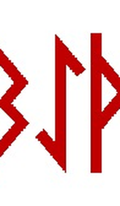   | line 8 all-red                     | ☐ agree X disagree: cropped too tight to see all but the excerpt is red               |
|    | line 9 all-red                     | ☐ agree X disagree: cropped tight, excerpt red                                        |

## Task 4 — dot-lattice size classes + matrix-only pages

Our read: three lattice sizes — 13-dot standard, 10-dot small, 23-dot large
(p57 only); pages 2, 14, 22, 26, 32, 49, 55 carry red ONLY as a dot lattice
(no rubric). Confirm dot counts and that the six "matrix-only" pages have no
other red ink we missed.

| crop                                 | our read        | yours                                                                                                |
| ------------------------------------ | --------------- | ---------------------------------------------------------------------------------------------------- |
|    | 13-dot standard | count: 13                                                                                            |
|  | 10-dot small    | count: 10                                                                                            |
|  | 23-dot large    | count: 23                                                                                            |
|    | p14 lattice     | other red on page? X no (not in visible portion. Also, isn't this just a 13-dot standard?) ☐ yes: __ |
|    | p22 lattice     | other red? X not visible (this is a 13 dot standard) ☐ yes: __                                       |
|    | p26 lattice     | other red? X no (13 dot) ☐ yes: __                                                                   |
|    | p32 lattice     | other red? X no (13 dot) ☐ yes: __                                                                   |
|    | p49 lattice     | other red? X no (10 dot) ☐ yes: __                                                                   |
|    | p55 lattice     | other red? X no (13 dot) ☐ yes: __                                                                   |

## Task 5 — p27 position 93: ᚢ or ᛒ? (dukotah's open human item)

Their classifier reads **U (ᚢ)** with the runner-up **B (ᛒ) at margin 5** —
the only unresolved glyph in their whole tree (`p27:93`, flagged
UNRESOLVED). Ours records ᚢ. It is the 17th glyph in this strip, the lone
stave-pair in `-ᛏᚱ-ᚢ-ᚣ-` (between ᛏᚱ and ᚣ):

Your read: ☐ ᚢ U ☐ ᛒ B ☐ neither: X (cropped too tight to see entire large glyph) U
se the chart above (stave count + right-side loops). This one is worth 
posting upstream when settled — their ledger explicitly waits on a human.

## Task 6 (larger, whenever convenient) — page readthroughs

p49 / p51 / p55 strip checklists are ready in `work/audit/page_49|51|55/`
(same format as the strip above: read off the image, mark OK or list
diffs). p51 is now correctly labelled book p51 post-relabel. These feed
divider-fidelity for campaign #11 (word-sums).

---

# Follow-up round #2 (2026-11-16) — answers to your answers

Thank you — everything you confirmed is banked. Four follow-ups below;
fill the ☐ boxes in place. **One honest correction first:**

> **p27 correction.** Your Task-5 "U" was asked against a crop that was
> **off by one line** — on p27 the top band is the mayfly-wing ornament and
> the second band holds three stream lines (line 1 in red + two black), so
> our band→line mapping was shifted and the old crop showed line 5, not
> line 4. We re-anchored by matching separator-dot patterns against the
> transcription; the crops below are cluster-anchored (verified against the
> dot pattern, not proportional spacing).

## F1 — p27:93, the real target + same-page references

The ticked glyph is position 93 (between the dots after `ᛏᚱ`, before the
pair before `ᛞ`). The compare sheet puts it against its own page-mates:
three glyphs our corpus records with the **same value as the target**
(@22/@25/@30 — all "arch": two staves joined at the top by a diagonal —
note our round-#1 shape chart said ᚢ joins at the *bottom*; that describes
the classic rune, not this angular font), plus the ᛒ candidates (@26/@31,
clear two-bulge) and ᛈ (@36, diamond). **Our read now: the target matches
the three arch references — ᚢ confirmed.** Your call:
☐ agree ᚢ ☐ disagree: __
☐ the tick points at the right glyph ☐ wrong glyph: __

## F2 — your "10 dots in red on L10" — found it

That is a red **10-dot diamond lattice in the LEFT margin** of line 10
(centre column of 4 + 3 each side) — machine-verified: exactly 10 red
connected components, RGB ≈ (175,5,5). Same motif as the p49 lattice you
counted (10 dots):

 

Red box = the 10-dot lattice; blue box = your confirmed `5*` (L4). The
dark marks at the RIGHT edge of L10 are black, not red
([zoom](img/oracle/p38_l10_rightedge_v2.png)).
☐ the red box is what you saw ☐ no, I meant something else: __

## F3 — wedge vs printed digits, examples as requested

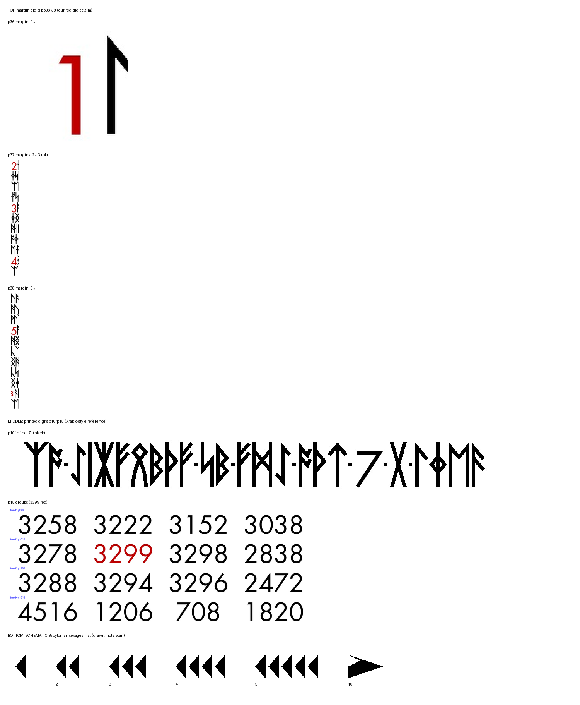

Top: the pp36–38 margin digits. Middle: p10/p15 printed digits. Bottom:
**drawn schematic** (not a scan) of Babylonian wedge forms for 1–5 and 10.
☐ margin digits look wedge ☐ printed ☐ neither/unclear: __

## F4 — p53 lines 7–9, full width this time

Twelve full-width bands (band 0 is ornament; stream lines follow — map
them yourself): `img/oracle/p53_band00_full.png` … `p53_band09_full.png`.
Which stream lines are entirely red? lines: __
# Round #3 (2026-11-16) — the black "cuneiform" stamp on pp33–39

Campaign #12 census finding: the "Babylonian sexagesimal art" of pp34–39
is ONE black stamp repeated identically (pixel-verified, maxdiff 0) on the
tops of pp34–39, plus a footer instance on p33. It brackets the pp33–39
section. Its only information is (a) what its glyphs mean and (b) where it
sits — and machine wedge-counting fails on it (strokes fused; see
`sweeps/2026-11-sex60/CENSUS.md`). Your eye, please:

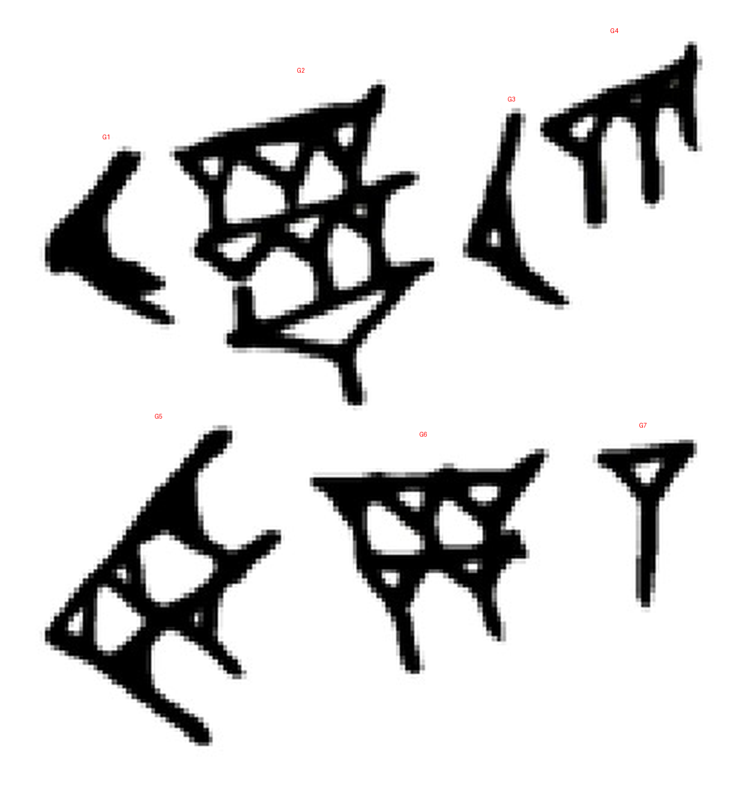
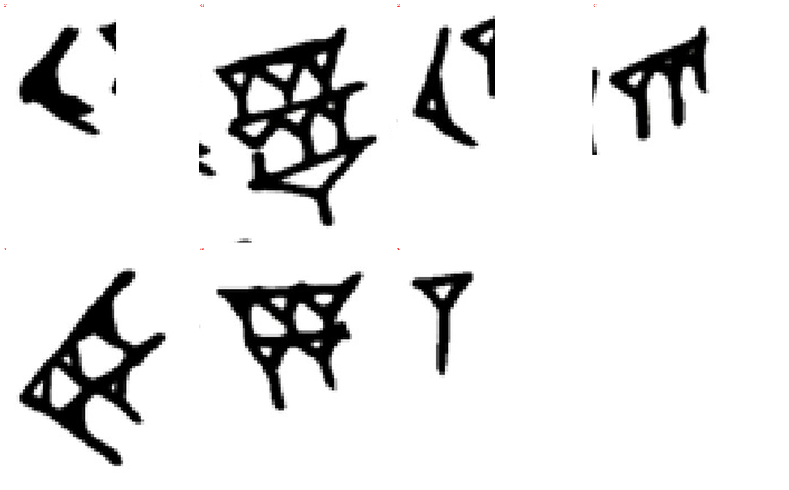
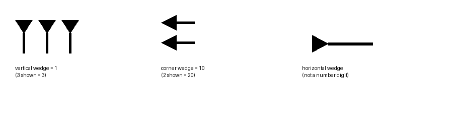

G1–G7 are reading order (top row 4, bottom row 3). Tiles crop slightly into
neighbours — read counts on the full stamp.

**S1 — what is it?**
☐ Babylonian **numbers** (then: digit values G1–G7 = __ __ __ __ __ __ __)
☐ cuneiform **signs** (if you can transliterate: __)
☐ ornament, not language
☐ unclear

**S2 — per-glyph tally** (vertical wedges = 1s, corner wedges = 10s;
"bar" = horizontal wedge, not a number digit):

| glyph | verticals | corners | bar? |
|---|---|---|---|
| G1 | __ | __ | ☐ |
| G2 | __ | __ | ☐ |
| G3 | __ | __ | ☐ |
| G4 | __ | __ | ☐ |
| G5 | __ | __ | ☐ |
| G6 | __ | __ | ☐ |
| G7 | __ | __ | ☐ |

**S3 — p33 vs pp34–39** (same stamp, resampled — confirm visually):
☐ same device ☐ visibly different: __

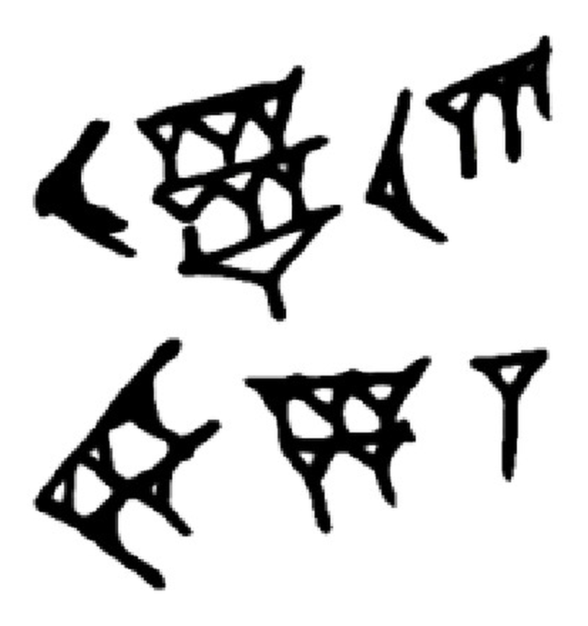

---

# Round #4 (2026-11-16) — lattice ↔ red-head alignment (campaign #13, O1 FLAG)

Campaign #13 measured it: 11 of your 14 red-word head pages also carry a red
dot-lattice (independence expects 5.4; p = 0.0007). Before we interpret that
as anything, we must rule out census misses on both sides — your eye:

**S4 — do these three red-head pages hide a lattice we missed?**
Lattices are small red dot diamonds, 13-dot ≈ 84 px tall at full scan
(~34 px here). One sheet per page; fill the line under each.

**p8** — lattice present? ☐ yes ☐ no · if yes dots = __ · location __

**p37** — lattice present? ☐ yes ☐ no · if yes dots = __ · location __

**p40** — lattice present? ☐ yes ☐ no · if yes dots = __ · location __

**S5 — do these lattice-only pages hide a red head word** (red drop-cap /
red opening word in the title band, like pp0/3/6/…)? One sheet per page.

**p2** — red head word? ☐ yes ☐ no · if yes, the word __

**p14** — red head word? ☐ yes ☐ no · if yes, the word __
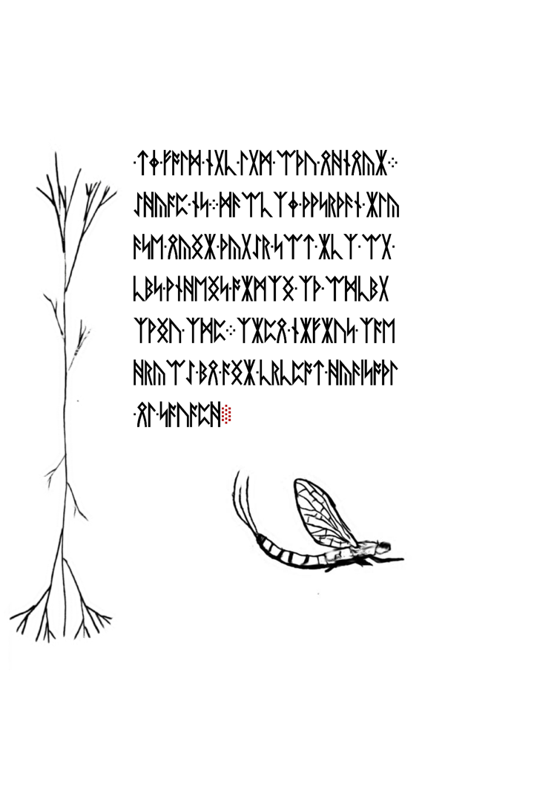

**p22** — red head word? ☐ yes ☐ no · if yes, the word __
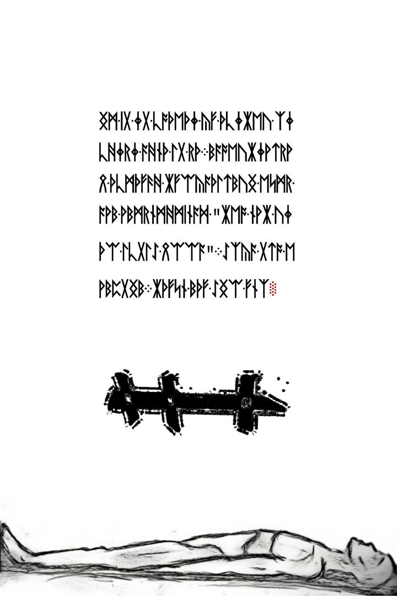

**p26** — red head word? ☐ yes ☐ no · if yes, the word __

**p32** — red head word? ☐ yes ☐ no · if yes, the word __

**p49** — red head word? ☐ yes ☐ no · if yes, the word __
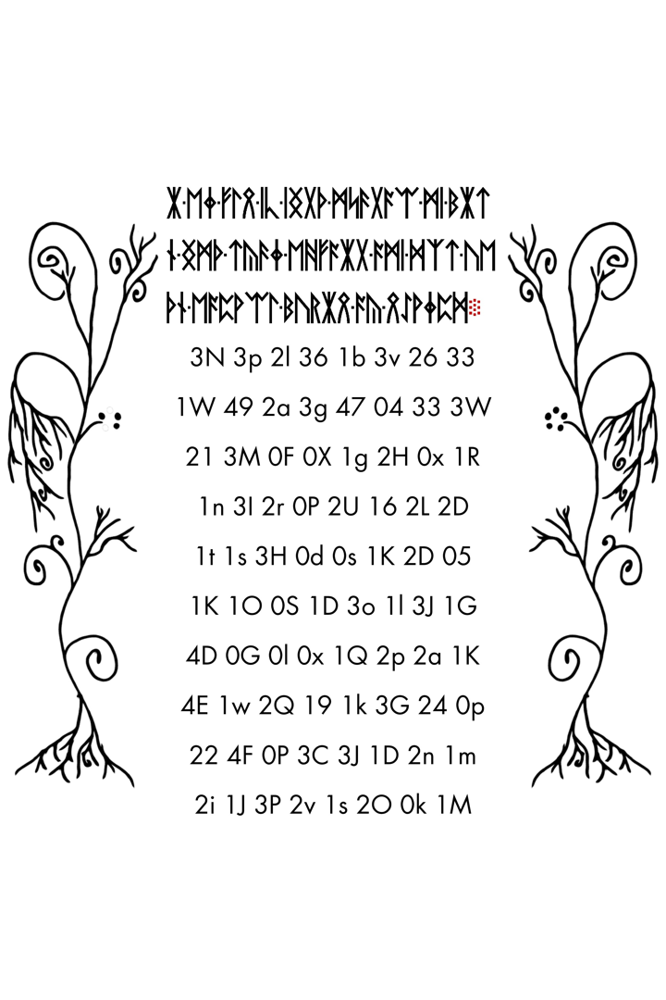

**p55** — red head word? ☐ yes ☐ no · if yes, the word __
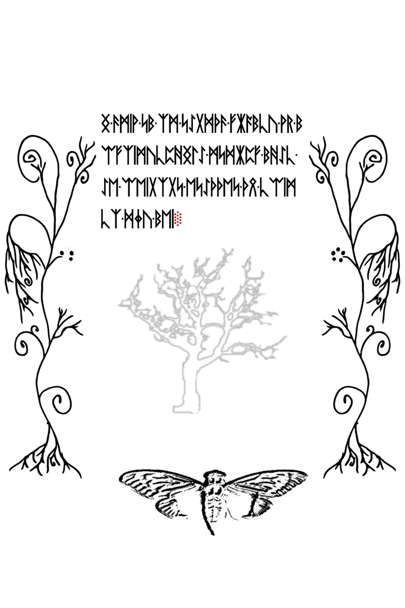

Reading key: all "no" on S4 + all "no" on S5 ⇒ the two red features are
independent-but-correlated section markers (flag stands as census fact).
S4 misses ⇒ flag weakens. S5 misses ⇒ heads are the complete marker and
lattices the subset ⇒ worth a re-test with the corrected head list.
