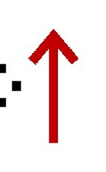
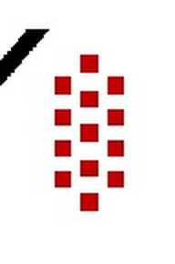

# Oracle queue #1 — human-eye tasks (2026-11-16)

Everything below is a crop we already cut, with our read stated and a blank
for yours. Fill any ☐ / ____ you can; partial answers are fine — each
confirmed item unblocks a frontier (see [MAP.md](MAP.md) §D: F2/F8/F9).
Crops live in `docs/img/oracle/` (tracked); full-page context crops stay in
`work/red_census/crops/`. Red notation: `*` suffix per red glyph.

**Rune oracle for Task 5** (the only glyph-identity call here):

| | shape | name |
|---|---|---|
| ᚢ (U) | two vertical staves joined at the **bottom by a curve/brace** — a cup; no right-side bulges | úr "aurochs" |
| ᛒ (B) | **one** vertical stave with **two closed bulges on the right** (like a Latin B) | bercan "birch" |

Key discriminator: count the staves (2 vs 1) and look for the right-side
loops (absent in U, present in B).

---

## Task 1 — the red margin digits (pp36–38) → unblocks F2/F9

Our read: p36 line 6 margin = `1*`; p37 lines 1/5/10 margins = `2*` `3*`
`4*`; p38 line 4 margin = `5*`. All five RED, all in the margin, sequence
1–5 across three pages.

| crop | our read | yours |
|---|---|---|
|  | `1*` red, margin | ☐ agree ☐ disagree: ____ |
|  | `2*` red, margin of L1 | ☐ agree ☐ disagree: ____ |
|  | `2* 3* 4*` red (L1/L5/L10) | ☐ agree ☐ disagree: ____ |
|  | `5*` red (L4) | ☐ agree ☐ disagree: ____ |

Extra question (matters for F18): do these digits look **Babylonian/
sexagesimal-style** (wedge-shaped) or like the p10/p15 Arabic-style printed
digits? ☐ wedge ☐ printed ☐ can't tell

## Task 2 — the other digit channels

Our read: p10's inline `7` is **black** (not red); p15's four digit lines
read `3278 3299 3298 2838` with **3299 red**.

| crop | our read | yours |
|---|---|---|
|  | `7` black, inline | ☐ agree ☐ disagree: ____ |
|  | 4 groups; `3299*` red, rest black | ☐ agree ☐ disagree: ____ |

## Task 3 — p53 red lines + arrow → unblocks F8

Our read: stream lines 7–9 are **entirely red**, and there is a red arrow
glyph immediately after line 6.

| crop | our read | yours |
|---|---|---|
|  | red arrow after L6 — direction: ____ | ☐ agree ☐ disagree: ____ |
|  | line 7 all-red | ☐ agree ☐ disagree: ____ |
|  | line 8 all-red | ☐ agree ☐ disagree: ____ |
|  | line 9 all-red | ☐ agree ☐ disagree: ____ |

## Task 4 — dot-lattice size classes + matrix-only pages

Our read: three lattice sizes — 13-dot standard, 10-dot small, 23-dot large
(p57 only); pages 2, 14, 22, 26, 32, 49, 55 carry red ONLY as a dot lattice
(no rubric). Confirm dot counts and that the six "matrix-only" pages have no
other red ink we missed.

| crop | our read | yours |
|---|---|---|
|  | 13-dot standard | count: ____ |
|  | 10-dot small | count: ____ |
|  | 23-dot large | count: ____ |
|  | p14 lattice | other red on page? ☐ no ☐ yes: ____ |
|  | p22 lattice | other red? ☐ no ☐ yes: ____ |
|  | p26 lattice | other red? ☐ no ☐ yes: ____ |
|  | p32 lattice | other red? ☐ no ☐ yes: ____ |
|  | p49 lattice | other red? ☐ no ☐ yes: ____ |
|  | p55 lattice | other red? ☐ no ☐ yes: ____ |

## Task 5 — p27 position 93: ᚢ or ᛒ? (dukotah's open human item)

Their classifier reads **U (ᚢ)** with the runner-up **B (ᛒ) at margin 5** —
the only unresolved glyph in their whole tree (`p27:93`, flagged
UNRESOLVED). Ours records ᚢ. It is the 17th glyph in this strip, the lone
stave-pair in `-ᛏᚱ-ᚢ-ᚣ-` (between ᛏᚱ and ᚣ):

Your read: ☐ ᚢ U ☐ ᛒ B ☐ neither: ____
Use the chart above (stave count + right-side loops). This one is worth
posting upstream when settled — their ledger explicitly waits on a human.

## Task 6 (larger, whenever convenient) — page readthroughs

p49 / p51 / p55 strip checklists are ready in `work/audit/page_49|51|55/`
(same format as the strip above: read off the image, mark OK or list
diffs). p51 is now correctly labelled book p51 post-relabel. These feed
divider-fidelity for campaign #11 (word-sums).
