# SEGMENTS — LP2 divided into 7 decoration-groups (v2)

**v2 = owner round-7 full decoration pass (2026-11-17).** Three boundaries moved vs the #18-registered 10 groups: spiral-scrolls run pp3–7 (old P2+P3 merge), mirrored cicadas include p26, and the 3/5-dot mirrored scrolls are continuous pp40–55 (old P8+P9 merge). Campaign #18's verdict stands as run on its registered segmentation; a #19 re-test on THIS partition is queued pending your sign-off. Pages are the original full-page scans (docs/img/oracle/pages/), book order within each group. Rune counts from core.validate; stream positions over pp00–55 (p50 runeless, excluded).

Evidence and verdict panel (v1, 10 groups): sweeps/2026-11-segments/. Regenerate: `python3 scripts/audit/make_segments_doc.py`.

## Q1 — pp00–02 (3 pages, 729 runes, stream pos 0–728)

*vertical fence (mirrored + flipped) + small ∞ top/bottom on all three pages (owner r7)*

**p0** *(262 runes)*

**p1** *(266 runes)*

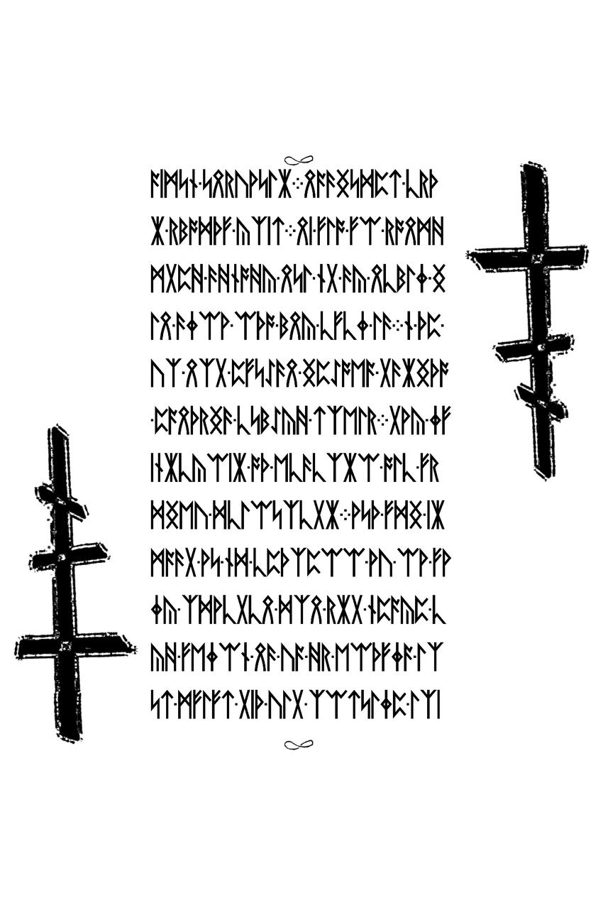

**p2** *(201 runes)*

## Q2 — pp03–07 (5 pages, 1145 runes, stream pos 729–1873)

*symmetric spiral-scrolls on ALL FIVE pages (owner r7 extends the family down to p3); p7-bottom 5-dot = vertical flip of p23-top — bracket opens here*

**p3** *(217 runes)*

**p4** *(261 runes)*

**p5** *(263 runes)*

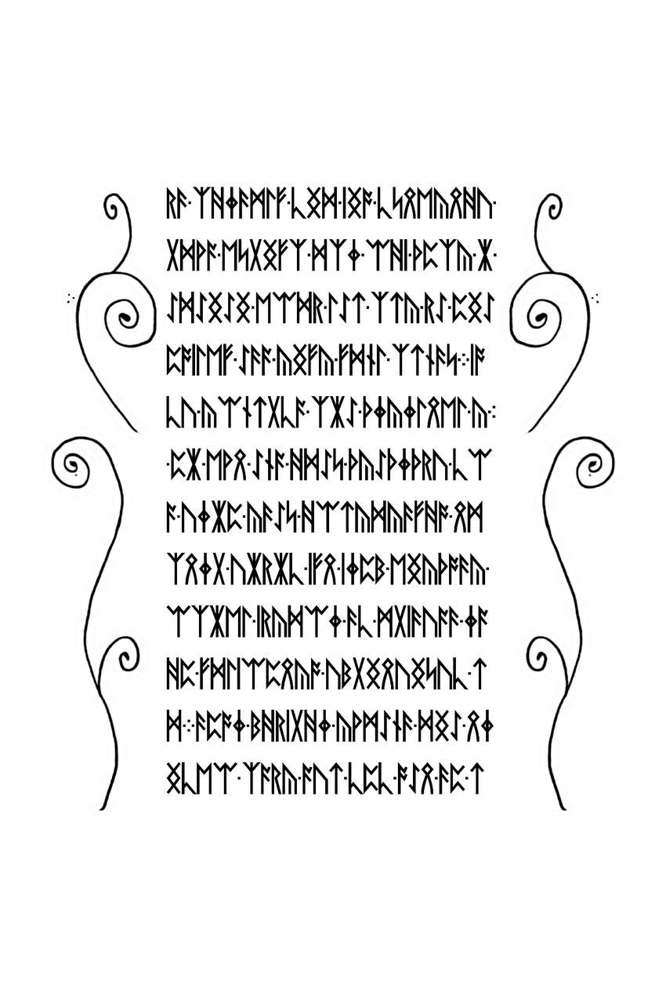

**p6** *(196 runes)*

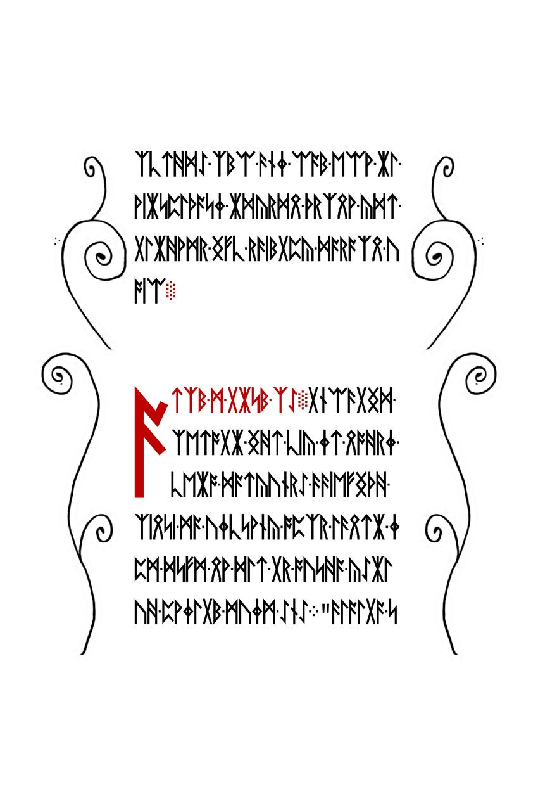

**p7** *(208 runes)*

## Q3 — pp08–22 (15 pages, 3632 runes, stream pos 1874–5505)

*interior of the p7↔p23 bracket — OWNER NESTED HYPOTHESIS (2026-11-17): segment-in-a-segment pp8–14 (alternating branch margins, dragonfly close, partial page: 7 lines, 1,729 runes) · AXIS p15 (decimal block 3278/3299red/3298/2838, large ∞, 8 rune lines below) · plain segment pp16–22 (no decorations, partial closer p22: 6 lines, fence + body in repose). Page symmetry EXACT 7|axis|7; core pp8–13 vs pp16–21 = 72 vs 72 lines; lengths NOT equal (1,729 vs 1,903 runes); LP1-style line-sum palindrome across axis REFUTED 0/72*

**p8** *(255 runes)*

**p9** *(268 runes)*

**p10** *(263 runes)*

**p11** *(273 runes)*

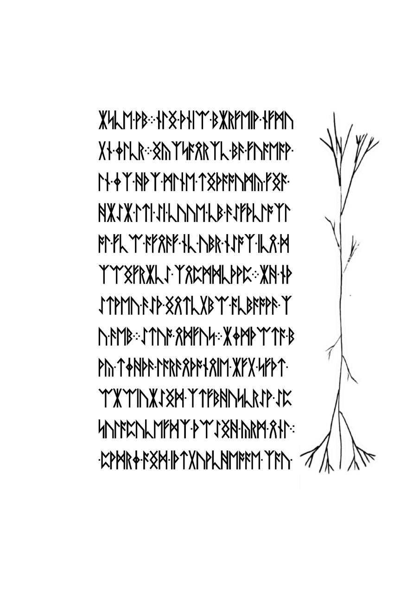

**p12** *(261 runes)*

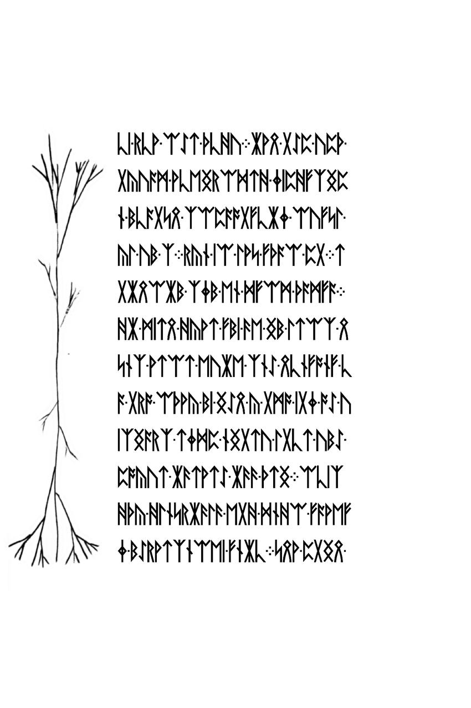

**p13** *(272 runes)*

**p14** *(137 runes)*

**p15** *(159 runes)*

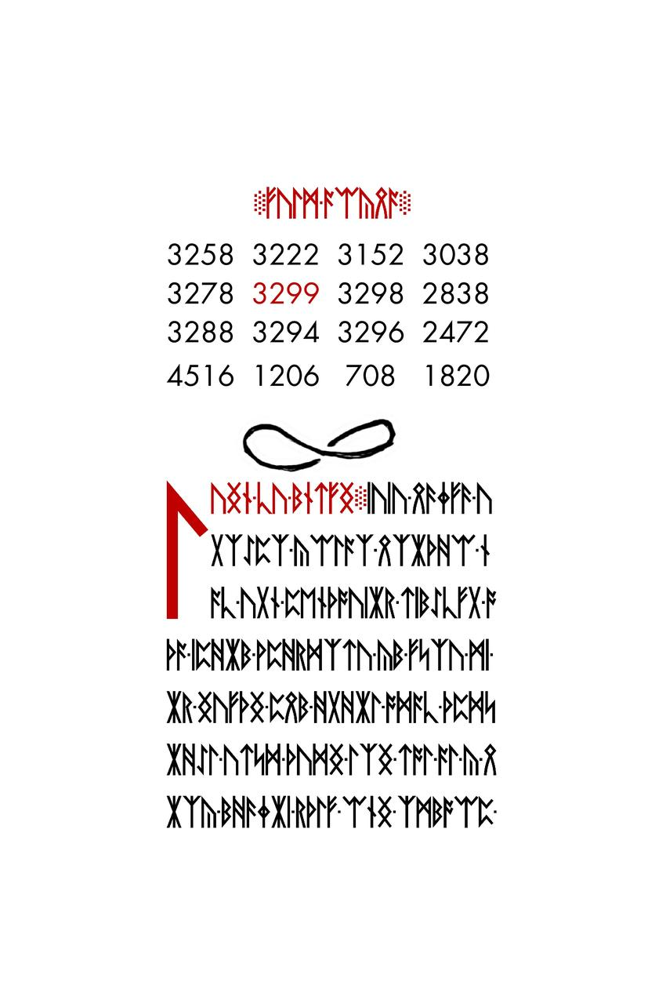

**p16** *(267 runes)*

**p17** *(273 runes)*

**p18** *(260 runes)*

**p19** *(271 runes)*

**p20** *(269 runes)*

**p21** *(273 runes)*

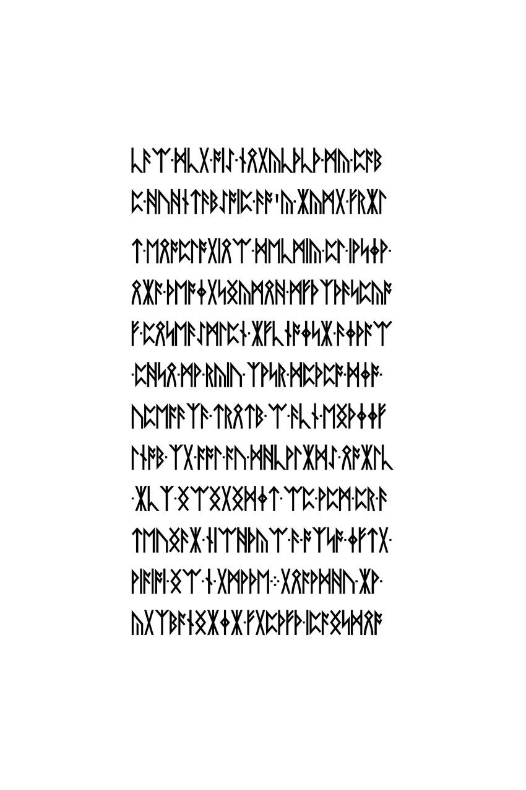

**p22** *(131 runes)*

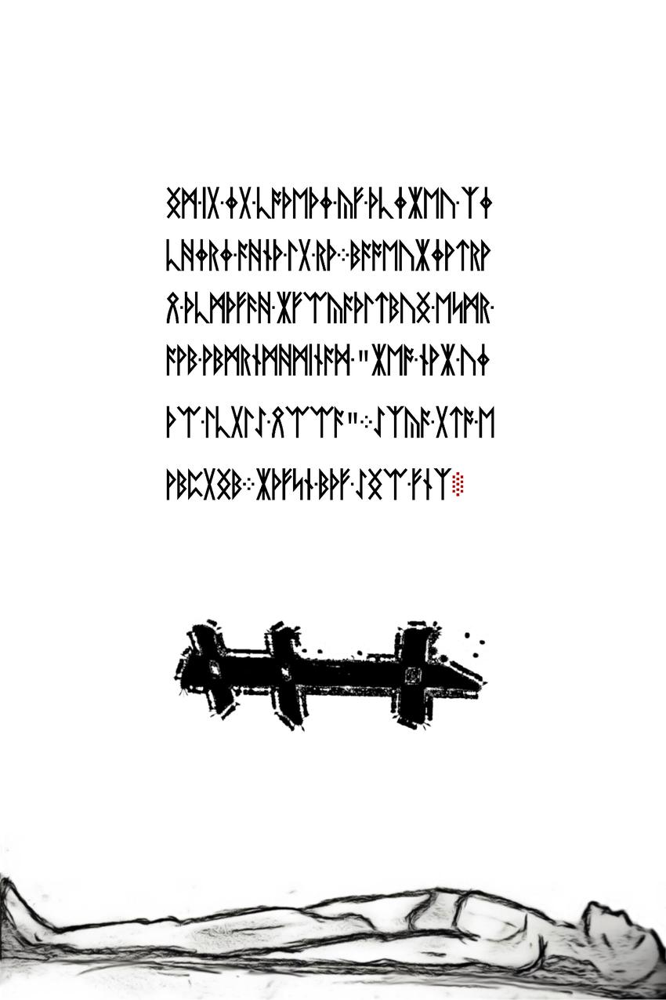

## Q4 — pp23–26 (4 pages, 1021 runes, stream pos 5506–6526)

*p23 = HINGE: its top dots are simultaneously the flip-partner of p7-bottom and the mirror-partner of p56-bottom ('a beginning here, an ending on p56'); mirrored cicadas p24–26 (owner r7 adds p26; jbo mayfly group pp23–26, dukotah pp24–26)*

**p23** *(213 runes)*

**p24** *(270 runes)*

**p25** *(273 runes)*

**p26** *(265 runes)*

## Q5 — pp27–32 (6 pages, 1433 runes, stream pos 6527–7959)

*gap; singletons only — p27 cicada wing at top, p32 blurry tree at bottom*

**p27** *(234 runes)*

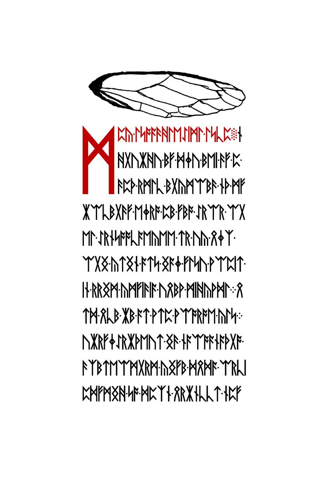

**p28** *(269 runes)*

**p29** *(277 runes)*

**p30** *(263 runes)*

**p31** *(269 runes)*

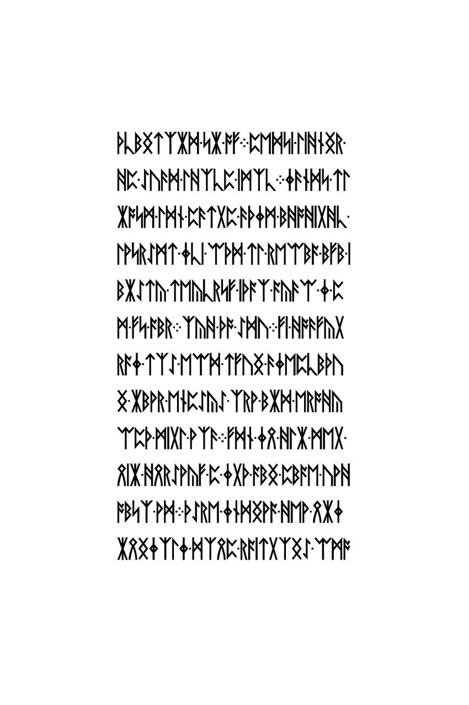

**p32** *(121 runes)*

## Q6 — pp33–39 (7 pages, 1680 runes, stream pos 7960–9639)

*owner r7: 'No scrolls; </Y patterns' on ALL SEVEN pages (independent of the machine finding: one pixel-identical black stamp ×7, campaign #12); 3-large-dot paragraph breaks at p33 and p39*

**p33** *(214 runes)*

**p34** *(261 runes)*

**p35** *(271 runes)*

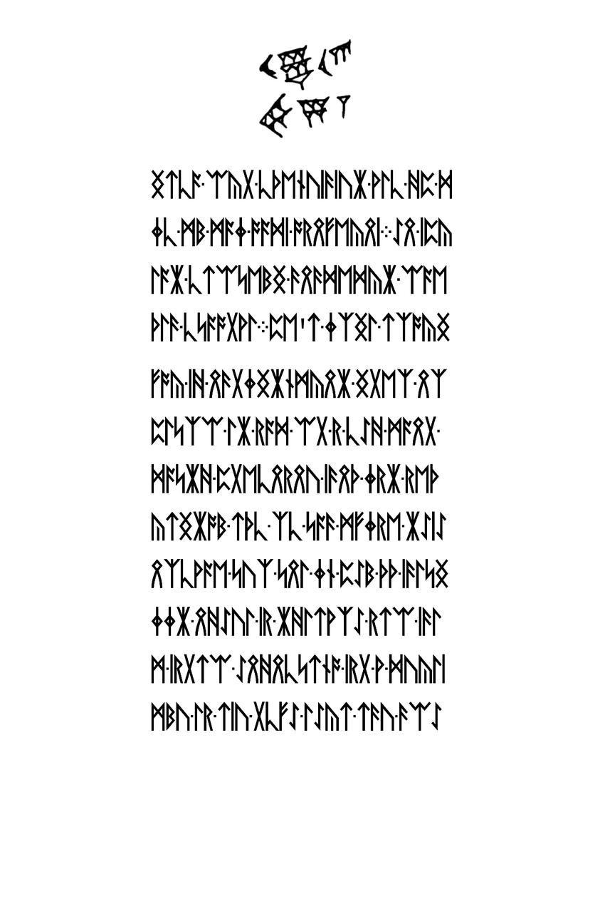

**p36** *(238 runes)*

**p37** *(228 runes)*

**p38** *(228 runes)*

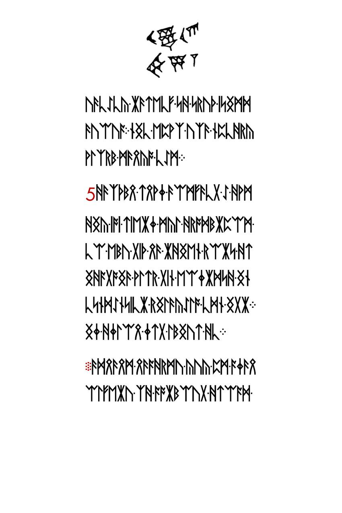

**p39** *(240 runes)*

## Q7 — pp40–55 (16 pages, 3316 runes, stream pos 9640–12955)

*'3 dot / 5 dot mirrored scrolls' on sides, CONTINUOUS pp40–55 (owner r7; includes runeless p50 and the whole base-60 stream pp49–51); p55 adds tree outline center + cicada bottom; p40↔p48 margin asymmetry (S8c) now reads as a sub-feature, not a boundary*

**p40** *(231 runes)*

**p41** *(273 runes)*

**p42** *(272 runes)*

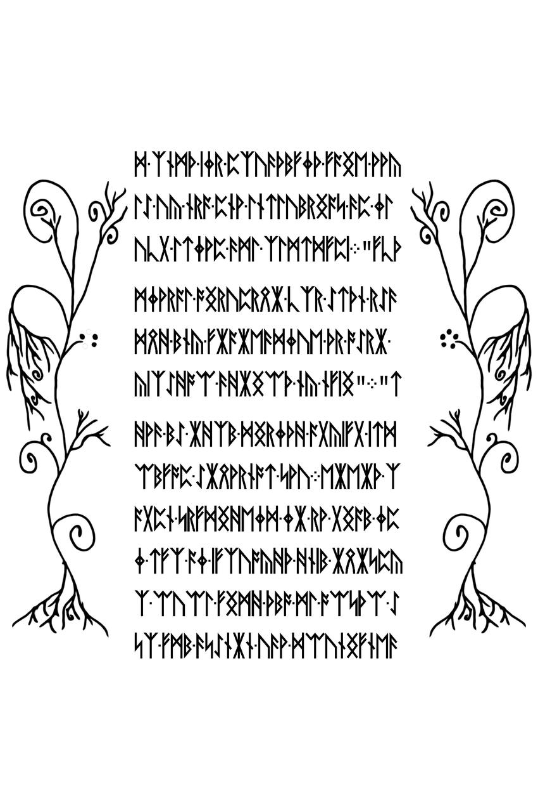

**p43** *(274 runes)*

**p44** *(273 runes)*

**p45** *(270 runes)*

**p46** *(270 runes)*

**p47** *(274 runes)*

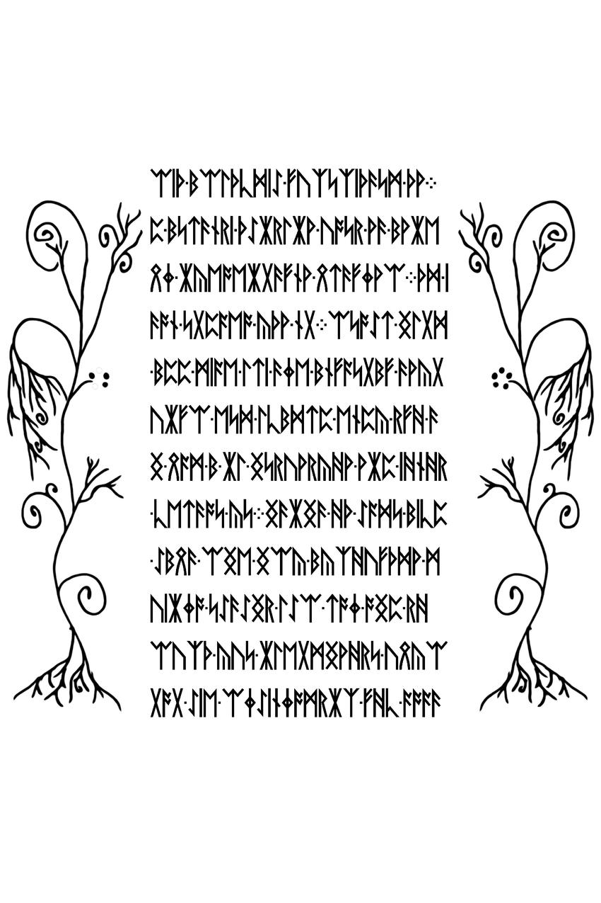

**p48** *(271 runes)*

**p49** *(66 runes)*

**p50** *(runeless token page)*

**p51** *(92 runes)*

**p52** *(263 runes)*

**p53** *(179 runes)*

**p54** *(232 runes)*

**p55** *(76 runes)*

## Q8 — pp56–57 (2 pages, 180 runes, solved (excluded from stream))

*solved closing pages; p56-bottom 5-dot pattern (groups of 3+2) = closing partner of the p23 hinge*

**p56** *(85 runes)*

**p57** *(95 runes)*

## Review notes — what your round-7 notes left open

1. **p23 hinge**: its top dots are (per your notes) both the flip-partner of p7-bottom AND the mirror-partner of p56-bottom. Palindrome hinge (house style) — shared by two brackets — or should p23 belong solely to the cicada group (jbo's mayfly group is pp23–26; dukotah's is pp24–26; your literal note puts mirrored cicadas on p24, p25, p26)?
2. **Q3 nesting (your 2026-11-17 hypothesis, measured):** branch-segment pp8–14 | axis p15 (decimals + ∞) | plain segment pp16–22. Page symmetry exact 7|axis|7, core line-counts 72↔72, both closers partial (p14: 7 lines/dragonfly, p22: 6 lines/fence+body) — but rune lengths unequal (1,729 vs 1,903) and the LP1 line-sum palindrome across the axis is REFUTED (0/72). Note: all four p15 decimals fall INSIDE the pre-axis segment's stream span (1874–3602), and 1,729 is the Hardy–Ramanujan number — logged, not evidence. Does the nesting stand as presentation (three passages) or is Q3 one passage with internal furniture?
3. **Q7 spans the base-60 token stream (pp49–51) and the runeless p50**, with the same mirrored scrolls throughout — one passage containing the tokens? If so the old P8/P9 split (my p40↔p48 margin-asymmetry bracket) is demoted to a sub-feature.
4. **Q5 is a group by ABSENCE** (only the p27 wing and p32 tree singletons). Anything at its edges (p26/p27, p32/p33) that should merge or split it?
5. **3-large-dot paragraph breaks on p33 and p39** (your note): both at Q6 edges — consistent with Q6 as a passage; same large-dot class as p7's `$` diamond and the 9 `$` pages (oracle round #6 S9 still live).
