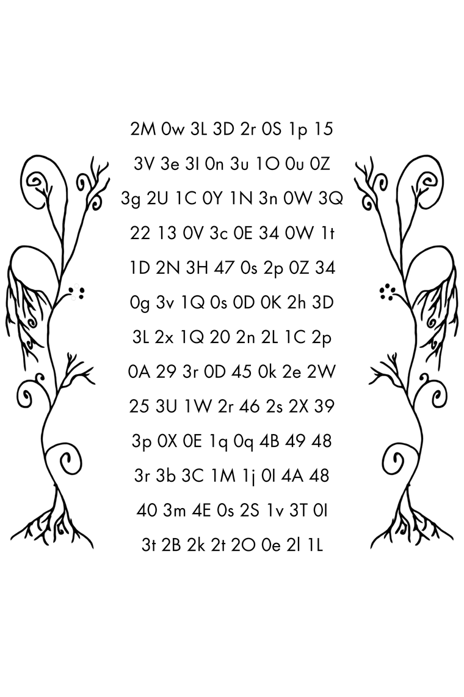
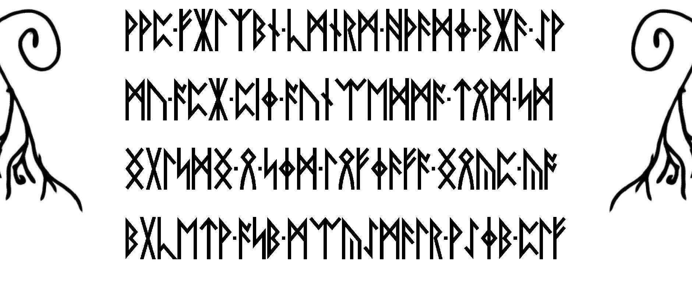
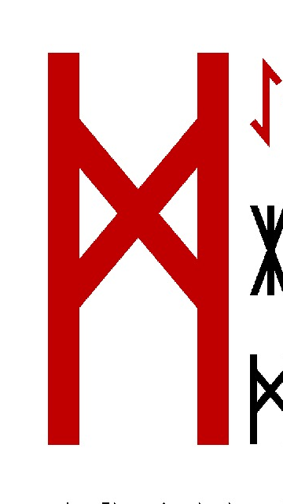
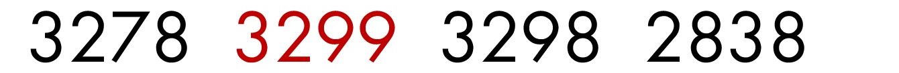

# The krisyotam stream's tail is shifted +1 relative to the book

_2026-11-15 · found during our transcription audit
([TRANSCRIPTION_AUDIT.md](TRANSCRIPTION_AUDIT.md)) · posted upstream as
[Dukotah/cicada3301#14](https://github.com/Dukotah/cicada3301/issues/14)._

**Claim.** The canonical rune stream (`krisyotam_runes.txt`, and every
machine-readable transcription derived from the same 2017 root) attributes
runic content to book page 50 that **does not exist on page 50**. The
stream's tail segments 50–54 are book pages **51–55**: a clean +1 page
attribution shift, introduced when the canonical stream was extracted
from the 2017 root as runes-only — the root **has a slot for page 50**
(it holds the page's base-60 token table, zero runes), and dropping the
"empty" slot silently renumbered the whole tail. This is a
**structural** (page-boundary) defect, not a
glyph-level mis-read, and it evades every safeguard the community has
used: lineage cross-diffing (identical copies agree) and solved-page
validation (the solved pages are p56–p57, past the defect).

## Setup: why unanimity hid this

All surviving transcriptions are rune-for-rune identical (dukotah
`crossdiff`: 13,136 runes, 0 divergences across krisyotam / relikd /
rtkd-iddqd) — because they all descend from the **single 2017 root**. The
root was image-audited 2017–2021 and reproduces the solved pages, so the
transcription was declared corroborated. Both checks are real — but the
solved pages sit *after* the tail, and cross-diffing copies cannot see an
error the root already contains.

## Exhibit A — book page 50 contains no runes

LP2 page 50 (ibotpeaches `67.jpg`; unified numbering = file N+17):



A 13×8 Latin token table between two marginal trees. **Zero runes.**
This matches dukotah's own Campaign VII §1: *"p50 = a 13×8 table, no runes
at all (104 tokens)"* — the image fact is not in dispute upstream.

Yet the stream carries a full segment at index 50 (page slots are
`%`-separated, one per book page).

## Exhibit B — stream segment 50 holds 92 runes in 4 lines

From `krisyotam_runes.txt` (sha256 `9b211a06a4bc31d6…`, split on `%`,
segment index 50), `-` = word divider as encoded:

```
ᚹᚹᛈ-ᚠᛡᛚᛉᛒᚾ-ᚳᛗᚾᚱᛗ-ᚻᚦᚫᛞᛄ-ᛒᛡᚫ-ᛇᚹ
ᛗᚢ-ᚪᛈᛡ-ᛈᛁᛄ-ᚪᚢᚾᛠᛖᛞᛗᚪ-ᛏᛟᛗ-ᛋᛞ
ᛝᚷᛚᛋᛞᛝ-ᛟ-ᛋᛄᛞ-ᛚᛟᚠᛄᚫᚠᚪ-ᛝᛟᚣᛈ-ᚣᚩ
ᛒᚷᚳᛖᛏᚹ-ᚪᛋᛒ-ᛗᛠᚣᛇᛗᚫᛚᚱ-ᚹᛇᛄᛒ-ᛈᛚᚠ
(4 lines, 92 runes: 24 / 21 / 23 / 24)
```

Reproduce:

```python
segs = open("krisyotam_runes.txt", encoding="utf-8").read().split("%")
lines = [ln.strip() for ln in segs[50].split("/") if ln.strip()]
runes = [c for c in "".join(lines) if not c.isspace() and c not in "-./"]
print(len(lines), len(runes))          # -> 4 92
```

NB: `split("/")[0]` **is** the first line — segments do not begin with a
leading `/`. (An auditor's `[1:]` here initially dropped line 1 and made
this exhibit look like 3 lines starting with `ᛗᚢ-…`; see Disclosure below.)

## Exhibit C — book page 51's rune lines pair with segment 50 verbatim

Book page 51 (`68.jpg`) = a 9×8 token table **plus 4 rune lines**:



We re-read the page from scratch (owner visual pass, glyph-by-glyph,
word dividers included, against no reference, entered line-by-line in
`work/audit/p51_runes/READ.md`). **All four lines came back
character-for-character identical** to segment 50 — runes *and* word
dividers:

| book p51 re-read | stream seg 50 | match |
|---|---|---|
| READING-1 `ᚹᚹᛈ-ᚠᛡᛚᛉᛒᚾ-ᚳᛗᚾᚱᛗ-ᚻᚦᚫᛞᛄ-ᛒᛡᚫ-ᛇᚹ` | L1 (same string) | **exact, 24/24** |
| READING-2 `ᛗᚢ-ᚪᛈᛡ-ᛈᛁᛄ-ᚪᚢᚾᛠᛖᛞᛗᚪ-ᛏᛟᛗ-ᛋᛞ` | L2 (same string) | **exact, 21/21** |
| READING-3 `ᛝᚷᛚᛋᛞᛝ-ᛟ-ᛋᛄᛞ-ᛚᛟᚠᛄᚫᚠᚪ-ᛝᛟᚣᛈ-ᚣᚩ` | L3 (same string) | **exact, 23/23** |
| READING-4 `ᛒᚷᚳᛖᛏᚹ-ᚪᛋᛒ-ᛗᛠᚣᛇᛗᚫᛚᚱ-ᚹᛇᛄᛒ-ᛈᛚᚠ` | L4 (same string) | **exact, 24/24** |

**92/92 runes, 4/4 lines, every word divider reproduced.** Line counts
agree too: 4 visible rune lines on p51, 4 lines in seg 50.

## Corroboration down the tail

| stream seg | lines (runes/line) | book page | visible layout |
|---|---|---|---|
| 50 | 4 · [24,21,23,24] | p51 | 9×8 table + 4 rune lines ✓ |
| 51 | 12 · [23,22,21,22,21,24,21,21,21,22,22,23] | p52 | dense rune page ✓ |
| 54 | 4 rune lines · [24,22,22,8] | p55 | 4 rune lines, **short last line** ✓ |

The distinctive signature is seg 54: four lines with a short 8-rune
finale — exactly what book p55 (`72.jpg`) shows. Page 55 is therefore
**not** untranscribed: it is seg 54, mislabeled (see "convention?" below —
dukotah's problem space "pages 0-54 / all 55 pages" (`PROBLEM.json`)
carries exactly this misnomer).

## Consequences

1. **Page labels ≥50 are off by one** in every published result that
   names stream pages by index — ours and dukotah's alike. Content
   statistics are unaffected (arrays were scanned correctly; only the
   page *name* is wrong), and within-page statistics on any single
   segment are untouched.
2. **"Page 55 untranscribed" is false** — it is seg 54.
3. The defect is **page-boundary only**: no evidence any rune was
   mis-read. The independently re-read page matches at **92/92 glyphs
   including every word divider**, which is also the first independent
   corroboration of divider fidelity anywhere in the stream.
4. Methodological: single-root cross-diffing and solved-page validation
   both missed a whole-page boundary error for eight years. Any
   transcription-verification protocol needs at least one **independent
   page-boundary check** against the images.

## Disclosure — auditor self-corrections

Two bugs in **our own** tooling briefly made this look like
shift-with-corruption instead of a clean shift; both fixed 2026-11-15:

- `split("/")[1:]` dropped every segment's first line (segments have no
  leading `/`). This shifted checklist separator lines by one on all 55
  pages and caused a spurious "seg 50 ≠ p51 line 1" mismatch — the owner's
  from-scratch read of p51 is what exposed it.
- A counting regex `[^ᚠ-ᛠ]` silently excluded ᛡ (U+16E1, above the range
  end), undercounting every page by its ᛡ count.

## Is "skipping the runeless page" an accepted convention?

The natural objection: maybe the root *intentionally* omitted a segment
for runeless p50, and the community silently agreed the stream skips it.
We checked — and the 2017 root file itself answers the question:

### The root does not skip p50. It gives p50 a slot.

`rtkd/iddqd` master transcription (fetched from the pinned upstream
2026-11-15, sha256 `e21743ccd9a07f38…`, 54,478 B) segments LP2 **by book
page**: 58 slots + a `§` EOF slot. Slot 50 exists and holds page 50's
**base-60 token table** in the same `-`/`/` transcription convention
(its first line `2M-0w-3L-3D-2r-0S-1p-15` matches the community's
`50.jpg` table exactly) — zero *runes*, but a real, present slot. Every
other slot maps to its book page with content identical to the canonical
stream (verified slot-by-slot, 0 mismatches):

```python
rt = open("rtkd_master.txt", encoding="utf-8").read().split("%")[16:]
# rt[p] == krisyotam seg (p if p < 50 else p-1) for all book pages p != 50,
# rt[50] = the p50 token table (0 runes), rt[58] = "§".
```

So the +1 shift was **born in the runes-only extraction** into
`krisyotam_runes.txt`: filter to runes → slot 50 becomes empty → the
empty segment is dropped → segments 50–56 inherit the labels of 49's
successors. Nobody agreed to skip p50; a conversion step deleted its
(empty-of-runes) slot.

### And the correct mapping survived — in relikd, then was discarded

relikd's upstream repo (fetched 2026-11-15) stores the same runes in
chunks named **by book page**, and the chunk boundaries are *correct*:

| chunk | runes | matches | not |
|---|---|---|---|
| `p40-53` | 3,008 | segs 40–52 (= book 40–53, p50 skipped) | segs 40–53 (3,240) |
| `p54-55` | 308 | segs 53+54 (= book 54–55) | — |

Someone in the chain knew p50 carries no runes and p55 does. But dukotah's
own cross-verification **concatenated the chunks and threw the boundaries
away** (`crossdiff.py` `load_relikd`: a flat `order` list, `s += runes_of(...)`)
and adopted the krisyotam indexing — discarding the only surviving
correct page map. The community's operating documents then carry the
wrong names (see 4 below).

Beyond the root file itself, nothing documents a skip convention, and the
community demonstrably never applied one:

1. **No statement anywhere.** The stream file has no header or comments
   (57 bare `%`-separated blobs); dukotah's authoritative
   `TRANSCRIPTION-VERDICT.md` never mentions a segment→page mapping; no
   README or ledger entry describes a skip rule.
2. **Numbering was treated as noise, not convention.** dukotah's
   cross-verification aligned lineages *"so that page-break/numbering/
   delimiter differences don't matter"* (`crossdiff.py` method) — if a
   mapping convention existed, numbering would be well-defined, not
   something to normalize away.
3. **The community's actual page numbering has no gap.** The wiki dump
   (scream314, 2018) numbers **all 58 pages** by image — `50.jpg` is
   present (token table, annotated "wrong!!!"), `55.jpg` is present. The
   gap exists only in the rune stream's segment indexing.
4. **The community's target space uses the wrong names.** `PROBLEM.json`:
   *"pages 0-54"*, *"all 55 pages"*. Under the correct mapping the 55
   unsolved rune pages are **0–49 + 51–55** — right count, wrong names.
   A known skip convention would have written the range the other way.

And the decisive point: **even if it were a convention, nothing changes.**
Under the skip reading the correct map is exactly the one we verified
(segs 50–56 = book 51–57), so every page-named tail result — ours and
dukotah's — still needs relabeling, and "p55 untranscribed" is still
false. The convention question changes intent (bug vs undocumented
feature), not consequences. An undocumented convention that the
community's own problem statement violates is functionally a defect.

*(Fetch recipe for the two upstream files: dukotah
`data/fetch_sources.py`; sha256 prefixes — rtkd master
`e21743ccd9a07f38…`, relikd `p40-53` `282ce106e92eb69a…`, relikd
`p54-55` `f4a2f9dde276a0ff…`.)*

## The red-ink channel — adjudicated to rubrication; one new channel found

Strict red-pixel census (R>150, R−max(G,B)>80) on the published JPGs:
**heavy red on book pp0, 3, 6, 7, 8, 15, 23, 27, 33, 39, 40, 53, 54, 56,
57** (600×900-px counts ≈2.0k–8.3k), trace (57–378) on ~10 more.

*Correction 2026-11-15, same day:* an earlier draft of this section claimed
"an entirely red rune line `ᚾᛗ-ᚱ` on p15" and "a red ᛁ beside black runes on
p33". Both were misreads of stylized content by this auditor; line-by-line
pixel adjudication at full resolution settles what red actually is:

| p33 title band | p15 printed digits |
|---|---|
|  |  |
| giant red drop-cap + the opening word(s) in red + a red dot-matrix ornament — and the rest of the **same line** black | `3278 3299 3298 2838` — the `3299` group is printed in red (p15 digits were not previously catalogued) |

So dukotah's `armada_osint/redrune/` verdict — red = **rubrication of
opening/section-initial words**, cryptographically null (English-only keytest,
their doctrine L7-A) — is CONFIRMED on the canonical published images, and
their two "scattered" pages (canon 3, 33) are exactly this title-band pattern,
not the segmentation drift they invoked to dismiss them. Red dot-matrices also
stand at mid-page section breaks (p33, line-end of the 5th text line) =
positional markers.

The genuinely new channel is the **printed digits** — catalogued only on
pp10/36/37/38 (`-7-`, `1-`, `2-3-4-`, `5-`) — which also occur on p15, where
one group is red. Proposed follow-up: full digit + red-matrix census mapped to
stream positions.

Notation adopted for the visual pass (no community convention exists — the
stream is colorless and dukotah keeps only positional flags): append `*` to
each red glyph, e.g. `ᚾ*ᛗ*-ᚱ*`.

Note the audit-harness strips rendered grayscale until commit `cef343d` —
before that this channel was literally invisible in our checklists, which is
why "some glyphs are red" needed demonstrating.

## What we are NOT claiming

- Not that the rune stream is unreliable on pp0–48: p49's three rune
  lines matched the image exactly in our pass, and pp56–57 decrypt under
  their published keys.
- Not that any *rune* was mis-read — the defect is purely
  page-boundary/segmentation.
- Not that the token tables are wrong: dukotah's three-witness
  canonicalization (relikd / scream314-tokens / scream314-decimals)
  stands, with 6 cells pending master-image adjudication.

## Bonus finding — the root is a 4th token witness, and it votes

`rtkd_master.txt` (fetched 2026-11-15) carries the pp49–51 token tables
too (256 tokens, same `-`/`/` convention). Scoring it against dukotah's
Campaign VII §5 disagreement table (verified: our parse reproduces the
canonical bytes on all unanimous cells):

- **The 6 "contested" cells (idx 25, 175, 182, 199, 215, 237): all token
  witnesses agree** — root, relikd and scream314's *token column* are
  identical, and the canonical bytes follow them. The contest is only
  scream314's own *decimal column* disagreeing with his own tokens. The
  4th witness reinforces the canonical reading; master-image crops
  remain the final arbiter but the prior just moved.
- **The 5 "token-split" cells (idx 45, 50, 165, 172, 246): the root sides
  with relikd on all 5** (1L/1l, 0L/0l, 0l/0I, 2s/2S, 3i/3I — all the
  sans-serif I/l/0/O class). dukotah broke those ties by scream314's
  decimal majority, so the canonical follows scream314 at idx 165
  (`0I` vs root/relikd `0l`) and 172 (`2S` vs `2s`) — with the root
  counted, 2-vs-2. **Adjudicated from the master image (2026-11-15):
  the canonical is correct at both, and the root/relikd reading is
  wrong.**

### Pixel adjudication: the p50 font distinguishes the class by height

Stroke-height calibration from *unanimous* cells on the same page
(`67.jpg`, connected-component bounding boxes, 3× zoom px):

| glyph (source cell) | height | top |
|---|---|---|
| digits `0 2 4` (many) | 204–209 | ~71 |
| uppercase `I` (idx 90 `3I`, idx 175 `0I`) | **200** | 75 |
| uppercase `S` (idx 172, adjudicated) | 208 | 71 |
| uppercase `L N T D` (idx 83, 100, 174, …) | 200–209 | ~71 |
| lowercase `l` (idx 182 `2l`, unanimous) | **220** | 55 |
| lowercase `s` (idx 173 area, unanimous) | 132 | 147 |
| ascenders `b k` (idx 161, 178) | 222 | 55 |

The contested bar at **idx 165 measures h=200, top=75 — `I`, not `l`**
(220/55). The contested **idx 172 letter measures h=208 — cap-height `S`**,
a lowercase `s` in the same row is 132. Both canonical bytes stand; the
root's token table is **not** an independent witness for this glyph class
(it agrees with relikd's errors, suggesting a shared source or a shared
misreading for the tables even where the rune streams are independent).

Consequence for the 6 "contested" cells (where all token witnesses agree
and only scream314's decimal column dissents): the two that live on p50
(idx 175 `0I`, 182 `2l`) are now **confirmed by the same height
measurements** — supporting `canon_256.bin` over the decimal-preferred
variant. The remaining four (p49/p51) sit in unanimous cells.

### Second calibration (p51, `68.jpg`) overturns the fifth split cell

Same method on `68.jpg`/`66.jpg`, raw px relative to row band, signatures
from *unanimous* witness cells:

| glyph (source cell) | w | h | top | note |
|---|---|---|---|---|
| digit `1` (30+ cells) | 19 | 67 | 1 | foot flag |
| cap `I` (p49 r4 `3I`, unanimous) | 8 | 67 | 1 | bare bar |
| lower `l` (p49 r1 `2l`, p51 r2 `0l`, unanimous) | 8 | **74** | −6 | ascender bar |
| lower `i` (p49 r10 `2i`, unanimous) | 7 | 42 | 26 | **+ separate dot w11×h11** |
| lower `j` (p51 r2 `1j`, unanimous) | 7 | 51 | 26 | + dot |
| cap `L` (p51 r1 `1L` etc., unanimous) | 26 | 67 | 1 | |
| `0` vs `O` | 49 vs 70 | 69 | 0 | width split |

**idx 246 (p51 r8c7)** — dukotah's fifth token-split cell: root+relikd
`3i`, scream `3I`, resolved by decimal majority to `3i` (canonical 0xe0).
The cell measures a bare bar w8×h67 top1 — the exact unanimous-`3I`
signature, no dot, not `i` (h42+dot). We read **`3I`, i.e. canonical byte
246 should be 0xc6, not 0xe0** — the only one of the five split cells the
pixels overturn (45/50 confirmed the canonical `1l`/`0l`; 165/172 confirmed
above). The owner's from-scratch read also wrote `3I`.

Owner's Roman-token pass on p51 rows 5–9: **40/40 pixel-confirmed** except
one case slip (`0m` → `0M` at r8c5: measured w76×h72 cap M; the `m`
signature is w55×h43).

All disagreements live in exactly one glyph class: sans-serif
`1/l/0/O/I/S/s` — independent confirmation of the owner's visual-pass
observation about the token font.

**Status: VERDICT CONFIRMED.** An independent from-scratch visual read of
book p51 matches stream seg 50 at 92/92 runes and 100% of word dividers;
the tail is a clean +1 page-attribution shift (runes-only extraction
dropped the root's empty-of-runes
p50). Remaining corroboration: segs 51–53 vs images 69–71.jpg in the
ongoing visual pass — this does not affect the verdict.
